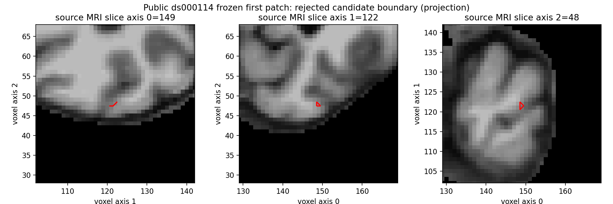
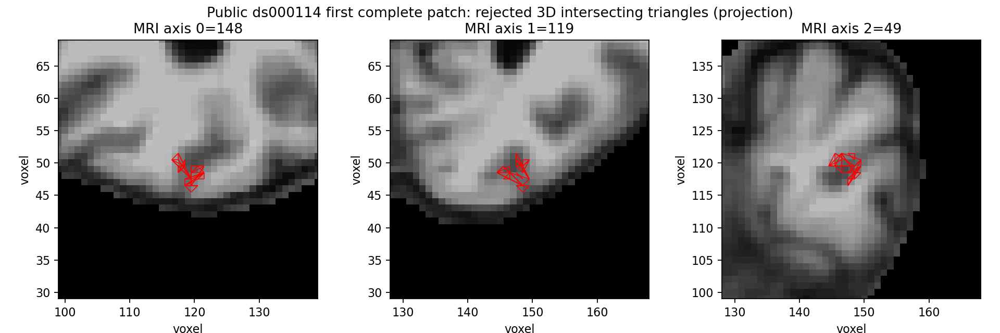

# 首个动态拓扑 patch：通用邻接修复与严格失败证据

本记录对应公开 ds000114 sub-07 左侧，从 `79a41cdd` 原始 T1 完整候选自产的 `orig.nofix`、`qsphere.nofix`、`brain.mgz`。本次只执行冻结同输入首缺陷原语，**不是完整 GA、连续表面链或 recon-all 整例**。不读取官方几何用于生成候选，不调用原版阶段程序。

## 已验证的修改

- 复用项目全部缺陷发现、初始保留/丢弃、完整候选边表、组织直方图和有序交叉拒绝。
- 新增实际源规则的有序三角面发现、全 source 顶点/面映射、闭合/流形/连接/重复/退化/相交严格门。
- 实测定位并修复 base 邻接丢失：原一环中一条未标记顶点间的边没有保留面支撑，仍须存在。仅从保留面生成图丢掉它，造成四条开放边；固定源明确独立复制邻接表。
- 首缺陷全部 67 inside、61 border、38 KEEP 均参与，未挑成功 patch/边、未丢困难 KEEP 或按已知顶点补面。
- 所有版本的失败报告保留。最新 v5 结构全部通过，但 17 几何相交面仍导致拒绝，未写候选表面。

## 真实结果

[summary.json](summary.json) 和 [summary_metrics.csv](summary_metrics.csv) 由保真导出的报告直接生成。

| 版本 | 新面 | 开放边 | 非流形边 / 顶点 | 零面积 | 朝向冲突 | 相交面 | API s |
| --- | ---: | ---: | ---: | ---: | ---: | ---: | ---: |
| v1 | 180 | 8 | 50 / 0 | 2 | 58 | 未运行 | 55.025 |
| v2 | 147 | 23 | 0 / 21 | 0 | 23 | 未运行 | 55.037 |
| v3 | 113 | 111 | 0 / 32 | 0 | 111 | 未运行 | 55.109 |
| v4 | 136 | 4 | 0 / 0 | 0 | 4 | 未运行 | 61.124 |
| v5 | 138 | 0 | 0 / 0 | 0 | 0 | 17 | 116.517 |

v5 输出候选计数 110,505 顶点、331,581 边、221,054 面、Euler −22。整个原始网格仍有其他缺陷，不能以该 Euler 推断首 patch 或全脑通过。原删除域 128 顶点、330 边、200 面、Euler −2，60 条边界边包括一处 degree-4 节点，不能默认为简单单凸环。

v4→v5 的完整失败子进程墙钟为 63.614→118.955 秒，harness 从 `main()` 起计为 63.706→119.083 秒。v5 增加了完整三维相交检查；这不是阶段加速对比，也不能累加推算整例。固定 CPU 8–11/4 线程，GPU 隐藏；v5 最大子进程 RSS 为 6,813,204 KiB，属于 CPU 内存，不是 GPU 显存。主机为共享 A100 节点，不是干净隔离环境。unit 预先使用同一新缓存，不能把所有 kernel 都称为冷 JIT。

[独立三维归因](reports/v5/intersection_diagnosis.json)对完整原网格与重建候选复用同一成熟谓词：原网格 0 相交面；候选 17 面、25 pair，全部为新 patch 对新 patch，0 外部对外部、0 新面对外部，所有 pair 无共顶点。该诊断分别耗时 51.175/58.040 秒，不移动坐标或降低门槛。

红线是三角面向同一代表切片的投影，不能将投影交叉本身当三维相交判据；实际判据及全部面/源顶点索引在 JSON。图只含已授权公开数据的衍生可视化。

## 版本、输入与复现

- 最新真实模块 SHA：`4b20a92f9ec1c4f1cc728a26b1fabbae3817497e50f238fdc2fb73e309b42de0`。
- 实际 fresh-exec driver SHA：`4e58f5634f9631eccb283646d439d21ede15904b74ff73c8e0d004e6dc28f2ae`。
- 每版所有源码、输入及 driver SHA 位于 `reports/vN/SOURCE_MANIFEST.json` / `binding.json`；v1/v2 尚无 fresh-exec wrapper 收据，只报告实际 API 计时。
- `orig.nofix` SHA：`cfa9c1d0f5681a87d4ae709d0b093e20fdc3466ea6525b7fc94ba61a4708b0f9`。
- `qsphere.nofix` SHA：`cf3c1e339c9d36c5245cb7d75cc11a4bd174ee3267e2f41ce8867061e9eed952`。
- `brain.mgz` SHA：`977f6fb298d38e10588cd636f4db38ca8c3456265b24d6d80d00d54e60e98eed`。
- 15 项结构与源邻接合同本地 1.218 秒、实际远端 .817 秒通过。它们不代替真实 MRI 检查。

复现参数与中文具名示例见 [七节说明](../../../../docs/recon_all/TOPOLOGY_RETESS_PYTHON.md)。实际环境版本及 affinity 存于 `reports/v5/benchmark.json`；无需新增依赖，NumPy/SciPy/NumBa/nibabel 已由主页 Conda 声明。

`reports/v4/full_edge_replay_diagnosis.json` 与完整重跑报告验证全部 canonical 元素、边代价/排序/接受哈希、面决策、源映射保持原失败版本。600–601 是 source-index 定位证据，修复按完整源一环规则执行，没有按该编号补边。原始 MRI/NPZ、完整私有源码快照和日志仅留授权服务器；公开收据不含它们。

## 保真与未完成范围

29 份 JSON 已在服务器端去除私有路径/主机/账号，保留 **2,335,036 个数值、布尔及 null 叶的类型和值**。首次和账号二次替换的 SHA 清单分别在 `reports/FIRST_PUBLIC_EXPORT_MANIFEST.json` 和 `reports/PUBLIC_EXPORT_MANIFEST.json`；下载后全部 public 文件 SHA 已核对。转移包 SHA `8a79a3885130f6035f771467dec741d910401f1d312877ee7aa2a8ee74007dfd`，27,719,680 字节，仅 JSON 和两张公开派生 PNG。

当前没有原版完整同输入首 patch 数值回归、另一半球/第二例/全缺陷或最终脑区指标结果。仍缺动态 USE_SOME/retry、全组织/曲率 fitness、mutation/crossover/controller。源最终 GA 路径在重三角化之后先执行 `defectMatch`，再检查三维相交；本候选尚未补齐该阶段。下一步应复用已有拟合和评分原语完成真实候选评价，不能只做 SOAP 然后称 GA 完成。生产默认和运行中的冻结源码不变，整体指标等效保持 `not_assessed`。
