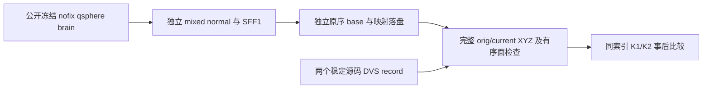

# raw→SFF1→base 的事后曲率核验

## 1. 功能与范围

复用已独立产生的完整 base，核对首次 global SFF1 的 K1/K2 是否随自产映射正确复制。只读比较工具不调用原软件、不重生候选、不从 DVS 填入初态。

## 2. Python、输入输出与失败

完整调用见 [中文功能说明](../../../../docs/recon_all/TOPOLOGY_GLOBAL_SFF.md)。工具 `compare_subset(candidate=..., candidate_maps=..., reference=..., reference_selection=..., reference_metadata=...)` 全部参数必填：

- 两个 state 字典：`original_vertices/current_vertices` 为 float32(N,3)，surface RAS/mm；`faces` 为 int32(F,3)，`nfaces` 是有效面数；`k1/k2` 为 float32(N)，mm⁻¹。
- own maps：整数 `source_order/vertex_translation(N)`，自身互逆全排列；不以参考坐标推导。
- reference selection：实际保存的原→新映射前缀，本次 1,889 项；其余映射没有直接捕获。
- metadata：`phase=0`，first DVS record。其他相位、非法类型/索引或自身映射报 `ValueError`。

返回只含聚合几何、映射和 K 比较。完整坐标/面/前缀的 byte 门失败，K 为 `not_assessed`；不报告无对应关系的逐顶点一致性。未知 H/K/E、PDF 与全 GA 都明确未测。输入不修改、无设备/精度默认、无新增依赖。

## 3. 命令行与复现

`tools/benchmark_recon_topology_sff1_base_subset.py` 的八个路径参数都必填。例子的所有具名参数及中文注释见功能说明第 3 节。候选 report 的输入/SHA 与两个 NPZ 必须匹配；参考 receipt 必须绑定两次 exit0、原输入和 state.record SHA。输出新 `report.json`，已有目录报错。候选必须由另一个纯 FNIT 生产步骤先写出，不能通过该工具把参考加工为输入。

## 4. 对应原调用

固定 FreeSurfer `d932c45b7941662ea380a05efef580568b98d41a` 的首次 `MRIScomputeSecondFundamentalForm()` 与 `MRIScorrectTopology()` 内 base copy；它们没有独立 CLI。原程序 benchmark 使用固定源码构建 `mris_fix_topology -ga -seed 1234 -threads 4`，只作参考，捕获 record 在第一次 candidate 前。

参考是 historical3a ds000114 sub-06 LH，和当前 CFFF79 另一例原域 SFF2 证据不同。DVS record 位于原网格 SFF2/校准之后，但 clone 的 K 来自此前 SFF1，后续原网格统计不回写 clone。参考在原 CPU 环境，候选在另一已声明 Conda CPU 环境，不发同硬件速度比。

## 5. 本次实际结果

| 冻结比较 | 完成与范围 |
| --- | --- |
| [v2](reports/comparison_v2.json)，自产 rawBase v1 | exit0；126,778 全顶点 K1/K2、完整 orig/current、有序 246,985 面与参考前缀全 0 bits |
| [v3](reports/comparison_v3.json)，自产 rawBase v2 | 同样 exit0/0 bits；显式 precenter 初始法向与 centered metric 分离，两版 state/maps SHA 相同 |
| 参考 | 独立两次 exit0，record SHA 完全相同 |
| own 生产 v2 | API 79.611412 秒；含加载/写出、排除导入与末尾 JSON 的工具 82.021968 秒，共享四线程观察 |
| 事后比较 v3 | 加载候选 0.531718 秒；截至 JSON 写前总 3.831842 秒，不是生产算法计时 |
| 本地契约 | 13 通过，JUnit 4.845 秒；映射/几何失败拒绝 K 门、来源/别名、容量和 signed-zero 诊断 |

本次只验证 copied K core。H/K、global 方向/汇总、curvature PDF、完整其他 base 属性、网格质量、GA 与整体等效未判定。初始缺陷法向由新生产显式自算但没有 native after 字段，仍 `not_assessed`。GPU 未执行，显存未测，不报告 0；TF32/精度设置未更改。

每四个顶点渲染一个点；完整数值计算覆盖全部顶点。figure receipt 绑定 v3 report、实际 state/capture 和脚本 SHA。

## 6. 版本与记录

`source_phase.json` 保存 startup precenter 与 merge postcenter 的消费边界。v2 对应旧 rawBase v1，v3 对应 rawBase v2；生产源码是 `861bc235` 加明确 38-file overlay，并非比较器或当前 HEAD。每模块、原输入、NPZ 和独立参考程序 SHA 在两个原字节报告中保留，不回填旧结果。

首次完整源码包上传被审批拒绝且未执行；之后仅传本轮 FNIT 工具/解析器、公开去敏参考收据和启动脚本，复用并核 SHA 的既有模块。没有转移完整 src/vendor、上游程序/库或影像。公开只保留范围与哈希，私有运行路径和启动脚本留工作环境。

## 7. 原代码与文献

- [固定 caller/base copy](https://github.com/freesurfer/freesurfer/blob/d932c45b7941662ea380a05efef580568b98d41a/utils/mrisurf_defect.cpp)。
- [固定 SFF](https://github.com/freesurfer/freesurfer/blob/d932c45b7941662ea380a05efef580568b98d41a/utils/mrisurf_metricProperties.cpp)。
- [固定主程序](https://github.com/freesurfer/freesurfer/blob/d932c45b7941662ea380a05efef580568b98d41a/mris_fix_topology/mris_fix_topology.cpp)。
- Fischl B et al. Automated manifold surgery. *NeuroImage* (2001). [DOI](https://doi.org/10.1006/nimg.2001.0781)。
