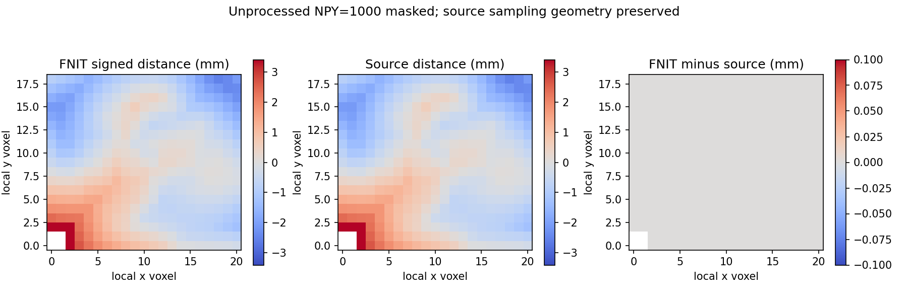

# 完整有向距离前置：真实冻结候选

## 1．功能与范围

自有 Python/Numba 实现 active new_loop3，复用现成角度伪法向及相邻面函数。v3完整距离、所有内部字段和后续聚合输出逐位匹配；v1错误采样头和v2伪法向尾差证据保留。预备MRI/PDF、完整GA和整例不属于本测试。

## 2．Python、输入与输出

[功能页](../../../../docs/recon_all/TOPOLOGY_SIGNED_DISTANCE.md)给出全部具名参数与注释。使用同候选 orig surface RAS/mm、面法向和原 incident CSR；局部体积须实际 mri_defect 几何，非距离图存储头。返回完整 XYZ float32/mm 距离及真实 bbox/伪法向诊断。

## 3．复现命令

```bash
python tools/benchmark_recon_topology_signed_distance.py \
  --capture isolated_reference/repeat0/distance.bin \
  --native-repeat isolated_reference/repeat1/distance.bin \
  --volume-capture isolated_reference/same_candidate_volume.bin \
  --observer-receipt isolated_reference/build.public.json \
  --output new_diagnostic/signed_distance \
  --threads 4
```

无原始影像或快照发布。参考仅在隔离benchmark使用，自产距离送已有体积函数，不把参考距离传入候选。

## 4．原软件调用与版本

固定 d932 的 mris_fix_topology 内部 mrisComputeDefectMRILogUnlikelihood_wkr active 距离分支；无独立CLI。源码Conda构建观察器种子1234/线程4，两repeat原raw SHA不同：OMP buffer行序有三组差异，按fno对应几何和最终距离一致。原始False原样保留，不重标为全捕获逐字节一致。

## 5．当前真实精度、时间与图

ds000114 sub-07 ses-test LH、自产79a41cdd完整候选，110,534顶点/216,860面/650,580 incident，1628 bbox面和903query，21×19×16体积。v3全部六组字段（bbox、坐标、邻面、顶点ID、伪法向、距离）不同元素0，max/P99=0，逐位一致；自产距离送入八个聚合字段与完整110,534 `curvbak` 同样0差异；两次完整自产重复一致。原参考完整 raw capture 不同而最终距离一致，原始 False 和原 SHA 保留。

完整距离 API 首次0.6962770754471421s、热重复0.08159037306904793s，合同已提供部分JIT cache。热重复 bbox0.013059227727353573、邻面0.0017177732661366463、伪法向0.003284466452896595、距离0.06077031418681145s；余量为验证/复制/返回。聚合0.5229222746565938s。导入1.582254377193749s，完整工具5.690778465010226s（不含前置bootstrap/最后JSON）。原参考6.483830288052559/5.633458794094622s含其他准备和捕获，无本子项独立 timer，不发布加速比。四线程，同主机不同固定CPU亲和性；共享负载未排除。GPU未用/显存未测，整体指标等效未判定。



图 mask 双方未处理NPY，仅改变显示。`reports/`保留v2原始公开导出，`reports/v3/`为新的17份JSON/PNG导出；原/public SHA和数值叶类型保真逐项校验。新运行上传Git ae868024，距离源码66b84289、正式角度依赖562d7f5f、回归脚本8db58c28、新DST2解析器e29dccc7；每个完整SHA见 launch/report。原生程序78aea68b来自固定源码只读观察器，不作候选依赖。完整记录见 `stage_comparison.csv`、`stage_times.csv`、`source_rules.json` 和 `PUBLICATION_MANIFEST.json`。

## 6．更新与benchmark

- v1错误诊断几何：存储header origin[-10.5,-9.5,-8]、scale1，而算法使用 mri_defect source origin及scale2(delta4)。两组错误选面无交集，6363差；不归因浮点/随机性。
- v2用同candidate FNITVOL1真实mri_defect几何，源码66b84289不变，最终距离/反馈全部精确；伪法向未全严格通过由对应函数独立定位。
- v3固定实际C++17翻译单元确认 sqrt/acos float重载及两次float除法，复用正式角度修复；采用DST2真实mri_defect采样字段并与同candidate局部MRI头交叉核对，所有内部及下游完整字段0bits。
- 未接生产GA、未扩验收阈值；既有旧冻输入数据、失败和raw SHA不改写。

## 7．参考文献与代码

[固定 active 源](https://github.com/freesurfer/freesurfer/blob/d932c45b7941662ea380a05efef580568b98d41a/utils/mrisurf_defect.cpp#L1838-L3030)。Ségonne F, Pacheco J, Fischl B. IEEE TMI 2007;26:518–529，[DOI](https://doi.org/10.1109/TMI.2006.887364)。来源及许可沿用项目通知；不发布原版CPP或程序。
