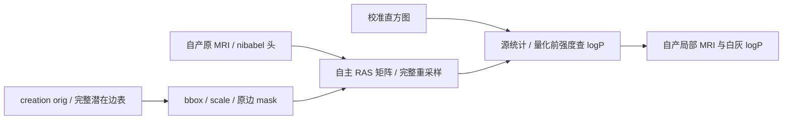

# 从原 MRI 准备完整局部缺陷强度与白灰 logP

## 1．功能与范围

自有 NumPy/Numba 实现标准 GA type=0 的局部准备：创建时全 orig 坐标、完整 potential EDGE 表与校准直方图，配合同一个自产原 MRI，生成完整局部 mask、强度和白灰 logP。不读取参考局部图进算法，不调用原版程序。校准直方图收集和完整 GA 控制器是显式上游/下游边界，不将单组件称完整迁移。



## 2．Python、输入与输出

[功能页](../../../../docs/recon_all/TOPOLOGY_VOLUME_PRIORS.md)列出全部具名参数、中文注释、XYZ数据结构、surface RAS/mm与索引乘数mm⁻¹。完整边表用于创建 bbox，不能用拟合后的 patch 面边替代；输入原 MRI 为 uint8，RAS矩阵由其 nibabel MGHHeader 自主生成。

返回21×19×16 uint8 mask/intensity、同 shape float32 white/gray logP、原几何、均值/方差/mean-log。均值映射到现有体积聚合的 initial_*_mean_intensity；本测试未重新收集校准直方图。counts须为正，bin_size允许0并保持源元数据。

## 3．复现命令

```bash
python tools/benchmark_recon_topology_volume_priors.py \
  --creation-capture isolated_reference/repeat0/prepared.creation.bin \
  --likelihood-capture isolated_reference/repeat0/prepared.likelihood.bin \
  --creation-repeat isolated_reference/repeat1/prepared.creation.bin \
  --likelihood-repeat isolated_reference/repeat1/prepared.likelihood.bin \
  --brain own_subject/mri/brain.mgz \
  --observer-build-receipt isolated_reference/build.safe.json \
  --observer-run-receipt isolated_reference/receipt.private.json \
  --producer-benchmark own_run/benchmark.json \
  --output new_diagnostic/volume_priors \
  --threads 4
```

`collect_receipts.py`在授权任务目录现场验证退出/程序/输入/capture SHA，只导出本版 JSON 与一张公开数据衍生 PNG。`summarize_results.py --directory`先校验公开SHA再生成两个CSV和SUMMARY；`diagnose_recon_topology_priors_matrix.py`只读复现矩阵位模式。原MRI、快照/NPZ、程序与原源码不发布。

## 4．原软件调用与版本

固定 d932 的 `mriDefectVolume`、`computeDefectStatistics`强度统计、`defectVolumeLikelihood(type=0)`均为 mris_fix_topology -ga 内部步骤，无独立CLI。只读参考程序独立Conda源码构建，种子1234、线程4；两次创建capture SHA a81fbe1d、采样后ca9821e4一致。新增观察器保持旧七个完整fitness文件SHA不变。固定实际翻译单元证明log(float)/ceil(float)均4字节，不能预设其为double。

## 5．当前真实精度、耗时与图

公开ds000114 sub-07 ses-test LH，来自79a41cdd自产原始T1连续链。110,534 creation orig顶点、4,723完整候选边、每组织256 bins；局部21×19×16。全部mask、uint8 intensity、白灰F32 logP、geometry、shape、4calibrated statistics不同数/最大/P99=0，逐位相同；两次候选及两次原参考捕获也相同。

原MRI头生成的内部4×4矩阵数值0差，7项+0与−0原始uint64位模式不同，因此原 `strict_full_local_fields_passed=False` 保留。`SUMMARY.json`分别记录全部计算字段精确与内部raw严格失败，不将False改成通过；成熟矩阵和采样器不修改。

API首次0.31241070199757814s（已共享合同JITcache）、热0.0608581118285656s。热统计0.000008711591362953186、bbox0.000034547410905361176、mask0.0011699758470058441、完整采样/logP0.0004916572943329811s，其余0.05915321968495846s是检查/复制/返回。导入1.2750386046245694s、完整工具4.124765652231872s（不含前置bootstrap/末尾JSON）。原观察器5.665037437342107/5.559619378298521s含上游/捕获，无本子步独立秒数，不能算加速比。

同主机总4线程，候选CPU100–103、参考8–11；共享负载未排除。GPU未用/显存未测。7合同服务器1.922s、本地2.285s通过；模拟合同不代替本段真实回归。完整GA、整例、OS隔离和整体指标等效均未验收。


`reports/`11份公开JSON/PNG逐文件验证原SHA/publicSHA、大小、数值/bool/null叶及类型保真；`PUBLICATION_MANIFEST.json`进一步绑定源码、复现脚本和说明。候选7b4beb48、benchmark2c6ac88c、原程序b00d5901；完整SHA见launch/report。原始矩阵脚本3195ae21保留，公开CLI为参数化复现版，SHA单列不回标原版本。

## 6．更新与benchmark

- 初版新函数将校准bin_size误限为正；真实两个source值均0，现按原统计保留0，不从相邻bins重建间距。通用零bin_size合同已补，非被试特例。
- 固定源x-only边采样、FZERO、ceil、uint8截断与量化前log查表均保留，不为匹配参考替换局部图。
- 内部矩阵7个±0差独立定位，无数值差、计算结果全byte-exact；原严格失败保留。
- source观察器前几个构建锚点/括号失败由其独立观察器记录保留，当前成功v4与失败版本不重标。
- 无新依赖/默认切换/生产参考输入。后续prepared fitness可消费当前自产priors，有向距离/体积聚合已各自独立验证，不由本测试推断完整GA。

## 7．参考文献与代码

[固定准备与统计源](https://github.com/freesurfer/freesurfer/blob/d932c45b7941662ea380a05efef580568b98d41a/utils/mrisurf_defect.cpp#L5291-L5716)。Ségonne F, Pacheco J, Fischl B. IEEE TMI 2007;26:518–529，[DOI](https://doi.org/10.1109/TMI.2006.887364)。沿用项目来源/许可通知，不复制发布原CPP或程序。
