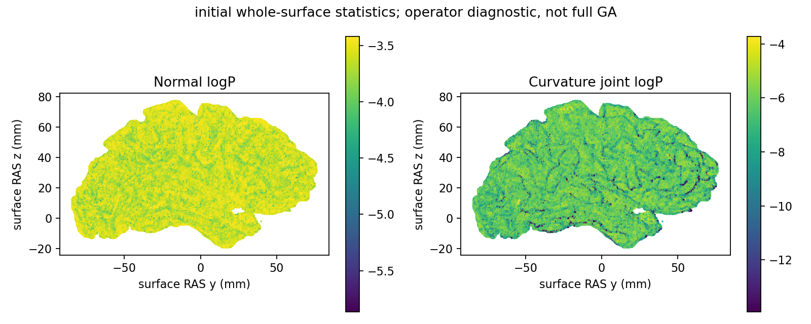
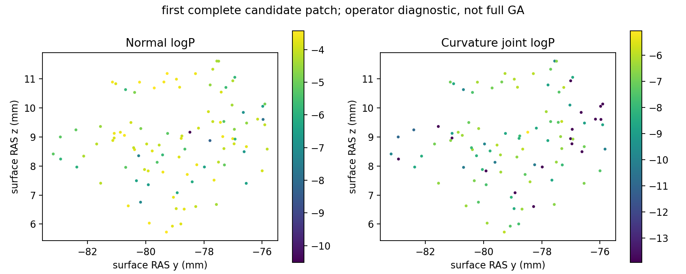

# 拓扑候选零面积诊断修复：两套真实冻结输入

## 1．功能与范围

修复成熟法向/曲率似然子项的输入边界：完整候选可以尚未重算面积，面积加权诊断未定义，而实际候选评分仍有限。保留源 IEEE 除法和 NaN 位模式，不补造面积、不取绝对值。只有两个完整评分子项，不是完整 unMRI、GA 或 recon-all。

## 2．Python、输入与输出

公开 API、完整具名示例与全部字段见[功能页](../../../../docs/recon_all/TOPOLOGY_NORMAL_CURVATURE_LIKELIHOOD.md)。坐标是 surface RAS/mm，面积 mm²，曲率 mm⁻¹。原有两个核心评分和逐顶点数组不变，新增诊断是否有限及 uint32 位模式。非法数组/PDF仍拒绝；零面积诊断保留 NaN/Inf，核心评分仍须有限。

## 3．复现命令

```bash
python tools/benchmark_recon_topology_zero_area_likelihood.py \
  --capture isolated_reference/repeat0/patch_statistics.bin \
  --native-repeat isolated_reference/repeat1/patch_statistics.bin \
  --observer-receipt isolated_reference/build.public.json \
  --output new_diagnostic/complete_patch \
  --threads 4 \
  --snapshot-scope "first complete candidate patch"
```

所有路径是独立诊断；output须空且不存在。参考仅提供比较字段，不进入生产。初始表面将 capture 换为 statistics.bin，并明确 snapshot-scope。私有NPZ/MRI保留服务器，公开 JSON 的非有限诊断为 null，同时保留原 uint32 bits。

## 4．原软件调用与来源

内部函数没有独立 CLI，固定 d932 源 `mris_fix_topology` 的只读观察器在首个完整候选评分后捕获，在GA搜索之前停止。参考种子1234、4线程，两个独立进程完整候选捕获 SHA 相同。生产用自有 NumPy/Numba，不运行该程序；原源码/二进制不发布。

## 5．本次真实精度、耗时及脑图

输入来自公开 ds000114 sub-07 ses-test 左侧，原始自产链绑定79a41cdd；完整110,534顶点。初始统计选108,538顶点，面积有序和70674.09808525257mm²。完整候选选99顶点，面积全部+0。

| 完整候选字段 | 自有与源参考共同值 | uint32位模式 | 一致 |
| --- | ---: | ---: | --- |
| curv_ll | −4.631804466247559 | 3230939070 | 是 |
| cll | NaN（未定义诊断） | 4290772992 / 0xffc00000 | 是 |
| qcurv_ll | −8.637045860290527 | 3238670679 | 是 |
| qcll | NaN（未定义诊断） | 4290772992 / 0xffc00000 | 是 |

初始和完整候选四字段均逐位一致；双方两次重复完整字段/数组一致。原程序未捕获逐顶点logP，只报告自有逐顶点重复。初始热API法向0.0343366963788867s、曲率0.011876030825078487s；完整候选0.0036090509966015816s /0.0014497451484203339s。工具入口含导入/读取/JIT/写NPZ/脑图分别10.701018831692636s /2.927582584321499s，最后JSON写出及前置bootstrap未计入。4线程CPU100–103，共享负载未排除；无原函数独立timer，无原生提速比，无整例结论。合同10项实际通过，详见reports/contracts.json。GPU未使用，显存未测，整体等效未判定。




两图是自有逐顶点logP，不是原版逐顶点误差或最终拓扑修复表面。数值/布尔/null逐叶保真导出，原SHA与公开SHA分别记录在PUBLIC_EXPORT_MANIFEST；全部原始体积/快照未下载或发布。

## 6．版本与benchmark

- 初始 bfb461f2：完整初始快照四字段匹配；不覆盖当前完整候选。
- signed 202c4813（aaa4fd76）：有符号面积规则修复，仍拒绝总面积0；保留历史提交和实测，不重标为当前通过。
- 本次 a4080960：numpy错误模型保留源 IEEE；完整99顶点候选与正常初始快照真实门通过。尚未接完整GA，不代表搜索、距离或最终拓扑完成。

## 7．参考文献与代码

[固定两项源函数](https://github.com/freesurfer/freesurfer/blob/d932c45b7941662ea380a05efef580568b98d41a/utils/mrisurf_defect.cpp#L1502-L1623)。Ségonne F, Pacheco J, Fischl B. IEEE TMI 2007;26:518–529，[DOI](https://doi.org/10.1109/TMI.2006.887364)。项目许可证与来源通知保持原有范围。
