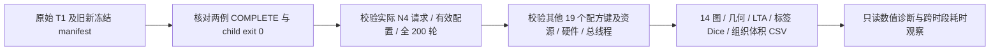
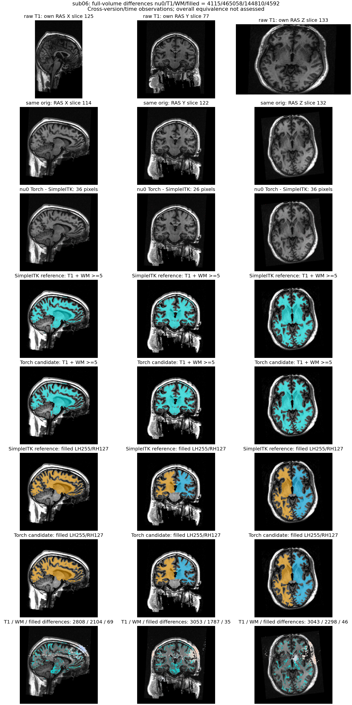
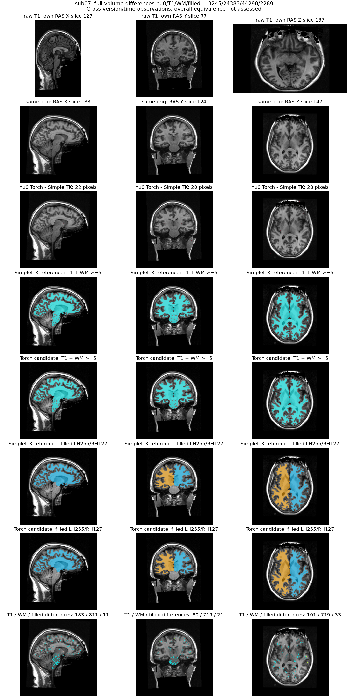

# 两例 SimpleITK / Torch N4 连续前段比较

## 1. 功能简介

`compare_n4_prefix.py` 比较明确指定的两个真实原始 T1→filled 连续运行。
参考为既有 SimpleITK/in-process 串行前段；候选为新源码上的 Torch/isolated 串行前段。
它复用项目体积比较、标签 Dice、LTA 读取和 CSV 比较接口，不重写 MRI 算子。
完成状态、源码和输入不匹配会失败；不会通过目录名称重标算法。



## 2. Python 调用与输入输出

```python
from pathlib import Path
from compare_n4_prefix import compare

comparison = compare(
    specification=Path("comparison_spec.private.json"),  # 显式指定每例原始T1及两角色实际运行、源码和完成收据
    output=Path("new_comparisons"),  # 必须不存在；保存 JSON 和不可变原始收据副本
)
```

两个参数都是路径，无数值单位。`specification` 是 `fnit-n4-prefix-comparison-v1` JSON，顶层包含：

- `comparison_source_root`：候选冻结源码根目录；运行时导入的项目比较模块必须属于该树且 SHA 与 manifest 相同。
- `comparison_helpers_file`、`comparison_helpers_sha256`：仓库已有 `compare_prefix.py` 的实际路径和固定 SHA；只复用 `_geometry`、`_dice`、`_csv_compare`，不调用其串并比较入口。
- `color_lut`：生产声明的 FreeSurferColorLUT 文本；内容 SHA 必须与两边资源收据匹配。
- `cases`：只允许 `sub06` 和 `sub07` 各一次。每例给 `case`、公开原始 NIfTI `raw_t1` 和 `reference`/`candidate`。
- 每个角色给 `trial_dir`、`complete_file`、`driver_exit_file`、`source_root`、`source_manifest`、`backend` 和 `n4_execution`。参考必须 `simpleitk`/`in-process`，候选必须 `torch`/`isolated`；两者输入调度实际为 serial，总线程均为4。

每个 `trial_dir/subject` 保留自产MRI与统计输出；脚本读取完整运行屏障及 `benchmark.json`、`fnit-native-free-run.json`。
两边分别完整校验其冻结文件，不要求版本号或程序哈希相同。21 个 profile 键仅允许 N4 两键变化，其他19键必须相同；这21键是调度选项，不是步骤数。

体积包括 `rawavg`、`orig`、`tmp/nu0`、`nu`、`T1`、`brainmask`、`synthseg.rca`、`norm`、`brain`、`aseg.presurf`、`wm.seg`、`wm.asegedit`、`wm` 和 `filled`，均为MGZ。
每个文件保留原空间，报告 shape、存储dtype、affine（mm）、voxel-to-surface-RAS、zooms和头字节；只有相同网格才做同索引误差和Dice。
灰度误差单位为存储值；标签图逐标签Dice，不用标签数值Pearson；WM主掩膜按 `WM_MIN_VAL >=5`，非零掩膜仅作独立诊断。
`filled` 的255和127分别为左、右半球。LTA必须type0，为source voxel→atlas voxel，平移单位是atlas voxel；组织CSV体积单位mm³。

返回字典和 `summary.json` 含两例数值/几何/前N4输入门及实际时钟；每例JSON包含18个直接阶段入口和filled标准复制的SHA、选定支持模块SHA、两套完整manifest差异、各阶段完整计时、实际精度/分配器和父子显存样本。
支持模块集合是透明的静态核对，不冒充完整运行时文件/动态库追踪。未知显存归属与null保持原值。
`.private.json` 是原字节收据副本，含机器路径，不应直接提交公开仓库。

输出目录已存在、输入或完成门不符、阶段遗漏、资源/预算/版本变化、读取中生产文件变化、非有限图像会抛异常；不会写成功 summary 或修改生产文件。
网格不同保留诊断但不计算同索引Dice；`all_geometry_dtype_exact` 独立记录失败。

## 3. 命令行调用

```bash
# PYTHONPATH 指向候选实际冻结源码；仅CPU比较，不执行网络或初始化CUDA
CUDA_VISIBLE_DEVICES='' OMP_NUM_THREADS=4 NUMBA_NUM_THREADS=4 \
  OPENBLAS_NUM_THREADS=4 MKL_NUM_THREADS=4 \
  PYTHONPATH="frozen_candidate/src" python compare_n4_prefix.py \
  --specification comparison_spec.private.json \
  --output new_comparisons
```

`--specification` 与Python同义；`--output` 必须新目录。指定host路径、原始数据和资源清单由运行者填写，不在公共示例中放服务器地址。
完整19阶段前段由 `tools/benchmark_recon_input_prefix.py` 保留生产所有原语句，只在 `filled_auto_checkpoint` 后插入三条返回语句；比较器另外检查该事实。

## 4. 对应原软件调用

这是 FNIT 两种 N4 后端的自产链诊断，没有独立官方比较 CLI。
前段组合参考为 `recon-all -s subject -i T1w.nii.gz -autorecon1` 后的注册、归一化、WM编辑与filled步骤。
本工具不运行官方程序，不把官方输出作为生产输入；历史与独立官方数值记录另列。
SimpleITK使用通用ITK Python库，Torch使用FNIT已有完整N4，不调用FS阶段二进制。

## 5. 当前验证范围与结果

两例新 Torch/isolated 原始T1空目录前段均连续执行到filled，19个阶段完整，driver与child退出码均0。参考为此前同主机、同CPU亲和性/目标GPU/总4线程的SimpleITK串行前段；这是跨版本、跨时段对照，不是ABBA受控速度测量。
新源码manifest为 `49b10856233ab2e12238a30e012456b37d8bbce25445c87c178a7a3a11be27cc`（784文件，`9fd532d8+dirty-torch-prefix`）；参考为 `655ac22bd8d0503652bba5947db64704f398fc867b247cb9e9e3c9484ac687b3`（783文件，`516a93e2+dirty-prefix`）。不使用提交后的HEAD替换这两个测试版本。

两边19个非N4配方键相同；18个直接阶段入口的函数源码SHA均相同。`native_free.py`整个文件SHA因N4选择接线变化而不同，不能说所有代码相同。完整manifest另有batch、profile、两benchmark、audit及三个filled后拓扑文件变化，全部列在机器收据。各自全部冻结文件、实际N4请求/运行、完整200轮和资源均已核验。
原始T1/conform的数组、空间和dtype两例全0差；所有14张图几何/dtype一致。两个原始T1 SHA分别为 `7e33afb28f631fac31d81e2428a6144f61aba4102859c694eeb49ee584de04f7` 和 `59ef7bed60d4db64d56d947ebed2ef62a9257c26fe879848fe24d10a490f74fc`。

### 严格数值诊断

下表每格为“不同体素 / 最大绝对差 / P99绝对差”，单位为存储值；255/127是离散半球标签，不能按数值相关性评价。

| 图像 | sub06 | sub07 |
| --- | ---: | ---: |
| `rawavg.mgz` | 0 / 0 / 0 | 0 / 0 / 0 |
| `orig.mgz` | 0 / 0 / 0 | 0 / 0 / 0 |
| `tmp/nu0.mgz` | 4115 / 1 / 0 | 3245 / 1 / 0 |
| `nu.mgz` | 3801 / 3 / 0 | 9216 / 3 / 0 |
| `T1.mgz` | 465058 / 23 / 1 | 24383 / 13 / 0 |
| `brainmask.mgz` | 200967 / 23 / 1 | 5801 / 13 / 0 |
| `synthseg.rca.mgz` | 0 / 0 / 0 | 0 / 0 / 0 |
| `norm.mgz` | 551092 / 7 / 1 | 52520 / 4 / 0 |
| `brain.mgz` | 754675 / 22 / 2 | 184870 / 16 / 1 |
| `aseg.presurf.mgz` | 0 / 0 / 0 | 0 / 0 / 0 |
| `wm.seg.mgz` | 203295 / 230 / 1 | 61703 / 230 / 0 |
| `wm.asegedit.mgz` | 144368 / 250 / 0 | 44208 / 250 / 0 |
| `wm.mgz` | 144810 / 250 / 0 | 44290 / 250 / 0 |
| `filled.mgz` | 4592 / 255 / 0 | 2289 / 255 / 0 |

SynthSeg与aseg.presurf标签两例完全相同，33组织体积CSV数值也完全相同。WM主掩膜按存储值>=5，而非以这些强度值做标签Pearson：

| 掩膜或变换 | sub06 | sub07 |
| --- | ---: | ---: |
| wm.seg.mgz Dice | 0.985089881 | 0.995310196 |
| wm.asegedit.mgz Dice | 0.991900857 | 0.997274074 |
| wm.mgz Dice | 0.991752651 | 0.997255203 |
| filled 左侧 Dice | 0.995557753 | 0.997227493 |
| filled 右侧 Dice | 0.995470695 | 0.997814215 |
| LTA不同元素数 | 4 | 0 |
| LTA最大绝对差，atlas voxel | 0.304666519 | 0 |

N4的uint8差值最大1，但后续T1、WM和filled已有可测差异，不能概括为无影响尾差。本次只定位误差传播与资源/时间，没有正式整体等效阈值，也没有从这些前段结果推断最终厚度、面积、体积或表面质量。**严格复现未通过；优化是否造成可接受退化暂未判定；整体指标等效未判定。** 此组没有运行官方同输入程序，不把旧e34或同输入N4参考改标为这组官方结果。

### 19步完整墙钟

每格为“SimpleITK前段 / Torch前段”，秒。所有GPU阶段都同步明确目标设备，阶段含写出；嵌套算法子时钟不重复相加。

| 阶段 | sub06 | sub07 |
| --- | ---: | ---: |
| input_talairach | 25.997 / 37.598 | 33.725 / 37.531 |
| n4 | 184.034 / 13.687 | 189.730 / 13.631 |
| nu | 5.211 / 5.582 | 4.994 / 4.886 |
| T1_normalize | 28.696 / 42.408 | 35.236 / 41.413 |
| brainmask | 0.969 / 0.977 | 0.745 / 0.662 |
| SynthSeg | 10.079 / 10.913 | 10.346 / 13.131 |
| mri_em_register | 34.227 / 36.152 | 32.534 / 35.707 |
| mri_ca_normalize | 23.392 / 24.132 | 22.591 / 23.614 |
| mri_cc | 13.530 / 13.792 | 9.132 / 9.848 |
| brain_second_normalize | 28.440 / 29.679 | 28.103 / 28.390 |
| entowm | 1.404 / 1.236 | 1.488 / 1.392 |
| ants_denoise | 18.754 / 19.322 | 16.291 / 16.574 |
| mri_segment | 35.002 / 34.502 | 30.698 / 35.344 |
| mri_edit_wm_with_aseg | 14.000 / 14.221 | 14.099 / 13.913 |
| wm_pretess | 5.910 / 6.632 | 4.913 / 5.134 |
| wm_fix_ento | 1.127 / 1.132 | 1.010 / 1.072 |
| wm_fix_acj | 1.668 / 1.421 | 1.541 / 1.401 |
| mri_fill | 27.663 / 28.157 | 24.615 / 25.085 |
| filled_auto_checkpoint | 0.001 / 0.001 | 0.001 / 0.001 |

### 完整前段、GPU与安装边界

| 时间范围，秒 | sub06 SimpleITK / Torch | sub07 SimpleITK / Torch |
| --- | ---: | ---: |
| 公开API，含校验/读写/线程恢复 | 464.285 / 373.256 | 486.859 / 360.458 |
| 冷CLI，含父监测/子退出 | 475.026 / 400.395 | 510.200 / 393.817 |
| 诊断child，额外含导入/资源SHA | 473.867 / 396.540 | 505.890 / 383.740 |

公开API的候选实测为373.255532/360.457809秒，内部调度total为373.254452/360.456683秒，差值包含线程恢复和最后报告写出，二者没有混用。相对既有前段的时钟下降是本次跨时段观察，不宣布稳定整例加速；两链都未运行filled后的完整表面流程。

GPU显存采样间隔0.5秒，最大实际间隔0.594秒，无失败样本。两例新前段整卡采样最大为12,917,669,888与12,850,561,024字节（约12.918/12.851GB）；其中可能包含其他进程，是同期整卡上界，不是FNIT进程树峰值。容器PID归属未解决，`peak_tree_total_bytes=null` 保留，不记0。完整Torch N4子张量allocated/reserved分别为1,295,297,024/1,384,120,320字节；父子同期显存不能用两项峰值相加计算。
现有运行环境/通用库已供本次真实前段使用；这份比较不构成全新Conda或无预装脑影像软件的干净隔离验收，不修改安装默认。

13项本地元数据契约和远端同一13项契约均通过。只读MRI比较105.416秒；该时间含哈希、加载和JSON读写，不是生产前段时钟。原始收据在私有run中逐字节保留，公开8JSON/2PNG经数值/bool/null保真去敏，并在接收端核验SHA。





图为canonical RAS，原始图单独使用自身网格；其他行同conform网格。红蓝为Torch−SimpleITK灰度差，青色为WM差异，黄色为filled标签差异。切面根据完整WM/filled差异选取，图不替代完整数值表。机器可读摘要见[summary.json](summary.json)，全部误差见[两例比较](reports/comparisons/summary.json)，精确逐步时钟见[CSV](stage_times.csv)，源/输出及图哈希见[导出清单](reports/PUBLIC_EXPORT_MANIFEST.json)。

## 6. 更新与benchmark记录

- v1：两例真实连续前段均完成；比较与派生图完整退出0。显式双角色spec、两套冻结版本校验；复用已有比较函数；保留14图、type0 LTA、每组织CSV、严格数值与几何诊断。
- 元数据测试不替代此前完整200轮N4同输入测试，也不把e34旧整例重标为当前数字拓扑profile。
- 既有SimpleITK同输入记录的case已重新核对：sub06为99个uint8体素、sub07为28个；见上一目录 `case_summary_v2.json`。新前段差异以本次运行报告为准。

## 7. 参考文献与原代码

- Tustison NJ et al. N4ITK: improved N3 bias correction. IEEE TMI 2010. [DOI](https://doi.org/10.1109/TMI.2010.2046908)。
- [SimpleITK N4 API](https://simpleitk.org/doxygen/latest/html/classitk_1_1simple_1_1N4BiasFieldCorrectionImageFilter.html)。
- [FreeSurfer recon-all 原脚本](https://github.com/freesurfer/freesurfer/blob/d932c45b7941662ea380a05efef580568b98d41a/scripts/recon-all)。
- 项目已有 `fnit.recon_all.compare_native_free`、`ca_normalize_python.read_voxel_lta` 及 `20261010_input_n4_synthseg_prefix/compare_prefix.py`。
