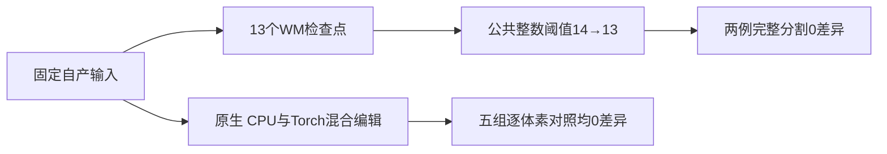

# 两例 WM 分割定位与纯 Python/Numba 编辑回归

## 1. 功能与范围

本报告区分 WM 首次差异诊断、完整编辑三方对照和最终源码文件 API 回归。实际基线为 `54f681dcab210a22c2e6862b2854a7033b5a208d` 加执行文件 SHA，不是从原始 T1 开始的新整例。



## 2. 输入、输出与 Python API

输入为公开 ds000114 sub-06/sub-07 的自产三维 uint8 强度、WM/brain，以及同网格整数 aseg/EntoWM。分割复用既有冻结输入，编辑使用 `79a41cdd` 自产连续链，各自SHA独立记录。候选不读取参考输出。

完整具名API见 [中文功能页](../../../../docs/recon_all/WM_NATIVE_INDEPENDENT.md)。输出为同 XYZ 网格 uint8 `wm.seg.mgz` 或 `wm.asegedit.mgz`，毫米 affine 不变。CPU完整入口保留原始4字节 aseg 与remove_paths几何证明，未支持分支抛错。

JSON清单分别记录服务器原始 `raw_sha256` 与当前公开 `published_sha256`，字符串脱敏不改变数值、布尔或null。交付包含真实前后/三方/终版SHA回归、26条阶段CSV、12条编辑时间CSV、摘要、两张脑图和实际合同日志。

## 3. 命令行与复现

先按功能页具名参数运行两个 `benchmark/recon_wm_*` 脚本。分割定位有额外检查点写出，不能作为生产性能；编辑计时包含完整文件API读写和传输。

```bash
# 校验实际公开SHA并生成CSV与摘要
python validation/recon_all/optimizations/20261010_wm_native_independent/summarize_results.py

# 合同测试不代替真实T1 benchmark
PYTHONPATH=src python -m unittest discover \
  --start-directory tests/recon_all --pattern test_mri_segment_bright_nonwhite.py
PYTHONPATH=src python -m unittest discover \
  --start-directory tests/recon_all --pattern test_wm_aseg_profile.py
```

`collect_receipts.py` 的四个路径参数必填，仅处理明确报告。`regress_frozen_reference.py` 的源图、参考报告/目录、模块/输出目录、版本必填，先核对完成状态与SHA；设备默认cuda:1、线程4。最终分割模块两例绑定实际使用3线程，配合单线程N4，总CPU预算4。删除旧编辑接口的被试哈希限制后，再以 `regress_final_cpu.py` 对最终CPU模块进行两例完整文件API回归：单线程、14.2505459/8.6762644秒，0体素差异、几何和dtype一致。两组终版计时只做正确性绑定，不与主表作加速比较。

## 4. 原软件对照

独立参考为 `mri_segment -wsizemm 13 -mprage` 及标准 WM 编辑 recipe。固定源码 `d932c45b7941662ea380a05efef580568b98d41a` 在 Conda 构建，实际重定位后的程序SHA写入报告。生产候选不执行原软件程序。

## 5. 实际精度、时间与资源

| 体素不同数 | sub-07 | sub-06 |
| --- | ---: | ---: |
| 旧版 bright-nonwm | 36 | 138 |
| 旧版最终分割 | 64 | 235 |
| 修复后13个检查点与最终分割 | 0 | 0 |
| 完整CPU/Torch混合编辑相对原生 | 0 | 0 |

首次差异前的加厚输出完全一致。原整数阈值13被旧注释误导成14，无证据归因于GPU精度。修复后最大/P99均0、所有标签Dice1、几何/dtype一致。两次原生完整编辑也重现；CPU与Torch混合精度相同。

| 完整编辑文件API秒数，两次 | sub-07 | sub-06 |
| --- | ---: | ---: |
| native | 22.7992556 / 22.7946679 | 23.2638760 / 23.1314656 |
| Python/Numba CPU | 13.9256477 / 7.9756726 | 8.8857582 / 8.5293956 |
| Torch混合 | 7.8049610 / 6.7797701 | 7.4036944 / 7.2329819 |

首例第一次CPU含JIT，导入与CUDA上下文初始化在主表计时前。两例同 A100 节点、四线程CPU24–27、cuda:1、TF32开启，无半精度。PyTorch allocated峰值553,648,128字节，reserved峰值641,728,512字节；不含驱动及共享任务，进程显存归属未测保留null。没有干净环境整例隔离证据，整体等效与整例提速仍未判定。


## 6. 更新与 benchmark

2026-10-10完成此实际报告。旧64/235记录保留为因果定位参考，现版修复结果在独立目录发布；说明修改后的最终执行SHA另有完整文件API绑定。旧 `no_fill`/`fixed` 兼容接口已移除被试哈希限制：前者仍执行几何证明和无fill有序核心，后者复用完整标准API；原始4字节aseg和未实现remove_paths分支的限制保留。最终CPU模块SHA为 `6550be1a1e36e0e8ae1df6b9fc1e2774127992c241b2e299a9b7fe37f8464ea6`。首次v4终版启动因tmux未继承PYTHONPATH失败，v5显式加载环境后两例成功；失败日志保留，不称作算法失败。源码、程序或输入变化需新目录，不能覆写历史收据。

## 7. 源码与文献

- [自有标准CPU编辑](../../../../src/fnit/recon_all/edit_wm_aseg_core_python.py)
- [自有WM分割](../../../../src/fnit/recon_all/mri_segment.py)
- [固定亮非白质源码](https://github.com/freesurfer/freesurfer/blob/d932c45b7941662ea380a05efef580568b98d41a/utils/mri2.cpp)
- Dale AM, Fischl B, Sereno MI. Cortical surface-based analysis. I. Segmentation and surface reconstruction. NeuroImage 1999;9:179–194.
