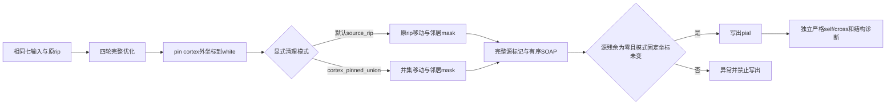

# pial清理模式和显存归属修订

## 1. 功能简介和流程

当前 `place_pial_t1` 默认 `cleanup_constraint_mode="source_rip"`，沿用四轮原rip作为清理移动限制和SOAP邻居排除mask。非rip但cortex外的顶点保留原算法的移动及邻居贡献。显式 `cortex_pinned_union` 才使用原rip与cortex外顶点并集；它同时改变移动域和邻居贡献，是强化诊断策略。尚未实现“仅冻结移动域而保留原rip邻居贡献”的第三种算法，也不把旧v11结果移交给该算法。



当前生产写出门保持全部清理后端源相交残余非零拒绝输出，并校验模式规定的固定坐标。严格self/cross和结构诊断独立报告；源写出成功不代表严格几何通过。

## 2. Python调用、输入输出及参数

```python
from fnit.recon_all.place_pial_python import place_pial_t1

# reconstruction_subject：自产上游subject；lh/rh为半球。
source_report = place_pial_t1(
    subject=reconstruction_subject, hemisphere="lh",
    cleanup_constraint_mode="source_rip",  # 可省略，生产默认
)
# 强化策略必须显式选择，并使用独立新输出，避免覆盖源模式结果。
strengthened_report = place_pial_t1(
    subject=reconstruction_subject, hemisphere="lh",
    output=strengthened_output_surface,
    cleanup_constraint_mode="cortex_pinned_union",
)
```

七项输入格式、所有既有参数和输出结构见 [pial函数文档](../../../../docs/recon_all/PYTHON_PIAL_PLACEMENT.md)。新增 `cleanup_constraint_mode` 为字符串，默认 source_rip，合法值仅这两个；非法值在输入读取前抛ValueError。四轮优化rip、完整候选、目标、梯度、GS接受和停止规则不改变。返回同名模式字段；cleanup另记录 `constraint_mode`、`soap_neighbor_mask`、`fixed_vertices`、`additional_pinned_vertices`。源残余失败的异常携带 `cleanup_diagnostics`，独立benchmark在失败报告中保留该诊断和实际模式。

`pial_cleanup_mask(ripped=..., cortex_vertices=..., constraint_mode=...)` 需要 `(N,) bool` 原rip和一维整数cortex顶点号，返回独立 `(N,) bool`；不修改标签或原rip。source_rip保留原mask，cortex_pinned_union调用成熟并集 helper。其mask同时传给SOAP移动与邻居过滤，不能描述成“只固定额外顶点”。

显存 `PlacementMemorySampler(uuid=..., interval_seconds=.5, trusted_host_pid_map=None)` 复用 `NvmlProcessQuery` 查询同一UUID，并沿用 `ProcessTreeDeviceSampler` 的可信宿主映射合同，逐样本核对当前进程starttime和PID namespace。映射键是driverPID，值需local_pid/starttime_ticks/pid_namespace/source，可附nspid_chain；来源证明由调用者独立提供，当前benchmark未提供可信映射。单NSpid和相同数字PID不证明归属。无可信映射时own_peak_bytes=null/unknown，整卡峰值与PyTorch allocated/reserved不代替本进程峰值。未使用任务5的sched映射，未引入tools源码依赖或其他内核推断。

## 3. 命令行调用

```bash
python tools/benchmark_recon_white_pial_chain.py \
  --subject "$FROZEN_OWN_SUBJECT" --output "$NEW_SOURCE_RUN" \
  --hemisphere lh --start-stage pial --device cuda:0 \
  --gpu-uuid "$OWN_PHYSICAL_GPU_UUID" --threads 4 \
  --base-commit "$BASE_COMMIT" --candidate-commit "$FROZEN_SOURCE_COMMIT" \
  --target-search-backend parallel --cleanup-constraint-mode source_rip
# 另一模式另选output，明确传 --cleanup-constraint-mode cortex_pinned_union。
```

`replay_recon_pial_cleanup_fixed.py` 同样新增该模式参数，默认source_rip。它只回放自产接受末态，不能替代新四轮阶段。报告区分实际模式固定坐标变化与并集pinned坐标变化；源模式可移动部分cortex外非rip顶点，不能据此给源模式错误贴上“模式固定坐标变化”标签。所有CLI既有参数意义见链审计与残余诊断页。

## 4. 原软件调用

原七输入 `mris_place_surface --pial --nsmooth 0 --rip-label cortex+hipamyg.label --pin-medial-wall cortex.label` 调用见 [链审计](README.md)。冻结源pin仅修改坐标、不修改rip；对应默认source_rip语义。原程序仅在隔离参考目录运行，不作为生产调用或新增依赖。

## 5. 当前真实精度、时间与脑图

冻结代码 f527db06 的14项CPU合同测试通过，耗时6.066秒，GPU禁用、单线程、CPU55；逐文件SHA已与固定Git blob核对，见 [测试收据](tests_modes_v19.json) 和 [日志](tests_modes_v19.log)。这不是完整阶段benchmark或实际显存测量。短测试与已有只读质量诊断重叠；表面优化已结束，不据其时间计算提速。

新增合同使用非rip且cortex外邻居，确认默认保留其贡献、显式并集排除其贡献；确认无宿主映射时相同数字PID+单NSpid仍为unknown；可信映射每次重新核对starttime；实际构造的开放、断开组件和退化网格不能仅凭无proper交叉得到结构通过。

新同输入numeric两模式完整阶段回归已完成，冻源为f527db06，运行产物分别命名source_rip/cortex_pinned_union，不覆盖旧v3/v11。分别核对全部border/step/pin事件和清理前后、mask及面字节；严格几何只有完整末态身份一致才能引用已独立计算的对应历史统计，否则not_assessed。两条路径均完成47步，全部52个border/step/pin事件与各对应冻结历史基线一致，完整清理before/after/faces/ripped数组均逐字节相同。source_rip固定集合5486、新增pin集合0，源标记415→32，完整self226/cross25896；cortex_pinned_union固定集合7890、新增2404，源标记415→184，完整self394/cross25284、退化2个。两条路径均退出1，不写标准pial；这确认默认源语义数值回归，不构成严格几何通过、全pipeline等效或提速。完整严格统计由完整终态身份匹配已有独立审计证明，见 [实际两模式回归](mode_regression_v19.json)。

已有v15两例完整四轮也已完成：sub06 RH为43步、全部48个优化/pin事件一致、源残余0、完整self0/cross254；sub07 LH为39步、全部44个事件一致、源残余9、完整self42/cross181。两例并集固定坐标变化均0、末态与各自产回放字节一致，严格几何均失败。见 [实际两例并集完整阶段](two_real_union_full_v15.json)。它们属于b97a0027历史隐式并集实现，不能转称新source_rip默认验证。

旧v11仍为实际并集移动/邻居模式：47步、52个优化/pin事件一致；源标记415→184、严格self226→394、white/pial25,284、退化面2个，退出1且无标准pial。并集固定坐标变化0不构成几何通过。旧真实NVML null读数不改成新规则下的resolved。脑图和原坐标继续留在服务器私有目录，不生成或导出新的原始影像。

## 6. 更新和benchmark记录

- 6d6eeeb7：历史默认并集mask，包含邻居贡献变化，不能称为源算法等价修复。
- 03b8c293：生产默认恢复source_rip；并集改为显式模式；报告实际模式，源残余拒绝门保留。
- 3f78082d：取消NSpid/PID碰号归属，复用可信映射合同；无证明读数unknown。
- f527db06：回放与自有输出审计增加闭合、单组件、非退化结构门；不覆写旧三份真实失败报告或源码绑定。

自有链分析器同样复用该结构门；旧v15分析源码和既有结果冻结不变。回放quality_gates分别检查源残余0、选定模式固定坐标未变、严格self0、严格white/pial0、退化面0、边界边0、非流形边0、单连接组件，缺字段不能通过。不以新的距离阈值、subject/vertex特例或交叉豁免降低质量。最终unionmanifest从固定Git blob生成，松散旧evidence副本不作为权威绑定。

## 7. 参考文献和代码来源

冻结 [FreeSurfer mris_place_surface.cpp](https://github.com/freesurfer/freesurfer/blob/d932c45b7941662ea380a05efef580568b98d41a/mris_make_surfaces/mris_place_surface.cpp) 与SHA/调用行见 [参考语义](reference_fixed_semantics.json)。SOAP复用项目成熟实现；PID身份合同来自项目 `profiling.ProcessTreeDeviceSampler`，原始驱动查询来自 `nvml_process_memory.NvmlProcessQuery`。重建背景：Dale、Fischl、Sereno，NeuroImage 1999，DOI 10.1006/nimg.1998.0395。

链分析器当前从实际chain报告读取模式，分别记录selected_mode_fixed与union_pinned。缺失或冲突的历史声明标为unknown/not_assessed，不按commit名称猜测。新字段不参与独立self/cross/结构质量门，不把source_rip允许的cortex外移动误判为固定漂移；旧v11/v15 JSON及隐式并集身份不改写。新增口径合同已通过：15项测试，6.279秒；实际v19末态报告核对源模式5486个固定顶点变化0，并集7890个顶点中954个坐标元素变化；显式并集模式两个集合均变化0。缺失模式标记unknown，union_pinned_is_selected_constraint=null。见 [测试收据](tests_modes_v20.json) 和 [实际选定约束指标](selected_mode_fixed_metrics_v20.json)。
