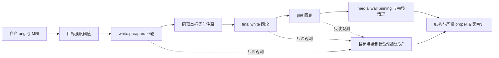

# 完整 white/pial 链的同输入与几何审计

## 1. 功能简介与流程

复用当前完整 Python/Numba/PyTorch 表面放置，不调用原版阶段程序。诊断观测器只复制边界目标、梯度、全部试步和清理状态，不改变候选、顶点顺序、固定顶点或接受规则。原版固定源码 Conda 程序只在独立参考目录执行。



本工具的标签/注释来自冻结阶段输入，未重新执行 annotation；其连续链只指三个放置阶段的自产坐标传递，不代表原始 T1 整例或当前 GA 的完整结果。

## 2. Python 调用、输入、输出与参数

输入 subject 使用标准 `mri/`、`surf/`、`label/` 结构。三张 `brain.finalsurfs.mgz`、`wm.mgz`、`aseg.presurf.mgz` 必须为同一 conform 三维网格及 scanner affine，分别为实际强度、白质强度标签和解剖标签。`H.orig` 为有序三角面 surface RAS/mm 网格；`H.orig.premesh` 用于自适应灰白统计。`H.cortex.label` 与 `H.cortex+hipamyg.label` 是对应顶点序号集合，`H.aparc.annot` 为同域颜色注释；顶点数/顺序必须匹配。七输入 pial 诊断只需最终 white、阈值表、两张 label 和三张 MRI，不伪造缺失注释。

```python
from pathlib import Path
from fnit.recon_all.place_surface_observer import PlacementObserver
from fnit.recon_all import place_pial_python
from fnit.recon_all.surface_placement_python import placement_options

subject_directory = Path("/private/subject")  # 真实自产 white/MRI/label
observation_directory = Path("/private/new_observation")  # 必须不存在
output_surface = Path("/private/subject/surf/lh.pial.T1")
placement_parameters = placement_options(device="cuda:0")  # 明确逻辑 GPU
with PlacementObserver(stage_module=place_pial_python,
                       directory=observation_directory) as placement_observer:
    placement_report = place_pial_python.place_pial_t1(
        subject=subject_directory, hemisphere="lh", output=output_surface,
        max_steps=400, trace_callback=placement_observer.callback,
        profile=True, **placement_parameters)
```

`stage_module` 指当前 white 或 pial 模块；`directory` 是新的私有观测目录。观测器仅用于独立、单线程调度 benchmark；不能在线程并发共享同一个 Python 模块。`callback` 的具名语义为 step、pass_index、coordinates、diagnostics，分别是迭代号、0–3 轮号、接受坐标副本和完整试步决定。

输出 `events.json` 包含 dtype、shape、坐标/目标/梯度 SHA 和数值决定；`*.private.npz` 保存真实数组，仅服务器私有保留。原阶段输出格式与网格有序面保持不变。未完成四轮或源清理残余时保留失败诊断，不写占位表面。

`mesh_structure(vertices, faces)` 返回连接组件、Euler、边界/非流形边、退化面、面积 mm² 与有向体积 mm³。体积是闭网格积分，不能代替 no-th3 脑区体积。`proper_pairs(first_vertices, faces, second_vertices=None, chunk_faces=256)` 返回严格面对集合及计数；`second_vertices=None` 是自相交，否则是同域 white/pial 穿越；跨表面不排除同索引面。分块只控制内存，没有候选数量截断。最新默认自相交包括共享一个顶点而仍产生 proper 交叉的面对，并分别返回共享顶点与非共享顶点计数；`exclude_shared_vertices=True` 仅用于源风格的历史对照。v9 冻结报告的 self 数值是非共享顶点子集，不能称为全部自相交计数。几何谓词保持双方开平面两侧、正长度交线条件，误差界内复用精确 IEEE Fraction 回退；点/边/共面接触不当作 proper。退化面单列，不能据此称质量通过。

## 3. 命令行调用

```bash
# 三阶段连续自产；固定参考仅在隔离克隆中运行
PYTHONPATH=src OMP_NUM_THREADS=4 NUMBA_NUM_THREADS=4 \
python tools/benchmark_recon_white_pial_chain.py \
  --subject /private/frozen_subject --output /private/fresh_chain \
  --hemisphere rh --start-stage preaparc --device cuda:0 \
  --gpu-uuid GPU-EXPLICIT-UUID --threads 4 --base-commit BASE_COMMIT --candidate-commit CANDIDATE_COMMIT \
  --target-search-backend parallel \
  --reference-binary /private/reference/mris_place_surface \
  --assets /private/reference/assets --reference-license /private/license.txt

# 独立只读质量审计：报告只含typed数值/哈希
PYTHONPATH=src OMP_NUM_THREADS=4 NUMBA_NUM_THREADS=4 \
python tools/analyze_recon_white_pial_chain.py \
  --case /private/fresh_chain --hemisphere rh \
  --output /private/fresh_quality --threads 4
```

benchmark 参数：`subject` 冻结输入目录；`output` 新目录；`hemisphere` 为 lh/rh；`start-stage` 默认 preaparc，也支持七输入 pial；`device` 默认 cuda:0，也支持 cpu；`gpu-uuid` 为明确物理卡标识；`threads` 默认4；`candidate-commit` 记录候选源码，`base-commit` 记录固定基线（v3 CLI 字段名历史上用于 candidate commit，真实基线在绑定文件另列）；`target-search-backend` 为 serial/parallel，默认沿成熟实现；`cleanup-constraint-mode` 默认 source_rip，显式 cortex_pinned_union 才采用并集移动/邻居mask；`reference-binary` 是固定源码 Conda 参考，可不提供；`official-binary` 是官方安装参考，缺少时不改标 Conda；`assets` 是参考所需资产目录；`reference-license` 是仅传给原版参考子进程的许可路径，不读取或导出许可内容。两种原版参考只作 benchmark，候选进程禁止启动外部进程。

quality 参数：`case` 上述私有结果目录；`hemisphere` 同侧；`output` 新统计目录；`threads` 默认4。每轮末、输入、pinning 后和清理后完整枚举；最终 proper 面对集合额外回放每个接受步，明确标为末态集合来源审计，不冒充所有瞬时交叉的完整计数。

probe 工具参数：`case`、`hemisphere` 同上；`binary` 未插桩 Conda 参考；`probe` 冻结梯度探针；`assets` 参考资产；`output` 新目录；`threads` 默认4。先比较探针与未插桩程序完整最终坐标/有序面，未通过不采用探针。探针 after_collision 是末次候选，接受态通过下一迭代 clear 起点核对；没有下一起点时明确 not_assessed。探针捕获范围以实际文件为准，不用空值代替后续步。

显式强化诊断模式的并集 mask Python 调用（不代表生产默认）：

```python
from fnit.recon_all.place_surface_final_cleanup import pial_cleanup_fixed_vertices
cleanup_fixed_vertices = pial_cleanup_fixed_vertices(
    ripped=optimizer_ripped_vertices,  # (N,) bool；四轮优化的原 rip，保持不变
    cortex_vertices=cortex_label_vertices,  # 一维整数；cortex.label 顶点序号
)
# 返回独立 (N,) bool：原 rip 和 cortex 外已经 pin 到 white 的顶点均冻结。
```

回放和完整轨迹比较：

```bash
PYTHONPATH=src python tools/replay_recon_pial_cleanup_fixed.py \
  --case /private/frozen_chain --hemisphere lh \
  --output /private/fresh_replay --device cuda:0 --threads 4
python tools/compare_recon_pial_observation_hashes.py \
  --baseline /private/baseline/pial-observation/events.json \
  --candidate /private/candidate/pial-observation/events.json \
  --output /private/fresh_trajectory_comparison.json
```

回放的 `case` 为自产四轮和原清理观测，`hemisphere` 为 lh/rh，`output` 必须是新目录，`device` 默认 cuda:0，`threads` 默认4；只生成私有诊断数组和统计，不写标准 pial。比较的 `baseline`/`candidate` 是两次完整观测 JSON，`output` 为新报告；逐项比较所有 border、step、pin 数组的 dtype/shape/SHA 和全部接受决定，清理本身独立比较。哈希一致要求完整字节相同，不用坐标容差。

显存采样器参数 `uuid` 指目标物理 GPU；`interval_seconds` 默认0.5秒。单层NSpid与相同数字PID不能证明NVML归属。trusted_host_pid_map默认None，沿成熟ProcessTreeDeviceSampler合同逐样本核对宿主映射、当前进程starttime和namespace；没有独立可信映射则own_peak_bytes为None/unknown，整卡峰值单列。未使用任务5sched映射，也不依赖tools源码。PyTorch allocated/reserved 同时记录；候选不启动 GPU 子进程。

## 4. 原软件调用

```bash
mris_place_surface --adgws-in autodet.gw.stats.H.dat --white --nsmooth 5 \
  --rip-bg-no-annot --rip-bg --rip-bg-lof --wm wm.mgz \
  --seg aseg.presurf.mgz --invol brain.finalsurfs.mgz --i H.orig \
  --o H.white.preaparc --restore-255 --outvol mrisps.wpa.mgz --threads 4
mris_place_surface --white --nsmooth 0 --rip-label H.cortex.label \
  --rip-surf H.white.preaparc --aparc H.aparc.annot --i H.white.preaparc \
  --o H.white --adgws-in autodet.gw.stats.H.dat --wm wm.mgz \
  --seg aseg.presurf.mgz --invol brain.finalsurfs.mgz --threads 4
mris_place_surface --pial --nsmooth 0 --rip-label H.cortex+hipamyg.label \
  --pin-medial-wall H.cortex.label --repulse-surf H.white --white-surf H.white \
  --i H.white --o H.pial.T1 --adgws-in autodet.gw.stats.H.dat \
  --wm wm.mgz --seg aseg.presurf.mgz --invol brain.finalsurfs.mgz \
  --restore-255 --threads 4
```

这些命令只在参考目录执行。完整注释版 pial 参考另包含 `--aparc H.aparc.annot`；七输入冻结诊断不凭空添加注释。实际命令/日志私有保存，公开只保留程序与输入 SHA。

## 5. 当前真实精度、运行时间和脑图

本轮从已提交 aeabc5a 基线开始。冻结 numeric 左侧完成 47 步，四轮结束于 25/35/41/47；源清理仍剩 32 个标记面，阶段失败，没有写出 pial.T1。v9 独立严格审计得到清理末态非共享顶点 proper 自相交 40 对、white/pial 穿越 25,896 对。pinning 前非共享顶点自相交为 0，pinning 后为 533；清理又移动了应固定到 white 的 954 个坐标元素。这些数值只属于这组冻结阶段输入。

先前 6d6eeeb7 默认采用原 rip 与 cortex 外顶点的并集，保持四轮优化的原 rip、边界目标、梯度和接受规则。但该mask同时改变SOAP移动域和邻居贡献，不能称为源算法等价bug修复。根审查后，当前生产默认恢复source_rip，保留非rip、cortex外邻居贡献；原并集路径仅作为显式cortex_pinned_union强化诊断策略。以下v11/v15及其回放负结果仍属于历史并集模式，数值和模式不转移给新默认。所有清理后端若源标记仍非零都抛异常。独立未插桩 Conda 参考耗时 291.766 s，探针完整运行 333.239 s，二者最终坐标及有序面完全一致。探针前 40 步捕获中，已评估的起点、rip、实际目标、sigma、梯度、末次候选和下一步起点接受坐标均为 0 差异；法向字段从第 2 步起有差异；第 2 步另核对到 413 个差异顶点均带 rip，可动顶点法向 0 差异，未导致这些已评估坐标差异。捕获之外的逐步对应标为 not_assessed。另独立读取原版最终文件，对失败候选 cleanup 末态逐元素比较，完整坐标和有序面 0 差异；因此同一组末态非共享顶点 self 40 对、white/pial 25,896 对也适用于该原版最终几何。候选没有标准输出，数值复现不能代替质量通过。固定集合与严格几何等 9 项 CPU 单元测试通过（冻结 b97a0027，8.140 s，单线程且 GPU 禁用）；日志与逐文件 SHA 已绑定。第二半球 sub06 RH 的 white.preaparc 已完成 38 步（18/28/35/38），坐标和有序面与隔离 Conda 参考 0 差异。诊断候选墙钟 312.022 s、参考完整调用 394.526 s；候选包含观测/JIT，参考另含包装调用，不宣称生产提速。PyTorch allocated/reserved 峰值分别 720,640,000 / 1,340,080,128 bytes，不能替代实际进程总显存。该连续链随后完成 final white 35 步（12/22/30/35）与 pial 43 步（24/31/36/43），三阶段完整坐标和有序面均与隔离同输入 Conda 参考 0 差异；final white/pial 候选诊断墙钟为 196.012 / 306.526 s。pial 源清理由 2 个标记面降到 0。独立审计却得到末态 white/pial 穿越 260 对，且旧清理移动了 3 个固定坐标元素；该阶段几何验收失败。非共享顶点 self 四轮末均为 0，pin 后为 1，清理后为 0。white/preaparc 的输入、四轮末和清理末非共享顶点 self 均为 0。起始 white 的 white/white 严格穿越为 0，故该起点的完整 self 也为 0；旧v14输出审计失败保留，v17修复后完整输出self审计已完成，见残余测量页。自产灰白统计文件与隔离参考字节一致（SHA `d5854c77e7164bd19eb6aeabaa90bf34f6ed5d2b70cf549293eff06c345bd3e1`）。第二例 sub07 LH 三阶段已完成 33/31/39 步，四轮边界为 14/22/30/33、11/19/27/31、22/29/34/39；完整坐标和有序面均与同输入 Conda 参考 0 差异。候选诊断墙钟为 293.031 / 143.171 / 234.216 s。pial 源标记 14→0，末态非共享顶点 self 为 0、white/pial 穿越为 189 对，旧清理移动 39 个固定坐标元素，几何验收失败。输入 white/white 严格穿越已有 48 对；前三轮 white.preaparc 非共享 self 为 2 对，第四轮及清理末恢复为 0，final white 各检查点非共享 self 为 0。v17实际写出审计现已补齐：preaparc/white/pial完整self为20/24/28，共享顶点proper继续计入失败门。固定 b97a0027 的 numeric 真实四轮已完成 47 步（25/35/41/47）；完整 52 个 border/step/pin 事件的全部数组摘要及接受控制与基线逐项一致。固定集合 7,890 顶点（新增 2,404），清理对 pin 状态及 white 的固定坐标变化均为 0。源标记 415→184，退出码 1，没有写 pial.T1；诊断墙钟 264.249 s，不计算成功输出提速比。完整终态坐标 SHA 与独立自产末态回放一致，因而该真实运行的完整严格 self 为 394 对（共享顶点 202、非共享 192），white/pial 为 25,284 对，退化面 2 个；几何验收失败。完整基线 self 为 226 对（共享 186、非共享 40），原版最终几何与基线完全一致。两例历史并集固定 pial 完整四轮已完成（v15）：sub06源残余0/self0/cross254；sub07源残余9/self42/cross181；两例模式固定坐标变化0、末态与自产回放字节一致，均不通过严格几何门。新source_rip/显式并集模式数值病例回归已完成47步及52事件一致，终态分别逐字节匹配各自冻结历史基线，均因源残余非零拒绝输出，旧v15不重标为新默认。没有正式算子门槛与整体等效阈值，因此 not_assessed，不事后定阈值。严格138文件整例检查由总控集成验收；本工具不把六个局部阶段当成整例。

阶段计时包含加载、搬运、JIT、完整优化、观测及写出；参考和输入复制分别列出。冻结 numeric 候选在残余失败门停止，诊断墙钟 347.280 s；它含观测、JIT 和清理且没有有效输出，不能与成功参考计算提速比。v3 NVML 初始化因采样模块缺失失败，own_peak_bytes=null；实际本进程显存小于 20 GB 的门尚未验证。观测开销属于诊断墙钟，不能宣称生产提速。原版可重复性/跨环境差异独立列出。

实际 MRI/white/pial 和 proper 面顶点脑图由 `plot_recon_white_pial_chain_private.py` 生成，只保留服务器私有 PNG。冻结 numeric 脑图已成功生成并留在服务器私有目录，大小/SHA 见 [实际脑图元数据](numeric_brain_private_metadata.json)；未取回或查看像素，manual_visual_review=false。脚本参数 `case`、`hemisphere`、`output` 分别为真实观测目录、半球和新的私有脑图目录。

代码审查中的参考语义：冻结 `d932c45b` 的 `mris_make_surfaces/mris_place_surface.cpp` 在 867–874 行先调用 pinning 再清理，1994–2021 行 pinning 仅更新 cortex 外 x/y/z，不更新 rip。源文件 SHA 为 `b57f6e18f2e3215fc99fb1a8720aa345459585e4618ed2b8fa2779c2ee0f9dcf`。并集固定集合同时强化移动约束并排除新增固定顶点的SOAP邻居贡献，不是原版最终清理的数值等价优化；当前已改为显式诊断选项，生产默认保留原rip语义；输入 cortex+hipamyg 与 cortex 标签和四轮原 rip 保持不变。需分别验收四轮轨迹一致、最终固定坐标零变化和末态严格几何，不能以原版写出成功代替这些门。来源证据见 [机器可读审查说明](reference_fixed_semantics.json) 与 [冻结源调用](https://github.com/freesurfer/freesurfer/blob/d932c45b7941662ea380a05efef580568b98d41a/mris_make_surfaces/mris_place_surface.cpp#L867)。不复制发布原版 C++ 代码。

残余交线长度、跨平面深度、固定面参与和输入 white 来源的只读诊断见 [残余几何测量说明](RESIDUAL_GEOMETRY.md)。两例完整固定清理回放分别得到 sub06 self=0/cross=254、sub07 self=42/cross=181，固定坐标元素变化均为0；均不通过严格几何门。三例长度/深度、实际写出独立审计、最终white集合的首次出现追踪及两个未插桩参考重复均已完成；详见残余几何测量说明。

## 6. 最近更新与benchmark记录

- aeabc5a：本轮固定起点，已有完整有序优化器与严格 white/pial 诊断。
- 5fca92b5：历史NVML采样曾使用单NSpid/相同数字PID判断；根审查指出该判断不足。本轮改用成熟可信宿主映射合同，旧真实null读数保留。
- 01ecc8a4：七输入 numeric pial 不添加无关注释；本轮 v3 冻结运行源码。
- a7f937c8：完整 proper 枚举、逐轮质量、末态面对来源与独立 Conda/probe。
- 3b5d17c0：带可证明符号误差界的开平面预过滤；保留完整 proper 谓词与候选。
- cb177913：完整自相交包括共享顶点 proper 面对，源风格子集单列。
- 6d6eeeb7 / 9a2f1430：历史默认并集移动/邻居mask与全部后端残余失败门；并集默认语义随后被根审查纠正为显式选项。
- 当前：生产默认source_rip；显式cortex_pinned_union保留旧并集算法；残余失败门保持。新两模式回归结果按模式独立记录，旧v11不覆盖。
- b97a0027：仅回放自产接受末态的清理回归；不作为完整四轮或有效标准输出。
- 后续探针读取修正：区分末次候选和经过接受/拒绝后的坐标；不改变生产数值。

当前没有改动共享调度、root crossing/joint resolver、拓扑保护文件或环境安装。四轮原有默认和源rip-only清理算法保持；本轮增加全部清理后端源残余非零拒绝输出门，并把历史并集mask改为显式强化诊断选项。这些质量门与选项变化分别列出，不再笼统称为生产默认未改。计算和脑图复用主页既有 NumPy/SciPy/Numba/nibabel/PyTorch/matplotlib；NVML 为可选观测依赖，当前冻结环境未成功导入，已保留失败收据，不自动安装或将缺失读数当作零显存。

## 7. 参考文献与原软件代码库

- Dale AM, Fischl B, Sereno MI. Cortical surface-based analysis I: segmentation and surface reconstruction. NeuroImage 1999. DOI: 10.1006/nimg.1998.0395。
- Fischl B, Dale AM. Measuring the thickness of the human cerebral cortex from magnetic resonance images. PNAS 2000. DOI: 10.1073/pnas.200033797。
- [FreeSurfer mris_place_surface](https://github.com/freesurfer/freesurfer/blob/dev/mris_make_surfaces/mris_place_surface.cpp)、[MRIS 优化实现](https://github.com/freesurfer/freesurfer/blob/dev/utils/mrisurf_mri.cpp)、[MRIS 边界目标与梯度](https://github.com/freesurfer/freesurfer/blob/dev/utils/mrisurf_compute_dxyz.cpp)。冻结参考程序、输入、探针及实际依赖的 SHA 在机器可读绑定中逐项列出；dev 链接仅供读者定位，不替代冻结版本。

当前源rip默认、显式强化策略、可信显存归属及结构门的完整修订说明见 [清理模式修订](CLEANUP_CONSTRAINT_MODES.md)。当前15项合同已通过（6.279秒）；两模式真实47步阶段回归已完成并绑定；两条路径的严格几何均失败。历史v11与既有v15–v18冻结诊断按实际并集模式保留。
