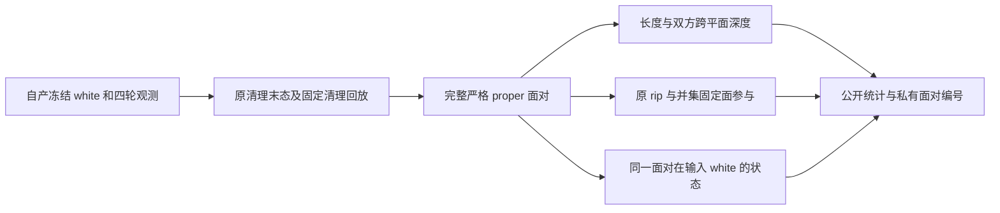

# 固定清理残余交叉的只读测量

## 1. 功能简介和流程

`measure_recon_pial_residual_geometry.py` 读取真实冻结观测与自产清理回放，完整枚举交叉，测量长度、跨平面深度、固定面参与以及同一面对在输入 white 中的状态。它不更新坐标、标签、候选或接受规则，也不写标准 pial。



## 2. Python 调用、输入和输出

此工具是独立诊断 CLI，Python 环境复用主页已有 nibabel、NumPy、SciPy、Numba。内部 `relations(first, second)` 接收 `(K,3,3)` float64 三角形坐标，单位 surface RAS/mm，输出逐对关系、交线长度和双方跨平面深度。只在 F64 误差界内调用已有 IEEE Fraction 精确谓词。

```python
from measure_recon_pial_residual_geometry import relations
# first_triangles、second_triangles 为同一真实面对集合的双方坐标。
relation, intersection_length_mm, first_depth_mm, second_depth_mm = relations(
    first_triangles, second_triangles)
```

`case` 指本任务自产四轮观测目录，须含 candidate 的 white、cortex label、pial-observation/events.json 及关联 NPZ。`replay` 指自产固定清理回放目录，须含 candidate_cleanup.private.npy。`hemisphere` 为 lh 或 rh。`output` 必须是新目录，避免覆盖旧证据。

完整 self 包括共享顶点的正长度开平面交叉；white/pial 不排除同索引面对。交线长度无截断阈值。双方深度分别为该三角形顶点到对方平面正侧最大距离与负侧最大距离的较小值；它不是最小修复位移、曲面距离或全局穿透深度。统计给出 count/minimum/median/P99/maximum，不据此豁免短交叉。

报告区分 original_rip 与 cleanup_fixed_union 两种标签下的 fully_free、mixed、fully_fixed 面；self 面对保留左右面顺序，cross 只统计 pial 一侧，white 全部不可变。`already_proper_at_same_face_pair_in_input_white` 仅回答同一面对在输入 white 是否已经交叉，不能定位完整重建流程中的最早成因。numeric 缺少更早 white 生成轨迹，不能把输入 white 的交叉归因于某个未观察阶段。两例连续链另用 `trace_recon_white_pair_origins.py` 回看输入 white 的最终交叉面对集合，在已观察 preaparc/white 的每步接受状态与清理状态中记录首次出现；不会把该最终集合的来源统计冒充全部瞬态交叉枚举。该工具的 case/measurement/hemisphere/output 分别为自产链、已完成测量目录、半球、新统计文件。

`report.json` 只含类型明确的统计、摘要和语义。`*.pairs.private.npy` 含面对编号，留在服务器私有目录；MRI、坐标和脑图也不导出。`legal_contact_count=not_assessed`：接触另行定义，proper 不能因固定面而重新归为合法接触。质量门保持原样。

## 3. 命令行调用

```bash
python tools/measure_recon_pial_residual_geometry.py \
  --case "$OWN_CHAIN_CASE" --replay "$OWN_CLEANUP_REPLAY" \
  --hemisphere lh --output "$NEW_PRIVATE_MEASUREMENT_DIR"
```

环境线程为4，CPU亲和性与已有任务一致，复用串行锁；只读 CPU 几何诊断不引入新 GPU 精度选项。所有变量由真实私有输入路径赋值，公开文档不包含服务器地址或实际私有路径。

## 4. 原软件调用

该统计没有对应的原软件单条命令。隔离参考仍使用链审计页的七输入 `mris_place_surface --pial` 调用。`repeat_recon_pial_native_reference.py` 另做一次未插桩参考：先核对七个输入与程序 SHA 与前次一致，再复制到独立参考目录执行，随后比较完整坐标及有序面。参考许可仅传入参考子进程，不进入生产计算。

重复工具参数：case 为自产冻结输入；previous 为已有独立参考结果；binary 为固定参考程序；assets 为已校验参考资源；reference-license 为私有许可文件；hemisphere 为半球；output 为新私有目录；threads 默认4。只公开实际观测到的差异及运行时间，不把单次参考成功当成几何验收，也不以插桩/未插桩两次运行冒充两个未插桩重复。

## 5. 真实精度、时间和脑图

三例末态长度/深度测量均已完成。完整来源见 [numeric真实测量](numeric_residual_measurement_v16.json)。

| 历史并集末态 | 对数 | 交线最大/P99（mm） | 首面跨平面深度最大/P99（mm） | 次面跨平面深度最大/P99（mm） |
|---|---:|---|---|---|
| 完整 self | 394 | 3.240779 / 3.007813 | 1.566558 / 1.504793 | 1.519757 / 1.392216 |
| pial/white | 25,284 | 2.449956 / 1.152352 | 1.943338 / 1.170836 | 1.255625 / 0.729007 |

输入 white 直接完整self为164对，不再把先前328个有序white/white面对称为328对self。其交线最大/P99为1.444949/1.269219 mm。末态self中的同一面对已有27对在输入white为proper，跨表面已有18对；这些来源统计只针对当前最终面对集合。

按并集固定标签，末态self有8对双方全固定、176对双方全free，另有混合组合；pial/white有16个pial面全固定、24,207个全free、1,061个混合面。具体原rip标签分类及涉及fixed/free顶点数量见JSON。双全固定self对应同一输入white的8个双全固定面对；pial全固定跨表面16对同样保留输入white几何。在此冻结white与固定约束下它们不能通过仅移动free顶点消除；这不定位更早numeric white成因、不推断完整重建流程无解，也不替代上游改进与独立复验。所有proper仍计入失败门，合法接触数量未评估，不通过长度/深度阈值作豁免。历史cortex_pinned_union完整清理回放已完成，直接统计如下；回放不等于新四轮重跑。

| 真实输入 | 源标记残余 | 完整 self proper | white/pial proper | 固定坐标变化元素 | 几何门 |
|---|---:|---:|---:|---:|---|
| numeric LH | 184 | 394 | 25,284 | 0 | 失败 |
| sub06 RH | 0 | 0 | 254 | 0 | 失败 |
| sub07 LH | 9 | 42 | 181 | 0 | 失败 |

报告见 [sub06 回放](sub06_fixed_terminal_replay_v11.json)、[sub07 回放](sub07_fixed_terminal_replay_v11.json)。数值病例已完成的真实47步与完整清理回放末态字节一致，完整 self 394 对、white/pial 25,284 对、退化面2个；新增统计以该末态为输入，不重跑47步。sub06 RH、sub07 LH 同时保留完整新四轮验证与末态回放，二者不能互相替代。实际脑图沿用私有绘图工具；未查看像素的图仍标记 manual_visual_review=false。

审计退出码只证明程序完成。`complete_measurement_not_quality_approval` 不表示质量通过。固定坐标零变化、源标记残余、完整 self/cross/退化面和四轮轨迹一致分别报告。

另两例完整测量见 [sub06统计](sub06_rh_measurement_v16.json)、[sub07统计](sub07_lh_measurement_v16.json)。历史并集末态sub06跨表面254对，交线最大/P99为1.754147/0.943764 mm；双方跨平面深度最大/P99分别为1.439485/1.410694、0.804575/0.764887 mm。sub07 self42对，交线最大/P99为4.188690/4.187804 mm，双方深度分别为0.271497/0.271497、0.394378/0.390319 mm；跨表面181对，交线最大/P99为1.293754/0.817697 mm，双方深度分别为1.099164/1.053862、0.597314/0.587113 mm。长度与深度分别报告，不据其中任一指标豁免proper。

输入white完整self：sub06为0；sub07为24，其中共享顶点24、非共享0。最终24对在已观察接受状态中有21对首次出现于preaparc、3对首次出现于white；preaparc最终输出已有20对。此处只追踪最终white集合，未枚举全部瞬态或拒绝试探，也未观察更早阶段，不能据此作因果归因。见 [sub06来源](sub06_rh_origins_v18.json)、[sub07来源](sub07_lh_origins_v18.json)。

修复后的实际写出审计均完成：sub06 preaparc/white/pial完整self分别0/0/0，pial跨表面260；sub07为20/24/28，pial跨表面189。三阶段候选与隔离原实现完整坐标和有序面均逐字节相同，双向采样顶点到完整三角面距离由完整几何身份保证为0。这不等于连续Hausdorff或完整pipeline等效，且严格几何仍失败。见 [sub06实际输出审计](sub06_rh_output_audit_v17.json)、[sub07实际输出审计](sub07_lh_output_audit_v17.json)。MRI shape/dtype/hash公开，原始空间变换只保留服务器，公开其JSON摘要。

第二次未插桩原实现运行完成，完整坐标、有序面均与第一次完全一致，最大坐标差与RMS均0；七输入及程序SHA一致且输入未变。第二次完整命令墙钟263.212秒，第一次291.766秒；没有多次稳态测量，不计算生产提速。见 [原实现重复收据](numeric_plain_repeat_v17.json)。测量解析合同交线2 mm、双方深度2/1 mm通过，仅为测量单元测试。冻结绑定见 [完成诊断清单](completed_diagnostics_binding_v20.json)。

## 6. 更新和benchmark记录

- a3564346：数值病例真实47步、固定坐标及严格失败证据。
- 此前：新增只读长度/深度与固定面参与诊断；未修改优化器、SOAP公式或受保护 crossing/joint/topology 文件。
- 根审查后：pial生产默认恢复source_rip；cortex_pinned_union成为显式选项。原v11与冻结后台v15–v18继续使用历史并集模式，不能按新默认重标。
- 自有输出审计发现 JSON 写出失败：nibabel MRI shape 含 numpy.int32；现在逐维转成 Python int，且初始报告明确标为 running_output_audit。旧 v13/v14 空报告退出码1，保留为失败记录；补跑只读审计，不补跑表面优化。

## 7. 参考文献和代码来源

严格关系复用项目已有 `white_pial_crossing_python.py` 的 F64 与 IEEE Fraction 谓词，没有修改该文件。完整面对枚举复用 `place_surface_quality.py`。参考 pin/cleanup 语义和源 SHA 见 [reference_fixed_semantics.json](reference_fixed_semantics.json)。源定位为 [FreeSurfer 固定提交 mris_place_surface.cpp](https://github.com/freesurfer/freesurfer/blob/d932c45b7941662ea380a05efef580568b98d41a/mris_make_surfaces/mris_place_surface.cpp)。脑表面重建背景：Dale、Fischl、Sereno，NeuroImage 1999，DOI 10.1006/nimg.1998.0395。
