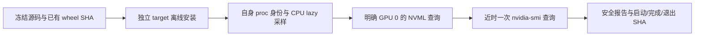

# NVML 私有安装与实际 GPU 只读查询

## 1. 功能简介

本页记录一次独立安装补验：复用已声明的 `nvidia-ml-py==13.580.82` wheel，在全新私有 target 安装，再用冻结的 FNIT 采样模块查询物理 GPU 0。它验证依赖发现、真实 NVML 查询和 PID 归属边界；不运行 MRI、不建立 CUDA context，不修改 Conda prefix、正在运行的整例或原始采样器。



源码是 `profiling.py` 的 `43fd54dd…` 和 `nvml_process_memory.py` 的 `1879606b…`，来源提交 `89e0da3e469295047d31636b9bba918f284af1cb`。此次没有更改这两个模块。CPU 安装补验、旧只读审查、此次实际 GPU 查询及 MRI/整例验收是不同范围。

## 2. Python 调用、输入和输出

[verify_live_nvml.py](verify_live_nvml.py) 的 `run` 参数如下。

| 参数 | 格式及含义 |
| --- | --- |
| `source_directory` | `Path`；含 `SOURCE_MANIFEST.json`、两个 `modules/*.py` 和验证脚本的冻结目录 |
| `source_manifest_sha256` | 64 位十六进制字符串；校验源码清单及每个 payload 的大小、SHA |
| `wheel_path` | `Path`；已有 BSD wheel，版本 13.580.82，49,008 字节，SHA `4361db337b0c551e2d101936dae2e9a60f957af26818e8c0c3a1f32b8db8d0a7` |
| `installation_directory` | `Path`；必须不存在的私有 target，不是共享 Conda prefix |
| `output_directory` | `Path`；必须不存在的独立收据目录，不位于冻结源码目录中 |
| `physical_device` | 非负整数，默认 0；启动环境的 `CUDA_VISIBLE_DEVICES` 必须明确等于该卡号，采样逻辑设备为 `cuda:0` |

调用不改变线程、TF32、autocast 或 allocator；启动者用 CPU 亲和性与环境确定预算。输出不包含 GPU UUID、驱动 PID、cmdline、私有路径、日志全文或影像。`report.public.json` 保存版本、SHA、时间、字节数、状态及归属失败理由；CLI 另写 `launch.public.json`、`COMPLETE.public.json` 和 `EXIT.public.json`，失败保留类型与验证脚本行号。模块或 wheel 不匹配、目录复用、设备不明确、安装失败或查询失败均明确报错，不静默转为 SMI。SMI 是独立的一次对照观察。

```python
from pathlib import Path
from verify_live_nvml import run

source_directory = Path("workspaces/gpu_pid_namespace_nvml_20261011_v2")
completion = run(
    source_directory=source_directory,  # 已核验的 FNIT 两模块和专用脚本
    source_manifest_sha256="169ddd953a395400ac5f25dcbadf2a0fb011df0e417461411d06b0300a90c4cf",
    wheel_path=Path("dependencies/nvidia_ml_py-13.580.82-py3-none-any.whl"),
    installation_directory=source_directory / "python_target_replay",  # 新私有安装目标
    output_directory=Path("runs/gpu_pid_namespace_nvml_replay"),  # 新查询收据目录
    physical_device=0,  # 运行前明确 CUDA_VISIBLE_DEVICES=0
)
```

Python `run` 返回完成摘要；启动/退出绑定由 CLI 写出。示例须复用匹配清单的实际源码，并使用全新安装与输出目录。

## 3. 命令行调用

```bash
source_directory="workspaces/gpu_pid_namespace_nvml_20261011_v2"
wheel_path="dependencies/nvidia_ml_py-13.580.82-py3-none-any.whl"
installation_directory="$source_directory/python_target_replay"
output_directory="runs/gpu_pid_namespace_nvml_replay"

CUDA_VISIBLE_DEVICES=0 OMP_NUM_THREADS=4 MKL_NUM_THREADS=4 OPENBLAS_NUM_THREADS=4 \
taskset -c 100-103 python "$source_directory/verify_live_nvml.py" \
  --source-directory "$source_directory" \
  --source-manifest-sha256 169ddd953a395400ac5f25dcbadf2a0fb011df0e417461411d06b0300a90c4cf \
  --wheel-path "$wheel_path" \
  --installation-directory "$installation_directory" \
  --output-directory "$output_directory" --physical-device 0
```

依赖安装只执行 `pip install --no-deps --no-index --no-compile --target`，没有下载。数据计算使用的环境与原始运行保持不变。

## 4. 原工具查询

本功能属于监测，不对应 FreeSurfer 影像阶段命令。实际独立对照为：

```bash
nvidia-smi --id=0 --query-gpu=index,memory.used --format=csv,noheader,nounits
```

NVML 使用 `nvmlDeviceGetComputeRunningProcesses` 和 `nvmlDeviceGetMemoryInfo(...).used`。进程列表、NVML 整卡值与 SMI 是顺序查询，时间与计量口径分开记录，不要求不同瞬间数值相等。

## 5. 本版实际结果与时间

真实环境为 Python 3.11.16、PyTorch 2.5.1、内核 3.10.0-1160.el7.x86_64。两个模块安装后 SHA 与冻结源相同；实际加载的 `pynvml.py` 来自新 target，264,920 字节，SHA `4251429c25f1615a4166f395d3c09fe0732bfb023864c4b7f12813373e5696ea`。目录权限为 700。

| 实际观察 | 结果 |
| --- | --- |
| 完整过程 | EXIT 0；10 项检查全部通过 |
| NVML | 一次完整 GPU 0 查询成功，0 个失败样本、0 次后端错误 |
| NVML compute-process 总和 | 3,193,962,496 字节；3 个进程；不能归属 FNIT |
| NVML 整卡占用 | 4,140,171,264 字节 |
| 近时 SMI 整卡占用 | 3,066 MiB，即 3,214,934,016 字节 |
| PID 映射 | NSpid 不可用、没有可信 driver→local 映射；alias 数为 0 |
| 进程树峰值 | `null`；resolved peak 同为 `null` |
| CPU lazy 采样 | `not_applicable`；没有创建 NVML 实例 |
| CUDA/计算策略 | 前后未初始化 CUDA；默认 float32；matmul TF32=False、cuDNN TF32=True，autocast 关闭，全部保持 |
| 线程与环境 | intraop=4、interop=64；进程亲和性限于 100–103；环境值保持 |

| 具名时间 | 秒 |
| --- | ---: |
| 离线 wheel 安装 | 1.0948693798854947 |
| Torch 和实际采样模块导入 | 4.529560202732682 |
| NVML 查询 | 0.6929592918604612 |
| SMI 查询 | 0.31964012049138546 |
| SMI 开始距 NVML 结束 | 0.047293324023485184 |
| 完整验证 API | 6.69296086486429 |

完整 API 包含安装、导入、查询和报告准备；分步骤嵌套于总计，不能再相加。整卡值是采样时的设备占用观察，可作同期整卡采样上界；compute-process 总和另列。它们均不是精确 FNIT 峰值，不保证连续 20 GB 预算，也不能相加。此次没有影像精度、MRI 脑图或整例质量验证。

原始安全数值与类型没有改写，见 [v2 实际报告](reports/v2/report.public.json)、[完成链](reports/v2/EXIT.public.json) 和 [收集清单](reports/COLLECTION_MANIFEST.json)。旧运行的采样结果没有覆盖。

## 6. 版本与失败记录

- **v1，验证脚本 `664a9f16…`**：离线 target 已产生，但自建采样包导入报 `ModuleNotFoundError`，冻结脚本行 87，EXIT 1；没有生成查询报告或 COMPLETE。只导出异常类型、行号与日志 SHA，不导出日志全文。这是安装验证启动失败，未证明 GPU 查询失败。
- **独立诊断 target**：同 v1 脚本从另一个新 target 实际完成查询，报告 `87ee7bae…`；它没有 v2 的 CLI 启动/退出绑定，保持诊断范围，不回标 v2。
- **v2，验证脚本 `650be301…`**：实际记录安装路径在入口及安装后均已存在 Python 负 finder 缓存。创建 package 后调用 `importlib.invalidate_caches()`，同一 `PYTHONPATH` 启动方式完成；新增 CLI 启动/报告/完成/退出 SHA 链。这个修复仅属于验证脚本；采样模块 `43fd54dd…/1879606b…` 没有变化。

v1 原脚本保存在 [frozen/verify_live_nvml_v1.py](frozen/verify_live_nvml_v1.py)，失败元数据、诊断和 v2 报告分别保存。此前 [CPU 安装补验](../20261011_gpu_pid_namespace_installed/README.md) 没有执行实际 GPU 查询，不能替代本页结果。没有重复运行已有 51 项采样合同，也没有新 MRI 工作负载。

## 7. 来源与参考

- [FNIT 采样行为与 PID 归属说明](../../../../docs/recon_all/GPU_PROCESS_MEMORY.md)。可信映射必须持续校验本地 starttime 与 namespace；数字 PID 相同或 NSpid 本身不证明宿主驱动归属。
- [项目环境声明](../../../../environment.yml)：`nvidia-ml-py==13.580.82` 是可选监测依赖，影像计算不依赖它。
- [NVIDIA NVML](https://developer.nvidia.com/management-library-nvml) 与 [nvidia-ml-py 13.580.82](https://pypi.org/project/nvidia-ml-py/13.580.82/)。本轮复用既有 BSD wheel，没有重新获取或发布第三方库代码。
- [v2 源码清单](reports/v2/SOURCE_MANIFEST.json)、[导出清单](EXPORT_MANIFEST.json) 与 [发布清单](PUBLICATION_MANIFEST.json)。静态源码审查、安装/监测补验、MRI 阶段、完整整例和 OS 隔离分别说明。
