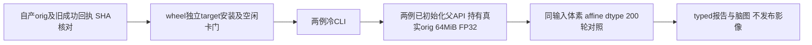

# Guarded Torch N4：两例固定输入回归

## 1. 功能与流程

独立验证9292a0a7源码对应的已安装wheel：已完成复用两例FNIT自产orig，分别调用冷CLI与已初始化父CUDA API，每次完整200轮。不修改科学核心、安装脚本或生产默认。



## 2. Python调用与数据

输入audit由tools/prepare_guarded_n4_inputs.py产生。命令接收服务器FNIT根目录与新JSON路径，只进行CPU读取、SHA和体素/几何核对。inputs.private.json记录真实路径，仅保留私有目录；inputs.public.json只导出来源、哈希、格式、旧报告及数值。

两例旧worker输入的SHA分别为4107fc4dbf62e4e5b070b7fc4bd7e8047dbb1d263d6b0730a90867dd042f6ea4、bde15a986a9c93149ac80a3454ba5ca9550ae31800f68dc03ff635cb87529d06。均为256³ uint8 MGH；父API用nibabel解析真实orig，转为64MiB FP32 GPU张量并在子运行期间保留。旧链torch分支orig文件SHA不同，体素、affine、dtype相同；本轮选择与旧worker完全同字节的FNIT conform输出，不使用官方上游影像。两例prefix完成回执exit0及自产orig体素相同另记。

既有run_isolated_n4参数/输出见docs/recon_all/N4_CACHED_WORKER.md。本轮仅调用该API，不另实现N4。输出为新路径nu0.mgz、worker私有回执及四组汇总，不覆盖旧文件。

## 3. 命令行与参数

```bash
python tools/prepare_guarded_n4_inputs.py \
  --fnit-root /data/FNIT --output /data/FNIT/runs/my_n4/inputs.private.json
# 隔离target安装已核验wheel，并设置PYTHONPATH到该target及既有nvidia-ml-py。
# 以下启动器在后台等待空闲GPU，通过同卡锁和实时门后才启动四组真实回归。
python tools/launch_guarded_n4_when_idle.py --fnit-root /data/FNIT --task my_n4
# 本轮授权共享低利用率策略：新协议在四子启动前写入，排除GPU4。
python tools/launch_guarded_n4_shared_gpu.py --fnit-root /data/FNIT --task my_n4
```

准备脚本--fnit-root为已有索引和产物所在目录，--output为不能已存在的新回执；启动器--task为独立workspaces/runs任务名。benchmark_guarded_n4_worker.py的--inputs为核验输入清单，--output为新执行目录，--diagnostic为已验证Linux3.10 PID映射工具，--wheel/--install-report为固定wheel和根离线核验回执，--installed-target为本轮独立安装路径，--audit-helper为原程序启动审计辅助目录，--gpu-uuid为完整UUID，--idle-baseline-bytes为现场NVML整卡基线。上述参数全部必填。新增--resource-protocol可选：缺省保留原空卡门；本轮传入预先写出的shared_low_utilization_v2协议，要求排除GPU4、同UUID两次相隔≥1秒利用率≤10%且free≥32,000,000,000字节、共用锁及启动前复查。四次调用均使用同一GPU、CPU88–91及4线程；完整CLI墙钟含子导入/IO/退出，父API外部墙钟另含真实orig加载/传输、子exec及IO/退出。父初始化单列在API墙钟外。核心GPU计时及传输按成熟实现同步，TF32默认开启，保留完整N4既有FP64拟合/FFT例外，不启半精度。

生产guard标志FNIT_RECON_FORBID_ORIGINAL_STAGES=1在冷CLI与API新exec中继承。审计目录通过既有sitecustomize记录Python启动和外部执行尝试；不从“未出现原命令”单独推断全部动态库行为。

## 4. 原软件调用

本轮不调用原软件，也不读取官方上游影像。只与既有完整Torch算法/旧worker输出比较，并携带旧报告中的原实现差异。原N4 recipe与参考命令见docs/recon_all/N4_COMPLETE_TORCH_20261009.md和N4_ITK_CONDA.md。

## 5. 本轮实测与资源状态

wheel SHA 3e5e2eb0332d328cd92a968a17ae8cc2c6d872a961d103bca4a9d0d65df39e51（5309664字节），623个Python文件wheel/target一致，29模块与冻结源码一致。旧空卡门WAIT和初轮输入哈希失败保持原样。用户授权共享策略后，先写新typed协议，再核验GPU6同UUID两次间隔1.007秒、利用率0%、free 51,586,531,328字节及锁；启动前再次通过。GPU4未参与。已有驻留进程与设备总量原样记录，未终止其他进程。

| 病例 | 调用 | 完整外部墙钟 s | 子文件API s | 轮次 | 对旧完整Torch/两个旧worker |
|---|---|---:|---:|---:|---|
| sub-06 | 冷CLI | 7.522 | 3.525 | 200 | 全体素/affine/dtype及文件SHA相同 |
| sub-07 | 冷CLI | 7.820 | 3.574 | 200 | 全体素/affine/dtype及文件SHA相同 |
| sub-06 | 已初始化父API | 8.428 | 3.411 | 200 | 全体素/affine/dtype及文件SHA相同 |
| sub-07 | 已初始化父API | 8.660 | 3.542 | 200 | 全体素/affine/dtype及文件SHA相同 |

四组均退出0，12项新旧输出比较均为0新增差；旧原实现差异4016/3259体素+1保留为历史证据。完整N4及B-spline模块与旧实际执行SHA相同，guarded worker对应本轮已安装wheel。TF32两项均True，autocast关闭；全部用同卡、CPU88–91和4线程，无半精度。这是共享环境各一次墙钟观测，不作受控整例加速结论。

已安装worker/CLI六项继承guard CPU负向合同通过，CUDA未初始化、精度不变。真实四子各有Python启动审计，未观察到原阶段命令执行；guard启用依据为本轮继承环境1、已安装源码装饰入口和独立负向合同。这不是外部shell子孙或动态库的完整系统调用审计。新协议时间先于四个实际worker启动。

同期监测每0.25秒尝试一次，四组实际最大间隔0.315/0.354/0.730/0.329秒，无当前帧查询失败。两组父API持有真实orig的67,108,864字节FP32张量，取得14/13个同快照父子行；仅这些经过Linux3.10 sched/同卡NVML行及身份复核的两行，观测合计最大2,401,239,040字节。单个已验证子行窗口最大1,900,019,712字节，子Torch峰allocated/reserved为1,295,297,024/1,384,120,320字节。父cache-off原始allocated/reserved为0，明确invalid，不代表其显存为0。

所有125个采样器样本的整树归属仍unknown/unresolved（含外部驻留进程），全序列tree峰值保持null；后续已验证父子窗口不回填早期未知，不等于连续峰或完整recon-all显存。父子五个driver PID在正常退出后的NVML列表中均消失，原共享驻留进程保留。完整重建20GB/10min未评估。

[完整typed报告](shared_v2/report.public.json)、[汇总](shared_v2/summary.public.json)、[执行审计](shared_v2/execution_audit.public.json)、[共享协议](shared_v2/resource_protocol_v2.public.json)、[协议时序](shared_v2/protocol_order.public.json)、[文件一致性](shared_v2/byte_equality.public.json)、[退出观察](shared_v2/post_exit.public.json)及manifest保存本轮证据。原WAIT、旧输入与初轮失败保留。公开副本使用一致的GPU物理ordinal别名，原UUID同卡核验事实及私有receipt SHA保留在PUBLIC_EXPORT_RECEIPT.json。PUBLIC_MANIFEST/DELIVERY_MANIFEST的files仅校验本目录Git已跟踪JSON；SOURCE_MANIFEST的5项files路径相对仓库根，原科学/脚本SHA不改。派生脑图仅作为私有交付附件，明确不在Git/bundle树及这两个Git校验清单中；已视觉核对，在私有交付目录n4_real_comparison.public.png（SHA fe0571a94b83c7672a2a1c7d9d0b14c021922762ecaf3dc6af5cda158bd0929b）；不纳入源MRI、权重或原日志。

## 6. 版本和benchmark记录

2026-10-11：固定9292a0a7与根MF SHA 81138d195eae18f341fb7a0485f67e3532fc103a65f9f522c7047549f7ead17a。准备输入初轮发现torch/native自产orig文件SHA不同，未将未配对输入当回归，随后核对完全同字节旧worker输入及体素/几何一致性。旧报告与源码绑定不修改。随后仅修改启动资源门；四组完整200轮真实回归完成，追加shared_v2报告，原科学模块和安装脚本未修改。

## 7. 参考与原代码

Tustison等，N4ITK，IEEE TMI，2010，[DOI](https://doi.org/10.1109/TMI.2010.2046908)。原[ITK5.4.7 N4实现](https://github.com/InsightSoftwareConsortium/ITK/blob/v5.4.7/Modules/Filtering/BiasCorrection/include/itkN4BiasFieldCorrectionImageFilter.hxx)。本轮复用FNIT n4_torch_worker、n4_itk_torch_experimental、n4_bspline_torch、profiling、nvml_process_memory及已验证诊断helper。

2026-10-11公开导出修正：仅匿名化实际GPU硬件UUID并修正Git/私有附件manifest边界；不重跑MRI，不改原私有报告、四组pass、历史WAIT/输入失败、科学源码/wheel/输出SHA与测量值。
