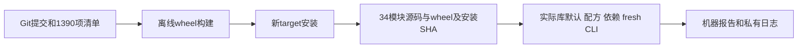

# 最终合并源码的独立安装核验

## 1. 功能与流程

冻结已提交源码7652b7b06040d93b4831743237ae030af71126ac，离线构建wheel并安装到新目录。检查34个关键模块及实际pial默认source_rip；不运行影像、JIT或CUDA前向。



## 2. Python调用、输入与输出

输入为冻结源码及[清单](SOURCE_MANIFEST.json)，每项包含相对路径、bytes和SHA-256。没有影像shape、坐标空间或单位。输出是新wheel、安装目录、JSON报告及私有日志；与旧科学阶段报告分开。

```python
from pathlib import Path
from verify_recon_genetic_profile_install import verify  # tools目录加入PYTHONPATH

installation_report = verify(
    source_directory=Path("/data/fnit-source-7652b7b0"),  # 与清单一致的src及安装元数据
    source_manifest=Path("/data/fnit-source-manifest.json"),  # 1390项size和SHA清单
    output_directory=Path("/data/new-install-check"),  # 必须不存在，位于源码目录外
    python_executable=Path("/conda/envs/fnit/bin/python"),  # 已安装主页依赖的Python
)
```

四参数必填Path；路径越界、缺失、SHA错误、输出已存在、依赖或子进程失败抛异常并保留日志。返回完整结构见[安装接口](../../../../docs/recon_all/PYTHON_GENETIC_PROFILE.md)。

## 3. 命令行与复现

先从本次公开版本导出安装源码，将本页清单复制到源码目录外；无需读取任何影像或许可证。1390项源码和安装元数据与实际测试的私有集成提交7652b7b0逐项SHA一致。本页记录实际测试版本，不把公开打包提交重标成新的影像测试。

```bash
# source_directory和output_directory是两个不同的新目录。
git archive HEAD \
  src pyproject.toml README.md THIRD_PARTY_NOTICES.md > frozen-source.tar
mkdir /data/fnit-source-7652b7b0
tar -xf frozen-source.tar -C /data/fnit-source-7652b7b0
python tools/verify_recon_genetic_profile_install.py \
  --source-directory /data/fnit-source-7652b7b0 \
  --source-manifest validation/recon_all/optimizations/20261011_integrated_python_install_v4/SOURCE_MANIFEST.json \
  --output-directory /data/new-install-check \
  --python-executable /conda/envs/fnit/bin/python
```

构建与安装均no-index/no-deps，复用已有环境；不是全新Conda安装验证。

## 4. 原软件对应

安装验证没有独立FreeSurfer等价命令。它不启动原软件；生产算法的对应命令见各功能页。

## 5. 实测结果

34模块source/wheel/installed SHA均一致，实际库默认source_rip。构建2.326786秒、安装0.744672秒、入口与依赖检查17.649014秒，均含各自IO。六个fresh模块CLI及实际安装的依赖console全部EXIT0；四个stage worker help显式继承禁用原程序标志。

wheel大小5,319,861字节，SHA-256为9b88eefb1d558ad35f26b6925dd0f30a9418672e8709deac581a0326017f3786。源码清单SHA为8471e5c3496668c5d80deea7aa09e3b23f47981bfa045ed0ab88fb13060fc373。

导入前后CUDA均未初始化，matmul TF32=False、cuDNN TF32=True，保留调用者设置；不是GPU前向策略。真实N4/GCA仍对应9292a0a7 wheel，pial双模式阶段对应f527及相应模块SHA，不重标为本wheel实测。整例、显存峰、脑图与干净环境隔离均未测。

[完整报告](report.public.json)与[根回归收据](root_receipt.public.json)记录逐模块、入口和合同证据：包装器4测试/5子测试，pial/质量15测试，状态装配11测试均通过；这些CPU合同不替代MRI或整例。

## 6. 更新记录

v3保留9292a0a7的29模块及实际N4/GCA回归绑定；v4追加五个pial/清理/质量/观测/显存模块、实际source_rip默认检查，重新构建与安装。本轮不新增依赖、不改算法精度。

## 7. 参考与代码

[安装验证工具](../../../../tools/verify_recon_genetic_profile_install.py)、[完整GA配方](../../../../docs/recon_all/PYTHON_GENETIC_PROFILE.md)、[pial](../../../../docs/recon_all/PYTHON_PIAL_PLACEMENT.md)、[主页Conda环境](../../../../environment.yml)。
