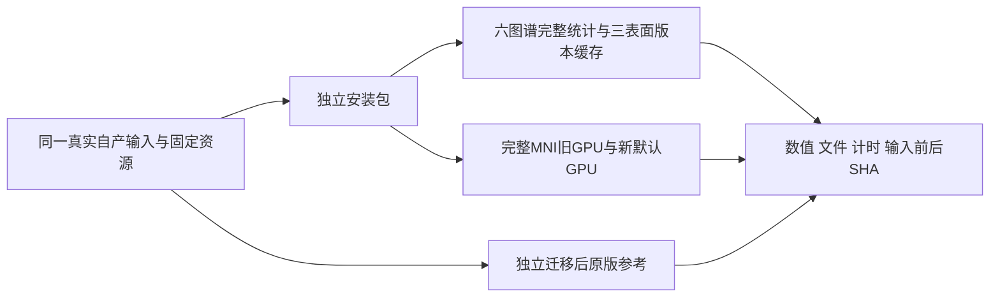

# 2026-10-11 任务5：Python MNI、统计缓存与安装验证

## 1. 功能和范围

复用已有 GPU warp、完整空间索引/20跳厚度及多图谱缓存。新增运行入口限制和依赖预检，修复成熟 principal() 留下 TF32 状态的问题。算法、输出范围和既有精度规则不变。基线为 aeabc5aba9341f0358772eb00b1f07eb2cbaf643，实测安装源码为22d4e0aa；参考脚本分别绑定b6ba58dd和d941dbc7。



## 2. Python、输入和输出

MNI的全部参数、模型精度与输出结构见 [MNI说明](../../../../../docs/recon_all/MNI_NONLINEAR_CHAIN.md)。统计完整接口、各参数和单位见 [缓存说明](../../../../../docs/recon_all/SURFACE_STATS_CACHE.md)。安装预检见 [安装说明](../../../../../docs/recon_all/PYTHON_RUNTIME_INSTALL.md)。两组公共真实T1的既有FNIT自产目录提供不同半球（case_A/lh、case_B/rh），完整white/pial、同序morph/注释和brainvol/talairach；MNI只取自产orig、crop及aff.lta。报告仅发布别名、typed数值与哈希，无影像、权重、许可证、服务器路径或原日志。

## 3. 命令行与安装

```bash
python tools/benchmark_recon_python_metrics_install.py --config /data/validation/config.json
fnit-verify-recon-all-python --assets-dir /data/fnit_assets --require-nvml
```

config各字段见MNI说明第3节。Python profile要求显式cuda:N、至少2线程。MNI只接受GPU后处理，CPU/conda在读写前ValueError。本报告测试时旧native_free CPU分支仍传conda；后续总控整合已取消该分支，并在完整入口提前拒绝CPU，见[入口合同回归](../20261011_mni_entry_integration/contract_checks.json)。这项整合不改写本报告的实际运行源码、输入或测量结果。

离线wheel构建、独立target安装和fresh入口退出均0，安装文件SHA与冻结源码一致。9项边界回归通过（3.77秒）。新预检的已安装console入口另在fresh进程通过（4.72秒），CUDA未初始化，进入/退出TF32状态相同，见[runtime_entry](runtime_entry.public.json)。已有Conda计算依赖及独立SimpleITK/NVML目录复用，pytest只装入本任务target。完整clean Conda重建未评估。

## 4. 原软件参考

厚度为 `mris_place_surface --thickness WHITE PIAL 20 5 HEMI.thickness`；MNI参考依次 `mri_warp_convert --inras DEFORM --insrcgeom CROP --outfswarp FORWARD --vg-thresh 1e-4 --lta1-inv CROP_TO_ORIG --lta2 CROP_TO_FULL`、`mri_ca_register -invert-and-save FORWARD INVERSE`、`mri_convert -rt nearest ORIG -at FORWARD CHECK`。原版程序只在独立reference目录执行，模型仍为同一FNIT FP32模型，故不是原版SynthMorph整链对照。

现场四个参考ELF整文件SHA与迁移前manifest不同。已从原转移包核回原大小/SHA；迁移前后全部执行段、常量/数据段和DT_NEEDED库名称一致，变化仅在.dynamic/.dynstr/.dynsym/.symtab，RPATH改变。报告保留两套SHA、逐段证据及whole-file mismatch，不宣称固定原二进制逐字节一致。参考资源中没有mris_anatomical_stats，因此本轮六套统计只验证旧/新FNIT数值，不作新的原软件统计准确度结论。

## 5. 最新真实精度、分步和完整阶段时间

两组12套完整.stats均逐字节一致、全部9个数值列误差0。white.preaparc、white和pial各自计算主曲率（3次），no-th3基础量1次，每套图谱仅1次摘要回传（合计6次）。候选恢复进入时False的matmul TF32；旧版留下True。

两组旧/新GPU的deform、forward、inverse、check数值、shape/dtype、affine均一致；三正式输出的intent/units一致。新GPU对迁移后参考三输出数值也为0差异。厚度最大差两组均9.5367431640625e-7 mm，P99均2.384185791015625e-7 mm。每次模型调用实际观察到两次CUDA FP32前向，matmul/cuDNN TF32关闭、autocast关闭。

| 完整阶段（秒） | case_A旧GPU/原版 | case_A新GPU | case_B旧GPU/原版 | case_B新GPU |
|---|---:|---:|---:|---:|
| 六套stats+preaparc版本检查 | 3.676 | 2.198 | 1.938 | 2.835 |
| 厚度（左列为原版） | 34.589 | 2.750 | 30.628 | 2.107 |
| MNI旧GPU与新默认 | 65.662 | 52.218 | 54.644 | 61.587 |
| MNI同模型+参考后处理 | 160.277 | 52.218 | 200.893 | 61.587 |

| MNI子步骤（秒） | A旧GPU | A新GPU | A参考 | B旧GPU | B新GPU | B参考 |
|---|---:|---:|---:|---:|---:|---:|
| deform_model_and_save | 35.060 | 24.766 | 21.265 | 22.363 | 27.096 | 23.026 |
| warp_convert | 4.430 | 4.064 | 32.034 | 4.866 | 5.087 | 35.391 |
| warp_inverse | 23.717 | 21.001 | 95.136 | 24.892 | 26.817 | 128.931 |
| resample_check | 1.723 | 1.626 | 11.185 | 1.704 | 1.735 | 12.628 |

四线程，CPU88–91、A100物理6/逻辑cuda:0；共享GPU，A先旧后新，B先新后旧。完整API包含模型载入、计算、传输和写出；全局CUDA初始化/复制冻结输入不计入。统计完整时间另含preaparc版本检查。不同次序时间排序变化，本轮没有新算法提速结论。

PyTorch最大allocated约11.729 GB、reserved约18.023 GB。NVML仅case_B保有完整导出，717次/0失败，最大间隔3.344秒；PID namespace归属未解决，任务显存峰值为null。41.501 GB是共享整卡观测，不能记为FNIT显存。case_A最后采样导出因JSON失败缺失，进程Torch峰值保留。

真实中轴位检查图交付附件为mni_real_check.public.png（不入Git），两例各含迁移后参考/Python GPU/绝对差三栏；差图全0。PNG SHA-256：`28fe7820fb980d4f233c18376004244290d3e1cf8721b2c6f947447d71ecb1a7`。

运行后所有冻结表面/注释/MNI输入、core模板和deform权重复核通过。生产API审计未触发原版阶段exec/许可访问/原运行库加载禁令，观察到通用CUDA编译器ptxas；范围限本次stats/MNI调用。

机器证据：[完整typed报告](verified_report.public.json)、[分步时间CSV](timings.public.csv)。报告SHA-256：`548df87cc00ade3f69b5942bacb52b3a675994c9d60ee85b6aad838f8df6fbe5`。138项原始T1整例、整体指标等效与完整安装隔离均not_assessed。

## 6. 更新与失败记录

2026-10-11：GPU-only生产边界、TF32作用域修复与dtype保护；离线安装和两例真实验证完成。v2参考厚度漏写半球前缀，脚本因找不到输出停止；v3首例MNI全部算完后遇MGH numpy-int32 JSON错误，修复仅报告，原输出与计时保留；v4仅执行第二例并恢复首例报告。收集时发现参考RPATH迁移导致manifest不同，逐段核验后保留差异。没有改生产模型、warp、厚度或统计公式。

2026-10-10：CUDA路径已不发现未用原程序；2026-10-03：脑区面积按原double逐面累加修复；2026-10-02：GPU后处理和空间索引厚度验证。旧结果保持各自源版本，入口见功能页。

## 7. 文献与源码

[固定FreeSurfer源码](https://github.com/freesurfer/freesurfer/tree/d932c45b7941662ea380a05efef580568b98d41a)、[SynthMorph论文](https://doi.org/10.1109/TMI.2021.3116879)。FNIT旧参考调用器mni_reference_aeabc.py为项目自有代码，仅在独立诊断运行；未复制发布原版C++。
