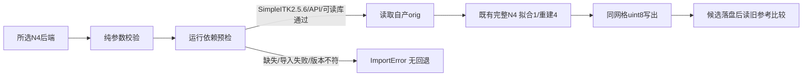

# N4 计算库发现与早期失败修复

## 1. 功能与范围

本轮修复成熟 SimpleITK N4 子函数的运行依赖检查。原始 T1 的新独立 Python GA 整例在 Talairach 后因缺少 `SimpleITK` 退出；包依赖声明、CLI help 和 FNIT 模块导入不能证明所选计算库已安装。现在运行预检在读取 T1、加载模型和创建 subject 之前执行；直接 N4 文件 API 也在读取影像之前检查。算法、参数、默认拟合单线程和异常线程恢复规则不变。

本页报告独立依赖恢复、focused 合同及一个冻结 sub06 完整 N4 文件 API。旧失败整例保持失败；没有续跑、新整例、GPU性能或整体等效结论。



## 2. Python 调用、输入和输出

```python
from fnit.recon_all.input_n4_chain import (
    require_n4_runtime_dependencies, run_n4_stage,
)

dependency_report = require_n4_runtime_dependencies(
    n4_backend="simpleitk",  # 只核所选计算库；无图像/模型/输出目录操作
)
n4_report = run_n4_stage(
    input_path="subject/mri/orig.mgz",     # FNIT自产三维XYZ uint8 T1
    output_path="diagnostic/nu0.mgz",      # 同shape/毫米affine的新uint8文件
    n4_backend="simpleitk",               # 完整通用Python库，无原版阶段程序
    n4_execution="in-process",            # SimpleITK仅此执行模式
    native_binary=None,                    # 不需要、不消费原程序
    device="cpu",                         # 不初始化CUDA
    threads=4,                            # 拟合保持1；重建4
    profile=False,                        # 不增加GPU同步
    report_path="diagnostic/n4.json",      # 可选实际版本/SHA/参数/耗时
)
```

| 输入/返回项 | 格式、含义与失败规则 |
| --- | --- |
| `n4_backend` | 必填selector：`native/torch/simpleitk`；非法值抛ValueError |
| `require_n4_runtime_dependencies` 返回 | SimpleITK分支：backend、required=True、实际2.5.6版本、ITK版本和计算库SHA；没有私有路径 |
| native/Torch预检返回 | required=False仅表示无需SimpleITK；不代替既有程序/设备校验，不触发SimpleITK导入 |
| `validate_n4_execution` | 纯参数校验，保留无安装依赖副作用；不能当作runtime gate |
| `input_path/output_path` | MGH/MGZ，三维XYZ、有限非负强度、每轴至少8且有正信号；新输出同网格uint8，原affine及tkr矩阵单位mm |
| N4其他参数/返回 | 沿用[完整功能页](../../../../docs/recon_all/N4_SIMPLEITK.md)的全部参数、固定recipe与文件/数组报告 |

预检惰性导入 SimpleITK，核固定2.5.6、必要API和实际库可读并计算SHA。不创建图像或滤波器，不改ITK线程、CUDA状态或TF32。缺包/ABI导入失败/未验证版本/API缺失/不可读库抛ImportError；没有静默回退，不通过修改原始影像或参考数据填补输出。平台库SHA只用于来源记录，不强制所有平台使用Linux wheel的SHA。

## 3. 命令行与安装

复用已声明 wheel，在独立target离线安装；旧Conda prefix保持不变。

```bash
# 此处均为调用者本地目录变量，wheel须先核SHA
simpleitk_wheel=/path/to/simpleitk-2.5.6-cp311-abi3-manylinux2014_x86_64.manylinux_2_17_x86_64.whl
dependency_target=/path/to/new-fnit-dependencies
python -m pip install --no-index --no-deps --target "$dependency_target" "$simpleitk_wheel"
export PYTHONPATH="$dependency_target${PYTHONPATH:+:$PYTHONPATH}"
python -c 'from fnit.recon_all.input_n4_chain import require_n4_runtime_dependencies; print(require_n4_runtime_dependencies(n4_backend="simpleitk"))'
python -m fnit.recon_all.n4_simpleitk \
  --i subject/mri/orig.mgz --o diagnostic/nu0.mgz \
  --fitting-threads 1 --reconstruction-threads 4 --profile diagnostic/n4.json
```

本轮独立复现脚本 `regress_dependency.py` 接受必填 `--module-directory`（四个显式冻结N4模块目录）、`--input/--reference/--reference-report`（自产orig、仅诊断的旧nu0及其完成报告）、`--input-sha256/--reference-sha256/--reference-report-sha256`（准确文件SHA）、`--output-directory`（必须全新）、`--code-version`（冻结来源）。生产API不接受reference参数；仅比较器在候选输出完成后读取参考。设置CPU亲和性和四线程由运行入口负责，GPU隐藏；输出report/COMPLETE/nu0，raw影像保留服务器、不发布。

```bash
# reference_file/reference_report是诊断旧结果，不能作为生产算法输入
python regress_dependency.py \
  --module-directory frozen_n4_modules --input subject/mri/orig.mgz \
  --input-sha256 "$input_sha256" --reference "$reference_file" \
  --reference-sha256 "$reference_sha256" --reference-report "$reference_report" \
  --reference-report-sha256 "$reference_report_sha256" \
  --output-directory new_diagnostic --code-version "$frozen_code_version"
```

## 4. 原软件与来源

对应原步骤为单 T1 recon-all 中的完整 N4 偏置场校正及 `make_nu` 包装；本轮只修依赖发现，不再次调用原软件。固定 N4 recipe、原独立 Conda ITK程序与两次重复、28/99量化体素差异仍绑定[原报告](../20261010_n4_simpleitk/README.md)，不重新标成本轮原生验证。

SimpleITK为允许的通用Python库，实际2.5.6/ITK5.4；不是原FS阶段程序/库，也没有从FS安装复制资源。既有 wheel 为52,798,369字节，SHA `99242c333ed17138134e9749f3a484518f41baebab0fc0f0fe7c657ab8090c07`；实际库SHA `c25cd8cf7053c8224c246744e1f1bc9af12db0c95a8221b27e9546cc4511b62c`。本轮未下载新包、修改共享环境或读取许可证。

## 5. 真实回归与耗时

实际输入是公开 ds000114 sub06 ses-test、`79a41cdd` 自产链的256³ uint8 `orig.mgz`，SHA `04ce13b5b3a7a22ab94536e4fab89868e985ce435069f4517d5840aa202b95ea`。旧完整文件N4 output SHA `47eca291283f22b380285441ad8c6e8248a2bb6f3601d0dac83b5f317a5ec98f`、服务器原始完成report SHA `2beb9ef64259f651ebfb1021779dbbca4f2822d2094ffc4ff477c1516f8df5f9` 绑定本轮比较；不把脱敏公开report SHA与该原始SHA混用。

本轮完整文件API已退出0，含影像读写和依赖预检的墙钟为 **187.9135132秒**。相对冻结旧输出，不同体素/max/P99均为 **0**，shape、uint8、affine和tkr完全一致，raw文件SHA也完全相同，输入before/afterSHA稳定。实际N4拟合/重建设置和线程恢复保持，CUDA未初始化；调用者TF32标志为 `[False, True]` 且前后不变。CPU100–103，总4线程，拟合1/重建4。共享节点有其他FNIT任务，这一单次阶段墙钟不是配对提速或整例时间。

安装状态实测：旧prefix不附加PYTHONPATH时不可发现SimpleITK，新target可发现2.5.6；预检0.8253946秒、全局线程4→4、CUDA未初始化。15focused/既有adapter合同在本地pytest与accelerator-b标准库unittest通过，分别9.90秒和3.266308秒；合同人工小影像只测失败/量化/线程规则，不当benchmark。完整N4结果以 `reports/regression.json` 和 `reports/COMPLETE.json` 为完成门。原始报告SHA为 `16053046a3181a946aaa1cfb4fdf737e3e2e00acc4a29b31c137c10108dcab76`；服务器严格字段/值白名单验证后四份JSON按原字节导出，raw与published SHA相同、数字/bool/null类型不变，见 `reports/PUBLIC_EXPORT_MANIFEST.json`。影像和私有日志未下载。沿用原真实脑图，不复制影像或为依赖修复生成新的脑区性能主张。

## 6. 更新、失败与版本边界

- 本轮源码freeze：Git `af1e782dd19a2e9473619f345dbf22c4fd8204a7` 加自有N4预检overlay。四个显式模块和两个tests逐SHA/size绑定 `reports/SOURCE_MANIFEST.json`；root新的整例预检接线不属于此独立阶段freeze。
- `reports/numerical_body_audit.json` 核对旧源码与修复版：仅移除显式依赖import/预检语句后，`correct_array/correct_volume` 的函数AST完全相同。此静态核对与上述真实完整N4零差异分别记录，不能替代整例运行审计。
- 首诊断v1使用accelerator-b未安装的pytest，EXIT1且N4输出目录未创建；新独立v2改用标准库unittest，原失败目录/退出码保持，不改科学源码。私有日志未读取或下载，判断根据新环境包发现和已冻结launcher导入顺序；见安全失败摘要。
- 原始整例v1因缺包失败保持失败。root另在新整例epoch接入前置预检并验证安装，不能把本页单N4完成当作整例成功。
- 初始严格精度尾差、fit1/fit4确定性差异和下游传播仍保留各自旧版本，不把依赖恢复称为算法等效或提前切默认。

## 7. 参考文献和代码

- [当前输入链](../../../../src/fnit/recon_all/input_n4_chain.py)、[完整N4适配器](../../../../src/fnit/recon_all/n4_simpleitk.py)、[focused tests](../../../../tests/recon_all/test_n4_dependency_preflight.py)
- [SimpleITK源码](https://github.com/SimpleITK/SimpleITK)、[完整N4文档](https://simpleitk.readthedocs.io/en/master/link_N4BiasFieldCorrection_docs.html)
- [ITK5.4 N4源码](https://github.com/InsightSoftwareConsortium/ITK/blob/v5.4.0/Modules/Filtering/BiasCorrection/include/itkN4BiasFieldCorrectionImageFilter.hxx)
- Tustison NJ et al. N4ITK: improved N3 bias correction. IEEE Trans Med Imaging. 2010;29:1310–1320. doi:10.1109/TMI.2010.2046908.
