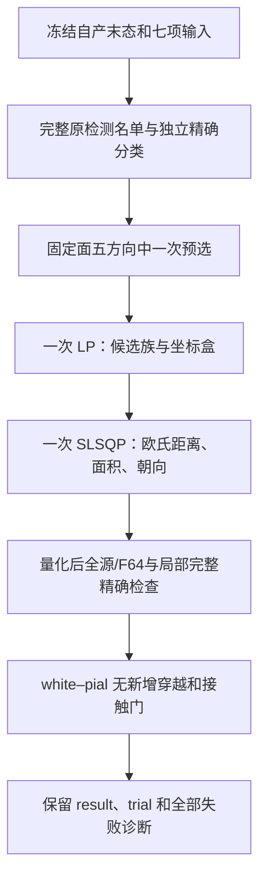

# pial 残余组的单次联合候选

## 1．功能简介

本目录准备一个独立、可选的几何诊断：把相互关联的可动顶点一起求解，检查单点更新反复被拒绝的残余自相交是否能改善。它没有接入生产默认，也不是原表面放置算法的逐字节重现。

复用现有 NumPy/Numba 相交检测、固定域预检、独立有理数裁剪、white–pial 检查及点到三角面距离函数。新增部分只预选一次固定面的半空间族，运行一次 LP，若可行再运行一次 SLSQP。小规模稠密约束在 CPU 上求解；不调用原版阶段程序，不启用半精度，也不占 GPU。



LP 失败只能说明**预先选定的半空间族在该坐标盒下不可行**，不能证明完整几何问题无解。固定角点在对方固定面平面的两侧时，不强制选择法向分离，仍检查已有外侧边方向。固定角点的精确接触不增加间距要求。1 mm 位移、面积比 0.2、间距 0.002 mm 和 100 次迭代是预定候选约束，不是整例指标等效阈值。

## 2．Python 调用、输入与输出

四个函数位于 [place_surface_residual_joint.py](../../../../src/fnit/recon_all/place_surface_residual_joint.py)。所有坐标使用 **surface RAS，单位 mm**；不改变有序面、顶点编号或标签。输入不修改。

| 参数 | 结构、含义与默认值 |
| --- | --- |
| `vertices` | 有限 `float32 (N,3)`，FNIT 自产 pial 进入本阶段的坐标。 |
| `faces` | 整数 `(F,3)`，与 white/pial 共用的有序三角面，无越界或退化面。 |
| `fixed_vertices` | `bool (N,)`，rip 和 cortex 外顶点；保持进入阶段的坐标，不重新钉到 white。 |
| `white_vertices` | 同网格有限 `(N,3)` 的自产 white，用于独立双表面检查。 |
| `exact_relation` | 独立 IEEE 有理数逐边裁剪函数，返回整数 0 无交会、1 正长度穿越、2 边/点接触、3 共面交会；不能用按距离容差忽略短穿越的函数代替。 |
| `max_displacement_mm` | 正有限数，默认 `1.0`；每个顶点相对进入坐标的欧氏位移上限。 |
| `minimum_area_ratio` | `(0,1]`，默认 `0.2`；每面相对进入几何的面积下限。 |
| `clearance_mm` | 正有限数，默认 `0.002`；仅为选定半空间中的可动角点设置。 |
| `optimizer_iterations` | 正整数，默认 `100`；单次 SLSQP 上限，不多种子重试。 |

`resolve_joint_residual_intersections()` 返回 `(result, trial, report)`：`result` 为 `float32 (N,3)`；拒绝候选时严格等于进入坐标。有限候选始终作为 `trial` 保留，即使拒绝；无候选时为 `None`。`report` 包含全部方向选择、固定角点精确符号、LP/SLSQP 状态和耗时、源/F64 名单、局部精确类别、位移 max/P99、面积、朝向、接受条件和原有 white–pial 穿越。`failed_residual` 不当作质量通过。

完整接受条件：所有固定元素的 `uint32` 视图身份不变（包括 +0/-0）；只改变残余组可动顶点；位移、面积及原法向点积达门；源/F64 **配对集合严格缩小**；不增加受影响区域的精确穿越、共面正面积或精确接触；不增加 white–pial 穿越或非固定精确接触。产生有限 trial 时，初态存在的 white–pial 穿越仍单独报告，不能把“没有新增”称为“末态全部为零”；无 trial 时相关门为 `null`，明确未测。两个表面的同编号面对仍须检查。

```python
from pathlib import Path
import numpy as np
from nibabel import freesurfer
from fnit.recon_all.place_surface_residual_joint import resolve_joint_residual_intersections
from tools.audit_pial_fixed_crossings_exact import checked_fixed_domain
from tools.audit_white_pial_crossing_exact import exact_clip_relation

subject_directory = Path("frozen-own-inputs/subject")  # 冻结自产七项输入目录
terminal_path = Path("frozen-own-inputs/cleanup-result.private.npy")  # 自产末态，不读参考坐标
white_vertices, ordered_faces = freesurfer.read_geometry(str(subject_directory / "surf/lh.white"))
white_vertices, ordered_faces, cortex_mask, rip_mask, fixed_mask = checked_fixed_domain(
    white_vertices=white_vertices,  # white 的 surface RAS 坐标
    faces=ordered_faces,  # 原有序面
    cortex_indices=freesurfer.read_label(str(subject_directory / "label/lh.cortex.label")),  # cortex 顶点
    hipamyg_indices=freesurfer.read_label(str(subject_directory / "label/lh.cortex+hipamyg.label")),  # 未 rip 域
)
result_vertices, trial_vertices, diagnosis = resolve_joint_residual_intersections(
    vertices=np.load(terminal_path),  # 原有限 float32 末态
    faces=ordered_faces,  # 同索引网格
    fixed_vertices=fixed_mask,  # rip 与 cortex 外固定域
    white_vertices=white_vertices,  # 自产 white，独立双表面检查
    exact_relation=exact_clip_relation,  # 独立有理数分类
    max_displacement_mm=1.0,  # 预定欧氏位移上限，mm
    minimum_area_ratio=0.2,  # 预定单面面积下限
    clearance_mm=0.002,  # 可动角点半空间间距，mm
    optimizer_iterations=100,  # 仅一次优化器调用
)
```

其它三个接口：

| 函数 | 额外输入与完整返回 |
| --- | --- |
| `exact_affected_self_pairs(vertices, faces, query_faces, exact_relation)` | `query_faces` 为有效一维整数面编号；返回正长度穿越 set、共面正面积 set、所有精确阳性 set、类别与计时 dict。原 IEEE 角点直接 min/max，inclusive bbox 枚举受影响面与**全网格**的面对，不排除共享编号；仅去同一面及重复 unordered pair。未变面无需重算，位于双方局部 bbox 外的面对不可能相交。该门不声称所有未变全图的已有相交均经过精确审查。 |
| `build_fixed_face_family(vertices, faces, fixed_vertices, pairs, clearance_mm=0.002)` | `pairs` 是完整、升序、唯一的 `(face_a,face_b)` tuple 列表，限单连通残余组；返回可动编号 `int (V,)`、所有入射面 `int (A,)`、`float64 (C,3V)` 线性矩阵、`float64 (C,)` 右端和完整方向诊断。 |
| `solve_joint_family(vertices, faces, active, affected, matrix, rhs, max_displacement_mm=1.0, minimum_area_ratio=0.2, optimizer_iterations=100)` | `active` 和 `affected` 是有域、升序、无重复的一维整数，后者必须恰好覆盖所有入射面；返回有限量化 trial 或 None 及优化器报告。LP 用辅助绝对值变量最小化 L1 位移，SLSQP 再最小化平方欧氏位移。 |

非法 shape/dtype/索引、非有限或退化几何、名单不完整/重复、多连通组、初始非 proper 名单及未知精确分类会抛 `ValueError`。缺文件、已有输出目录、冻结 SHA 或资源不符、输入运行中改变和写出几何不符明确失败。初始没有源/F64 相交时返回未改输入及限定该检测范围的状态，不宣称全图物理质量通过。

## 3．命令行与可复现冻结

完整诊断入口为 [benchmark_recon_pial_joint_projection.py](../../../../tools/benchmark_recon_pial_joint_projection.py)。10 个 Path 参数均必填：

| 参数 | 输入或输出 |
| --- | --- |
| `installed_directory` | 冻结安装包及声明依赖；不读取 dirty 工作树。 |
| `overlay_directory` | 冻结的 joint、cleanup、projection、white crossing 四模块；逐一校验协议 SHA。 |
| `diagnostic_case` | `subject` 七项输入及 `cleanup-result.private.npy`，空间如上。 |
| `input_hashes` | [input_hashes.json](input_hashes.json)，七项相对名→SHA-256。 |
| `protocol` | [protocol.json](protocol.json)，参数、来源 SHA、35 点组、40 个完整面对及四核预算。 |
| `exact_report` | 先前独立精确审计的完整 entry 40 对名单；只用于确认自产进入网格和 proper 类别。 |
| `preflight_source` | 冻结的 `audit_pial_fixed_crossings_exact.py`，复用完整名单和固定域预检。 |
| `exact_audit_source` | 冻结的 `audit_white_pial_crossing_exact.py`，独立逐边有理数裁剪。 |
| `distance_module` | 已验证并带 SHA 的双向点到三角面函数。 |
| `output_directory` | 须不存在的新私有目录；生成 result NPY/表面、有限 trial NPY/表面、完整 `report.json` 和 `COMPLETE.json`。 |
| `threads` | 默认 `4`，本协议要求 CPU 112–115 且 CUDA 隐藏；实际绑定不符失败。 |

运行前应登记资源并再次确认四核使用情况。下例中的路径均须替换为实际冻结目录；七项数据和源码先校验 SHA。此阶段没有默认生产入口：

```bash
# 四核固定预算；不改变其它任务或整例冻结源码。
CUDA_VISIBLE_DEVICES='' OMP_NUM_THREADS=4 OPENBLAS_NUM_THREADS=4 MKL_NUM_THREADS=4 NUMBA_NUM_THREADS=4 \
taskset -c 112-115 python tools/time_recon_python_benchmark.py \
  --log-path private-run/cold-cli.log \
  --report-path private-run/cold-cli.json \
  -- python tools/benchmark_recon_pial_joint_projection.py \
     --installed-directory frozen-installed \
     --overlay-directory frozen-four-modules \
     --diagnostic-case frozen-own-inputs \
     --input-hashes validation/recon_all/optimizations/20261011_pial_joint_projection/input_hashes.json \
     --protocol validation/recon_all/optimizations/20261011_pial_joint_projection/protocol.json \
     --exact-report frozen-self-audit.safe.json \
     --preflight-source frozen-preflight.py \
     --exact-audit-source frozen-exact-audit.py \
     --distance-module frozen-surface-distance.py \
     --output-directory private-run/candidate \
     --threads 4
```

`run()` 返回完整 dict；冷 CLI 包括进程启动、导入、哈希校验、加载、求解、碰撞检查、距离和写出。内部 resolver、bbox 枚举、exact 分类、white 查询及 LP/SLSQP 时间分别报告；嵌套时间不相加冒充整例。RSS 为进程/子进程 CPU 峰值，**不代表父子同时合计**；显存为 `null`，不伪称测到零。

本目录 `export_joint.export()` 的五个具名 Path 参数分别为 `report_path`、`timer_path`、`complete_path`、`schema_source`、`output`。前四者为本任务完整数值报告、冷 CLI 收据、完成收据和固定 SHA 的成熟 typed schema；输出必须为新公共 JSON。它逐层拒绝未知键、私人字符串、类型/枚举/计数/退出码/来源不合和接受条件矛盾；失败不生成输出，不运行影像，不用字符串替换“脱敏”私有整报告。

```python
from pathlib import Path
from importlib.util import module_from_spec, spec_from_file_location

exporter_path = Path("validation/recon_all/optimizations/20261011_pial_joint_projection/export_joint.py")  # 冻结导出源码
module_spec = spec_from_file_location("joint_export", exporter_path)
exporter = module_from_spec(module_spec)
module_spec.loader.exec_module(exporter)
public_report = exporter.export(
    report_path=Path("private-run/candidate/report.json"),  # 完整数值和枚举，无私人路径
    timer_path=Path("private-run/cold-cli.json"),  # 外层冷进程计时
    complete_path=Path("private-run/candidate/COMPLETE.json"),  # 原始输出与报告 SHA 绑定
    schema_source=Path("validation/recon_all/optimizations/20261011_white_pial_crossing/export_qc.py"),  # 已冻结公共 schema
    output=Path("new-public-joint.safe.json"),  # 新文件，不能覆盖
)
```

## 4．对应原软件步骤

本联合求解是新增独立诊断，**没有等价的原软件独立 CLI**。它位于完整 pial 放置后的残余质量检查位置；原源码对应 `mris_place_surface` 的 pial 分支和碰撞/最终清理内部步骤，已有固定输入参考命令见 [Python pial 说明](../../../../docs/recon_all/PYTHON_PIAL_PLACEMENT.md)。本候选不调用该程序，也不读其结果挑选方向、参数或步长。

此前同七输入原程序两次与自有完整 pial 末态一致但仍有残余的证据保持原 SHA 与原网格；不能将它当作本候选正确性的证明，也不能代表当前新原始 T1/GA 整例。

## 5．当前验证、精度和耗时

**本目录目前仅完成本地数学、API 和 typed 导出合同；真实联合候选待主任务审核协议后运行。** 未测 GPU、整例提速、右半球/第二例、脑区指标等效，也没有本候选脑图可发布。

此前冻结自产 entry 的独立精确审计已在其原报告确认：源有 80 directed/F64 有 40 unordered 配对，40 对均为 proper，单组 35 点含 20 固定和 15 可动。旧单点候选只接受 1/1846 次，残余 40→38；完整固定子结构小门没有发现固定 face–edge/edge–edge 障碍。后者仅限检查范围，不能证明联合可行。这些是**旧版本、旧网格的实测起点**，见 [原报告目录](../20261011_white_pial_crossing/README.md)；本目录未重标旧结果。

新的 exact 局部门已在小几何中证明：共享顶点编号的真穿越不会被跳过；共享边接触与共面正面积分开；极短的正长度穿越保持；受影响 bbox 枚举与独立完整小网格逐面对裁剪一致。SLSQP 的面积、朝向和位移约束 Jacobian 用独立中心有限差分检查；LP 失败不进入 SLSQP；拒绝时 result 保持进入值，trial 和失败原因保留。typed exporter fixtures 的元数据专为 schema 合同构造，**不是 MRI 结果**。

实际本地通过数、墙钟、源码 SHA 和 XML 绑定见 [LOCAL_CHECKS.json](LOCAL_CHECKS.json)。真实阶段将另外发布初态/trial/result 的源/F64/精确名单、全部 max/P99、局部异常和脑图；不通过时也保留完整收据与私有候选。当前 `overall_metric_equivalence="not_assessed"`。

## 6．版本与 benchmark 记录

| 版本 | 范围与证据 |
| --- | --- |
| 既有残余单点/自由平面候选 | 原冷 CLI、失败候选、40/38 exact 与固定子结构证据保留在原目录，不修改。 |
| 当前 independent joint v1 | 一次预选族→LP→SLSQP；新增完整受影响区域 exact 门；固定/未变域改用位模式比较，故障注入确认浮点相等但符号零变化仍拒绝；协议在实验前冻结，不根据结果放宽。 |
| 当前导出合同 | 完整 producer 与冷 CLI/完成收据 typed 校验；保留接受与拒绝、无 trial 分支，white/pial 同编号 pair 合法，self unordered pair 必须不同且升序。仅本地 fixture 合同。 |

本次版本/复用源绑定见 [SOURCE_MANIFEST.json](SOURCE_MANIFEST.json)；输入绑定见 [input_hashes.json](input_hashes.json)，资源只读观察见 [RESOURCE_CHECK.json](RESOURCE_CHECK.json)。CPU 短采样显示共享负载，不代表预留核或稳定吞吐。未启动真实候选前不填写其精度、耗时、成功或加速。

## 7．参考文献与代码

- [FreeSurfer 固定源码仓库](https://github.com/freesurfer/freesurfer)：`mris_place_surface` / `utils/mrisurf_deform.cpp`，只用于独立参考。
- Dale AM, Fischl B, Sereno MI. Cortical surface-based analysis. I. Segmentation and surface reconstruction. *NeuroImage* 1999;9:179–194.
- Kraft D. A software package for sequential quadratic programming. DLR-FB 88-28, 1988；本候选通过已声明 SciPy 的 SLSQP 接口调用。
- [SciPy linprog / SLSQP 实现](https://github.com/scipy/scipy/tree/main/scipy/optimize)：通用 Python 依赖及其内部编译库允许使用，不等于运行原版脑影像阶段程序。没有新增安装依赖。
