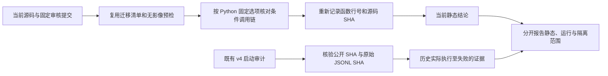

# recon-all Python 配方调用链审计（2026-10-11）

## 1. 功能简介

本页核对当前 `backend="python"` 的实际条件调用链，重点检查是否仍间接执行原版 FreeSurfer 阶段程序或加载其专用计算库。复用 [426c68ec 的清单采集器](../20261010_batch_python_profile_prevalidation/collect_prevalidation.py)，没有再实现一套迁移清单。当前 24 组步骤和 76 条函数引用逐项重新读取源码、行号和 SHA-256；历史报告只复用结构。

审核提交为 `bee263f93d1842b44ede5ecf3c791af11613f8ce`，实际采集时 HEAD 为 `f18c43e97409299cd0ef5ba03aa75c6aea393839`。本轮只更正 `native_free.py`、`batch.py` 中过时的 WM 路径搜索说明：不可达证明失败时已执行完整搜索，不能继续写成无条件拒绝。两文件去掉说明字符串后的运行 AST 与审核提交完全相同，未改变算法、默认值或运行分支。



## 2. Python 调用、输入与输出

```python
from pathlib import Path
import importlib.util

repository_directory = Path("/path/to/Fudan-Neuroimaging-toolkit")
audit_script_path = repository_directory / "validation/recon_all/optimizations/20261011_python_call_chain_audit/audit_call_chain.py"
module_specification = importlib.util.spec_from_file_location("fnit_call_chain_audit", audit_script_path)
audit_module = importlib.util.module_from_spec(module_specification)
module_specification.loader.exec_module(audit_module)

# 新目录：已有报告不能被覆盖；该调用不读取 T1、不加载模型、不创建 CUDA context。
new_report_directory = Path("/path/to/new_call_chain_audit")
audit_summary = audit_module.audit(
    repository=repository_directory,
    output=new_report_directory,
    reviewed_commit="bee263f93d1842b44ede5ecf3c791af11613f8ce",
)
print(audit_summary)
```

| 参数 | 格式与意义 |
| --- | --- |
| `repository` | `Path`，包含 `src`、`.git` 与既有验证目录的仓库根目录。 |
| `output` | `Path`，必须不存在的新报告目录；不覆盖已有结果。 |
| `reviewed_commit` | 可由本仓库 Git 解析的审核提交；用于核对运行 AST 和原始文件 SHA。 |

输入是源码、包版本、既有公开启动事件和校验清单，没有 MRI 数组、官方分割、坐标修补或权重输入。输出无解剖坐标或物理单位；行号为一基索引，文件大小为字节，SHA 为文件或函数实际 UTF-8 字节的 SHA-256。

| 输出 | 内容 |
| --- | --- |
| `current_inventory.json` | 14 项原版程序条件调用、当前默认和完整 Python 配方、包版本、源码哈希及验收缺口。 |
| `call_chain.json` | 24 组当前调用链、76 条实际函数引用、未选择的 C++ 分支、138 项声明输出、文档 AST 比较和历史事件绑定。 |
| `preflight.json` | 两种此前被 batch 过早拒绝的合法选项进行空任务预检的实际收据；没有 MRI batch 实跑。 |

缺文件或函数、原 SHA 或事件数不一致、当前运行 AST 改变、CUDA 被预检初始化时明确失败。工具包含手工条件分支审核，不是形式化可达性证明，也不记录系统动态库或全部文件访问。

## 3. 命令行调用

```bash
# 使用项目已安装的 Python 和依赖；输出路径需为新目录。
PYTHONPATH=src python \
  validation/recon_all/optimizations/20261011_python_call_chain_audit/audit_call_chain.py \
  --repository . \
  --output /path/to/new_call_chain_audit \
  --reviewed-commit bee263f93d1842b44ede5ecf3c791af11613f8ce
```

三个具名参数与 Python 调用相同，均必填。`reviewed_commit` 同时用于 docstring 之外的 AST 一致性检查：未来算法有意改变时，应审核新的基线，不能把旧提交重新标为当前版本。

## 4. 对应原软件调用

本工具是 FNIT 调用链审计，没有对应的 FreeSurfer 命令。下表记录当前 `backend="native"` 混合对照分支仍可能执行的独立源码构建程序及已有自有替代；不是本次实际执行程序的日志。

| 阶段 | 原版程序与选择条件 | Python 配方的实际替代 |
| --- | --- | --- |
| N4 | `fnit_n4_itk`，`n4_backend=native` | SimpleITK 完整 N4；另有显式完整 Torch N4。 |
| WM segmentation | `mri_segment`，`wm_backend=native` | Torch 直方图、缓存平面及有序 CPU 规则，独立 Python worker。 |
| WM/aseg 编辑 | `mri_edit_wm_with_aseg`，`wm_edit_backend=native` | 完整 Python/Numba 编辑和 typed/byte 路径搜索。 |
| 拓扑修复 | `mris_fix_topology_fnit`，`topology_backend=native` | 当前配方仍是数字拓扑；独立完整源语义 GA 尚未接入该配方。 |
| nofix inflate | `mris_inflate`，`surface_placement_backend=native` | 自有完整标准 nofix inflation。只设置 `inflate_backend=torch` 不替换此步。 |
| 标准 inflate | `mris_inflate`，`inflate_backend=native` | 自有完整 Torch inflation 与 sulc。 |
| white.preaparc | `mris_place_surface`，`surface_placement_backend=native` | 自有完整 Python/Numba 放置。 |
| final white/pial | `mris_place_surface`，同上；可选原版快速 white | 自有完整放置、动态碰撞和清理。 |
| avg_curv | `mrisp_paint`，同上 | 自有图谱采样和有序平均。 |
| 曲率统计 | `mris_curvature_stats`，同上 | 自有完整文本统计及八张派生图。 |
| defects 投射 | `mri_label2vol`，`defects_backend=native` | 自有 Torch 投射，左清零、右累积。 |
| GCA | `mri_em_register`，CPU auto 或 `native_optimizations=original` | CUDA auto 已用自有 Torch 评分与 Python EM；配方为隔离 worker、Torch 求逆、chunk 1024。 |
| 顶点指标 | `mris_place_surface`，非 CUDA 且非 `python_only` | CUDA 默认及 Python 配方使用自有厚度、面积和曲率。 |
| MNI 后处理 | `mri_warp_convert`、`mri_ca_register`、`mri_convert`，非 CUDA 分支 | 自有 GPU warp、求逆与检查，晚期 Python worker 并行。 |

14 行是调用条件清单，不是 14 个互异程序，更不是 CUDA 默认实际运行次数。具体函数、行号、SHA 和参数保存在机器报告。

## 5. 当前结论与真实执行范围

### 当前条件调用链

Python 配方的 21 项设置使上述原版调用均不被选择。没有发现曲率、defects、ROI 统计或球面平均器的间接原版程序调用：

- `_run_curvature_stats` 的 `python_only` 分支执行自有 Python/Numba；`source_libm` 是自有 Numba 的浮点数学语义名称，不是 FreeSurfer 专用共享库。
- `_run_defects_volume` 的 Torch 分支提前返回；保留双侧共享 `surface.defects.mgz` 的顺序。ROI 统计消费同表面版本的 `SurfaceStatsCache`，脑区 `-no-th3` 定义没有改成 TH3 顶点体积。
- 两次球面注册明确传 CUDA 平均设备，消费自有 Triton 平均器；惰性编译/`ctypes` 的原版 CPU 平均器分支未被选择。Synth 的 CPU Eigen/列卷积分支同样不被 CUDA 配方选择。
- SimpleITK、NumPy、Numba、PyTorch、Triton 等通用库内部编译计算符合当前边界。Python worker 的 `sys.executable -m` 是自有进程隔离，不是原版阶段命令。
- 两轮 normalize 均显式传 `device=device`；有序 ridge/反馈仍有 CPU 工作。CA normalize 调用未传设备，保持自有 CPU 默认。CPU 实现本身不是迁移缺口。

`expected_outputs.paths()` 当前声明 **138 个互异路径**。完整性检查在 mesh/MNI join 后判断存在及缺失；存在不等于数值、标签或网格质量通过。本轮没有执行新影像流程，也没有验证当前版本实际生成全部 138 项。

### 历史 v4 启动审计：只证明已执行至失败的路径

| 实际版本与样本 | 状态 | 事件数 | 被阻止的原版阶段尝试 |
| --- | --- | ---: | ---: |
| 冻结 v4，sub06 | `failed`，`register_hemisphere_group` | 839（8 个启动事件、831 个进程事件） | 0 |
| 冻结 v4，sub07 | `failed`，`finish_surface_hemisphere_group` | 10940（12 个启动事件、10928 个进程事件） | 0 |

历史生产代码为 `922f569806bfdfafb9ba16355ae9660efd261eba` 加冻结 manifest `21bfe987f5f2cfde992578208d8235b1ed90ad2c4608c95df1b0f4c6751b9d9a`。20 个公开事件文件逐项验证公开 SHA、导出原 SHA、原 JSONL SHA 与事件数。这些失败运行不是 bee 当前版本实跑，也不能证明未到达的末尾统计步骤已执行。

当前运行审计、共享库加载审计、完整文件访问审计及干净环境/OS 隔离均**未验证**。严格复现、优化是否引入退化和整体指标等效不能由静态审计判断；整体保持 `not_assessed`。本任务没有新的耗时、精度、显存测量；无需生成无影像依据的脑图。实际包版本和 `CUDA initialized before/after=False` 保留在报告中。

### 下一优先级

优先将现有自有完整源语义 GA 接到生产，并验证连续全部缺陷修复和终态网格质量。当前数字拓扑与原版 GA 是不同算法；独立 GA 的函数存在不等于 CLI 配方已接入或原始 T1 整例通过。既有 sphere 翻折、pial 自相交及 N4 传播差异继续保留。WM 两例完整编辑已解码零差、十例均未触发 active 搜索；真实 active 分支仍未验证，不能将合同测试升级为真实分支通过。

## 6. 更新与 benchmark 记录

| 版本 | 本次复用或修改 | 范围 |
| --- | --- | --- |
| `426c68ec` | batch Python 预检修复和现行原版阶段清单 | 本轮重新调用 collector；两个空任务预检通过，没有影像 batch 运行。 |
| `ebc52dda` | 完整 typed/byte WM remove-paths 实现 | 两例冻结同输入 CPU/混合/独立参考解码零差；十例无 active。见 [WM_REMOVE_PATHS](../../../../docs/recon_all/WM_REMOVE_PATHS.md)。 |
| `bee263f9` 审核、`f18c43e9` 采集 | 当前 24 组条件链和 76 条引用；仅更正两文件 WM 说明 | 当前静态审核及历史失败收据绑定；没有新影像 benchmark。 |

历史 [v4 完整终态收据](../20261010_python_profile/README.md) 和 [v4 静态结构](../20261010_python_profile_static/README.md) 保持原版本；本轮没有覆盖其源码或结果。`PUBLICATION_MANIFEST.json` 将公开报告与实际提交文件字节绑定，原始 SHA 与公开 SHA 不互相替代。

## 7. 原实现与参考文献

- [FNIT 仓库](https://github.com/weikanggong1/Fudan-Neuroimaging-toolkit)；[recon-all 公共调用说明](../../../../docs/recon_all/README.md)。
- [FreeSurfer 固定源码](https://github.com/freesurfer/freesurfer/tree/d932c45)，原版程序仅作为独立 benchmark；不发布其源码、库或参考影像。
- [FreeSurfer recon-all 官方说明](https://surfer.nmr.mgh.harvard.edu/fswiki/recon-all)。
- Dale AM, Fischl B, Sereno MI. Cortical surface-based analysis. I. Segmentation and surface reconstruction. *NeuroImage* 1999.
- Tustison NJ et al. N4ITK: improved N3 bias correction. *IEEE Transactions on Medical Imaging* 2010. [SimpleITK](https://simpleitk.org/) 的完整 N4 是通用 Python API，与原版阶段程序调用分开核对。
