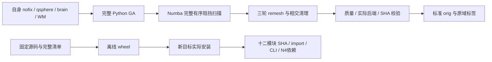

# 完整 Python GA 配方：有序扫描接入与实际安装

## 1. 功能简介

完整 Python GA 配方显式使用自有 Numba 有序阻挡扫描。它保留全部扫描域、首阻挡顺序、动态邻接更新和原谓词，不启用 fastmath。标准表面发布前核对实际后端、完成状态、质量、报告和文件 SHA；返回 Python 后端或缺少后端记录均失败。

底层文件 API 仍默认 Python 扫描，供同输入参考。Numba 和通用 Python 依赖没有运行原 FreeSurfer 阶段程序。这个改动接入完整算法，不通过删步骤或近似网格缩短运行。



这里的安装验证没有运行 GA、模型或 MRI。完整 GA 的真实同输入回归、生产前段回归和原始 T1 整例分别报告。

## 2. Python 调用、全部输入与输出

生产 Python 调用见 [GA 配方](../../../../docs/recon_all/PYTHON_GENETIC_PROFILE.md)，无需用户额外指定扫描参数。独立文件 API 的 `blocker_scan_backend` 默认 `"python"`，可显式选择 `"numba"`，其余完整输入、参数和算法失败条件见 [有序扫描说明](../../../../docs/recon_all/TOPOLOGY_ORDERED_BLOCKER_SCAN.md)。

本次修改的内部 `_run_and_publish_genetic_topology()` 由生产调度调用。`subject: Path` 是自身被试目录；`hemi: str` 仅为 `lh/rh`；`threads: int` 是当前半球预算；`remesh_scalar_storage: str` 为已验证的 `numpy/python` 存储策略，四者均必填。输入是该被试的 nofix、qsphere、brain、WM；表面为 surface RAS/mm，MRI 为 conformed 网格。返回发布收据字典，含实际后端、线程、质量、相对路径及 SHA；写出真实 `H.orig.premesh`、原始顶点域 `H.defect_labels`、`H.orig` 和 `H.topology.genetic.publish.json`。算法、质量、后端或收据失败时抛异常，标准文件不发布。

```python
from pathlib import Path
from verify_recon_genetic_profile_install import verify

installation_report = verify(
    source_directory=Path("/data/frozen-source"),  # 含固定 pyproject、许可证和 src
    source_manifest=Path("/data/SOURCE_MANIFEST.json"),  # 相对路径、大小、SHA 和版本
    output_directory=Path("/data/new-install-check"),  # 须不存在、位于源码目录之外
    python_executable=Path("/conda/envs/fnit/bin/python"),  # 已安装主页依赖的解释器
)
```

`verify()` 的四个参数均为必填 `Path`。它核对清单、离线构建、安装到新目标、执行真实 import 与两个 fresh CLI help。返回并写 `report.json`：Git 基底、源码 overlay、清单 SHA、wheel 大小/SHA、十二个模块的 source/wheel/installed SHA、build/install/entry 秒数、依赖版本、实际导入精度标志及 CLI 收据。中间产物保留在输出目录；私有日志只记录该次安装。没有影像输出、坐标单位或 GPU 计算。已有输出、路径越界、源码变化、wheel 或安装来源不符、缺少 N4 依赖及子进程失败均抛异常。

服务器复核的 `verify_wheel.py` 接受必填 `--workspace`、`--run-directory`（`Path`）。前者包含 wheel、expected.json 和入口脚本；后者必须不存在。返回无 Python 值，成功写 report/COMPLETE，失败非零退出。它实际安装并验证十二文件，不下载依赖，不改旧环境。

```python
from export_installation import export_installation

public_installation = export_installation(
    run_directory=Path("/data/completed-install"),  # 含实际 report 与 COMPLETE
    expected_report=Path("/data/local-installation.json"),  # 同冻结源码和 wheel 的本地结果
    output_file=Path("/data/new-public-installation.json"),  # 须不存在的新 JSON
)
```

导出器三参数均必填，返回并保存 `report` 与原报告 SHA。逐项核对完成收据、十二模块、21项配方、实际依赖与精度状态、CLI；只输出这些已声明字段和计时，GPU 未测保持 `null`。时间单位秒，文件大小为字节。校验或输出冲突抛异常；不导出原日志、路径或影像。`installation.json` 为本地实测，`accelerator-b_installation.json` 为服务器安全字段，二者不是 MRI benchmark。

v2 导出器把固定合同写入代码：双方必须包含相同顺序的十二个唯一模块、六个声明的源码 overlay、21 项精确配方及两个指定 CLI。模块、wheel、N4、精度和 CLI 均拒绝未知键；校验完整 SHA、整数与 bool 类型，退出码必须是真正的整数 0，不能用 `False` 代替。重复 JSON 键、非有限计时、缺失模块、空 CLI 或不明源码路径在写出公共结果前失败。

## 3. 命令行调用与复现

```bash
installation_arguments=(
  --source-directory /data/frozen-source         # 与清单相同的源码
  --source-manifest /data/SOURCE_MANIFEST.json   # 本次完整源码清单
  --output-directory /data/new-install-check    # 新输出目录
  --python-executable /conda/envs/fnit/bin/python # 已有主页依赖
)
python tools/verify_recon_genetic_profile_install.py "${installation_arguments[@]}"

python verify_wheel.py \
  --workspace /data/frozen-wheel-workspace \
  --run-directory /data/new-server-install

python export_installation.py \
  --run-directory /data/completed-server-install \
  --expected-report /data/local-installation.json \
  --output-file /data/new-public-installation.json
```

v2 schema 合同可单独运行：`PYTHONDONTWRITEBYTECODE=1 python test_export_installation.py -v`。测试只重编码已发布安装元数据，验证正常输出和错误拒绝，不运行 MRI、模型、扫描核或安装。实际服务器导出另有独立收据，不能把合同夹具当成真实安装验证。

源码冻结使用 Git 基底 `c2293890dad4bc3b697d06848aa1bad40f441137`，显式覆盖清单中的六份运行源码，共1465文件。完整内容见 [SOURCE_MANIFEST.json](SOURCE_MANIFEST.json)，SHA `47090ab1419cafcab4f2d3c3fb0542e27aadadafd40ad43dc8536f81709ae21d`。复现时从 Git 恢复这些文件并逐项校验清单；不能把整个可变工作区复制成科学输入。未纳入他人的 retessellation 修改；该文件使用 Git 版本 SHA `4b20a92f9ec1c4f1cc728a26b1fabbae3817497e50f238fdc2fb73e309b42de0`。

新 wheel 为5,292,385字节，SHA `ef654b830c2e5b34afa0589cb8bf45287ba9a02a59f0c73a699516365bbf6a43`。安装器使用 `--no-deps --no-index`，不构成从零创建 Conda 的验收；当前 SimpleITK 和 Numba 已在主页环境声明，本改动没有新增依赖。独立依赖目标和运行中的环境均保持原位置。

## 4. 对应原软件

完整算法对应隔离 benchmark 的 `mris_fix_topology -ga`、三轮 `mris_remesh` 和 `mris_remove_intersection`。命令与固定参数见 GA 配方和扫描说明。内部扫描核、生产收据校验、wheel 安装及 schema 导出没有独立原软件 CLI。

生产只读取原始 T1、自产中间结果和声明资产。官方结果仅属于参考验证，不进入这个文件接口或发布函数。

## 5. 真实数据回归、时间与资源

| 范围 | 实际结果 | 比较边界 |
| --- | --- | --- |
| 第四缺陷，同输入完整候选 | 暖闭环6.779169→3.825242秒；72状态字段和2,656,862次谓词顺序相同 | 单候选；非整例 |
| 首缺陷完整 GA | 495搜索评分＋最终评分，80字段/三检查点/29轮控制相同；API1252.549→1349.788秒 | 共享窗口未观察到完整阶段提速；只捕获随机调用数，不声称逐次随机值相同 |
| 实际库入口六评分 | 81字段/四检查点、20,877次随机 bounds/value 顺序相同；搜索收尾39.564→39.261秒，冷CLI118.402→119.883秒 | 非默认全部搜索；未观察到CLI提速 |
| 当前原始T1前段对旧Python实际前段 | 14张实际MRI数组、dtype、几何及LTA相同；全部Dice=1 | 优化未增加此前前段数值误差；不是官方或整例等效 |
| 发布合同 | 9测试、23子测试，15.90秒；缺失/错误实际扫描后端被拒绝 | 小文件夹具，不是MRI |
| 本地构建 / 安装 / 入口 | 2.242129 / 0.763629 / 7.154812秒；十二模块三处SHA相同 | 实际新wheel安装，无MRI/GPU |
| 本地两个fresh CLI | 1.825254 / 2.290494秒 | 包含导入，无算法运行 |
| accelerator-b安装 / 入口 / 合计 | 2.567623 / 15.022903 / 17.598017秒；十二模块三处SHA相同 | 现有依赖、一个CPU核、CUDA不可见 |
| accelerator-b两个fresh CLI | 2.698571 / 3.243573秒 | 完整help进程，非重建时间 |

v2 已对上述完成安装的同一原报告在服务器实际导出，退出码为 0。原报告 SHA 仍为 `e1df7751face944909c2b9031d3e43d51c9078ecfe6af323f63c0c326a61aae9`，公共 JSON 保持 8,564 字节及 SHA `ac09aed915fbc5a3e57533f3ec16b6d08c7d163aae00b274e386f36a9a61f258`，与 v1 逐字节相同；不是只验证元数据夹具。此次仅重导出已完成安装报告，没有重新安装或执行重建，也没有测导出耗时或 GPU。现场结果由父任务的工具观察，见 [V2_ACTUAL_EXPORT.json](V2_ACTUAL_EXPORT.json)。

真实阶段的完整数值与脑图见[第四候选](../20261011_topology_ordered_blocker_scan/README.md)、[首缺陷](../20261011_topology_genetic_blocker_scan/README.md)、[直接库入口](../20261011_topology_genetic_blocker_wiring/README.md)。当前前段读入、全量比较和文件SHA诊断见[实际前段回归](../20261011_python_ga_volume_prefix/README.md)；其14图数组相同，但仅8图文件字节相同，原因未定位。

安装前后 CUDA 未初始化，TF32 标志保持调用者原值；不据导入测试宣称实际GPU前向。N4依赖为SimpleITK2.5.6/ITK5.4，实际扩展库SHA `c25cd8cf7053c8224c246744e1f1bc9af12db0c95a8221b27e9546cc4511b62c`。服务器仅核100、一个线程；本地线程未重设，详见收据。显存、干净环境隔离和原始T1完整运行在本安装测试中未评估。

新有序扫描安装产物尚未完成从原始T1的整例。本版已于UTC 2026-10-10 21:35:26从同一原始sub06和新空目录启动，A100 GPU1/逻辑cuda:0、核104–107/总4线程，复用已验证的NVML依赖；协议与实际启动分别见[raw_v3_launch_protocol.json](raw_v3_launch_protocol.json)和[raw_v3_launch_start.json](raw_v3_launch_start.json)。新任务未恢复旧运行，也不读取官方结果。现有另一冻结产物的原始T1 GA整例仍在运行，不能改标为本wheel验证。本轮完整九缺陷、最终网格质量、138严格复现、整体指标等效和实际整例加速尚未通过，600秒目标未达到。

## 6. 版本与证据记录

- 核心扫描提交 `1828ba7578971ad670e8168943fb8e1d93a97f90`；真实测试先绑定源SHA，不用提交时间替换实测版本。
- 源码与实际安装对应 [installation.json](installation.json)、[accelerator-b_installation.json](accelerator-b_installation.json)；服务器原报告SHA `e1df7751face944909c2b9031d3e43d51c9078ecfe6af323f63c0c326a61aae9`。
- [contracts.json](contracts.json)、[contracts.xml](contracts.xml)保留调用和错误发布门回归；JUnit本体15.877秒，pytest完整报告15.90秒。
- [early_setup_failure.json](early_setup_failure.json)记录冻结完成前请求验证脚本的失败；[export_preflight_failure.json](export_preflight_failure.json)记录错误预期导出哈希。二者均在科学计算前停止，原结果未改写；修正后安装/导出独立保留。
- 公共输出和导出器SHA见 [EXPORT_RECEIPT.json](EXPORT_RECEIPT.json)，全部交付文件见 `PUBLIC_MANIFEST.json`。旧冻源运行继续使用原文件，不原地更新。
- v1 原导出器、8,564 字节公共产物和原导出收据原样保留在 [frozen/v1](frozen/v1)，不重标为 v2。v2 源码 SHA 为 `532f0355df5782013f2e66ff2c53c2c85e3743c50ef534b85c6cf36cf3608795`；当前导出收据绑定 v2 的服务器实际执行，同时保留 v1/v2 公共字节相同的结果。
- [SCHEMA_CONTRACTS_V2.json](SCHEMA_CONTRACTS_V2.json) 记录六个函数测试、23 个错误拒绝案例和一个正常元数据夹具。正常夹具在 v1/v2 的序列化逐字节相同，所有错误案例无输出；这是 schema 合同测试，服务器实际导出证据单独记录。

## 7. 原实现与参考文献

- [FNIT recon-all](https://github.com/weikanggong1/Fudan-Neuroimaging-toolkit/tree/main/src/fnit/recon_all)。
- [固定FreeSurfer拓扑源码](https://github.com/freesurfer/freesurfer/blob/d932c45b7941662ea380a05efef580568b98d41a/utils/mrisurf_defect.cpp)。
- Fischl、Liu与Dale，Automated manifold surgery: constructing geometrically accurate and topologically correct models of the human cerebral cortex，IEEE TMI，2001，20:70–80，[原论文](https://surfer.nmr.mgh.harvard.edu/pub/articles/fischl01-topology-fixing.pdf)，[DOI](https://doi.org/10.1109/42.906426)。
- [Numba](https://github.com/numba/numba)；[SimpleITK N4](https://simpleitk.org/doxygen/latest/html/classitk_1_1simple_1_1N4BiasFieldCorrectionImageFilter.html)。
