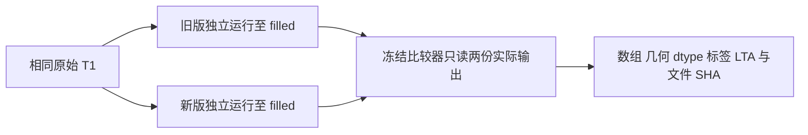

# 新版纯 Python 配方的真实前段回归

## 1. 功能简介

本次复用冻结比较器，核对公开 ds000114 `sub-06/ses-test` 的两次 FNIT 自产连续链。旧版使用 Python 有序拓扑扫描；新版接入 NumBa 有序扫描并加载 NVML。双方从同一原始 T1 开始，在实际生成 filled 后比较 14 张 MRI 和 Talairach LTA，没有重跑、修补或复制参考影像。



**前段回归通过；整例未完成。** 两份整例在比较时均为 `running`。安全导出器保留既有模板描述，具体运行状态以上述字段为准；这里没有完成的官方对照，也没有整体指标等效结论。此显式 Python 配方声明无原版阶段程序，SimpleITK 属于通用 Python 库；本次实际仅验证到 filled，整例运行时隔离尚未验收。

## 2. Python 调用、输入和输出

复用 [compare_actual_prefix.py](../20261011_python_ga_volume_prefix/compare_actual_prefix.py) 的 `compare_actual_prefix`，全部参数均具名。

| 参数 | 格式与意义 |
| --- | --- |
| `installed_target` | `Path`；实际已独立安装的 FNIT 包，不是工作区源码 |
| `private_dependency` | `Path`；已有 SimpleITK 私有安装目录，保持原环境 prefix |
| `comparator` | `Path`；冻结 `evaluate_recon_volume_prefix.py` |
| `expected_comparator_sha256` | 64 位十六进制；本次为 `5c261463…`，运行前检查完整 SHA |
| `baseline_benchmark` | `Path`；旧整例原样 benchmark 收据，允许整例仍运行或之后失败，但必须实际完成 filled |
| `candidate_benchmark` | `Path`；新版原样 benchmark 收据，同样必须实际完成 filled |
| `expected_input_sha256` | 64 位十六进制原始 T1 SHA；本次为 `7e33afb…` |
| `output_directory` | `Path`；必须不存在的新诊断目录，不能是生产输出目录 |
| `threads` | 整数，默认 4；此冻结诊断要求四个 CPU 核且隐藏 CUDA |

```python
from pathlib import Path
from compare_actual_prefix import compare_actual_prefix

fnit_root = Path("FNIT")  # 已授权环境中的 FNIT 固定工作根目录
receipt = compare_actual_prefix(
    installed_target=fnit_root / "runs/python_genetic_blocker_install_20261011_v1/installed",  # 新版实际安装包
    private_dependency=fnit_root / "workspaces/n4_runtime_dependency_20261011_v1/dependencies",  # 已有通用库
    comparator=fnit_root / "workspaces/recon_python_ga_prefix_compare_20261011_v2/source/evaluate_recon_volume_prefix.py",  # 冻结比较器
    expected_comparator_sha256="5c2614639f624c82a597fdd93aa03f64016aabb42eb4948dd315564cbcf077b5",  # 拒绝源码漂移
    baseline_benchmark=fnit_root / "runs/recon_python_ga_whole_20261011_v2/benchmark.json",  # 实际旧运行收据
    candidate_benchmark=fnit_root / "runs/recon_python_ga_whole_20261011_v3/benchmark.json",  # 实际新运行收据
    expected_input_sha256="7e33afb28f631fac31d81e2428a6144f61aba4102859c694eeb49ee584de04f7",  # 相同公开原始输入
    output_directory=fnit_root / "runs/prefix_replay/diagnostic",  # 新目录，拒绝覆盖
    threads=4,  # 与启动环境及亲和性相同
)
```

运行前需从冻结脚本目录导入函数，并设置四线程、四核亲和性和 `CUDA_VISIBLE_DEVICES=''`。返回执行摘要；私有输出为 `direct.private.json`、`execution.private.json` 及四份原样 producer/runtime 快照。失败抛异常，不更改生产。比较前后及最终检查 30 个 MRI/LTA 文件 SHA，防止读取过程中数据改变。

本页 [metrics.json](metrics.json) 是独立白名单导出：`volumes` 为 14 个文件名到数值/几何/dtype/标签结果的字典，`talairach_lta` 含两个 4×4 VOX_TO_VOX 矩阵，`diagnostic` 为计时及资源字段，另含源码、输入和原收据 SHA。`rawavg` 位于原始导入网格，其余 MRI 在自产 conform 网格；强度是存储值，没有物理单位；标签 Dice 无量纲；不进行诊断重采样。

### MGZ 字节差异定位

[inspect_encoding.py](encoding/inspect_encoding.py) 只读相同两份实际前段。`compare(baseline_subject=..., candidate_subject=...)` 的两个参数为 `Path` 被试目录，均须包含上述 14 张 MRI；没有缺省路径。单文件 `inspect(subject_directory=..., filename=...)` 另接受相对 `mri/` 的文件名。输入为 3D MGZ，须含完整 20 字节扫描参数，支持普通长度标签及 FNIT 已有的旧 CTAB version 2；其他格式、截断标签或读取中变化明确报错，不改写影像。

```python
from pathlib import Path
from inspect_encoding import compare

fnit_root = Path("FNIT")  # 实际固定工作根目录；先将本页 encoding/ 加入导入路径
encoding_report = compare(
    baseline_subject=fnit_root / "runs/recon_python_ga_whole_20261011_v2/subject",  # 实际旧输出
    candidate_subject=fnit_root / "runs/recon_python_ga_whole_20261011_v3/subject",  # 实际新输出
)
```

返回 `volumes[文件名]`，包含压缩文件与解压数据 SHA、头/体素/扫描参数/标签四区段的字节数和 SHA、标签 ID/长度/SHA、来源是否与自己的实际路径完全相符。没有返回影像数组、路径或标签文本；坐标和标签不改变，长度以字节计。来源一致仅判定字节差异原因，不判定算法或整体指标等效。另返回诊断函数秒数、库版本、亲和性、RSS 和输入未改变标志。

## 3. 命令行调用

冷 CLI 同时使用 [冻结计时器](../../../../tools/time_recon_python_benchmark.py)，包含进程启动、依赖导入、哈希、加载、比较及文件写出。本次亲和性为 96–99。

```bash
# 将固定根目录改为自己实际使用的 FNIT 路径
fnit_root="/path/to/FNIT"
source_directory="$fnit_root/workspaces/recon_python_ga_prefix_compare_20261011_v2/source"  # 冻结的三个脚本
python_executable="$fnit_root/envs/recon_main_20261009_v3/bin/python"  # 实际验证环境
installed_target="$fnit_root/runs/python_genetic_blocker_install_20261011_v1/installed"  # 新版安装包
private_dependency="$fnit_root/workspaces/n4_runtime_dependency_20261011_v1/dependencies"  # 已有依赖
comparator="$source_directory/evaluate_recon_volume_prefix.py"  # 冻结比较器
baseline_benchmark="$fnit_root/runs/recon_python_ga_whole_20261011_v2/benchmark.json"  # 旧运行
candidate_benchmark="$fnit_root/runs/recon_python_ga_whole_20261011_v3/benchmark.json"  # 新运行
comparison_directory="$fnit_root/runs/prefix_replay"  # 必须是新目录
output_directory="$comparison_directory/diagnostic"  # runner 创建，不预先补数据
test ! -e "$comparison_directory" || exit 1
mkdir -- "$comparison_directory"

# 四核只读比较；隐藏 CUDA；外层计时器包含冷启动及最终文件写出
CUDA_VISIBLE_DEVICES='' OMP_NUM_THREADS=4 MKL_NUM_THREADS=4 \
OPENBLAS_NUM_THREADS=4 NUMBA_NUM_THREADS=4 \
taskset -c 96-99 "$python_executable" "$source_directory/time_recon_python_benchmark.py" \
  --log-path "$comparison_directory/driver.private.log" \
  --report-path "$comparison_directory/cli.private.json" -- \
  "$python_executable" "$source_directory/compare_actual_prefix.py" \
  --installed-target "$installed_target" \
  --private-dependency "$private_dependency" \
  --comparator "$comparator" \
  --expected-comparator-sha256 5c2614639f624c82a597fdd93aa03f64016aabb42eb4948dd315564cbcf077b5 \
  --baseline-benchmark "$baseline_benchmark" \
  --candidate-benchmark "$candidate_benchmark" \
  --expected-input-sha256 7e33afb28f631fac31d81e2428a6144f61aba4102859c694eeb49ee584de04f7 \
  --output-directory "$output_directory" --threads 4
```

安全发布复用 `tools/export_recon_genetic_prefix.py --validation-kind actual-prefix`，五个输入为前段报告、执行收据、冷 CLI 收据、全新公共输出目录及原始输入 SHA。必须一并提供同版本 `export_recon_gca_receipts.py`；它只使用该模块的 `numeric_leaves` 校验数值及类型。未传出私人原收据、路径、影像或日志。

编码诊断的 CLI 使用本页脚本，不重跑 MRI 算法；`--output` 为父目录已存在、文件尚不存在的新 JSON。实际四核、四线程环境与前段比较相同。

```bash
# 指定两份实际自产被试及全新数值报告；不将任何输出写回生产目录
CUDA_VISIBLE_DEVICES='' OMP_NUM_THREADS=4 MKL_NUM_THREADS=4 OPENBLAS_NUM_THREADS=4 \
taskset -c 96-99 python encoding/inspect_encoding.py \
  --baseline-subject FNIT/runs/recon_python_ga_whole_20261011_v2/subject \
  --candidate-subject FNIT/runs/recon_python_ga_whole_20261011_v3/subject \
  --output diagnostic/encoding.json
```

## 4. 原软件调用

本比较器是 FNIT 验证工具，没有独立 FreeSurfer CLI。此任务比较两份 FNIT 实际前段，不新增官方参考。`mri_em_register`、`mri_segment` 等阶段名称表示流程语义，当前显式 Python 配方使用自有实现。官方参考必须在隔离 benchmark 路径生成，不能作为生产中间输入；已有对官方误差仍见 [前次实际前段报告](../20261011_python_ga_volume_prefix/README.md)。

## 5. 实际精度、耗时和资源

| 实际输出 | 不同体素数 | 数组、dtype、affine、tkr、zooms 全同 |
| --- | ---: | --- |
| `rawavg.mgz` | 0 | 是 |
| `orig.mgz` | 0 | 是 |
| `tmp/nu0.mgz` | 0 | 是 |
| `nu.mgz` | 0 | 是 |
| `T1.mgz` | 0 | 是 |
| `brainmask.mgz` | 0 | 是 |
| `synthseg.rca.mgz` | 0 | 是 |
| `norm.mgz` | 0 | 是 |
| `brain.mgz` | 0 | 是 |
| `aseg.presurf.mgz` | 0 | 是 |
| `wm.seg.mgz` | 0 | 是 |
| `wm.asegedit.mgz` | 0 | 是 |
| `wm.mgz` | 0 | 是 |
| `filled.mgz` | 0 | 是 |

14 张 MRI 均有限；最大和 P99 误差均为 0，filled 各标签 Dice 和 WM 非零前景 Dice 均为 1。LTA 16 个元素与文件 SHA 相同。MRI 文件 SHA 只有 8/14 相同，不能把解码数组相同写成所有文件逐字节相同。

后续[实际编码诊断](encoding/metrics.public.json)确认全部 14 份 MGH 头、体素字节和扫描参数完全相同。`orig`、`nu0`、`nu`、`T1`、`brainmask` 的差异只在 TAG 31：两份文件各自记录本被试实际 `talairach.xfm` 路径；`filled` 的差异只在 TAG 3：各自的 FNIT fill 输入/输出来源路径。CTAB 与其余标签相同，两个标签的实际内容均通过各自路径的完整匹配，未输出路径文本。14 个输入文件 SHA 与前次冻结报告一致且读取中未变化；**生产文件没有归一化或重写**，严格文件 SHA 结果仍保留 8/14。本次没有新增表面叠加图，表面尚待完整运行。

| 同输入诊断 | 实测值 |
| --- | ---: |
| 比较函数墙钟，含报告准备 | 45.957593388 s |
| 冷 CLI，含加载、读写与退出 | 46.107064885 s |
| 子进程高水位 RSS | 1045917696 字节 |
| GPU 计算 | 无；GPU 显存为 null |

这不是整例耗时。新版整例在 [阶段快照](STAGE_SNAPSHOT.public.json) 中仍运行，已记录 CLI 部分墙钟 1231.179 秒；N4 为 187.710691 秒。新旧运行在同一共享环境、相同四线程预算，但 GPU 编号、CPU 亲和性和运行时段不同，不能从单次时间推断整例提速。

编码诊断函数实测 7.604675 秒，包含两份 14 图的读取、解压、标签解析和前后哈希，不含冷进程导入及最终 JSON 写出，不能当作 CLI 或整例墙钟。RSS 高水位 204312576 字节，CPU 96–99，隐藏 CUDA；实际 Python 3.11.16、nibabel 5.4.2、zlib 1.3.2，没有 GPU 计算。[完成收据](encoding/COMPLETE.public.json)为 EXIT 0；编码结果绑定原两份运行与独立诊断器 SHA `61cbe180…`。

新版 NVML 快照共 2412 个样本、失败 0 次，最大观测间隔 0.793823 秒；整卡采样峰值 14461173760 字节。父子进程归属无法可信映射，tree peak 为 null。compute-process 总和与整卡峰值查询口径、时刻不同，不相加，也不保证连续低于 20,000,000,000 字节。allocated/reserved、整例最终资源与 OS 隔离验收未在本任务完成。

## 6. 版本、失败和验收边界

- 实际候选基于 `c2293890…` 加六个明确源码覆盖，完整 1,465 文件清单 SHA `47090ab…`、wheel SHA `ef654b…`。有序扫描接入随后提交为 `c668f4c2…`；没有把之后工作分支 HEAD 写成已经运行的整例版本。
- 比较器、runner、timer 和 exporter 完整 SHA 见 [SOURCE_BINDINGS.json](SOURCE_BINDINGS.json)，原数据/生产收据 SHA 见 metrics。公共文件保持服务器导出原字节，见 [完成收据](COMPLETE.public.json)。
- 第一次发布脚本仅复制主模块，因缺少同版本 `export_recon_gca_receipts` 导入失败（EXIT 1）。[失败收据](EXPORT_FAILURE.public.json) 保留实际类型、行号和哈希。补齐已有冻结辅助模块后导出 EXIT 0，未重跑或改写比较数据。
- 编码诊断 v1 将旧 CTAB 当普通长度标签，退出 1；保留[失败收据](encoding/FAILURE.public.json)和[原脚本](encoding/frozen/inspect_encoding_v1.py)。v2 按项目现有 writer 的完整 version 2 格式解析后从新目录退出 0，不改变生产文件或省略 CTAB。小格式手动断言另见 [LOCAL_CHECKS.json](encoding/LOCAL_CHECKS.json)，不替代实际影像诊断。
- 严格前段回归：通过；优化新增前段退化：本次未见；输出完整性、网格质量、white/pial、最终脑区指标及整体等效：待整例完成。10 分钟目标尚未达到。

## 7. 来源与参考

- [Python 配方及安装边界](../../../../docs/recon_all/PYTHON_GENETIC_PROFILE.md)；[有序扫描与实际安装](../20261011_python_ga_blocker_route/README.md)。
- [真实前段比较器](../../../../tools/evaluate_recon_volume_prefix.py)、[类型化发布器](../../../../tools/export_recon_genetic_prefix.py)、[同输入 runner](../20261011_python_ga_volume_prefix/compare_actual_prefix.py)。原软件来源与文献沿用各计算阶段说明，不编造验证工具的等价 CLI。
- [NVML 查询与 PID 归属](../20261011_gpu_pid_namespace_nvml/README.md)。本次只读对照、冻结同输入阶段、自产整例和官方比较分别报告。
