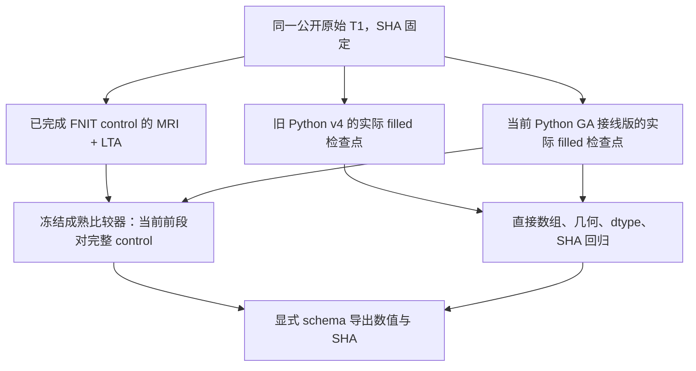

# Python GA 接线版的原始 T1 前段回归

## 1．功能与范围

本页记录公开 ds000114 的 sub-06、ses-test 单 T1 的两次只读诊断。第一项把当前自产前段与已经整例完成、退出码为 0 的 FNIT control 比较；第二项直接读取旧 Python v4 和当前版的实际前段影像，检查这次更新是否引入数据或空间退化。两项均重新读取真实 MRI 和 LTA，没有重跑、修改或补齐生产文件。

旧 Python v4 原始 T1 整例最终失败，退出码为 1，但实际连续完成了 filled。它只用于第二项前段回归，不被当成第一项的完整 control。当前原始 T1 整例在收据捕获时仍在运行。本页没有新的整例完成、官方等效或整例提速结论。



诊断不执行 GA；GA 位于 filled 之后。此次前段首差不能归因于 GA，也不能预先归因于编译器、线程、舍入或随机性。

## 2．Python 调用、输入和输出

下面的路径变量由操作者指向已授权的本地数据与冻结安装目录。公开收据没有服务器地址或私有绝对路径。

```python
from pathlib import Path
from run_prefix_regression import run
from compare_actual_prefix import compare_actual_prefix

control_receipt = run(
    installed_target=installed_target,  # 固定安装目录，不使用可变工作区源码
    private_dependency=private_dependency,  # 已安装的 SimpleITK 依赖目录
    comparator=comparator,  # 已冻结的 evaluate_recon_volume_prefix.py
    reference_benchmark=reference_benchmark,  # 同 T1、完整完成且 exit 0 的 FNIT control
    candidate_benchmark=candidate_benchmark,  # 当前自产连续链的 benchmark.json
    expected_input_sha256=input_sha256,  # 原始 T1 的完整 SHA-256
    output_directory=control_output_directory,  # 已存在且为空的诊断目录
    threads=4,  # 本次固定四核预算；同时隐藏 CUDA
)

direct_receipt = compare_actual_prefix(
    installed_target=installed_target,  # 同一固定安装产物
    private_dependency=private_dependency,  # 同一声明的 Python 依赖
    comparator=comparator,  # 仅复用成熟的体积、Dice 和 LTA 读取函数
    expected_comparator_sha256=comparator_sha256,  # 比较器完整 SHA-256
    baseline_benchmark=baseline_benchmark,  # 旧 Python 实际 filled 检查点，后续整例失败
    candidate_benchmark=candidate_benchmark,  # 当前实际 filled 检查点
    expected_input_sha256=input_sha256,  # 两边必须来自同一原始 T1
    output_directory=direct_output_directory,  # 新目录，必须尚不存在
    threads=4,  # 限定四核，拒绝 CUDA 可见或预算不符的调用
)
```

两函数的全部参数均为具名参数。路径参数类型为 `pathlib.Path`；两个 SHA 为 64 字符小写十六进制 `str`；`threads` 为 `int`，默认 4，本次接口只接受 4。基准收据旁必须存在 `subject/fnit-native-free-run.json`、`subject/mri/` 的 14 个文件及 `subject/mri/transforms/talairach.lta`。输入清单或已完成检查点不符、依赖目录缺失、安装来源不符、输出目录冲突、影像读取期间变化时抛异常；不自动修补生产目录。

| 文件 | 数据结构与语义 |
|---|---|
| `rawavg.mgz` | `[256,156,256]`、`>f4`，原始导入网格的强度 |
| `orig.mgz`、`tmp/nu0.mgz`、`nu.mgz`、`T1.mgz`、`brainmask.mgz`、`norm.mgz`、`brain.mgz` | `[256,256,256]`、`uint8`，各自产出的 conform 网格强度；brainmask 同时保留其强度语义 |
| `synthseg.rca.mgz`、`aseg.presurf.mgz` | `[256,256,256]`、`>f4`，存储离散标签；按标签 ID 计算 Dice |
| `wm.seg.mgz`、`wm.asegedit.mgz`、`wm.mgz` | `[256,256,256]`、`uint8`，严格比较所有存储值，另按非零前景计算 Dice |
| `filled.mgz` | `[256,256,256]`、`uint8`，标签 0、127、255 分别比较 |
| `talairach.lta` | 完整 `4×4`、`VOX_TO_VOX` 矩阵；不重采样后再比较 |

强度单位是文件的存储强度，无物理单位；affine 与 `vox2ras_tkr` 的坐标长度单位为 mm，LTA 输入输出为体素坐标。不同网格不会被当成同空间影像强行比较。

返回值和机器可读输出：

- `run()` 返回诊断执行收据 `dict`，保存 `prefix.private.json`、`execution.private.json` 和三份原样生产 JSON 快照。
- `compare_actual_prefix()` 返回执行收据 `dict`，保存 `direct.private.json`、`execution.private.json` 和双方 producer/runtime 共四份原样快照。全部 MRI/LTA 校验读前、读后及诊断完成时的 SHA。
- `metrics.json` 是第一项的安全数值导出；`direct/metrics.json` 是第二项。每文件保留 shape/dtype、严格不同体素数、最大/P95/P99/平均绝对误差、几何差异、输入 SHA，标签图保留逐标签体素数与 Dice；LTA 保留两套全部 16 元素。没有标签值 Pearson 相关性。
- `EXPORT_RECEIPT.json` 与 `direct/EXPORT_RECEIPT.json` 绑定原诊断报告、导出器和安全产物 SHA，验证数字、bool、null 的类型和值经序列化保持。

两种导出的完整 Python 接口如下，全部参数必填、类型同上，输出目录必须不存在：

```python
from export_recon_genetic_prefix import export_metrics, export_direct_regression

control_export = export_metrics(
    prefix_report=control_prefix_report,  # 第一项私有诊断 JSON
    execution_receipt=control_execution_receipt,  # 第一项诊断执行收据
    cli_timing_receipt=control_cli_receipt,  # 冷进程包含完整读写的墙钟收据
    output_directory=control_public_directory,  # 新公共数值目录
    expected_input_sha256=input_sha256,  # 校验同一原始 T1
)
direct_export = export_direct_regression(
    prefix_report=direct_prefix_report,  # 第二项私有诊断 JSON
    execution_receipt=direct_execution_receipt,  # 第二项诊断执行收据
    cli_timing_receipt=direct_cli_receipt,  # 第二项完整冷进程收据
    output_directory=direct_public_directory,  # 新公共数值目录
    expected_input_sha256=input_sha256,  # 校验双方实际 filled 的原始输入
)
```

导出器逐字段验证原样快照 SHA、版本、输入、完成门和固定 schema。陌生版本字符串只保留其 SHA；原生产路径、日志、地址、GPU UUID、影像及许可证不导出。任何校验失败抛异常，不通过字符串替换掩盖内容。

历史公开收据另由 `compare_published_receipts()` 对照，参数全部必填：

```python
from compare_published_receipts import compare_published_receipts

historical_receipt_comparison = compare_published_receipts(
    historical_report=historical_report,  # 旧版已发布前段 JSON，保留旧报告身份
    current_report=current_public_report,  # 本次第一项公共数值 JSON
    historical_whole_receipt=historical_whole_receipt,  # 旧整例 failed/1 的终态证据
    historical_exit_receipt=historical_exit_receipt,  # 旧版真实退出码证据
    expected_input_sha256=input_sha256,  # 同原始公开 T1
    output=historical_comparison_output,  # 尚不存在的新 JSON 文件
)
```

该函数不读取影像，只输出逐文件 SHA、shape/dtype 与保留聚合指标是否一致。聚合指标相同不被解释为数组相同；真实数组结论来自第二项。

## 3．命令行复现

先冻结安装产物、比较器、脚本和输入 SHA，再指定一组空闲四核。环境变量只设置本次诊断，不改变生产精度。以下变量由操作者填写；本页不提供私有地址或存储路径。

```bash
export CUDA_VISIBLE_DEVICES=''  # 本只读诊断不执行 GPU 算法
export OMP_NUM_THREADS=4 OPENBLAS_NUM_THREADS=4 MKL_NUM_THREADS=4
export NUMBA_NUM_THREADS=4 ITK_GLOBAL_DEFAULT_NUMBER_OF_THREADS=4
export PYTHONPATH="$FNIT_INSTALLED_TARGET:$FNIT_PRIVATE_DEPENDENCY"

taskset -c "$FNIT_DIAGNOSTIC_CPUS" "$FNIT_PYTHON" run_prefix_regression.py \
  --installed-target "$FNIT_INSTALLED_TARGET" \
  --private-dependency "$FNIT_PRIVATE_DEPENDENCY" \
  --comparator "$FNIT_FROZEN_COMPARATOR" \
  --reference-benchmark "$FNIT_COMPLETE_CONTROL" \
  --candidate-benchmark "$FNIT_CURRENT_CANDIDATE" \
  --expected-input-sha256 "$FNIT_T1_SHA256" \
  --output-directory "$FNIT_NEW_CONTROL_DIAGNOSTIC" \
  --threads 4

taskset -c "$FNIT_DIAGNOSTIC_CPUS" "$FNIT_PYTHON" compare_actual_prefix.py \
  --installed-target "$FNIT_INSTALLED_TARGET" \
  --private-dependency "$FNIT_PRIVATE_DEPENDENCY" \
  --comparator "$FNIT_FROZEN_COMPARATOR" \
  --expected-comparator-sha256 "$FNIT_COMPARATOR_SHA256" \
  --baseline-benchmark "$FNIT_OLD_PYTHON_CANDIDATE" \
  --candidate-benchmark "$FNIT_CURRENT_CANDIDATE" \
  --expected-input-sha256 "$FNIT_T1_SHA256" \
  --output-directory "$FNIT_NEW_DIRECT_DIAGNOSTIC" \
  --threads 4
```

`FNIT_DIAGNOSTIC_CPUS` 指向四个现场确认未被其他绑定任务占用的核。复用仓库 `tools/time_recon_python_benchmark.py` 的 `--log-path`、`--report-path`、`--` 子命令包装以上调用，才能得到包含冷启动、加载、全部比较及输出写入的 CLI 墙钟。本次 timer 源码 SHA 在收据中，不把函数返回前墙钟当成完整 CLI 时间。

```bash
"$FNIT_PYTHON" tools/export_recon_genetic_prefix.py \
  --prefix-report "$FNIT_DIRECT_REPORT" \
  --execution-receipt "$FNIT_DIRECT_EXECUTION_RECEIPT" \
  --cli-timing-receipt "$FNIT_DIRECT_CLI_RECEIPT" \
  --output-directory "$FNIT_NEW_PUBLIC_DIRECT_DIRECTORY" \
  --expected-input-sha256 "$FNIT_T1_SHA256" \
  --validation-kind actual-prefix
```

`--validation-kind` 默认为 `completed-control`，保持完整 control 门；`actual-prefix` 只接受双方真实 filled、同输入和四份捕获快照，明确允许旧整例后来失败。第一项已实测的 v1 导出器冻源保存在 `frozen/export_recon_genetic_prefix_v1.py`，用 `PYTHONPATH` 增加仓库 `tools` 目录即可复现；它与当前 v2 分开绑定，不把旧收据重新标为 v2。

`compare_published_receipts.py` 的 CLI 对应 Python 接口所有参数：`--historical-report`、`--current-report`、`--historical-whole-receipt`、`--historical-exit-receipt`、`--expected-input-sha256`、`--output`，均必填。本次固定公开路径和生成输出见 `historical_receipt_comparison.json` 的原收据 SHA。

## 4．原软件调用及实现关系

这些比较与导出工具没有独立的 FreeSurfer 等价 CLI，也没有调用官方软件。它们属于 recon-all 产物的诊断步骤。完整生产入口及对应原软件阶段见[recon-all 说明](../../../../docs/recon_all/README.md)，N4 配方与原始源码关系见[SimpleITK N4](../../../../docs/recon_all/N4_SIMPLEITK.md)。

第一项参考来自先前已经完成的 FNIT control，不能写成“本次官方参考重跑”。第二项参考来自旧 Python 自产前段；旧整例失败的原始退出证据仍被保留。两项均没有读取官方结果去选择参数或修补候选。

## 5．本次真实结果、时间与资源

原始 T1 SHA：`7e33afb28f631fac31d81e2428a6144f61aba4102859c694eeb49ee584de04f7`。

当前生产版本：`5d1cdb5ef7e9c50932e63f2361c8640d66ed8384`，实际安装清单 SHA 为 `a403b973b4da16a8a403eeb96e92008935a20404bcd21093004d592a078d6d93`。旧实际 Python 前段版本为 `922f569806bfdfafb9ba16355ae9660efd261eba`，清单 SHA `21bfe987f5f2cfde992578208d8235b1ed90ad2c4608c95df1b0f4c6751b9d9a`。诊断打包时 Git commit 为 `1279dd09f8f7947b52405c2c8a185d3f74a0f47c`，与生产版本分别记录。

成熟比较器本次现场 SHA 为 `5c2614639f624c82a597fdd93aa03f64016aabb42eb4948dd315564cbcf077b5`。完成 control 的原版本字符串不符合公开版本语法，只保留字符串 SHA `3bc6963a562e6fc53749ebc6da9883be7f66922aa4a64dd375e833771061db6f` 和原 producer SHA；不从运行目录名猜实际版本。实际装入的比较依赖模块、运行器、timer、导出器以及原收据 SHA 均在两份公共 `metrics.json` 中。

| MRI | 当前对已完成 FNIT control：不同体素 | 最大绝对误差 | P99 | 当前对旧 Python 实际前段：不同体素 |
|---|---:|---:|---:|---:|
| rawavg | 0 | 0 | 0 | 0 |
| orig | 0 | 0 | 0 | 0 |
| tmp/nu0 | 99 | 1 | 0 | 0 |
| nu | 92 | 3 | 0 | 0 |
| T1 | 1,549 | 8 | 0 | 0 |
| brainmask | 1,103 | 8 | 0 | 0 |
| SynthSeg | 0 | 0 | 0 | 0 |
| norm | 1,563 | 4 | 0 | 0 |
| brain | 13,133 | 16 | 0 | 0 |
| aseg.presurf | 0 | 0 | 0 | 0 |
| wm.seg | 10,162 | 230 | 0 | 0 |
| wm.asegedit | 7,566 | 230 | 0 | 0 |
| wm | 7,583 | 230 | 0 | 0 |
| filled | 485 | 255 | 0 | 0 |

第一项的 14 MRI shape/dtype、affine、vox2ras_tkr 和 zooms 均与 control 相符，LTA 全部 16 元素相同。SynthSeg 的 33 个标签和 aseg.presurf 的 38 个标签 Dice 均为 1。filled 的 Dice 为：标签 0 `0.9999850904678135`，标签 127 `0.9994082886610866`，标签 255 `0.9996443307684982`。WM 非零前景 Dice：wm.seg `0.9986994219653179`，wm.asegedit `0.9994592556488472`，wm `0.9994519672722566`。uint8 WM 值的最大差 230 和 filled 标签值差 255 属于严格存储值诊断，不能当成分割误差的物理距离。

**第二项直接实际回归：14/14 MRI 数组、shape/dtype、affine、vox2ras_tkr、zooms 均严格相同，所有值有限；全部最大/P99 误差为 0，所有标签和 WM 前景 Dice 为 1；LTA 16 元素及文件 SHA 相同。** 所有 30 个输入文件在读取前后及最终检查时 SHA 均稳定。当前前段与旧 Python 自产前段没有新增数据或几何退化。

MRI 文件字节 SHA 仅 8/14 相同。orig、tmp/nu0、nu、T1、brainmask、filled 的文件 SHA 不同，但本次直接读取证明其数组与已检查的几何完全相同；文件字节差的具体原因未定位，不猜测 gzip、header 或写出时间。`historical_receipt_comparison.json` 另保留每文件旧/新 SHA：旧公开报告的保留指标 14/14 相同，且共同 control 文件 SHA 14/14 相同；该聚合证据没有代替第二项的实际读取。

本次 control 对照的首差定位在 `tmp/nu0` 的 N4 输出：99 个体素相差 1。它在当前与旧 Python 前段之间并未新增；原 control 与 SimpleITK 路线的原因仍待专门的同输入浮点诊断。不能因前段回归通过就声称与 control 或官方逐位复现。

| 只读诊断 | 函数墙钟（执行收据写入前） | 完整冷 CLI 墙钟 | 子进程峰值 RSS |
|---|---:|---:|---:|
| 当前前段对完整 FNIT control | 42.951510 s（其中比较与读入 40.092828 s） | 43.150101 s | 1,168,838,656 字节 |
| 当前对旧 Python 实际前段 | 64.096263 s | 64.423770 s | 1,045,676,032 字节 |

两项都是四线程、CPU affinity 112–115 的共享环境观察，CUDA 隐藏；GPU 显存和父子同时占用未测，以 `null` 记录，不能写成 0 显存。这些时间仅含诊断，不是生产前段或整例时间，不计算整例提速。依赖版本为 Python 3.11.16、nibabel 5.4.2、NumPy 1.26.4、Numba 0.67.0、SimpleITK 2.5.6。没有新增依赖，也没有对生产 TF32/FP32 策略作修改。

本任务未做官方重复性、第二例当前版、当前整例终态、GPU 显存预算、干净环境隔离、表面或脑区最终指标验收，也没有生成新的脑图。整体指标等效保留 `not_assessed`。下一步应等待当前原始 T1 整例结束，针对最终实际网格与指标评价；N4 历史差异另按相同输入配方定位，不阻止这项无退化的前段接线回归。

## 6．版本与证据更新记录

- 旧 Python v4 公开前段报告 SHA：`6669313695e37014920f9aa8c7d7d846dcb0798765e1bd7286ad8355ccbeb770`。它记录的是当时的前段，不重标为当前结果；旧终态与退出码 SHA 在历史收据对照 JSON 中。
- 本次完整 FNIT control 前段对照的公共 JSON SHA：`fa38d58b40f639f198ea45fa9cd3c460e8cb6b967f5a7ecb87cb99cb66086307`；v1 导出源码 SHA `bdf78f5e2d4886683bca08eeda25d375f68e1187c2bbf9a55878db5ee57bc9a7`，原冻源保留。
- 本次直接实际前段回归公共 JSON SHA：`d9bff13489d446f951df80dcbd3a66a340833d114c795654f30ee20016c5f172`；v2 导出源码 SHA `192bca4a359affc02d6c49b54f2eb9632f0c910c11a9f9b8e90d67ec78f8ade6`。没有降低数值门或修改完整 control 前置要求。
- `SOURCE_BINDING.json`、`EXPORT_SOURCE_BINDING.json`、`DIRECT_SOURCE_BINDING.json`、`DIRECT_EXPORT_SOURCE_BINDING.json` 区分两次冻结脚本和两次安全导出；私有启动脚本只发布 SHA，具体路径留在授权服务器。`ARTIFACTS.json` 绑定本次全部公开文件大小与 SHA。

两项原样生产快照、完整诊断 JSON、执行及冷 CLI 收据均保留在授权服务器私有任务目录，未下载或发布。这里只有允许的数值、来源哈希和 FNIT 自有复现脚本。生产、旧报告和其他人的修改保持原有状态。

## 7．参考资料与原实现

- [FreeSurfer 固定源码](https://github.com/freesurfer/freesurfer/tree/d932c45b7941662ea380a05efef580568b98d41a)：原 recon-all 及体积前段语义依据；本页未执行原程序。
- [FNIT SimpleITK N4 配方与验证](../../../../docs/recon_all/N4_SIMPLEITK.md)、[N4 当前整例诊断](../../../../docs/recon_all/N4_WHOLE_DIAGNOSTICS_20261010.md)：与本任务独立的 N4 算法和历史误差证据。
- [ITK N4 源码](https://github.com/InsightSoftwareConsortium/ITK/blob/v5.4.0/Modules/Filtering/BiasCorrection/include/itkN4BiasFieldCorrectionImageFilter.hxx)；Tustison 等，N4ITK: Improved N3 Bias Correction，IEEE TMI，2010，[DOI](https://doi.org/10.1109/TMI.2010.2046908)。
- [公开 ds000114](https://openneuro.org/datasets/ds000114)：本例原始 T1 的来源，输入身份以 SHA 为准。
- [成熟前段比较器](../../../../tools/evaluate_recon_volume_prefix.py)、[安全导出器](../../../../tools/export_recon_genetic_prefix.py)、[冷 CLI 计时器](../../../../tools/time_recon_python_benchmark.py)。
