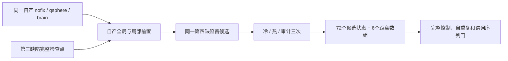

# 第四拓扑候选的距离区间并行回归

## 1．功能与范围

本目录比较原串行距离核、新距离核的串行及 2/4 线程模式，并独立评估候选控制器的一次预检复用。只重放自身第三缺陷完整检查点后的第四缺陷首候选，不继续完整遗传搜索，不启动原版程序，不代表原始 T1 整例。



五组依次运行，每组为新的 Python 进程。诊断包装器只在该进程临时替换 `topology_patch_fitness.defect_signed_distance`，实际记录 `global_function_replacement=True`，结束时恢复函数及 Numba 线程 mask。生产默认不变，GA 候选之间仍然串行。

## 2．Python、输入与输出

脚本入口为 `diagnose_distance_slabs.parent(protocol_path=...)`。调用者先准备私有 JSON 协议和不可变源码目录；以下变量指向本机已授权位置。

```python
from pathlib import Path
from diagnose_distance_slabs import parent

parent(
    protocol_path=Path(private_protocol_path),  # 私有 JSON；绑定冻结源码、输入哈希和四核预算
)
```

| 协议字段 | 格式、含义与限制 |
| --- | --- |
| `source_directory` | 冻结 Python 源码根目录，含 `original`、`candidate`、`root_cycle` 三个变体和 manifest。 |
| `source_manifest_sha256` | manifest 文件的 SHA-256；每个源码文件的大小与 SHA 逐一校验。 |
| `diagnostic_driver_sha256` | 实际 driver 的 SHA-256，阻止未绑定脚本混入。 |
| `distance_source_sha256` | 三个变体实际距离模块 SHA，按变体名映射。 |
| `candidate_cycle_source_sha256` | 三个变体实际候选控制器 SHA，按变体名映射。 |
| `fourth_tool_sha256` | 冻结的既有第四候选工具 SHA；不改它的 freeze 或 flags。 |
| `inputs.input_surface` | 同一自产 `orig.nofix`，FreeSurfer 表面格式；surface RAS 坐标，mm。 |
| `inputs.input_qsphere` | 同一自产 quick sphere，须与 nofix 有相同顶点对应和有序面。 |
| `inputs.brain` | 同链 `brain` 体积，nibabel 可读；MRI 几何来自头信息。 |
| `inputs.state_checkpoint` | 第三缺陷完整持久状态的无 pickle NPZ，保留坐标、容量、K/E/fx/curvbak/rip 等字段。 |
| `inputs.producer_progress` | 已冻结的自产 progress JSONL，核对第三缺陷编号与检查点 SHA。 |
| `expected_checkpoint_sha256` | 实际完整检查点 SHA，不能用参考结果补状态。 |
| `output_directory` | 必须不存在的私有新目录；已有目录报错。 |
| `threads`、`cpu_affinity` | 本协议固定为总4线程、CPU 80–83；CUDA 隐藏，各数学库共用该预算。 |
| `expected_cycle_field_count` | 预设72，另加6个距离数组；不因结果变化缩减字段。 |
| `expected_predicate_calls`、`expected_predicate_sequence_sha256` | 第三次审计预设的完整调用数与顺序 SHA，前两次普通计时不启用审计。 |

距离返回数组为 float32/mm 的局部 XYZ `distance_mm`、有序面 bbox/坐标、边邻面、伪法向顶点索引及伪法向，定义见[距离功能页](../../../../docs/recon_all/TOPOLOGY_SIGNED_DISTANCE.md)。每次调用按当前候选坐标重算；不跨候选复用几何。未处理距离保留1000哨兵。

输出私有目录保留五组 cold/warm/audit 候选 NPZ、完整持久状态 NPZ、六项距离 NPZ、控制记录、完整机器报告、进程退出和完成收据。每次比较都核 shape、dtype、bytes 与完整控制。任何源码/检查点不匹配、随机消费、状态差异、线程恢复失败或子进程失败都抛异常并保留失败记录；失败不能称完成。

`export_distance_slabs.export(input_run=..., frozen_source=..., output_directory=...)` 仅在全部门通过后创建新的 `metrics.json` 和 `EXPORT_RECEIPT.json`。它按固定类型选择数字、布尔值、空值、受控枚举及 SHA，不复制任意文本、路径、命令、日志、原始 JSON、影像或 NPZ。`export_cycle_timings.export(input_run=..., output_directory=...)` 从同一已完成报告另选固定四项 cycle 与五项 candidate 秒数，生成 `CYCLE_TIMERS.json` 和独立收据；不重新运行或修改原记录。

## 3．命令行与复现

先从 Git `5def77e6ffce6e32c6b4c8e67df3750b4cc677f4` 生成仅 Python 的源码冻结。`original` 保持该版本；`candidate` 只替换距离模块；`root_cycle` 只替换候选控制器。由调用者私有生成协议中的实际路径和 manifest，不将服务器路径放入公开报告。

```bash
# 五组顺序运行；协议固定四核，环境统一数学库/Numba总预算并隐藏CUDA。
CUDA_VISIBLE_DEVICES="" OMP_NUM_THREADS=4 OPENBLAS_NUM_THREADS=4 \
MKL_NUM_THREADS=4 NUMBA_NUM_THREADS=4 \
python diagnose_distance_slabs.py --protocol private_protocol.json

# 必须等严格对照和退出收据完成，再导出有限类型的公开结果。
python export_distance_slabs.py \
  --input-run private_result \
  --frozen-source frozen_source_triplet \
  --output-directory new_public_metrics

# 从已经完成的报告补选九项API子时钟；不执行候选。
python export_cycle_timings.py \
  --input-run private_result \
  --output-directory new_public_cycle_timers
```

| 组 | 唯一源码/运行差异 |
| --- | --- |
| `original_serial` | 原距离 `66b84289…`、原控制器 `4ffe4373…`。 |
| `serial` | 新距离 `11c360b0…`，显式 serial；原控制器。 |
| `parallel2` | 同新距离，显式 parallel，距离期间 mask2；外围总预算仍4。 |
| `parallel4` | 同新距离，显式 parallel，mask4；原控制器。 |
| `root_cycle_serial` | 原距离，控制器 `044ae6d1…`；单独衡量预检复用，不与距离优化合并。 |

全部其他源码为同一 Git 冻结，含受保护的 retessellation `4b20a92f…` 和 scanner `33a919df…`。不打包工作区中其他未提交版本。

## 4．原软件对应

距离模块对应固定 FreeSurfer `d932c45b7941662ea380a05efef580568b98d41a` 的 active `new_loop3` 有向距离前置；控制器复用对应候选评分语义。内部步骤没有独立 CLI。本轮没有运行原软件，基线是已经完成冻结同输入验证的 FNIT 串行实现。原软件的冻结单阶段重复证据见[距离功能页](../../../../docs/recon_all/TOPOLOGY_SIGNED_DISTANCE.md)，不把该历史证据改标为本轮原软件实测。

## 5．真实结果与性能边界

五组全部完成，driver、主导出和子时钟导出退出0。[完整指标](reports/v1/metrics.json)及[主收据](reports/v1/EXPORT_RECEIPT.json)绑定源 manifest `a9ffd8c6…`、协议 `dc0180b0…` 和实际载入的63个 FNIT helper。五组×冷/热/审计共15次对照，全部78字段的shape/dtype/bytes与全部控制相同，自重复通过；double fitness均为−119.29359245300293。每组第三次审计均为2,656,862次谓词调用、预设顺序SHA相同、随机消费0。各自独立JIT cache，原始检查点、progress及三张原输入SHA相同。

| 组 | 首次距离 API / s | 暖距离 API / s | 首次完整 cycle / s | 暖完整 cycle / s | fresh CLI / s |
| --- | ---: | ---: | ---: | ---: | ---: |
| 原串行 | 3.677842 | 0.475060 | 19.969540 | 3.772341 | 148.295691 |
| 新串行 | 3.855348 | 0.458801 | 19.148805 | 3.710041 | 144.793849 |
| 新 parallel2 | 3.512684 | 0.223670 | 16.376523 | 3.037098 | 127.196744 |
| 新 parallel4 | 3.941938 | 0.144773 | 18.884122 | 3.152171 | 133.807767 |
| 仅控制器预检复用、原距离 | 3.408127 | 0.447385 | 18.071868 | 3.496588 | 128.591002 |

fresh CLI 包括新进程导入、哈希校验、从原输入自产基底/先验、每次准备、三次候选、JIT、加载、NPZ和控制文件读写，不是单次候选或整例。第三次审计有额外观测成本，不作为普通吞吐。API子时钟见[固定九项报告](reports/v1/CYCLE_TIMERS.json)及[独立收据](reports/v1/CYCLE_TIMERS_EXPORT_RECEIPT.json)，嵌套时钟不与完整API/CLI重复相加。

parallel2 的暖距离约快2.124倍，审计距离同样从0.474701降至0.228715秒；parallel4暖距离约快3.281倍。不过四线程首次距离比原串行慢，不能只报告暖收益。双线程暖完整cycle观察缩短19.49%，但**未修改的retess也从2.092180降至1.842294秒**；仅控制器组未改的retess为1.966245秒。共享负载、频率或JIT时段差异尚未独立分离，不能把完整cycle/CLI的全部差值归因于距离或预检优化，也不声称稳定整例速度比。原生产双侧各worker为2线程，本轮外围总预算4、只在距离期间用mask2；实际生产两线程的显式参数接线和首候选完整门仍待完成。

CPU亲和性80–83、总4线程，NumPy1.26.4、Numba0.67.0、PyTorch2.5.1。五组自身峰值RSS为2,123,362,304–2,143,801,344字节，属于CPU进程内存。CUDA隐藏，前后均未初始化；GPU allocated/reserved为null，不能将其称零显存。执行完成、冻结同输入严格复现和本次状态退化门已通过；最终网格、分区/厚度/面积/体积及原始T1整例均未测，整体指标等效未判定。显式parallel后端尚未接入生产调度，当前整例耗时不变。

源码是Git `5def77e6` 加两项独立overlay，不改标为后来 `HEAD`。主报告SHA `57b9a2ac…`、子时钟 `fd88653c…`；两份收据分别绑定完整私有源报告及实际导出代码。所有MRI、NPZ、完整私有报告和日志留在授权目录，没有公开它们。

## 6．更新记录

- 本地[距离实现合同](DISTANCE_LOCAL_CONTRACTS.json)：原距离合同与新增并行合同共14项、48子项通过（JUnit实际62条，错误/失败/跳过均0）；另7类输入×serial/parallel1/2/4共28组与原源码逐字节通过。
- 第五组控制器的[root本地合同](CYCLE_LOCAL_CONTRACTS.json)：21项、9子项通过，24.33秒（JUnit实际30条、24.31秒，错误/失败/跳过均0），绑定044a源码与三套测试SHA。它是本地实现门，不能替代真实候选或整例。
- 真实协议：同一自产第三缺陷完整检查点，第四缺陷首候选；五组分别冷/热/审计，78完整数组和全部控制逐项比较，不改变随机流或排序。
- 预定审计：2,656,862次谓词调用，序列 SHA `9acfa6711c58ddb952253c078faef6ef05aedea24c5475f82ebd0e9af5ceff87`；随机消费0。
- 状态：五组实际回归及typed导出完成，15个完整78字段对照通过。完整GA、生产参数接线和原始T1整例未改标；生产默认保持serial。
- 初次本地driver语法检查失败的[收据](PREPARATION_FAILURE.json)保留，修复后才上传和运行；没有MRI启动。有限类型导出器[12项负向/3项版本正向检查](EXPORT_CONTRACTS.json)通过。

## 7．原代码与参考文献

[固定原距离及 unMRI 代码](https://github.com/freesurfer/freesurfer/blob/d932c45b7941662ea380a05efef580568b98d41a/utils/mrisurf_defect.cpp)，[固定距离归并代码](https://github.com/freesurfer/freesurfer/blob/d932c45b7941662ea380a05efef580568b98d41a/utils/mrisurf_metricProperties.cpp)。Ségonne F, Pacheco J, Fischl B. IEEE TMI 2007;26:518–529，[DOI](https://doi.org/10.1109/TMI.2006.887364)。不发布原 C++ 文件或二进制。
