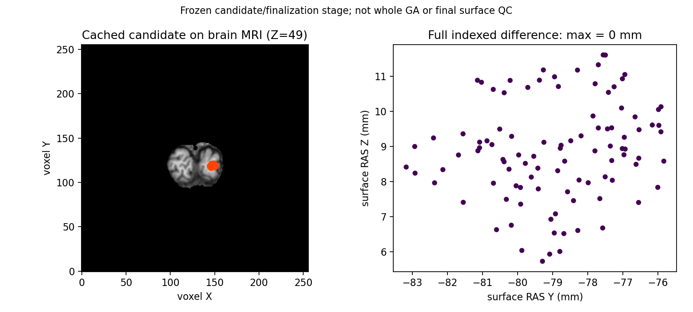

# 保留面索引缓存：完整同输入候选阶段 ABBA

## 1．范围与完成状态

公开 ds000114 sub-07 ses-test 左半球，在既有真实冻结输入上运行完整候选/最终写回，保持全部评分、状态、剔除和有序几何判定。缓存只复用同一保留面身份与边计数；动态邻接和新增面每次独立计算。四次新进程退出0，严格阶段回归通过；生产默认不变，完整GA、最终网格质量、原始T1整例和整体指标等效尚未判定。

## 2．版本、输入和输出

冻源Git基点`c0e8b3db82777606e82cd754297d167e9772479a`；基线`fc78aebfc6db81e2bdee7506bf7ab29aaab398ee`。实际18文件[SOURCE_MANIFEST](reports/SOURCE_MANIFEST.json)的SHA为`7090a7c1b11ec057404bf389fc28bb5d8c75472b72a4b6a34aee0d38df673561`，包含基线6模块、新版7模块、工具与启动脚本哈希。它不包含影像、原软件源码、程序或私人凭据。

输入是完整阶段前重连快照、属性快照、全局先验、自身nofix/qsphere和uint8三维conformed脑MRI；三个阶段后参考仅在自产结果落盘后读取。全部九输入和实际加载模块SHA见[完整公开报告](reports/report.json)。当前顶点110,534、保留面216,722，选中99、新面138；表面坐标为surface/canonical RAS，几何原坐标单位mm，有序面为整数三角索引。

输出为自产完整候选/最终状态NPZ与控制JSON，保留在私有运行目录；此处发布全部162字段矩阵、四次实际秒数、输入/代码哈希及真实派生PNG。公开报告还绑定服务器完整私有报告SHA `dd9c344b19910b1542e69ebe99b0171b567872241e6d519c00480455dd396850`，只导出白名单数值，不复制路径、命令或NPZ内容。[接收回执](reports/export_receipt.json)的全部五文件大小与SHA已本地复核。

## 3．严格回归

相对A1，A1/B1/B2/A2各自产状态字段shape、dtype和字节相同，完整控制相同；每个比较包含162数组字段。每次原版首候选门为`strict_bounded_candidate_pipeline_passed`，自身末态重复门为`bounded_real_finalization_repeat_passed`。它们不是原版完整搜索赢家、全半球或整例通过。

本地20项合同全部通过，JUnit16.767秒、终端观察墙钟16.84秒，见[合同](reports/contracts.json)及[JUnit](reports/contracts.junit.xml)。覆盖完整基底校验、不可变快照、重复面、无面支撑边、当前邻接、顺序、边容量与候选隔离；这些小网格合同不代替真实MRI结果。其他人的未提交retessellation代码保留；实际服务器运行使用清单指定冻结依赖。

绘图另有4项失败条件合同通过，pytest5.74秒，见[记录](reports/plot_contracts.json)：错误brain、非绑定产物、NaN、负索引和越界面在写PNG前拒绝。真实图与上述小fixture合同分别报告。

## 4．实际耗时与资源

| 次序/版本 | 完整CLI秒 | 完整API秒 | 缓存准备秒 |
|---|---:|---:|---:|
| A1，基线 | 92.306609 | 85.766696 | 0 |
| B1，缓存 | 91.439419 | 84.934997 | 0.987594 |
| B2，缓存 | 54.285356 | 48.892885 | 1.064928 |
| A2，基线 | 61.459395 | 56.831254 | 0 |
| 中位数：基线→缓存 | 76.883002→72.862388 | 71.298975→66.913941 | 已计入完整时间 |

本组CLI缩短5.229523%，API缩短6.150207%。每子进程6次完整面发现，B各准备一次。四次父CLI316.963930秒、父API316.187004秒；不与嵌套时间相加。[CSV](stage_seconds.csv)与完整报告保留所有实际调用，包括3.929秒慢调用。

同主机、固定CPU116–119及4线程；运行后探测Xeon Platinum8369B、Python3.11.16、NumPy1.26.4、Numba0.67.0、Torch2.5.1、nibabel5.4.2。子进程最大RSS1,545,524KiB；它不是同一时刻父子合计内存。CUDA隐藏，显存/allocated/reserved均null，不能写成零显存。ABBA期间没有负载连续采样；冷JIT、热缓存和共享主机影响保留，四次不是稳定吞吐证据。不能将本组收益外推495次完整搜索，更不能宣称整例或十分钟目标。

## 5．脑图及复现



实际slice Z=49、±2体素内69个候选顶点；MRI vox2ras_tkr逆将surface RAS/mm转换为voxel XYZ。全110,534对应坐标最大/P99误差0。绘图先绑定四次brain SHA与实际A1/B1位置，核验完整坐标、有序面和选中字段，并拒绝非有限坐标、负/越界索引。该局部阶段图不是完整表面QC。

图数据、实际脚本和报告SHA见[绘图收据](reports/plot_receipt.public.json)及[退出/墙钟](reports/plot_EXIT.json)。真实新版图重跑后PNG与初版相同，脚本不同；各自回执独立，没有重新标记初版结果。完整参数、带具名中文注释的Python示例、CLI及失败行为见[功能页](../../../../docs/recon_all/TOPOLOGY_FACE_DETECTION_CACHE.md)。

```bash
# 在计算环境导出完成的诊断；完整私有记录留在原运行目录。
python tools/export_recon_topology_face_detection_cache.py \
  --run-directory fresh-face-cache-abba \
  --source-manifest frozen-source/SOURCE_MANIFEST.json \
  --plot-directory completed-plot \
  --output new-public-export
```

导出入口要求两个EXIT0、全部四次字段/控制成功、实际图及输入/报告/清单SHA闭合；不满足时抛异常，不生成通过。完整ABBA复现需要同SHA的阶段前输入与冻结模块，不把手动诊断当原始T1连续整例。

## 6．更新与安装

- 完整保留面索引一次准备；新面overlay、源有序几何谓词与每候选邻接不共享。
- 动态入口增加显式默认`None`参数，保持旧生产算法；仅验证工具显式启用。
- 完整状态缓存的另一实验仍比基线慢，见[保留失败记录](../../../../docs/recon_all/TOPOLOGY_CANDIDATE_STATE_CACHE.md)，没有把局部提速写成完整提速。
- NumPy、Numba、nibabel和matplotlib已在主页Conda及pyproject声明，无新增依赖。干净无脑影像软件环境整例安装未验证。
- 本轮正在独立验证完整默认495次评分的长期复用，未完成的项目不改标为成功。

## 7．来源

内部`detectDefectFaces`没有独立官方CLI，属于固定`mris_fix_topology -ga`；原生程序仅在隔离benchmark运行。生产实现使用自有Python整数控制与已有Numba浮点几何谓词。

- [完整功能与源码链接](../../../../docs/recon_all/TOPOLOGY_FACE_DETECTION_CACHE.md)。
- [固定d932拓扑源码](https://github.com/freesurfer/freesurfer/blob/d932c45b7941662ea380a05efef580568b98d41a/utils/mrisurf_defect.cpp)。
- [Fischl等，2001，Automated manifold surgery](https://doi.org/10.1109/42.906426)。
