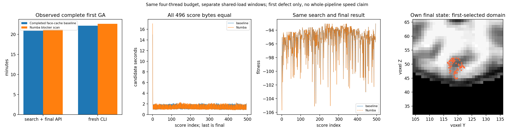

# 完整默认首缺陷有序扫描回归

本组从原始自产nofix、qsphere与brain MRI开始，连续准备base/先验/边/MRI，
执行完整默认首缺陷搜索与最终评分/写回。10个体、max_unchanged10、niters−1、
seed1234、删除规则均不变。两侧均使用已有保留面缓存；新侧只加入Numba
完整首阻挡扫描，没有混入white state_context。

## 1. 范围

这是一个缺陷的完整默认GA，未完成全部九缺陷或recon-all。旧候选/最终winner
只在本次全部产物保存之后读入。初始状态、先验和局部MRI由本链自身输入生成。
诊断工具透明传递一次prepare结果，不将本组aliases当作实际库参数贯通证据。

## 2. 输入与输出

输入是公开ds000114 sub07的自产LH原nofix/qsphere/uint8 brain。矩阵为自身MRI
tkregister RAS→voxel。三个完整NPZ保留first candidate、最终状态与search state；
原件留在服务器。公开metrics只含数值、状态、输入/产物/源SHA和选择的计时。

## 3. 可复现调用

具名完整命令与每个参数见[七节说明](../../../../docs/recon_all/TOPOLOGY_ORDERED_BLOCKER_SCAN.md)。
`benchmark_recon_topology_genetic_blocker_scan.py`默认完整科学协议需10/10/−1/1234，
`--blocker-scan-backend numba`明确选择。部署与当前显式三库接口的源码分别冻结。

## 4. 对应原步骤

对应`mris_fix_topology -ga`首缺陷完整搜索。原程序只是已有隔离参考；本轮数值门
比较旧FNIT与新的FNIT，没有原版运行时依赖。全源GA随机调用值/官方winner未逐位观测。

## 5. 完整实际结果

| 实际边界 | 原保留面缓存 | 加Numba扫描 |
|---|---:|---:|
| fresh CLI | 1329.6288180286065s | 1357.0571260964498s |
| search+final阶段（含evaluator准备） | 1252.5487796692178s | 1277.391707465984s |
| evaluator准备 | 6.4059782130643725s | 6.594984466210008s |
| search API | 1240.9868765464053s | 1265.8884943192825s |
| finalization | 4.864994557574391s | 4.816015367396176s |
| raw base准备 | 49.41298516280949s | 51.3923727478832s |
| peak child RSS | 1648036KiB | 1703964KiB |

新完整wrapper API至报告前为1349.7881898535416s。CLI包括子解释器启动、实际源
校验、准备/JIT、495+最终评分、产物读写与事后比较。两次独立共享窗口的CPU
分别8–11与84–87，均总4线程、无CUDA；不是受控ABBA。同预算的完整新CLI观察慢
2.06%，没有据第四候选阶段优势推断完整GA提速。全九缺陷/整例仍未完成本组门。

495搜索+最终1评分、497重连（含最后额外几何）、29条generation(末零基index28)
完整保留。80保存字段shape/dtype/bytes、三个完整NPZ SHA、所有496 double fitness、
完整有序控制与RNG drawcount1,362,381均相同。此工具没有逐draw bounds/value序列
捕获；不能把drawcount+control一致写成全部随机数值或原版winner逐位一致。
第一缺陷best/final为−93.04168701171875。所有本组完整数值门通过，最终mesh/sphere
质量与整体指标等效not_assessed。

右图是自产最终状态中首评分selected域叠加自身MRI，不是官方误差或全mesh形状评估。

## 6. 版本与来源

科学manifest7435adf4…，helper33a919df…，dynamic74c381ac…。`EXPORT_RECEIPT.json`
绑定本次实际BLOCKER_SCAN_COMPLETE/EXIT和private报告SHA，并验证旧baseline报告
和已公开过程SHA，防止把其他旧耗时拼入本次结果。`PLOT_RECEIPT.json`进一步绑定
实际运行、完整源payload、MRI变换实际加载模块、MRI/NPZ/PNG SHA。
原私有路径/命令/日志/NPZ/MRI均未发布，所选数值、bool/null类型保持不变。

## 7. 参考

[FNIT](https://github.com/weikanggong1/Fudan-Neuroimaging-toolkit)、
[固定拓扑源](https://github.com/freesurfer/freesurfer/blob/d932c45b7941662ea380a05efef580568b98d41a/utils/mrisurf_defect.cpp)。
本组无新依赖、不切库默认、不推main。
