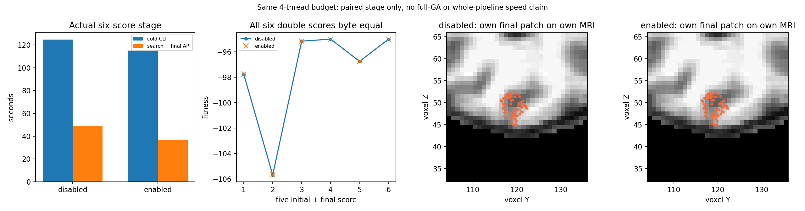

# 显式遗传拓扑保留面缓存接口：真实阶段验证

## 完成范围

新 `prepare_genetic_defect_evaluator`、`search_and_finalize_defect` 与 `repair_genetic_topology` 增加 `face_detection_cache=False`，接受 Python bool/NumPy np.bool_。每个缺陷只为当前完整保留面建立一次不可变索引，评分及最终几何复用；下一缺陷重新建立。生产默认和RNG/控制规则不变。

本次两个fresh子进程从同一公开基准链自产 nofix、qsphere 与MRI输入开始，直接走新版库参数。固定种群5、niters=0、seed1234，完整执行5个初始评分+1个最终评分及几何写回。没有提前读取参考after/旧赢家生成候选。

## 实际结果与计时

- 两子进程及父工具退出0；四NPZ/81字段的shape、dtype、所有字节及完整文件SHA相同，最大/P99差异0。
- 两个完整控制记录相同；20,877次实际随机调用的顺序、bounds、值与SHA相同。
- 新源码CFFF聚焦7合同退出0，8.451813747175038秒；本地7合同0.059秒另计，不代替真实数据。

| 实际墙钟秒 | 关闭缓存 | 开启缓存 |
| --- | ---: | ---: |
| Fresh完整子CLI | 124.8539729565382 | 114.99733323045075 |
| 搜索及最终几何API（含透明观察） | 48.945483883842826 | 36.92841023020446 |
| 自身峰值RSS KiB | 1610944 | 1580584 |

父pairCLI 249.76858772616833秒，含源码检查、两个fresh子进程与事后完整比较。各准备/读写及库内nested时间见 [metrics.json](metrics.json)。固定CPU88–91、共4线程、CUDA隐藏，1秒采样记录共享环境；关闭→开启两次观察，未作ABBA，不能报告稳定吞吐或整例提速。显存/allocated/reserved未用，无法精确归属的同时峰值为null。

## 科学源码与发布来源

实测manifestSHA `33f234fd92aef70865bb95ea9536b1e5154283f33cccec66f678a2aaacd83221`；完整原始源码清单、输入MRI、状态、日志及命令留服务器。发布仅更正两个核心docstring的bool/np.bool_说明，去docstring AST与实测源码相同；[publication_source_binding.json](publication_source_binding.json)分别保存两个实际SHA，不重标既有实验。

[EXPORT_RECEIPT.json](EXPORT_RECEIPT.json)核科学完成门和原数值/类型保真；[RECEIVER_SHA.json](RECEIVER_SHA.json)核本地收到的安全指标与图SHA。[PLOT_RECEIPT.json](PLOT_RECEIPT.json)核图生成器v2、源manifest、实际加载MRI变换SHA和导出指标SHA。图生成器v1来源门不足，原图/收据留服务器；v2只重绘，不重跑GA或改原指标。

投影显示两组自产最终缺陷在同链MRI上的位置，坐标单位体素；不是原软件误差或最终网格QC。原版完整赢家/整例等效未评估。本次不是默认495评分、完整九缺陷、原始T1 recon-all或600秒整例证明；完整九缺陷另在独立冻结目录执行。

## 调用和参数

完整Python具名参数、八项CLI参数、原软件命令、流程图、更新记录与参考文献见 [七节功能文档](../../../../docs/recon_all/TOPOLOGY_GENETIC_FACE_CACHE.md)。新benchmark没有原版输出参数；safe exporter只在完整退出/产物SHA/科学源码门通过后输出白名单；原始MRI/许可证/地址/账号/私有路径不发布。
