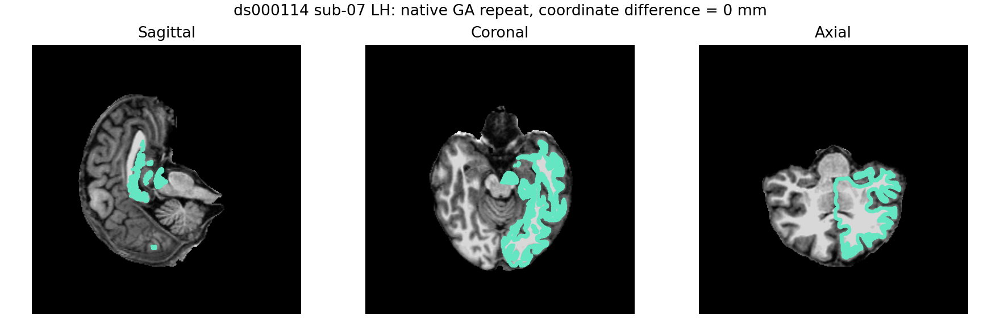

# 固定原生拓扑 GA：同输入重复与搜索控制诊断

## 1. 功能与范围

本目录为独立参考 benchmark，复用固定源码构建的 `mris_fix_topology_fnit`。公开 ds000114 sub-07 ses-test 左半球的五项输入与冻结79版本逐文件SHA相同；完成全部九个缺陷至 `orig.premesh`，不运行后续remesh或整例。生产自有代码没有增加原版程序调用。

默认重复和仅增加 `-verbose_low` 的补测均退出0。三份原生结果的108710个顶点坐标、217416个有序面和数值几何完全相同；文件头来源信息和原始字节不同。该结果证明原生重复几何稳定，不替代自有完整GA赢家或整体等效验收。


## 2. Python调用、输入与输出

这两个脚本仅针对本冻结参考，SHA不符即失败，没有通用生产入口。完整调用示例：

```python
from pathlib import Path
import sys

diagnostic_directory = Path("validation/recon_all/optimizations/20261011_topology_native_repeat")
sys.path.insert(0, str(diagnostic_directory))  # 只加载本目录诊断脚本
from benchmark_native_ga_repeat import run

source_directory = Path("frozen79")              # 含source.json/source.tar/src的冻结自身源码
reference_subject = Path("reference/subject")    # 已有自产五输入和只作事后比较的premesh
benchmark_report = Path("reference/benchmark.json")
producer_report = reference_subject / "fnit-native-free-run.json"
reference_log = reference_subject / "scripts/surface.lh.lh.topology-ga-fnit.log"
native_program = Path("reference-bin/mris_fix_topology_fnit")  # 独立固定构建参考
asset_directory = Path("data-only-assets")       # 已声明data-only资源根
comparison_module = Path("compare_complete_subject.py")     # 固定已有比较器
output_directory = Path("new-repeat")           # 独立新输出

arguments = dict(
    source=source_directory, subject=reference_subject, benchmark=benchmark_report,
    runtime=producer_report, reference_log=reference_log, binary=native_program,
    assets=asset_directory, comparison_module=comparison_module,
    output=output_directory,
)
run(**arguments, phase="preflight")  # 只校验，先写版本及资源回执
report = run(**arguments, phase="run")  # 完整参考算法；含加载和读写
```

| 参数 | 意义与格式 |
|---|---|
| `source` | 冻结79自身源码目录；固定commit、archive及三模块SHA |
| `subject` | 名称为`subject`的已有完整自产目录；表面为surface RAS/mm，有序三角面 |
| `benchmark`、`runtime` | 原始生产报告JSON，仅绑定版本/程序，不参与参考算法 |
| `reference_log` | 原九缺陷日志，仅事后提取可见搜索行为 |
| `binary` | SHA为`c3bb6b74…`的独立源码构建程序；不是系统预装程序 |
| `assets` | 已有data-only根目录 |
| `comparison_module` | 已有完整被试比较器，固定SHA `ea8e7faf…` |
| `output` | 私有新运行目录；只复制五项输入，不复制参考premesh作算法输入 |
| `phase` | `preflight`或`run`，默认重复脚本必填 |
| `baseline_repeat` | 低详细度脚本新增必填路径；先核默认重复已完成及report SHA，产物只在新结果完成后比较 |

五项输入为`lh.orig.nofix`、`lh.inflated.nofix`、`lh.qsphere.nofix`、`brain.mgz`、`wm.mgz`，完整SHA及大小见[前置回执](reports/default_preflight.json)。表面文件保存float32 `(N,3)`顶点和int32 `(F,3)`有序三角面，坐标为surface RAS、单位mm；三个表面使用同一顶点编号。MRI是MGH/MGZ三维XYZ网格，保留实际存储dtype、体素尺寸和RAS几何，不在此诊断中重采样或转换dtype。

Python脚本输出新subject中的`lh.orig.premesh`、私有原日志和安全`report.json/COMPLETE.json`；默认脚本还写`preflight.json`。输出顶点和面仍采用上述结构，N/F由完整GA结果决定。`EXIT_CODE`由外层Bash/tmux launcher记录，Python API本身不写该文件；低详细度补测要求默认重复已有真实退出回执。空间、dtype及全部比较数值由固定比较器保存。

低详细度函数`benchmark_verbose_native_ga.run()`接受上表相同参数，去掉`phase`并新增`baseline_repeat`；只加`-verbose_low`，不使用会改变警告退出语义的`-errors`。线程和种子不开放修改：总预算4核、参考内部1线程、seed1234、CUDA隐藏。许可证由已有私有`FS_LICENSE`提供，只检查可读性，不读取或发布内容。

输入校验、读写或参考子进程异常向外传播；保留已经建立的目录和原日志，不为失败的新运行生成`COMPLETE.json`。使用新输出目录，已有完成结果不覆盖。`status="complete"`表示诊断完整执行，坐标、几何和原始文件的严格比较分别记录；原始文件字节不同不等于子进程失败，也不表示整体等效通过。

## 3. 命令行与安全导出

```bash
# FS_LICENSE由已有私有环境设置；不要将许可证内容或实际私有路径写入Git。
# 在独立Bash/tmux launcher中执行；失败也记录真实退出码。
run_reference_with_exit_receipt() {
  benchmark_output_directory="$1"
  shift
  if [ -e "$benchmark_output_directory/report.json" ] || \
     [ -e "$benchmark_output_directory/COMPLETE.json" ] || \
     [ -e "$benchmark_output_directory/EXIT_CODE" ]; then
    return 1  # 不覆盖已有结果或退出回执
  fi
  benchmark_exit_code=0
  "$@" || benchmark_exit_code=$?
  if [ -d "$benchmark_output_directory" ]; then
    printf '%s\n' "$benchmark_exit_code" > "$benchmark_output_directory/EXIT_CODE"
  fi
  return "$benchmark_exit_code"
}
run_reference_with_exit_receipt new-verbose-repeat \
  taskset -c 100-103 env CUDA_VISIBLE_DEVICES= NUMBA_NUM_THREADS=4 OMP_NUM_THREADS=4 \
  python benchmark_verbose_native_ga.py \
  --source frozen79 --subject reference/subject \
  --benchmark reference/benchmark.json --runtime reference/subject/fnit-native-free-run.json \
  --reference-log reference/subject/scripts/surface.lh.lh.topology-ga-fnit.log \
  --binary reference-bin/mris_fix_topology_fnit --assets data-only-assets \
  --comparison-module compare_complete_subject.py --baseline-repeat new-repeat \
  --output new-verbose-repeat
```

默认脚本使用相同参数，去掉`--baseline-repeat`，将`--output`设为`new-repeat`；先直接运行`--phase preflight`，成功后由`run_reference_with_exit_receipt new-repeat`包装`--phase run`，写入默认重复的`EXIT_CODE`。若在创建目录之前失败，launcher只返回非零退出码，不虚构运行产物。

`supplement_native_repeat.py`的`reference/default-repeat/verbose-repeat`为三份完成表面，`brain`为公开MRI，`output`为新诊断目录；只读并生成字节分区JSON及PNG。`audit_control_sources.py`接受仓库、报告目录及三份私有固定源文件，输出源码SHA/行号，不复制原软件源码。`collect_public_receipts.py --fnit-root <私有任务根>`只导出9个明确JSON/退出码/PNG，逐文件校验SHA和完成绑定，不包含MRI、表面、原日志、程序或许可证。

## 4. 对应原软件与搜索规则

本次参考实际参数与原79 wrapper一致。下列示例中的本地目录均为具名占位；`subject`中有五项同输入，居中球面由冻结wrapper从qsphere生成，不能借用参考结果。脚本内部调用同时设置`SUBJECTS_DIR`、`FREESURFER_HOME`和`FNIT_CENTERED_COORDS`；末项启用此固定参考程序的FNIT居中坐标替换，裸argv不能代替相同环境的复现。

```bash
benchmark_subjects_directory="$(pwd)/benchmark-subjects"
benchmark_assets_directory="$(pwd)/data-only-assets"
benchmark_centered_sphere="$benchmark_subjects_directory/subject/surf/lh.topology-centered.sphere"
env SUBJECTS_DIR="$benchmark_subjects_directory" \
  FREESURFER_HOME="$benchmark_assets_directory" \
  FNIT_CENTERED_COORDS="$benchmark_centered_sphere" OMP_NUM_THREADS=1 \
  mris_fix_topology_fnit -threads 1 -mgz -sphere qsphere.nofix \
  -inflated inflated.nofix -orig orig.nofix -out orig.premesh \
  -ga -seed 1234 -threads 1 subject lh
# 另一次独立补测仅在subject lh前增加：-verbose_low
```

固定源码main538–556的`-ga`开启initial selection和vertex elimination。种群为10、`max_unchanged=10`、`niters=-1`；日志头“number of generations:10”实际打印未改善门，不能当实际只执行10代。源码12200覆盖历史static3，12801按未改善门循环，13261按FEQUAL累计/重置，13279起保留五代剔除等待及零删除停止。

原生日志全九缺陷“41 mutations /79crossovers /127eliminated”中的前两项为严格改善最优解的事件数。源码12907/13113才加全局成功计数；13216–17的交叉后变异改善同时增加两者。自有`mutation_attempts`是尝试数，不能直接与41比较。现有自有`crossover_mutation`改善诊断只加`mutation_improvements`，尚未改其运行记录或算法；本首缺陷没有该类成功事件。

原`setRandomSeed`消费一次OpenRan1及double区间缩放，与自有随机流静态语义一致。全部首候选排序、精确逐候选评分和运行期RNG状态未捕获，不因相同seed或日志接近宣称完全相同。

## 5. 最新真实精度、耗时与脑图

| 完整独立范围 | 默认重复 | 低详细度补测 |
|---|---:|---:|
| 原生完整九缺陷秒 | 172.84925048798323 | 155.90543626621366 |
| wrapper墙钟秒，含Python居中/参考读写 | 181.26816925872117 | 不单列 |
| 诊断墙钟秒，含前置校验、复制、比较 | 183.71356419287622 | 168.2842080593109 |
| 顶点坐标不同元素数/最大/P99 mm | 0/0/0 | 对两份参考均0/0/0 |
| 有序面不同元素数 | 0 | 对两份参考均0 |
| 数值几何 | exact | exact |
| 头filename/原始file bytes | 不同/不同 | 不同/不同 |

同主机不同时段的共享负载、导入和JIT存在；没有受控速度配对，不能把两行耗时差解释为提速。CUDA隐藏，显存记null，子参考RSS保存原报告。新原生程序完整运行是参考重复诊断，不是整例耗时；尚未评估整体指标等效。

默认`strict_decoded_reproduction=False`原字段包含filename，原机器字节保留未改。派生[控制审计](reports/control_audit.json)明确分开`strict_coordinates/strict_ordered_faces/strict_geometric_fields=True`和`strict_header_filename/strict_file_bytes=False`。原始文件首差在offset27的preamble，且filename不同；不能写成只有尾部filename差。坐标及有序面二进制数据块、数值几何字节完全一致，[分区诊断](reports/byte_sections.json)保留全部层次。

首缺陷低详细度打印29轮，逐条与自有29条`generation_trace`最优fitness按原四位科学格式完全相同；自有`search_generations=28`是停止前的零起始计数，不能视作少运行一轮。九个严格改善事件的phase、slot及打印值全部对应；七次剔除数量`3,3,3,2,5,2,2`原序相同。自有最佳−93.04168701171875落在原最终打印−9.3042e+01的区间[−93.0425,−93.0415]。

初始10次评分的六位打印有9次相同；slot1原打印−105.683649，自有−105.68364810943604打印−105.683648，六位打印相差1e−6。原生精确double未观测，不能把打印差当作精确评分误差。此局部差异保留，未归因于随机或编译器。低详细度未打印精确总候选数、最终double和停止分支码，它们仍为null；495仅属于已有自有首缺陷报告。当前证据不支持用控制规则失配解释运行时间差；单候选实现与状态装配仍需独立剖析。



绿色点显示切片附近的重合原生表面；全坐标误差为0mm。该脑图展示重复位置，不替代最终white/pial质量或原始T1整例评分。

## 6. 版本、失败与复现记录

参考wrapper绑定原79commit `79a41cdda2397525a8952dd5af303372b352916c`及archiveSHA `e0a9a418…`；参考程序SHA `c3bb6b74…`。默认诊断脚本SHA `9671ccbc…`，低详细度脚本SHA `07094a62…`，二者各有完整完成回执，未重写原产物。自有首缺陷对照仍绑定原`d7631041…`及58文件覆盖，原精确报告和源码清单通过SHA绑定，不改标本轮版本。

只读审计首版因误用`generations`键而退出1，尚未生成报告；实际机器字段是`search_generations`，修复工具字段后完成审计，未重跑算法，见[失败摘要](reports/audit_schema_failure.json)。本轮无生产算法、阈值、随机种子或默认设置变更。收集器第二版仅将私有字符串扫描改为通用路径/网络地址检查；新SHA `786e85e6…`在服务器独立执行，九个原产物与第一版逐字节相同。[第一版收集清单](COLLECTION_MANIFEST_v1.json)保留原收集器SHA `5466b860…`，不回标为新版。

公开JSON字节、bool/null和所有数值保持服务器原样；[收集清单](COLLECTION_MANIFEST.json)绑定9个原始安全产物，[发布清单](PUBLICATION_MANIFEST.json)绑定本目录最终全部payload。比较器及绘图工具可复用；完整文件、原软件源码/程序、MRI、许可证与服务器私有路径留在私有任务目录。

## 7. 原实现与参考文献

- [固定FreeSurfer拓扑源码](https://github.com/freesurfer/freesurfer/blob/d932c45b7941662ea380a05efef580568b98d41a/utils/mrisurf_defect.cpp)。
- [固定命令入口](https://github.com/freesurfer/freesurfer/blob/d932c45b7941662ea380a05efef580568b98d41a/mris_fix_topology/mris_fix_topology.cpp)。
- [随机流工具](https://github.com/freesurfer/freesurfer/blob/d932c45b7941662ea380a05efef580568b98d41a/utils/utils.cpp)。
- [Fischl等，2001，自动拓扑校正](https://doi.org/10.1109/42.906426)。
- [公开ds000114](https://openneuro.org/datasets/ds000114)。
