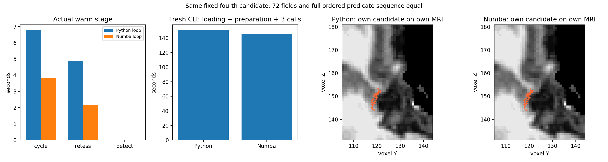

# 第四缺陷有序阻挡扫描真实配对

本组是固定第四缺陷首候选的完整阶段对照，未执行该缺陷完整遗传搜索。
输入为公开sub07原始T1自产链的nofix、qsphere、MRI与前三缺陷完成检查点。
实际冷/热/审计两侧全部72字段、完整控制与2,656,862次谓词序列一致。

| 项目 | Python | Numba |
|---|---:|---:|
| fresh CLI | 150.78036309871823s | 145.21440125536174s |
| warm完整candidate闭环 | 6.779169046320021s | 3.825241770595312s |
| warm retess | 4.891674037091434s | 2.1733762621879578s |
| warm detect | 0.01252290140837431s | 0.013253919780254364s |
| fitness | −119.29359245300293 | −119.29359245300293 |

两fresh进程按Python→Numba独立运行，CPU84–87/总4线程、CUDA隐藏。
共享窗口的单次配对不是稳定ABBA性能；普通冷/热不启用序列记录，audit
时间含完整缓冲和哈希。完整pair CLI303.62434371653944s含两侧读写/准备/
三次调用与比较，不能叫recon-all或全部九缺陷墙钟。

`metrics.json`保留原完整分步数值、每组72字段门、资源、score、所有输入/
产物SHA及源序列SHA。`EXPORT_RECEIPT.json`验证271个数值/布尔/null类型
和值保真，并绑定实际父报告、完成门、实际源manifest与导出程序。
`source_phase_binding.json`分别保存第四实测和新完整首缺陷冻结源SHA；
去除docstring的AST逐位相同，不能把新的文档SHA回标旧实测。

`exporter_v1_failed.json`保留一次导出guard schema错误：Python参考没有
导入其未使用的Numba模块。新导出保留源payload校验，要求Numba侧加载
扫描器；并未修改科学程序、原记录或原始产物。

严格门是阶段几何/控制/状态一致。最终全mesh质量、整例速度与整体指标
等效均未判定。全字段NPZ、原影像、完整私有报告和日志留在服务器。
功能接口、具名示例、旧剖析和版本边界见
[七节说明](../../../../docs/recon_all/TOPOLOGY_ORDERED_BLOCKER_SCAN.md)。

图像绑定当前导出receipt及实际run三个完成文件SHA，源payload与实际MRI变换模块也校验。
此前v2原导出receipt另存exporter_v2_original_EXPORT_RECEIPT.json，科学数值JSON相同。
