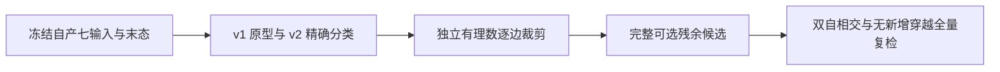

# 冻结自产 pial 的 white 接触分类与独立候选

## 1．本次功能和范围

本目录绑定一个既有公开 T1 的 FNIT 自产 pial 末态，网格为 95,045 顶点、190,086 面。本轮没有从原始 T1 重跑，也没有读取官方坐标。只读检测区分开平面的正长度交线、精确边/点/共面接触、原源容差接触。随后对残余自相交做显式独立候选；不改生产默认 SOAP 或正在运行的整例。



共有顶点编号不能排除两个表面的面对。全固定且坐标与自己的 white 完全重合只能标识已有非穿越接触，不能豁免真正的内部穿越。已有初态穿越、候选无新增穿越、最终零穿越以及整体指标等效分别记录。固定 pial 与同索引 white 精确重合只是一项接触来源标记，不豁免 white 自相交，也不说明 white 自相交检查已通过。

## 2．Python 接口、输入与输出

计算接口与全部参数见 [white–pial 说明](../../../../docs/recon_all/WHITE_PIAL_CROSSING_QC.md)。`WhitePialCrossingIndex(white_vertices=..., faces=..., fixed_vertices=...)` 缓存有限浮点 `(N,3)` 自产 white 与有序整数 `(F,3)` 面，空间为 surface RAS/mm。`query(pial_vertices=..., query_faces=None)` 返回 proper/contact/fixed-contact 三个面对集合及完整数值摘要；输入非法/退化明确报错，不移动顶点。

只读工具 `benchmark_white_pial_crossing.run()` 的参数：`installed_directory` 为冻结安装包，`overlay_directory` 为冻结 helper，`diagnostic_case` 含七前置和自产末态，`input_hashes` 为七相对路径/SHA JSON，`terminal_sha256` 固定自产末态，`protocol` 为预定语义，`output` 为不存在的新 JSON，`threads=4` 为正整数 NumBa 预算。可选 `baseline_helper_source`/`expected_baseline_helper_sha256` 必须同时传，重放 v1 自有原型用于分类排错；不是官方参考。

七前置为 `surf/lh.white`、`surf/autodet.gw.stats.lh.dat`、`label/lh.cortex.label`、`label/lh.cortex+hipamyg.label`、`mri/brain.finalsurfs.mgz`、`mri/wm.mgz`、`mri/aseg.presurf.mgz`。末态为同一网格 float32 `(N,3)`；三张 MRI 只读哈希，不解码体素。输出包含全部计数/长度/平面深度、空间、输入/代码 SHA、线程/CPU亲和性和时间/RSS。前后输入与源码必须不变；输出存在/哈希漂移或局部全局集合不一致报错。

独立审查 `audit_white_pial_crossing_exact.run()` 输入同上，另用必填 `expected_helper_sha256` 固定代码；`global_proper_sample=1024` 为排序全集上的确定性等距样本。它以独立逐边平面裁剪复核全局样本及全部受影响面的完整 white bbox 面对，不调用源 `interval`。输出完整类别、差异数量、局部集合相等性和墙钟/RSS；分类失败保存报告并退出 1。

新增两个小的只读审计工具，不重复运行优化器：

| 工具 | 全部参数与结构 |
|---|---|
| `audit_pial_self_pairs_exact.run()` | `installed_directory: Path` 冻结安装、`overlay_directory: Path` 冻结 pair helper、`diagnostic_case: Path` 七输入/进入末态、`candidate: Path` 同网格自产 float32 `(N,3)` NPY、`input_hashes: Path` 七 SHA、`terminal_sha256: str`/`candidate_sha256: str` 表面哈希、`exact_audit_source: Path` 独立裁剪源码、`expected_exact_audit_sha256: str`/`expected_pair_helper_sha256: str` 固定程序、`expected_entry_float64_pairs: int`/`expected_candidate_float64_pairs: int` 预定非负完整计数、`output: Path` 新 JSON 均必填；`threads: int=4`。完整枚举 source/F64 并逐对精确分类，返回全部面对/固定角点/共享 ID 和坐标/连通组以及时间/RSS；预期数、哈希、dtype/shape 或名单非法直接失败 |
| `audit_pial_fixed_crossings_exact.run()` | `diagnostic_case: Path`、`candidate: Path`、`input_hashes: Path`、`terminal_sha256: str`、`candidate_sha256: str` 同上；`exact_report: Path` 为上一步完整安全名单、`expected_exact_report_sha256: str` 固定名单、`output: Path` 新 JSON 均必填；`threads: int=4`。精确检查所有固定面–固定边和固定边–固定边，输出每对固定来源 `rip`/`outside_cortex`/二者、固定坐标是否等自产 white、全部子结构类别及聚合/时间/RSS。不重新枚举网格、移动顶点或放宽质量门 |

两工具使用 surface RAS/mm；有序面不变，所有输入字节前后核 SHA。固定边贯穿固定面开内部可证明非退化面下不可消除的 proper；固定边之间交会只能证明持久接触，不一概解释为 triangle proper。输出不是整例质量通过；已有输出、非有限几何、非法固定域、来源漂移明确失败。

固定结构工具在精确运算前独立核对两末态名单：`source_directed_pairs`、`float64_pairs`、`union_pairs` 与全部行相符，面对有序且无重复，每行已分类为 `proper`，五类计数完整一致。两标签只能为有效顶点域内的一维整数索引，允许重复，拒绝负数、越界、浮点和 bool；报告中的固定点总数须等于从 rip/cortex 推导的实际域。非法输入抛 `ValueError` 且不写输出。接触或混合类别名单应使用前一精确分类接口，不能直接作为本固定 proper 审计的输入。

工具内部 `checked_pair_rows(record=..., state=..., face_count=...)` 返回原 `rows` 列表；`record` 为单末态完整 dict，`state` 为 `entry` 或 `candidate`，`face_count` 为正整数。`checked_fixed_domain(white_vertices=..., faces=..., cortex_indices=..., hipamyg_indices=...)` 返回 `(white, faces, cortex, rip, fixed)`：前两项为 float32 `(N,3)`/int32 `(F,3)`，后三项为 bool `(N,)`；坐标仍为 surface RAS/mm，不重 pin 或修改几何。这两个内部检查没有独立 CLI，参数均必填。

安全导出器均为只读，不生成 MRI：

| 导出器 | 全部具名输入与输出 |
|---|---|
| `export_qc.export(report_path=..., timer_path=..., output=...)` | 三个必填 `Path`；检测 producer JSON、冷 CLI JSON、新公共输出。保留全部 QC/源版本和 v1/v2 差异，固定字段/枚举/类型检查；失败不写文件 |
| `export_audit.export(report_path=..., timer_path=..., output=...)` | 三个必填 `Path`；独立审查及其冷 CLI，输出数值/源 SHA/类别/差异/完整局部门。成功/失败均按实际字段保留；未知字段拒绝 |
| `export_candidate.export(report_path=..., timer_path=..., complete_path=..., diagnostic_case=..., input_hashes=..., output=...)` | 六个必填 `Path`；仅完整独立候选收据。前后复核七输入/末态与两份候选产物 SHA，输出完整 typed trace、接受/拒绝、双碰撞/穿越、拓扑、位移/双向点到面距离和资源，失败质量不隐藏 |
| `export_self_audit.export(report_path=..., timer_path=..., output=...)` / `export_fixed_audit.export(...)` | 三个必填 `Path`；分别读完整 selfpair/固定子结构报告与冷计时，固定 typed/枚举/计数/所有行及 SHA 全量检查后输出；不删失败/非proper/0障碍项，未知字段、私人字符串、布尔伪计数/退出码等拒绝且不写文件 |

导出文件不含影像、坐标、私人路径、主机/GPU标识、许可证或日志。源码、原始报告与计时 JSON 以 SHA 绑定；原样完整 producer/日志留在私有任务。`output` 必须不存在，未知字段、非法类型/哈希、布尔伪整数或状态矛盾抛异常，不覆盖已有文件。计数单位为面对/面/顶点/元素，长度和距离为 mm，时间为秒，内存为字节。

## 3．具名参数复现

```python
from pathlib import Path
from tools.audit_white_pial_crossing_exact import run

report = run(
    installed_directory=Path("frozen-installed"),   # 同一已固定 FNIT 安装包
    overlay_directory=Path("frozen-helper"),       # helper SHA 对应的独立目录
    diagnostic_case=Path("own-frozen-pial"),        # 自产七输入及末态，只读
    input_hashes=Path("input_hashes.json"),         # 七相对路径与完整 SHA
    terminal_sha256="e6440bc08203f01c3fdbb9845a8f5b86b28402c4913edcb45f2b3bc2cae0906f",  # 固定自产末态
    expected_helper_sha256="acf0a8037db63ea682bdbf7c8fda83b175b4d7946e7164b584056e88891e238d",  # v2实际helper
    output=Path("new-exact-audit.json"),             # 必须不存在
    global_proper_sample=1024,                      # 预定等距样本，不按结果选取
    threads=4,                                     # 固定 NumBa 线程预算
)
```

内部预检可单独用于接口排错，不重新执行真实相交运算：

```python
from tools.audit_pial_fixed_crossings_exact import checked_pair_rows, checked_fixed_domain

complete_rows = checked_pair_rows(
    record=own_exact_state_record,       # 单末态完整精确名单与计数 dict
    state="entry",                      # 固定为进入末态；候选使用 candidate
    face_count=own_ordered_face_count,   # 同网格正整数面数
)
white, faces, cortex, rip, fixed = checked_fixed_domain(
    white_vertices=own_white_vertices,  # 有限浮点 (N,3)，surface RAS/mm
    faces=own_ordered_faces,            # 同网格整数 (F,3)，索引有效
    cortex_indices=own_cortex_indices,  # 一维整数标签索引
    hipamyg_indices=own_hipamyg_indices, # 一维整数标签索引；用于推导 rip
)
```

命令行参数与 Python 同名；固定四核、四线程、隐藏 CUDA：

```bash
CUDA_VISIBLE_DEVICES='' OMP_NUM_THREADS=4 OPENBLAS_NUM_THREADS=4 \
MKL_NUM_THREADS=4 NUMBA_NUM_THREADS=4 taskset -c 112-115 python \
  tools/audit_white_pial_crossing_exact.py \
  --installed-directory "$installed_directory" \
  --overlay-directory "$frozen_helper_directory" \
  --diagnostic-case "$own_diagnostic_case" \
  --input-hashes "$seven_input_hashes" \
  --terminal-sha256 "$own_terminal_sha256" \
  --expected-helper-sha256 "$frozen_helper_sha256" \
  --global-proper-sample 1024 --threads 4 --output "$new_audit_report"
```

完整候选用 `tools/benchmark_recon_pial_residual_solver.py`，参数为冻结安装包、三份 overlay、自产阶段目录、七输入 JSON、[candidate_protocol.json](candidate_protocol.json)、新输出目录、既有双向点到面模块及 `threads=4`；不传 `reference_run`。协议预定 1mm 最大累计位移、面积比例至少 0.2、0.002mm 分离间距、四轮、100次 SLSQP、可转动平面和完整初始面对；这些是候选约束，**不是已确认的整体指标等效阈值**。

固定障碍接口的完整具名示例（路径由索引设置，均为自产同输入）：

```python
from pathlib import Path
from tools.audit_pial_fixed_crossings_exact import run

report = run(
    diagnostic_case=Path(own_diagnostic_case),        # 自产七输入与原进入末态
    candidate=Path(own_candidate_npy),                # 本轮完整失败候选；只读
    input_hashes=Path(seven_input_hashes),             # 原七相对路径/SHA清单
    terminal_sha256=own_terminal_sha256,               # 进入末态原字节SHA
    candidate_sha256=own_candidate_sha256,             # 保存后已复核的候选SHA
    exact_report=Path(actual_self_audit),              # 已完整审查40/38名单
    expected_exact_report_sha256=self_audit_sha256,    # 名单文件的实际固定SHA
    output=Path(new_fixed_audit_report),               # 新文件，不覆盖旧证据
    threads=4,                                        # 四线程声明，亲和性另记录
)
```

两补充导出器只有上述 Python 接口，没有独立 CLI。两个审计工具 CLI 与 Python 参数同名，路径为 `tools/audit_pial_self_pairs_exact.py` 和 `tools/audit_pial_fixed_crossings_exact.py`；完整冻结参数、预期计数、源码和语义分别见 [self_audit_protocol.json](self_audit_protocol.json) 与 [fixed_audit_protocol.json](fixed_audit_protocol.json)。它们没有生产 CLI 入口；复用上方 `CUDA_VISIBLE_DEVICES=''` 和 `taskset -c 112-115`，不启动第二个整例。

外层 `time_recon_python_benchmark.time_command(command=[...], log_path=..., report_path=...)` 复用已提交计时器，argv 无 shell 展开，两个新路径父目录须存在。冷 CLI 包含加载、校验、CPU计算、全部检测、距离和读写；子进程 RSS 与父子同时占用不是同一统计。GPU/同时 CPU 未测保持 null，不写成零。

## 4．对应原软件

本独立几何检查、精确审查和候选没有官方独立 CLI。原 pial 对照命令为固定参数 `mris_place_surface --pial`，详细七前置和原命令见 [Python pial](../../../../docs/recon_all/PYTHON_PIAL_PLACEMENT.md)。本轮未调用原阶段程序，未新增官方参考；已有两次官方同输入可复现而残余相交的证据仍保持其原版本。

## 5．实际精度、时间、资源与脑图范围

| 本轮实测 | QC v1 原型 | QC v2 精确回退 | 独立 exact 审查 |
|---|---:|---:|---:|
| 全局分类 proper 面对 | 29,461 raw，非可靠物理结论 | 25,896 集合计数 | 均匀抽样 1,024 加全部局部 bbox |
| 精确接触面对 | 163,148 原型分类 | 210,648 | 815 个局部接触逐一验证 |
| 独立审查面对/差异 | 未测 | 局部/全局三集合一致 | 3,561 / 0 |
| 完整查询函数秒数 | 71.446028 | 136.139977 | 包含在审查完整墙钟 |
| 冷 CLI 秒数 | 118.391889 | 326.245346 | 204.058058 |
| RSS 高水位/字节 | 645,734,400 | 781,176,832 | 697,446,400 |

v2 同时完整重放 v1，两任务工作量与共享负载不同；不能将冷墙钟比当作性能退化或加速比。v2 去除 3,565 对误判：共有两个角点 3,252、共有一个角点 313；其中 3,379 对的 pial 面全固定且与自身 white 完全相同。精确回退不以距离阈值丢弃任何短正长度交线，合同覆盖到 1e-15 mm。

独立 exact 审查的 complete bbox 区域为 107 个受影响面、2,539 个面对；和全局 1,024 样本有两对重叠，总 3,561。精确分类为 proper 1,124、边/点 775、共面 40、无接触 1,622，差异 0；完整局部 proper/contact 集合均与 v2 相同。独立裁剪 1.384793 秒，整体函数 202.223967 秒包含读取/哈希、完整检测、独立候选构造与裁剪，外层冷 CLI 另含启动/导入/最终写出。不能把 25,896 集合大小直接解释为生物学异常数量，也不能把抽样核验写成全局每一对均已独立复核。

完整 guarded 候选实际退出 0，但残余质量为 **`failed_residual`**。1,846 次候选中仅 1 次接受；源有向面对 80→76、F64 无向面对 40→38，双方相交面/顶点均为 32/35→31/34。只改变 2 个顶点、5 个坐标元素，最大同索引位移 0.013959759 mm，变化顶点 P99 0.013820218 mm；全顶点 P99 为 0，不能遮盖局部最大值。双向顶点到三角面最大距离为 0.009796446/0.007788144 mm、P99 均为 0。固定 7,890 个顶点全部元素零变化，有序面不变；最小面积比例 0.986478508，没有新朝向翻折，单连通闭合网格、Euler=2、非流形边/顶点及边朝向冲突均为 0。进入时 cortex 外有 954 个坐标元素不等于 white，完整保留，不重新 pin。

初态及候选白质穿越分类集合均为 proper 25,896、非内侧壁精确接触 16,993；全量/局部维护集合相同，**无新增门通过、最终零穿越/零接触均失败**。1 次接受行完整保存 `decision="eligible"`；239 次候选因新增 white–pial proper 面对拒绝，其余原因分别为优化不可行 909、朝向 172、面积 6、新自相交 519。没有放宽预定约束或接入生产。

冷 CLI 1,103.352676 秒，进程峰值 RSS 6,142,488,576 字节（CPU 内存，不能当作显存）。残余函数 864.454238 秒已包含 white 全量初/末查询 125.120396/127.134650 秒、240 次入射面局部查询合计 53.402470 秒、SLSQP 合计 66.301245 秒；空间查询与精确分类内部未独立计时，其余 492.495476 秒不能直接归为某算子。外部双谓词前/后 QC 为 80.774554/87.462305 秒、双向点到面 50.036487 秒。嵌套时间不重复加到墙钟。[完整候选](candidate.safe.json) 保留全部 1,846 行接受/拒绝、源 SHA、局部异常与失败；[计时拆分](CANDIDATE_TIMING_DIAGNOSTIC.json) 区分实测与未分项部分。

每次候选门已只复查变化顶点全部入射面，维护未变面的初始集合并在接受后更新，末态再全量校验。当前 local query 仍重建完整 pial 几何数组，自相交局部查询也有完整几何/空间索引成本；未基于推测修改正在运行的冻结版本，也没有据这次阶段结果声称整例加速。

全部 selfpair 精确审计实际完成：进入 40/40、候选 38/38 均为 `proper`，边点/共面/无接触全部 0；所有面对均无共享顶点 ID 或相同坐标角点。每对含 2–5 个固定角点，没有六角点全固定的面对。唯一连通组进入有 35 个顶点（20 固定/15 可动），末态有 34 个顶点（同 20 固定/14 可动）。这些残余不能凭接触误判或固定标签豁免。

完整双谓词枚举 77.132818/73.171352 秒，独立精确审计 0.051047/0.051919 秒；函数 154.405890 秒、冷 CLI 156.294913 秒、RSS 615,890,944 字节。只审查完整既有阳性名单，不宣称所有共享 ID 面对或全脑所有潜在相交均已精确枚举。[self_audit.safe.json](self_audit.safe.json) 保留全部 40/38 行及连通组。

固定子结构小门也已真实完成：两末态均完整审查 10 条固定面–固定边、38 条固定边–固定边，全部 exact `none`，未发现该子结构证明的不可移动交会。20 个固定点全部由 rip 且 cortex 外指定，坐标在进入/候选时都逐元素等自产 white。不能将“未发现这类固定障碍”解释为联合求解可行，不能将零固定交会当作整个表面零自相交。[fixed_audit.safe.json](fixed_audit.safe.json) 保存全部来源与检测；精确子检查 0.004713/0.004483 秒、冷 CLI 2.250874 秒、RSS 67,428,352 字节。

[逐面对拒绝分析](CANDIDATE_REJECTION_DIAGNOSTIC.json) 完整绑定 1,846 行候选。现算法每次只改一侧并排除对方面顶点；真实残余集中在一个 20 固定/15 可动组，逐对方法不能据此宣称联合可行或不可行。172 次朝向、6 次面积拒绝发生在 F64 约束检查后量化到 float32 的完整面检查，未接受这些无效几何。下一步若继续算法，应先围绕同一连通组联合移动分析新自相交/white 穿越约束，不放宽门或扩增启发式搜索；本轮没有执行该联合优化。

所有任务隐藏 CUDA，四线程预算、CPU 112–115；独立审查进程的实际亲和性现场核验相同。NumPy/NumBa/nibabel/SciPy 版本及全部输入/源码 SHA 保存在安全 JSON 与清单。GPU资源、PyTorch allocated/reserved、原始 T1 整例、第二例/另一半球、整体指标等效和隔离部署均未在本任务验收。


这是相同冻结进入末态的既有 32 面/35 顶点图，不是新候选效果图或 white–pial 分区图。完整 190,086 背景面保留，surface RAS/mm 的深度排序二维投影仅展示位置。新候选仅两点移动，当前未生成新候选或穿越分区图；上图明确保留进入末态范围。

## 6．代码版本、合同与原始证据

- 运行从工作分支冻结实际文件，各工具/helper 的完整 SHA 见 payload 清单；不把工作区 HEAD 当作整个实际安装包来源。
- [qc_v1.safe.json](qc_v1.safe.json)、[qc_v2.safe.json](qc_v2.safe.json)、[audit.safe.json](audit.safe.json)、[candidate.safe.json](candidate.safe.json)、[self_audit.safe.json](self_audit.safe.json)、[fixed_audit.safe.json](fixed_audit.safe.json) 为远端实际固定 schema 导出原字节，[EXPORT_RECEIPT.json](EXPORT_RECEIPT.json) 绑定 exporter/producer/timer 的完整 SHA。原样 producer、时间、日志和表面留在私有任务，未下载后字符串替换脱敏。
- v1 [原 helper](frozen/v1/white_pial_crossing_python.py)、[原脚本](frozen/v1/benchmark_white_pial_crossing.py)和协议保持原字节，分类误判明确保留。v2 source/schema、确定性样本与候选协议均在执行前冻结，没有按结果改门。
- 数学/API/报告/导出合同完整本地 46 passed、160 subtests；另独立 exact 小组 21 passed、127 subtests。记录分别见 [LOCAL_CHECKS.json](LOCAL_CHECKS.json) 与 [EXACT_AUDIT_LOCAL_CHECKS.json](EXACT_AUDIT_LOCAL_CHECKS.json)，并非两次真实 MRI。候选导出新增 schema 为 3 passed、8 subtests，另单列，不当作候选已成功。
- `accepted` 行的 `decision="eligible"` 在复制前补齐，修复报告缺字段；兼容默认候选几何不变，未改 production 或默认 SOAP。
- 原 classifier 未调用的浮点 `_coplanar_area` 已移回原几何诊断工具，该工具传入单位法向；没有修改既有 MRI 分类或面积算法。实际 v2/候选运行的 [helper 原字节](frozen/v2/white_pial_crossing_python.py) 与工具保留；当前活跃函数 AST（排除说明字符串）全部相同，当前完整 focused 合同 60 passed、190 subtests，见 [RELEASE_LOCAL_CHECKS.json](RELEASE_LOCAL_CHECKS.json)。原 46/160 收据仍绑定当时源码，不改标新运行。固定障碍另有 9 passed、19 subtests 合同，见 [FIXED_AUDIT_LOCAL_CHECKS.json](FIXED_AUDIT_LOCAL_CHECKS.json)。
- 固定结构 `run()` 原先依赖上游安全导出器检查完整性，独立 API 未重查计数/重复/类别，标签转索引前也未拒绝负数或浮点。当前补齐上述失败门，原精确几何函数 AST 不变。本地 13 passed、61 subtests、20.30 秒，包含原数学/schema合同及真实公共 40/38 行的只读名单校验；未读取 MRI、未重跑真实精确检查。见 [新接口收据](FIXED_AUDIT_PREFLIGHT_LOCAL_CHECKS.json)。实际固定结构审查仍使用 SHA `4946afefcb415e222d0a64360424fbd831dec2eb190805f2f22aa72f30b03d4a` 的 [原工具](frozen/fixed_v1/audit_pial_fixed_crossings_exact.py)；原测试与 [版本绑定](frozen/fixed_v1/source_binding.json)保留原字节，旧 9/19 和实际 2.250874 秒均不重标为新源码运行。
- NumPy/SciPy/NumBa/nibabel 均已有主页 Conda 依赖；Fraction 标准库无新增安装项。没有改运行中的冻结源码、MRI、旧报告或他人修改。

## 7．源码与参考

- [实现与接口](../../../../docs/recon_all/WHITE_PIAL_CROSSING_QC.md)、[完整 pial](../../../../docs/recon_all/PYTHON_PIAL_PLACEMENT.md)、[原残余诊断](../../../../docs/recon_all/PIAL_RESIDUAL_CLEANUP_DIAGNOSTIC.md)。
- [FreeSurfer 固定碰撞源码](https://github.com/freesurfer/freesurfer/blob/d932c45/utils/tritri.cpp)与[曲面形变](https://github.com/freesurfer/freesurfer/blob/d932c45/utils/mrisurf_deform.cpp)。
- Fischl B. FreeSurfer. *NeuroImage* 62, 774–781 (2012). [DOI](https://doi.org/10.1016/j.neuroimage.2012.01.021)。
