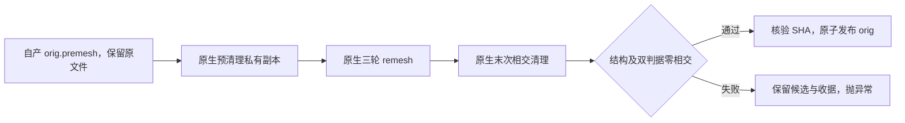
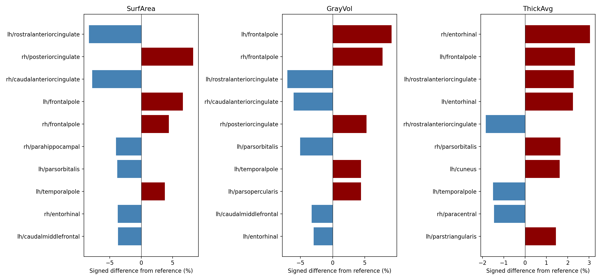
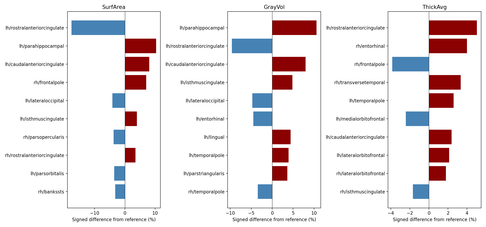

# 原生自编译表面收尾：阶段回归与整例测评

本轮将已定位为慢点的拓扑 GA、网格收尾和 white/pial 等表面步骤接到固定源码的 Conda 独立构建程序，保留成熟 FNIT GPU 阶段。冻结科学提交 `93affde8` 的两例原始 T1 空目录整例与事后评估均已完成：**病例外层完整墙钟为 2,218.682／2,010.322 秒**，各退出 0、138/138 输出齐全、生产基本网格门通过。严格逐文件复现仍为 **14/138、23/138**，整体指标等效和受控退化未判定。当前结果与全部阶段时间分别见 [metrics.public.json](metrics.public.json) 和 [runtime.public.json](runtime.public.json)；同输入与失败尝试的版本绑定保留在 [stage_summary.public.json](stage_summary.public.json)。

## 1. 功能与误差定位

`_finish_native_topology()` 读取 FNIT 自产 premesh，先清理私有副本，再三轮 remesh、末次清理，独立质量检查通过且 SHA 绑定正确后才原子发布 `orig`。原始 premesh 保留，执行链没有按被试或已知顶点添加例外。



sub-07 右侧同一原生 GA premesh 若直接执行 remesh→清理，仍有 **11 个源判据相交面和 11 个几何判据相交面**，原报告保留。因此只更换末次清理程序不能解决该输入；新增预清理后的完整链在两份实测网格上通过。预清理改变几何，可能影响后续 remesh 网格及最终指标，仍须完成整例官方误差评估。

公共入口显式选用 `backend="native"`、`topology_backend="native"`、`topology_finish_backend="conda-cpp"`。已有 `surface_placement_backend="native"` 路径调用自编译 white/pial 和 atlas paint；本轮新开关负责拓扑收尾。完整参数和整例 Python／CLI 调用见[功能说明](../../../../docs/recon_all/NATIVE_TOPOLOGY_FINISH.md)。

## 2. 实际版本与程序

FreeSurfer 源码固定 `d932c45b7941662ea380a05efef580568b98d41a`，在 Conda 工具链内新建独立构建，构建退出 **0**。没有复制系统预装 FreeSurfer 的二进制。安装脚本补齐此前 MINIMAL 构建遗漏的 `mris_remesh` 目标、安装和 SHA 清单；许可证与完整私有产物不发布。

| 对象 | 实际版本／SHA-256 |
| --- | --- |
| `mris_remesh` | `008add1ec4dde4bb3bd5b8c6d41cc31b0adc4e893347d63d7dabdc5529a7fd4a` |
| `mris_remove_intersection` | `4f0ccd8a0fcecccc2a7964bf4f6ee5d5c8d9a51b6a432080afe417cbb0ba6f38` |
| 阶段回归代码提交 | `91b7035ece299f3eef7fbc5a5f8e7703a3efaa5b` |
| `native_free.py` | `2d5393b12d1b34f9eda3f4afae6dfcb5f579fd969bb3cc4ce5a6de6555ee8b92` |
| 整例冻结提交 | `efa85ef0eecdfcec2bff097fdd141b5997d97c53`，上述生产函数文件 SHA 未变 |
| 整例源码清单 SHA | `39c5a30ce19573f726b1a4bdc76aa45978f3d5622ef5bf457315939a446c7c45` |
| 直接 remesh／清理私有报告 SHA | `2f9bca5355f405c2253cb581807bac46d820adab5e7dbd209ac0e201c04245b7` |
| 两份生产函数回归合并私有报告 SHA | `9065ed65c5c57c71a857bbf252be01e6cb17cdcedccf970af7d463cb759b999f` |

最新阶段及正在运行的整例均冻结为 `93affde8d369ee6ade22f2c105701ed6577e89a4`，`native_free.py` SHA 为 `64412e3a161a12cd5ddc85caec5faccb5300183c4758d9bc9341793f83ecfb88`，源码清单 SHA 为 `e8dca760536d19bc72a88f4bfe67a5768d4380902958f7cd1b82913e4072b30d`。新阶段报告 SHA 为 `4b1c9a2dc6336055e29840b292f3692b03d065f9adb9dc4588e8c28829529d16`；上表保留之前尝试的版本绑定。

复现脚本 SHA 见机器报告。输入、候选及输出完整 SHA 保留于私有报告和逐阶段收据。`accelerator-a-1` 为脱敏主机别名；本轮共享资源的单次阶段时间不能直接换算成受控整例提速。

## 3. 真实同输入阶段结果

输入是冻结、带 SHA 的 FNIT 自产 premesh，未读取官方参考。秒数包含程序运行、读写及检查；完整 API 另含包装和收据开销。

| 来源／半球 | 预清理 | 三轮 remesh | 末次清理及复检 | 发布 | 完整 API | 最终结构／源相交面／几何相交面 |
| --- | ---: | ---: | ---: | ---: | ---: | --- |
| ds000114 sub-06／左 | 4.637519 s | 21.149648 s | 60.094713 s | 0.032206 s | **85.952282 s** | passed／0／0 |
| ds000114 sub-07／右 | 4.126558 s | 18.091389 s | 49.620352 s | 0.028552 s | **71.897877 s** | passed／0／0 |

最新冻结版本重新运行相同输入：左侧 **87.217588 秒**（129,674 顶点、259,344 面），右侧 **72.229500 秒**（115,122 顶点、230,240 面）。两份均通过结构与双判据零相交门，与发布命名前的版本坐标、有序面完全相同；不是与官方或旧 Python 网格逐点相同。

结构门覆盖有限坐标、闭合、单连通、genus-0、边与顶点流形、面方向和零面积；末次相交检测独立使用源判据及几何判据。清理保留有序面、顶点数和 MRI 几何头；remesh 本身允许改变顶点数与面索引。不能由本表推断与旧 Python 或官方网格逐点相同，也没有据此判定整体指标等效。

实际 Conda 环境 **15 项测试通过**：收尾链 11 项、remesh 安装 1 项、监督器 3 项。最新冻结版本在实际 Conda 通过候选发布 14 项、安装 1 项、监督器 3 项、GPU 准入 7 项、进程归属 15 项、评估绑定 6 项。准入与归属合计 22 项，不能再次相加。最终在本地通过评估器／比较器／资源边界／安装／监督器相关 42 项。合同测试与上述真实阶段 benchmark 分别记录。

## 4. 输入、输出与复现

两脚本要求新的输出目录，存在时停止以保留现场。输入为 FreeSurfer 三角表面：顶点 `(N,3)`、surface RAS、毫米；面 `(F,3)` 为整数有序索引；文件尾为 MRI 几何。资产目录只提供声明资源，不是官方结果目录。

### 4.1 直接 remesh／清理诊断

[`benchmark_same_input.py`](benchmark_same_input.py) 的必需参数：`--premesh` 为自产冻结输入；`--remesh-binary` 与 `--intersection-binary` 为独立构建程序；`--assets-dir` 为资产；`--output-dir` 为新目录。`--preclean` 默认关闭，开启增加前置清理；`--python-orig` 默认不提供，仅用于可选旧结果比较，不进入计算。`--max-pair-candidates` 默认 `5000000`、须为正整数，保护几何检测内存；超限标记 `resource_guard_blocked`，不按零相交处理。

```bash
# 输入：FNIT 自产冻结 premesh；输出：新的诊断目录，保留全部候选和报告。
python validation/recon_all/optimizations/20261016_native_surface_hotspots/benchmark_same_input.py \
  --premesh /data/fnit/stages/sub-07/rh.orig.premesh \
  --remesh-binary /data/fnit-conda/bin/mris_remesh \
  --intersection-binary /data/fnit-conda/bin/mris_remove_intersection \
  --assets-dir /data/fnit/assets \
  --output-dir /data/fnit/runs/sub-07-direct-native-check \
  --max-pair-candidates 5000000
```

上例诊断直接 remesh→清理；加 `--preclean` 检查前置清理。输出有 `report.json`、程序日志、`orig.native-remesh`／`orig.native-cleaned`；开启预清理另存 `premesh.native-preclean`。报告含 SHA、结构、两类相交数、候选数量、命令与完整墙钟。质量通过退出 0，完成但质量失败退出 2；缺失文件、命令失败或几何改变等抛异常，并尽量保存失败报告。此脚本不发布生产 `orig`。

### 4.2 实际生产函数回归

[`benchmark_pipeline_finish.py`](benchmark_pipeline_finish.py) 从 JSON 清单读取输入，校验 SHA 后复制到新私有被试目录，再调用生产函数。清单为列表，每项四个字段如下；两个输入均须填入实际 64 位 SHA：

```json
[
  {"case":"sub-06-lh","hemi":"lh","premesh":"/data/fnit/stages/sub-06/lh.orig.premesh","sha256":"替换为实际输入SHA-256"},
  {"case":"sub-07-rh","hemi":"rh","premesh":"/data/fnit/stages/sub-07/rh.orig.premesh","sha256":"替换为实际输入SHA-256"}
]
```

`case` 为无路径分隔符的输出子目录名；`hemi` 只接受 `lh`／`rh`；`premesh` 为文件路径；`sha256` 未匹配则停止。五个具名参数均必需：

```bash
# cases-json：上方输入清单；output-root：必须不存在；其余目录为声明资源与程序。
# 复现时显式固定线程，并核对报告中的实际 CPU 亲和性。
OMP_NUM_THREADS=4 NUMBA_NUM_THREADS=4 OPENBLAS_NUM_THREADS=4 \
python validation/recon_all/optimizations/20261016_native_surface_hotspots/benchmark_pipeline_finish.py \
  --cases-json /data/fnit/manifests/native_finish_cases.json \
  --output-root /data/fnit/runs/native-finish-new \
  --native-bin-dir /data/fnit-conda/bin \
  --assets-dir /data/fnit/assets \
  --code-version 93affde8d369ee6ade22f2c105701ed6577e89a4
```

`--native-bin-dir` 定位两个程序，`--assets-dir` 提供资产；`--code-version` 记录实际冻结提交，不能替代源码 SHA 核查。输出包括每例 `subject/surf/H.orig`、私有候选、`subject/scripts/H.native-*.json`，以及根目录 `stage_report.private.json`。合并报告含源码／脚本 SHA、线程、CPU 亲和性、完整时间及收据；失败抛异常并保存失败状态。

等价的内部 Python 调用如下；这是内部入口，运行前 `surf/H.orig.premesh` 与 `scripts` 目录须已就绪：

```python
from pathlib import Path
from fnit.recon_all.native_free import _finish_native_topology

remesh_seconds, cleanup_and_publication_seconds = _finish_native_topology(
    subject=Path("/data/fnit/runs/native-finish-new/sub-06-lh/subject"),  # 新私有被试目录
    hemi="lh",  # 半球名：lh 或 rh
    assets=Path("/data/fnit/assets"),  # 声明的 FNIT 资产
    remesh_binary=Path("/data/fnit-conda/bin/mris_remesh"),  # 固定源码 Conda 独立构建
    intersection_binary=Path("/data/fnit-conda/bin/mris_remove_intersection"),  # 同一构建的相交清理程序
)
```

函数返回单位秒的二元组：三轮 remesh 时间，以及两次清理／检查／发布的其余时间，均含读写。已有收据禁止重入；失败保留候选与收据，已有 `orig` 保持原字节，或继续不存在。

## 5. 原始 T1 整例、误差与资源

### 5.1 完整耗时与官方参考

两例都从原始公开 ds000114 T1 和新的空目录开始，顺序使用同一 H100、总 4 CPU 线程；每例左右半球在独立进程并行。本轮没有手动补跑输出。时间单位为秒：

| 病例 | 病例外层完整墙钟 | CLI | 完整测评包装器 | 独立事后评估 | 退出／输出／生产基本网格门 |
| --- | ---: | ---: | ---: | ---: | --- |
| sub-06 | **2,218.682** | 2,210.178 | 2,216.291 | 1,318.019 | 0／138/138／passed |
| sub-07 | **2,010.322** | 2,001.400 | 2,007.907 | 1,340.480 | 0／138/138／passed |

病例外层包含解释器启动、校验、加载、数据传输、计算和读写；CLI 是内层重建命令，包装器另含其哈希校验。两例监督器合计 **4,230.598 秒**；外层租约另含 6.491 秒准入准备，总墙钟 **4,238.158 秒**。共同准备时间不任意摊成单例，事后误差评估不计入生产整例。租约、整例 launcher、两例重建和事后评估均退出 0，退出审计没有遗留自有后代。

旧纯 Python `cbaffa` 两例外层分别为 19,448.046／12,094.283 秒，完整记录见[旧版两例报告](../20261016_accelerator-a-1_cbaffa_two_case/README.md)。本次约 2,010–2,219 秒，接近约 2,000 秒目标，仍不能称两例均不超过 2,000 秒。两版跨时段共享负载与配方不同，保留观察值，不将它们写成受控配对加速。

归档官方 FreeSurfer 8.2.0 完整墙钟为 5,735.363／6,138.304 秒；CPU 型号和共享负载未完整绑定，不是本轮同条件重测，不能据此计算配对速度比。官方视图仍为 700 个普通文件、无符号链接，清单 SHA `e6aa553acfe943b4dd753804b7fbf57e6916c89d16f3c65003a677515be303be`，仅由事后评估读取。

### 5.2 当前最慢的步骤与实现

下表是本次超过 100 秒的顶层阶段，左右半球组用组墙钟；组内子步骤、左右半球时间不可相加或再次计入整例。全部 59 项顶层阶段及超过 100 秒的半球子步骤已保留于 `runtime.public.json`。

| 阶段 | sub-06 | sub-07 | 实际实现 |
| --- | ---: | ---: | --- |
| N4 | 141.776 | 143.958 | SimpleITK Python API／ITK CPU；保留既有算法 |
| 双侧 surface 组 | 714.267 | 780.423 | 自编译 GA/white.preaparc/remesh/清理 + 自有 Torch inflation 与球面 |
| 双侧球面配准组 | 288.921 | 218.085 | FNIT Python/Numba + GPU averaging；overlap CPU |
| 双侧最终 white/pial 组 | 367.597 | 300.470 | Conda 独立编译 C++ |

原生配方覆盖 GA、nofix inflation、preclean/remesh3/postclean、white.preaparc、最终 white、pial、avg_curv 与 curv.stats；CUDA 厚度、面积、平均曲率、脑区统计、WM/GCA/defects、标准 inflation、球面 GPU 算子和 Synth 链仍复用自有实现。完整分工和具名参数见[功能页](../../../../docs/recon_all/NATIVE_TOPOLOGY_FINISH.md)。`startup_wait_seconds=90` 是上限配置，实际各组启动等待约 2.72–3.20 秒，不能把上限当作额外耗时。

### 5.3 严格诊断和脑区指标

两例分别完成 138 项严格诊断，通过 14 和 23 项，未宣称逐文件复现通过。每例 20/20 空间门可比较，最终四张 white/pial 均完成八方向点到三角面距离。两端网格顶点数或有序面不同，44 个顶点图和 12 个注释的同索引比较均标为 `not_assessed_vertex_correspondence`。

aparc 68 个匹配脑区的 MAE 和绝对相对误差 P90 如下；未缺失脑区或全局体积统计字段：

| 指标 | sub-06 MAE／P90 | sub-07 MAE／P90 |
| --- | ---: | ---: |
| 厚度均值 | 0.016809 mm／1.5367% | 0.019044 mm／2.1989% |
| 表面积 | 31.750000 mm²／3.7791% | 22.882353 mm²／3.5613% |
| 灰质体积 | 82.397059 mm³／4.4138% | 73.073529 mm³／4.0447% |
| 平均曲率 | 0.002000 mm⁻¹／3.1829% | 0.001368 mm⁻¹／3.0198% |

六套皮层统计均完整：aparc／DKTatlas／a2009s／aparc.pial／BA_exvivo／BA_exvivo.thresh 分别匹配 68／62／148／68／28／28 区，各项 missing/extra 均为 0。共同 `-no-th3` 定义在两端各自网格重算的三套脑区体积，不能用 TH3 顶点体积替代：

| no-th3 图谱 | sub-06 体积 MAE／P90 | sub-07 体积 MAE／P90 |
| --- | ---: | ---: |
| aparc | 82.352 mm³／4.424% | 72.996 mm³／4.027% |
| aparc.DKTatlas | 73.540 mm³／2.706% | 70.164 mm³／3.037% |
| aparc.a2009s | 83.754 mm³／9.175% | 81.307 mm³／9.348% |

归档参考统计命令标明 `-no-th3`；FNIT 原统计文件未在命令元数据标明体积模式，因此原 GrayVol 和共同重算结果分开报告。与旧 `cbaffa` 观察相比，当前两例厚度 MAE 均降低；sub-06 面积、灰质体积误差升高，sub-07 两项 MAE 降低。不能由这一组跨配方观察宣布完全无退化，受控优化回归仍未判定。

### 5.4 分割 Dice

七张离散标签图均使用非背景标签并集；每格为 **最小／P05／中位数**，不是标签数值的 Pearson 相关性。

| 标签图 | sub-06 Dice | sub-07 Dice | 不同体素 sub-06／sub-07 |
| --- | ---: | ---: | ---: |
| `aseg.mgz` | 0.000000/0.980129/1.000000 | 0.984048/0.992875/1.000000 | 18401／11950 |
| `aparc+aseg.mgz` | 0.000000/0.905324/0.962164 | 0.880855/0.921327/0.967363 | 29428／20566 |
| `aparc.a2009s+aseg.mgz` | 0.000000/0.820497/0.931411 | 0.724638/0.846982/0.935645 | 42117／31401 |
| `aparc.DKTatlas+aseg.mgz` | 0.000000/0.922396/0.965980 | 0.923490/0.933314/0.972926 | 26982／18669 |
| `wmparc.mgz` | 0.866180/0.906973/0.960815 | 0.880855/0.912931/0.964609 | 42499／31850 |
| `ribbon.mgz` | 0.974843/0.975097/0.984612 | 0.980853/0.980861/0.987880 | 22969／15215 |
| `filled.mgz` | 0.999975/0.999975/0.999979 | 1.000000/1.000000/1.000000 | 13／0 |

sub-06 的标签 77（WM-hypointensities）在参考为 0 体素、FNIT 为 1 体素，Dice 为 0；这个极小标签必须与皮层分区差异分开解释，原始最小值仍保留。各标签计数及最差标签见机器报告。

### 5.5 表面距离、局部误差和质量

下表每格按 **FNIT→官方／官方→FNIT** 排列，单位 mm。最大值是实际抽样点到对侧三角面的最大距离，不是连续 Hausdorff 距离。

| 病例／表面 | 双向均值 | 双向 P99 | 双向抽样最大 |
| --- | ---: | ---: | ---: |
| sub-06 lh.white | 0.03811／0.03800 | 0.28566／0.29150 | 3.48289／3.06451 |
| sub-06 rh.white | 0.04425／0.04383 | 0.30748／0.30643 | 2.87279／1.45230 |
| sub-06 lh.pial | 0.06993／0.06923 | 0.53223／0.53758 | 4.12626／3.17910 |
| sub-06 rh.pial | 0.06686／0.06901 | 0.47356／0.50973 | 2.10882／2.06415 |
| sub-07 lh.white | 0.03151／0.03304 | 0.22979／0.23613 | 1.51441／6.02501 |
| sub-07 rh.white | 0.03264／0.03257 | 0.24187／0.24226 | 2.08458／1.64351 |
| sub-07 lh.pial | 0.05939／0.05919 | 0.42472／0.41939 | 2.63902／2.51281 |
| sub-07 rh.pial | 0.06051／0.06036 | 0.45129／0.44699 | 2.14922／2.92019 |

局部异常仍需保留：sub-07 左 white 的官方→FNIT 最大距离 **6.02501 mm**；68 区中 sub-06 最大相对面积差为左 rostralanteriorcingulate **−8.309%**，sub-07 同区 **−17.606%**。68 区厚度最大差分别为右 entorhinal **+0.091 mm**、左 rostralanteriorcingulate **+0.116 mm**。更细的 a2009s 图谱中，左／右 Lat_Fis-ant-Vertical 的局部灰质体积偏差分别达到 sub-06 **+54.57%**、sub-07 **−30.91%**；不能以 68 区均值掩盖这些局部差异。

两例候选四侧均单连通、Euler=2、无边界边和非流形边；全部顶点环、全部 white 面与 sphere/sphere.reg 面已检查。候选 white/pial 各自自相交数及球面负向面数均为 0。跨 white/pial 的真正横穿不为零：

| 病例 | FNIT 左／右横穿对 | 归档官方左／右横穿对 |
| --- | ---: | ---: |
| sub-06 | 469／215 | 441／269 |
| sub-07 | 212／173 | 240／213 |

官方 sub-07 右 white／pial 的独立自相交分别为 7／4 面；官方该例 sphere/sphere.reg 也有局部负向面。保留参考自身异常并不免除 FNIT 的质量检查。生产基本网格门通过与全局互不穿越是不同结论，不能宣称全面无局部异常。

下图是本次已完成评估生成的最差 aparc 脑区有符号相对误差摘要，横轴单位为百分比；不是全脑平均值。





两例各另有当前 T1 表面叠加和局部分区边界图，保留于私有验证环境，六张图的 SHA 已纳入 `metrics.public.json`。公开脑区误差图与其中对应 PNG 逐字节一致；不发布原始 MRI、参考文件或许可证。

### 5.6 显存、精度与安装实测范围

| 项目 | sub-06 | sub-07 |
| --- | ---: | ---: |
| 有效采样数 | 4183 | 3785 |
| 最大采样间隔（秒） | 0.9306237419368699 | 0.9349751300178468 |
| 失败采样数 | 0 | 0 |
| 目标整卡采样峰值（字节，含他人） | 75739693056 | 84748009472 |

请求间隔为 0.5 秒，实际由 nvidia-smi 采样；pynvml 未安装后选用该已支持后端。FNIT 自身父子进程同时显存峰值两例均为 **null／ownership_unresolved**，整卡和计算进程汇总峰值含外部任务，不能据此判定本任务是否低于 **20,000,000,000 字节**。主进程 allocator 实际关闭缓存，surface 子进程启用缓存且各自 allocated/reserved 峰值可用；其他 worker 的 unavailable 不是 0，各进程不同时间峰值不相加。

保留 TF32 默认和经过验证的 FP32 例外；SynthSeg 实际前向为 float32、cuDNN TF32 关闭，没有启用 FP16/BF16。独立 Conda 源码构建、补齐 remesh 的安装清单和当前真实 CLI 路径已验证；全新环境安装、无预装软件环境的整例执行/动态库/文件访问隔离尚未验证。额外本地路由审查受本机 base Numba ABI 导入问题限制，未改环境；实际 CUDA 科学验证以上述远端冻结整例为准。

### 5.7 复现与验收状态

完整原始 T1 命令及每个参数见[原生配方第 3 节](../../../../docs/recon_all/NATIVE_TOPOLOGY_FINISH.md#3-命令行调用)。病例清单只含公开原始 T1 路径、病例名和输入 SHA；原生程序必须由主页 Conda 安装路径构建。评估复用下列正式工具，所有目录为调用者在本机准备的普通文件目录：

```bash
# source-root：实际冻结生成器源码；reference-root：已核对的普通文件参考视图。
# expected-native-programs-manifest：生成器实际使用的自编译程序清单；两个 SHA 须预先固定。
# benchmark：本例完整运行报告；output：新的事后评估目录，存在时拒绝覆盖。
PYTHONPATH=/data/fnit/source/src:/data/fnit/source/tools \
OMP_NUM_THREADS=4 OPENBLAS_NUM_THREADS=4 MKL_NUM_THREADS=4 NUMBA_NUM_THREADS=4 \
python /data/fnit/source/tools/evaluate_recon_torch_run.py \
  --benchmark /data/fnit/runs/native-two/ds000114_sub-06/benchmark.json \
  --source-root /data/fnit/source \
  --reference-root /data/fnit/reference-plain \
  --reference-manifest-sha256 e6aa553acfe943b4dd753804b7fbf57e6916c89d16f3c65003a677515be303be \
  --case ds000114_sub-06 \
  --candidate-profile mixed-native-surfaces \
  --expected-native-programs-manifest /data/fnit/native-build/bin.sha256 \
  --expected-native-programs-manifest-sha256 3cb9b290a76bb94ecd2be1d76ac7cc52ff0fb5d7929e181a915c85b4ae4b3b7e \
  --driver /data/fnit/source/validation/recon_all/optimizations/20261002_parallel/compare_whole_cases.py \
  --scripts-dir /data/fnit/source/validation/recon_all/python_gpu_port \
  --label-table /data/fnit/assets/FreeSurferColorLUT.txt \
  --output /data/fnit/evaluation/ds000114_sub-06-new \
  --threads 4
```

输入原始 T1、权重/资产、源文件、程序、138 输出、700 参考文件、评估器和辅助脚本、报告及图像均已绑定 SHA。两份评估报告 SHA 依次为 `ef0a98f3f40dd4ca2ae0ebc4ed6f2062c04eaf5e67213fb1c4333951e38f9381` 和 `0a6b3ae7c85be78321555cb3936b3e6940beb974e5d90f62d1b2fcb9d1e0d2fd`。机器报告分别保留执行完成、输出完整、生产网格门、严格复现、受控退化和整体等效；后两项保持 **not_assessed**，不事后制定或放宽指标阈值。

## 6. 更新记录、原命令及参考

2026-10-16：独立构建补齐 `mris_remesh`；直接阶段 sub-07 仍有 11／11，保留失败；通用预清理链在两份自产网格通过；原生收尾／安装／监督器 15 项测试通过，后续所有权 14 项、准入相关套件 22 项通过；原始 T1 v1 启动环境失败、v2 两例均在 SynthSeg OOM；GPU1 同输入 SynthSeg 探针通过。最新 `93affde8` 同输入回归、两例原始 T1 空目录整例及事后评估已完成，当前指标和边界见第 5 节。科学源码与后续文档发布提交分开绑定，发布提交以 main 的 Git 历史为准。

对应固定源码命令：

```bash
mris_remove_intersection INPUT.orig.premesh PRIVATE.preclean
mris_remesh -i PRIVATE.preclean -o PRIVATE.remeshed --remesh --iters 3
mris_remove_intersection PRIVATE.remeshed PRIVATE.postclean
```

FNIT 加入的几何／结构检查、双判据相交、SHA 绑定和原子发布属于内部步骤，没有独立官方 CLI。完整 native white/pial 参数见[功能页](../../../../docs/recon_all/NATIVE_TOPOLOGY_FINISH.md)。

原代码：[mris_remesh](https://github.com/freesurfer/freesurfer/blob/d932c45b7941662ea380a05efef580568b98d41a/mris_remesh/mris_remesh.cpp)、[mris_remove_intersection](https://github.com/freesurfer/freesurfer/blob/d932c45b7941662ea380a05efef580568b98d41a/mris_remove_intersection/mris_remove_intersection.cpp)。方法：Dale et al., *NeuroImage* 1999（皮层表面重建）；Fischl et al., *Cerebral Cortex* 2004（拓扑修复）；[Fischl 2012, *NeuroImage*](https://doi.org/10.1016/j.neuroimage.2012.01.021)。
