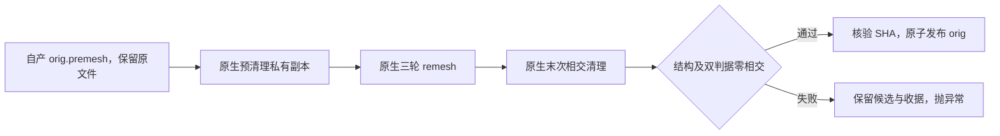

# 原生自编译表面收尾：阶段回归与整例测评

本轮按用户要求，将已定位的慢表面步骤接到固定 FreeSurfer 源码的 Conda 独立构建程序，并保留 FNIT 的质量门。新构建退出 0；两份冻结 FNIT 自产 `orig.premesh` 经实际生产函数回归，均通过结构及源／几何双判据零相交检查，首次完整阶段为 **85.952 秒、71.898 秒**；修复候选发布命名后，以冻结提交 `93affde8` 重跑为 **87.218 秒、72.229 秒**，前后坐标和有序面完全一致。这些是阶段结果；新配方两例原始 T1 的 v2 运行均在 SynthSeg 因共享 GPU0 显存不足而失败。GPU1 同输入 SynthSeg 独立探针为 **11.013760 秒**，分割 0 个差异体素、仿射误差 0；该探针不代表整例。新的 GPU1 两例空目录整例已通过启动前哈希和显存检查，正在运行。**2,000 秒目标、最终误差、整例显存及整体指标等效均未判定**。数据见 [stage_summary.public.json](stage_summary.public.json)。

## 1. 功能与误差定位

`_finish_native_topology()` 读取 FNIT 自产 premesh，先清理私有副本，再三轮 remesh、末次清理，独立质量检查通过且 SHA 绑定正确后才原子发布 `orig`。原始 premesh 保留，执行链没有按被试或已知顶点添加例外。



sub-07 右侧同一原生 GA premesh 若直接执行 remesh→清理，仍有 **11 个源判据相交面和 11 个几何判据相交面**，原报告保留。因此只更换末次清理程序不能解决该输入；新增预清理后的完整链在两份实测网格上通过。预清理改变几何，可能影响后续 remesh 网格及最终指标，仍须完成整例官方误差评估。

公共入口显式选用 `backend="native"`、`topology_backend="native"`、`topology_finish_backend="conda-cpp"`。已有 `surface_placement_backend="native"` 路径调用自编译 white/pial 和 atlas paint；本轮新开关负责拓扑收尾。完整参数和整例 Python／CLI 调用见[功能说明](../../../../docs/recon_all/NATIVE_TOPOLOGY_FINISH.md)。

## 2. 实际版本与程序

FreeSurfer 源码固定 `d932c45b7941662ea380a05efef580568b98d41a`，在 Conda 工具链内新建独立构建，构建退出 **0**。没有复制系统预装 FreeSurfer 的二进制。安装脚本补齐此前 MINIMAL 构建遗漏的 `mris_remesh` 目标、安装和 SHA 清单；许可证与完整私有产物不发布。

| 对象 | 实际版本／SHA-256 |
| --- | --- |
| `mris_remesh` | `008add1ec4dde4bb3bd5b8c6d41cc31b0adc4e893347d63d7dabdc5529a7fd4a` |
| `mris_remove_intersection` | `4f0ccd8a0fcecccc2a7964bf4f6ee5d5c8d9a51b6a432080afe417cbb0ba6f38` |
| 阶段回归代码提交 | `91b7035ece299f3eef7fbc5a5f8e7703a3efaa5b` |
| `native_free.py` | `2d5393b12d1b34f9eda3f4afae6dfcb5f579fd969bb3cc4ce5a6de6555ee8b92` |
| 整例冻结提交 | `efa85ef0eecdfcec2bff097fdd141b5997d97c53`，上述生产函数文件 SHA 未变 |
| 整例源码清单 SHA | `39c5a30ce19573f726b1a4bdc76aa45978f3d5622ef5bf457315939a446c7c45` |
| 直接 remesh／清理私有报告 SHA | `2f9bca5355f405c2253cb581807bac46d820adab5e7dbd209ac0e201c04245b7` |
| 两份生产函数回归合并私有报告 SHA | `9065ed65c5c57c71a857bbf252be01e6cb17cdcedccf970af7d463cb759b999f` |

最新阶段及正在运行的整例均冻结为 `93affde8d369ee6ade22f2c105701ed6577e89a4`，`native_free.py` SHA 为 `64412e3a161a12cd5ddc85caec5faccb5300183c4758d9bc9341793f83ecfb88`，源码清单 SHA 为 `e8dca760536d19bc72a88f4bfe67a5768d4380902958f7cd1b82913e4072b30d`。新阶段报告 SHA 为 `4b1c9a2dc6336055e29840b292f3692b03d065f9adb9dc4588e8c28829529d16`；上表保留之前尝试的版本绑定。

复现脚本 SHA 见机器报告。输入、候选及输出完整 SHA 保留于私有报告和逐阶段收据。`accelerator-a-1` 为脱敏主机别名；本轮共享资源的单次阶段时间不能直接换算成受控整例提速。

## 3. 真实同输入阶段结果

输入是冻结、带 SHA 的 FNIT 自产 premesh，未读取官方参考。秒数包含程序运行、读写及检查；完整 API 另含包装和收据开销。

| 来源／半球 | 预清理 | 三轮 remesh | 末次清理及复检 | 发布 | 完整 API | 最终结构／源相交面／几何相交面 |
| --- | ---: | ---: | ---: | ---: | ---: | --- |
| ds000114 sub-06／左 | 4.637519 s | 21.149648 s | 60.094713 s | 0.032206 s | **85.952282 s** | passed／0／0 |
| ds000114 sub-07／右 | 4.126558 s | 18.091389 s | 49.620352 s | 0.028552 s | **71.897877 s** | passed／0／0 |

最新冻结版本重新运行相同输入：左侧 **87.217588 秒**（129,674 顶点、259,344 面），右侧 **72.229500 秒**（115,122 顶点、230,240 面）。两份均通过结构与双判据零相交门，与发布命名前的版本坐标、有序面完全相同；不是与官方或旧 Python 网格逐点相同。

结构门覆盖有限坐标、闭合、单连通、genus-0、边与顶点流形、面方向和零面积；末次相交检测独立使用源判据及几何判据。清理保留有序面、顶点数和 MRI 几何头；remesh 本身允许改变顶点数与面索引。不能由本表推断与旧 Python 或官方网格逐点相同，也没有据此判定整体指标等效。

实际 Conda 环境 **15 项测试通过**：收尾链 11 项、remesh 安装 1 项、监督器 3 项。最新冻结版本在实际 Conda 通过候选发布 14 项、安装 1 项、监督器 3 项、GPU 准入 7 项、进程归属 15 项、评估绑定 6 项。准入与归属合计 22 项，不能再次相加。另在本地通过评估器／比较器／资源边界相关 38 项。合同测试与上述真实阶段 benchmark 分别记录。

## 4. 输入、输出与复现

两脚本要求新的输出目录，存在时停止以保留现场。输入为 FreeSurfer 三角表面：顶点 `(N,3)`、surface RAS、毫米；面 `(F,3)` 为整数有序索引；文件尾为 MRI 几何。资产目录只提供声明资源，不是官方结果目录。

### 4.1 直接 remesh／清理诊断

[`benchmark_same_input.py`](benchmark_same_input.py) 的必需参数：`--premesh` 为自产冻结输入；`--remesh-binary` 与 `--intersection-binary` 为独立构建程序；`--assets-dir` 为资产；`--output-dir` 为新目录。`--preclean` 默认关闭，开启增加前置清理；`--python-orig` 默认不提供，仅用于可选旧结果比较，不进入计算。`--max-pair-candidates` 默认 `5000000`、须为正整数，保护几何检测内存；超限标记 `resource_guard_blocked`，不按零相交处理。

```bash
# 输入：FNIT 自产冻结 premesh；输出：新的诊断目录，保留全部候选和报告。
python validation/recon_all/optimizations/20261016_native_surface_hotspots/benchmark_same_input.py \
  --premesh /data/fnit/stages/sub-07/rh.orig.premesh \
  --remesh-binary /data/fnit-conda/bin/mris_remesh \
  --intersection-binary /data/fnit-conda/bin/mris_remove_intersection \
  --assets-dir /data/fnit/assets \
  --output-dir /data/fnit/runs/sub-07-direct-native-check \
  --max-pair-candidates 5000000
```

上例诊断直接 remesh→清理；加 `--preclean` 检查前置清理。输出有 `report.json`、程序日志、`orig.native-remesh`／`orig.native-cleaned`；开启预清理另存 `premesh.native-preclean`。报告含 SHA、结构、两类相交数、候选数量、命令与完整墙钟。质量通过退出 0，完成但质量失败退出 2；缺失文件、命令失败或几何改变等抛异常，并尽量保存失败报告。此脚本不发布生产 `orig`。

### 4.2 实际生产函数回归

[`benchmark_pipeline_finish.py`](benchmark_pipeline_finish.py) 从 JSON 清单读取输入，校验 SHA 后复制到新私有被试目录，再调用生产函数。清单为列表，每项四个字段如下；两个输入均须填入实际 64 位 SHA：

```json
[
  {"case":"sub-06-lh","hemi":"lh","premesh":"/data/fnit/stages/sub-06/lh.orig.premesh","sha256":"替换为实际输入SHA-256"},
  {"case":"sub-07-rh","hemi":"rh","premesh":"/data/fnit/stages/sub-07/rh.orig.premesh","sha256":"替换为实际输入SHA-256"}
]
```

`case` 为无路径分隔符的输出子目录名；`hemi` 只接受 `lh`／`rh`；`premesh` 为文件路径；`sha256` 未匹配则停止。五个具名参数均必需：

```bash
# cases-json：上方输入清单；output-root：必须不存在；其余目录为声明资源与程序。
# 复现时显式固定线程，并核对报告中的实际 CPU 亲和性。
OMP_NUM_THREADS=4 NUMBA_NUM_THREADS=4 OPENBLAS_NUM_THREADS=4 \
python validation/recon_all/optimizations/20261016_native_surface_hotspots/benchmark_pipeline_finish.py \
  --cases-json /data/fnit/manifests/native_finish_cases.json \
  --output-root /data/fnit/runs/native-finish-new \
  --native-bin-dir /data/fnit-conda/bin \
  --assets-dir /data/fnit/assets \
  --code-version 93affde8d369ee6ade22f2c105701ed6577e89a4
```

`--native-bin-dir` 定位两个程序，`--assets-dir` 提供资产；`--code-version` 记录实际冻结提交，不能替代源码 SHA 核查。输出包括每例 `subject/surf/H.orig`、私有候选、`subject/scripts/H.native-*.json`，以及根目录 `stage_report.private.json`。合并报告含源码／脚本 SHA、线程、CPU 亲和性、完整时间及收据；失败抛异常并保存失败状态。

等价的内部 Python 调用如下；这是内部入口，运行前 `surf/H.orig.premesh` 与 `scripts` 目录须已就绪：

```python
from pathlib import Path
from fnit.recon_all.native_free import _finish_native_topology

remesh_seconds, cleanup_and_publication_seconds = _finish_native_topology(
    subject=Path("/data/fnit/runs/native-finish-new/sub-06-lh/subject"),  # 新私有被试目录
    hemi="lh",  # 半球名：lh 或 rh
    assets=Path("/data/fnit/assets"),  # 声明的 FNIT 资产
    remesh_binary=Path("/data/fnit-conda/bin/mris_remesh"),  # 固定源码 Conda 独立构建
    intersection_binary=Path("/data/fnit-conda/bin/mris_remove_intersection"),  # 同一构建的相交清理程序
)
```

函数返回单位秒的二元组：三轮 remesh 时间，以及两次清理／检查／发布的其余时间，均含读写。已有收据禁止重入；失败保留候选与收据，已有 `orig` 保持原字节，或继续不存在。

## 5. 原始 T1 整例与资源状态

两例使用 `efa85ef0eecdfcec2bff097fdd141b5997d97c53`，从原始 T1 和全新空目录运行。v1 在创建被试前因启动器 `PYTHONPATH` 丢失已声明的 SimpleITK 依赖而失败，旧目录和收据保留；没有完成科学重建。v2 恢复此前声明依赖并核对 **SimpleITK 2.5.6** 后重新启动，环境清单 SHA 为 `c25cd8cf7053c8224c246744e1f1bc9af12db0c95a8221b27e9546cc4511b62c`。两例均在 **SynthSeg CUDA OOM** 处失败，未完成整例；启动前观测到的空闲显存随后被共享 GPU0 的外部任务占用。原运行现场与失败记录保留，不能据此前置阶段宣称已得到整例耗时。

为核查阶段是否可运行，在 GPU1 以相同输入单独重跑 SynthSeg：完整阶段 **11.013759778 秒**，分割 **0 个差异体素**，仿射最大绝对误差 **0**。这是同输入阶段探针，不能替代原始 T1 与空目录整例。共享卡调度新增可选启动前显存门槛，实时核对目标 UUID 和空闲字节；不足时不创建科学子进程并释放前置失败的未解决标记。这次快照不预留显存，也不能保证启动后没有外部任务进入。

v3 将目标切到 GPU1，冻结 `93affde8`，启动前逐项校验 **2,264 份文件**，原生程序清单 SHA 为 `3cb9b290a76bb94ecd2be1d76ac7cc52ff0fb5d7929e181a915c85b4ae4b3b7e`。最低空闲门槛为 22,000,000,000 字节；实际启动前空闲 27,848,081,408 字节。两例从新空目录顺序运行；该门槛不是资源预留。当前运行中，不报告预测整例时间。

本配方成功整例的完整墙钟、138 项覆盖、严格逐文件诊断、Dice、双向表面距离、厚度／面积／体积及局部异常仍为 **not_assessed**。旧纯 Python 和仅更换 GA 的混合结果见[变慢定位](../20261016_topology_ga_runtime_debug/README.md)，不能移给本次配方。

GPU 保持 TF32 默认和已有经验证的逐阶段 FP32 例外，没有启用 FP16／BF16。原生表面程序使用 CPU；Synth 和其余 FNIT GPU 阶段保留原设备策略。整例父子进程同时显存峰值、采样覆盖及 **20,000,000,000 字节**预算尚未判定；共享整卡峰值不能当作本任务占用。干净环境全流程执行、动态库和文件访问验证尚未完成。本次阶段没有原始 T1 输出脑图，当前配方图示应在整例完成后生成。

## 6. 更新记录、原命令及参考

2026-10-16：独立构建补齐 `mris_remesh`；直接阶段 sub-07 仍有 11／11，保留失败；通用预清理链在两份自产网格通过；原生收尾／安装／监督器 15 项测试通过，后续所有权 14 项、准入相关套件 22 项通过；原始 T1 v1 启动环境失败、v2 两例均在 SynthSeg OOM；GPU1 同输入 SynthSeg 探针通过。最新 `93affde8` 同输入回归与候选发布检查通过，GPU1 v3 两例空目录整例正在运行；当前尚未推送 main。

对应固定源码命令：

```bash
mris_remove_intersection INPUT.orig.premesh PRIVATE.preclean
mris_remesh -i PRIVATE.preclean -o PRIVATE.remeshed --remesh --iters 3
mris_remove_intersection PRIVATE.remeshed PRIVATE.postclean
```

FNIT 加入的几何／结构检查、双判据相交、SHA 绑定和原子发布属于内部步骤，没有独立官方 CLI。完整 native white/pial 参数见[功能页](../../../../docs/recon_all/NATIVE_TOPOLOGY_FINISH.md)。

原代码：[mris_remesh](https://github.com/freesurfer/freesurfer/blob/d932c45b7941662ea380a05efef580568b98d41a/mris_remesh/mris_remesh.cpp)、[mris_remove_intersection](https://github.com/freesurfer/freesurfer/blob/d932c45b7941662ea380a05efef580568b98d41a/mris_remove_intersection/mris_remove_intersection.cpp)。方法：Dale et al., *NeuroImage* 1999（皮层表面重建）；Fischl et al., *Cerebral Cortex* 2004（拓扑修复）；[Fischl 2012, *NeuroImage*](https://doi.org/10.1016/j.neuroimage.2012.01.021)。
