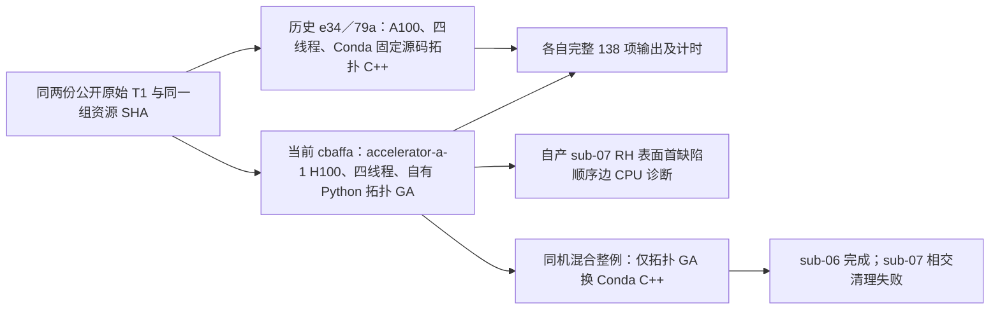

# recon-all 整例变慢定位：拓扑 GA

## 范围与结论

2026 年 10 月 16 日核对了两例公开 ds000114 原始 T1 的历史和当前整例收据，并在 accelerator-a-1 对一例自产表面的**首缺陷顺序边候选**做了 CPU 剖析；随后将同一份 FNIT 自产上游交给 Conda 独立构建的 C++ 拓扑程序，分别重测两侧瓶颈。本次诊断未修改生产算法；另用固定源码 `cbaffa990c7f1d9c0df418762025f6a1507f0092` 和全新空目录执行了仅将拓扑 GA 切为该 C++ 程序的混合整例。混合配方的 sub-06 完成，sub-07 在表面相交清理处失败，不能记为两例完成。完整数值和 SHA-256 见 [机器报告](runtime_diagnosis.json)。

当前整例增长主要落在完整 Python 拓扑遗传搜索：sub-06 左半球 GA 为 **17,145.582 秒**，占该例 CLI 墙钟的 **88.3%**；sub-07 右半球为 **9,671.259 秒**，占 **80.0%**。旧版用 Conda 内固定源码独立编译的 `mris_fix_topology_fnit`，当前版用自有 `python-ga`、GPU 缺陷距离和 packed 状态。两版还换了主机、CPU/GPU、N4 等后端，因此历史 2,000 多秒与当前 1 万多秒是**非配对对照**；阶段计时足以定位当前主要瓶颈，不能将整例倍率当作同机算法加速比。



## 整例计时与可比性

| 公开 T1 | 历史 e34 CLI | 历史 79a CLI | 当前 cbaffa CLI | 当前病例外层墙钟 | 当前 GA 左／右半球 |
| --- | ---: | ---: | ---: | ---: | ---: |
| sub-06 | 2,122.900 s | 2,718.390 s | 19,413.989 s | 19,448.046 s | 17,145.582／12,380.305 s |
| sub-07 | 2,056.372 s | 2,653.001 s | 12,082.773 s | 12,094.283 s | 7,632.393／9,671.259 s |

三版两例的原始 T1 SHA-256 依次为 `7e33afb28f631fac31d81e2428a6144f61aba4102859c694eeb49ee584de04f7` 和 `59ef7bed60d4db64d56d947ebed2ef62a9257c26fe879848fe24d10a490f74fc`；16 个权重和 102 个资产的文件名与 SHA 映射摘要同为 `c01d77debbc11046db102990fdb954ca8df72560362d2f818262a5440689fb3b`。历史 e34/79a 在 A100、Xeon Platinum 8369B 上运行；当前 cbaffa 在 accelerator-a-1、H100 PCIe、Xeon Gold 6430 上运行。均为四线程，但共享负载和算法组合不同。旧版拓扑原生程序 SHA 为 `c3bb6b744f3d3ebcc0bbaf6a79b4266eb712ea51a113b06157456b560654fde6`；当前生产 benchmark 的原生程序映射为空。

e34 的本机记录中，原生拓扑左／右半球为 sub-06 **134.452／73.206 秒**、sub-07 **152.099／95.265 秒**。当前 `persistent_hemisphere_pipeline` 为 **18,610.434／11,343.946 秒**。左右半球并行，GA 时间包含于整例表面组，**不能将左右时间或嵌套阶段直接相加**。当前 N4 为 141.998／143.417 秒、GCA 注册为 29.327／29.453 秒，均不解释万秒级耗时。

### 同机混合整例进度

混合配方仍用上述 `cbaffa` 源码、同两份 T1、相同资源映射和四线程，在 accelerator-a-1 的共享 GPU0 上从新空目录执行；仅拓扑 GA 使用 SHA-256 为 `79175111afac50ca4a740a54d2e83a68ab1fbe78b857d8099052f3322301dce1` 的 Conda 独立构建程序。半球调度从纯 Python 基线的 persistent 改为 groups，后续 remesh、相交清理、white 和 pial 仍为 FNIT Python/Torch。以下使用两版 benchmark 的 `full_harness_seconds`，包括外层校验与 CLI；不是旧 e34/79a 的跨主机 CLI 时间。

| 公开 T1 | 纯 Python cbaffa 完整墙钟 | 混合配方完整墙钟 | 混合运行状态 | 输出及网格 |
| --- | ---: | ---: | --- | --- |
| sub-06 | 19,428.595 s | 5,349.477 s | EXIT 0 | 138/138，双侧生产网格门通过 |
| sub-07 | 12,090.243 s | 976.856 s，**仅失败前耗时** | EXIT 1，右侧相交清理仍有 11 个源判据和 11 个几何判据相交面 | 未完成，未进行整例验收 |

sub-06 的完整墙钟观察值约缩短 3.63 倍，但这两次不是交错配对：半球调度、拓扑输出网格、CUDA 分配缓存策略和运行时共享负载均可能影响其余阶段。不能把这个倍率归因于 C++ GA 的独立算法收益。sub-07 失败发生在 C++ 已产出 `orig.premesh`、FNIT remesh 之后的严格 Python 相交清理；同侧纯 Python 基线曾通过。新算法生成的有序面和顶点数本就不同，这一失败是混合链的真实回归，不能把 976.856 秒当作成功整例速度。失败目录、worker 日志和原始租约回执保留；外部 UID 的 GPU 进程导致租约归属审计未通过，但科学作业本身的 sub-06 EXIT 0、sub-07 EXIT 1 分别以病例 benchmark 和输出核对。目标 GPU 整卡峰值混有其他用户，FNIT 自身同时显存峰值仍未归属，20 GB 预算未判定。sub-06 的事后官方比较已完成，见下节；sub-07 没有完整整例输出，严格与脑区指标仍未评估。

sub-07 右侧随后在新隔离目录重放同一份 FNIT 自产 `orig.premesh`：FNIT 三轮 remesh 用时 **87.25 秒**，随后独立源判据和几何判据均有 **26 个相交面**。FNIT Python 清理耗时约 **73.97 秒**，独立 Conda C++ 清理耗时约 **26.41 秒**；两者最终有序面和全部顶点坐标逐位一致，独立复检均剩 **11／11** 个相交面。原生程序退出 0，但其日志也报告剩余 11 面，因此切换相交清理程序不能让此例通过零残余门。旧纯 Python 与新 C++ 拓扑在 `orig.premesh` 已有不同的顶点和面数（109,503／219,002 对 109,539／219,074），不能用同索引位移归因；旧纯 Python 的 premesh 和最终 orig 均复检为 0／0。新 C++ premesh 的局部 ROI 复检已确认两簇相交在 GA 输出时就存在，remesh 随后放大；这只定位先后顺序，**局部簇计数不能相加为全脑总计**。全脑 premesh 扫描因候选膨胀触发内存保护停止，原始全脑相交数仍为 `not_assessed_memory_guard`。局部 onset 与显式 ROI 复检报告 SHA-256 分别为 `30d21c39389c9ec3cc06e4bb25254ea930605388ca8e2ccbca995093d9b37036`、`36a557166faf4c029be7b6e90c1a65eeddcc58de46210ba79b22d144e8dddc4f`。该阶段重放不是新的原始 T1 整例。完整私有结论 SHA-256 为 `96af604d81b54aca17a1c4f6c7ab5cbfd19c3a6aa40e9320240b94d3511d4b28`，私有产物清单 SHA-256 为 `eb31dba1ab91757f0528849048a5cffbed0bfcff9bffe5927fd7892962824996`，公共摘要在[机器报告](runtime_diagnosis.json)。

### 混合 sub-06 事后评估

同一冻结提交的新版评估器读取混合整例原始 T1 输出，以及预先冻结的官方普通文件参考视图。它重新计算并校验自产 **138 个普通文件**、官方清单 **700 个普通文件**，以 4 个 CPU 线程完成严格逐文件、七张离散标签图 Dice、四张最终 white/pial 表面的双向点到三角面距离、脑区统计、扩展网格质量和三张脑图。评估器 EXIT 0，报告 `status=complete`；事后比较耗时 **1,365.542 秒**，不计入上述 **5,349.477 秒**整例运行时间。该结果只属于 sub-06，官方 **5,735.363 秒**是历史归档时间，不能当成此次同环境配对速度。

严格复现为 **14/138**，通过的文件集合与纯 Python sub-06 相同。离散分割的关键结果如下；标签 77（WM-hypointensities）在官方为 0 体素、混合候选为 1 体素，因此 `aseg.mgz` 等图的最小 Dice 为 0，须结合标签大小和 P05 一起看。

| 输出 | 不同体素 | Dice P05 | Dice 中位数 |
| --- | ---: | ---: | ---: |
| `aseg.mgz` | 18,724 | 0.9793 | 1.0000 |
| `aparc+aseg.mgz` | 28,661 | 0.9074 | 0.9635 |
| `aparc.a2009s+aseg.mgz` | 40,446 | 0.8564 | 0.9340 |
| `aparc.DKTatlas+aseg.mgz` | 26,300 | 0.9267 | 0.9684 |
| `wmparc.mgz` | 40,542 | 0.9096 | 0.9626 |
| `ribbon.mgz` | 23,468 | 0.9751 | 0.9840 |
| `filled.mgz` | 13 | 0.99998 | 0.99998 |

| 最终表面 | 候选→官方均值／P99 mm | 官方→候选均值／P99 mm | 双向最大 mm |
| --- | ---: | ---: | ---: |
| LH white | 0.0406／0.2951 | 0.0410／0.2971 | 3.454／3.984 |
| LH pial | 0.0721／0.5595 | 0.0700／0.5293 | 4.624／3.196 |
| RH white | 0.0436／0.2965 | 0.0428／0.2937 | 2.320／1.494 |
| RH pial | 0.0678／0.4895 | 0.0684／0.4932 | 2.351／2.172 |

距离在共同的 surface RAS 毫米空间按源顶点到目标完整三角网格计算。候选与官方顶点数不同，同索引厚度和注释局部图标为 `not_assessed_vertex_correspondence`。aparc 68 区厚度、面积、灰质体积的绝对相对误差中位数分别为 **0.506%／0.952%／1.009%**，P90 为 **1.429%／3.754%／4.682%**；其余图谱与 `-no-th3` 体积定义逐项保存在私有机器报告。扩展质量检查显示双侧拓扑有效，`sphere`／`sphere.reg` 均无翻折；white/pial 真实横穿对数为候选 LH／RH **524／233**，官方 **441／269**。左侧局部穿越增加，不能仅凭平均表面距离改善宣称没有退化。整体指标等效没有预先确认的统一门槛，仍为**未判定**。

私有完整 `evaluation.json` 的 SHA-256 为 `32142c30bfb3c0caf6a28cab9465cd2beccdbac7a5d3cd7ea6639d282f4e42a3`；官方参考普通文件清单为 `e6aa553acfe943b4dd753804b7fbf57e6916c89d16f3c65003a677515be303be`。事后评估器与几何比较器 SHA-256 为 `c8247ccdc492bfd520331fc2673417ac92ef3c2f4fd33543ce46ca806204f83b`、`79dd2ec3237300ea0dcfb7de44f789ebe36791fc25d502d7187da7f51dea41b7`。完整命令留在私有 `evaluation_tools_mixed_v2/run_hybrid_sub06_v1.private.sh`（SHA-256 `987a3c3bd62d6983637ef66b830bf58f77003e22791356827482beb41f8eaa18`），脑图 `t1_surface_overlay.png`、`region_errors.png`、`local_region_boundary.png` 留在私有评估目录。整例目标 GPU 显存所有权仍为 `ownership_unresolved`，整卡峰值包含外部进程，20,000,000,000 字节预算未判定。

## 当前 GA 的工作量

| 病例／半球 | 缺陷数 | 候选评估次数 | 搜索用时 | GA 文件接口用时 | 搜索平均每次 |
| --- | ---: | ---: | ---: | ---: | ---: |
| sub-06 LH | 24 | 12,330 | 15,668.267 s | 17,139.249 s | 1.271 s |
| sub-06 RH | 20 | 8,765 | 10,692.073 s | 12,378.726 s | 1.220 s |
| sub-07 LH | 9 | 4,721 | 6,743.360 s | 7,631.294 s | 1.428 s |
| sub-07 RH | 5 | 4,420 | 9,093.599 s | 9,670.097 s | 2.057 s |

搜索占各 GA 文件接口用时约 **86%–94%**；不是输出写入、N4 或统计尾段主导。sub-07 RH 最慢的是从零计数的缺陷 `2`：**39,964 条边、1,853 个内部顶点、1,940 次候选评估、6,621.566 秒搜索**。该缺陷一项就占该半球 GA 文件用时约 68.5%。候选必须按现有遗传策略完整评估，不能通过减少轮数或改变评分规则换取未经验证的速度。

## 本次 CPU 候选剖析

[脚本](profile_first_candidate.py)读取 FNIT 自产 `orig.nofix`、`qsphere.nofix`（surface RAS、mm）和 `brain.mgz`（conformed uint8 网格），写出新目录内 `profile.json` 和可选 `candidate.pstats`；失败抛异常并保留目录。它使用 `ordering=np.arange(...)` 评估 sub-07 RH **缺陷 0** 的顺序边候选。此缺陷仅 **80 条边、14 个被选顶点**。它既非生产 GA 随机/遗传过程实际选取的首个候选，也不是上述最慢缺陷。诊断用两个 CPU 线程和 serial 距离；完整整例为四线程、GPU 缺陷距离。脚本没有对应的 FreeSurfer 独立 CLI；相关官方内部步骤属于固定版本 `mris_fix_topology`。

| 同一初态的候选 | 观测周期 | 说明 |
| --- | ---: | --- |
| 第一次，不启用 cProfile | 14.906 s | 冷 JIT 和缓存初始化可能计入 |
| 第二次，启用 cProfile | 1.133 s | 已预热，包含 cProfile 开销 |
| 独立复测第二次，不启用 cProfile | 0.639 s | 热态；另存完整候选与后态字段 SHA |

首次两次的 fitness、面数组 SHA、坐标数组 SHA 一致。启用 cProfile 的第二次状态物化为 **0.600 秒**、完整候选接口为 **0.370 秒**；候选内几何 **0.311 秒**、五项评分 **0.049 秒**。cProfile 的最高独占时间为 `topology_state_pack._pack_storage_prefix` **0.264 秒**。另一独立复测中，未启用 cProfile 的第二次热态周期 **0.639 秒**，其中状态物化 **0.270 秒**、候选接口 **0.320 秒**、几何 **0.264 秒**、CPU 距离 **0.043 秒**；两次运行的 32 个候选字段、40 个后态字段及控制信息 SHA 逐一相同。该复测首次周期为 3.660 秒，说明首次运行随 JIT 缓存状态变化。两个独立执行并非交错配对；**14.906→1.133 秒不是加速实测，1.133 与 0.639 秒也不能相减成精确的 cProfile 开销**。启用与不启用 cProfile 的热态计时差异较大，尚不能隔离剖析器开销和共享负载。小缺陷的 CPU 结果不能外推到生产 GPU 距离和 39,964 边缺陷。首个完整私有 profile 的 SHA-256 为 `56136379f9f9868aefd6c781d3fa2e39cfd6816364f660fe3b69db77067508dd`，实际执行脚本 SHA 为 `2323080ded888b7c846426334ff5040337c01380a165f7f6d9d6afaedd1b4fff`；独立未剖析复测的 profile SHA 为 `2b41700acf23f2001c7ff10d1fd08faba38d41ccbf3b3486d380c15d713631b2`、脚本 SHA 为 `5d5ae6e77dcbc781f79243d5ea5a9ffc96f0f248f30262e06ff411d6c0103345`。报告分别位于 `$FNIT/runs/<private-run>/diagnostics/topology_ga_runtime_debug_20261016/sub07_rh_first_cpu_profile_v1` 和 `sub07_rh_first_cpu_capture_baseline_v1/result`。

该脚本是诊断 CLI，无公开 Python 函数接口；每个参数含义如下。`--input-surface` 是自产未修复表面，`--input-qsphere` 是对应预球面，`--brain` 是自产 MRI，`--output` 必须是不存在的新目录，`--threads` 指 CPU 总线程数，`--profile` 对第二次运行开启 cProfile；默认两线程且不启用 cProfile。

```bash
python validation/recon_all/optimizations/20261016_topology_ga_runtime_debug/profile_first_candidate.py \
  --input-surface /path/to/subject/surf/rh.orig.nofix \
  --input-qsphere /path/to/subject/surf/rh.qsphere.nofix \
  --brain /path/to/subject/mri/brain.mgz \
  --output /path/to/new_diagnostic_directory \
  --threads 2 --profile
```

运行时还须使当前固定 FNIT 源码的 `src` 和 `tools` 位于 `PYTHONPATH`。诊断脚本不读取官方参考、不写生产表面。当前 GPU1 在本次检查时被其他 UID 占用约 54 GiB；未抢占对方进程，也未运行 GPU 同机 A/B。该观察**不能推断历史整例的共享负载原因**。

## 同输入 C++ 拓扑阶段结果

在 accelerator-a-1 上，隔离的 C++ 阶段复用当前 cbaffa 整例自产的同侧 `orig.nofix`、`inflated.nofix`、`qsphere.nofix`、`brain.mgz` 和 `wm.mgz`。五个文件逐项 SHA-256 与原目录一致。执行程序是 Conda 内固定 FreeSurfer 源码独立编译的 `mris_fix_topology_fnit`，程序 SHA-256 为 `79175111afac50ca4a740a54d2e83a68ab1fbe78b857d8099052f3322301dce1`；C++ 内部一个线程，外层亲和 CPU 0、1，不占 GPU。第一次隔离启动因未指定私有许可证而在计算前退出，失败回执保留；第二次在全新目录运行，两侧均 EXIT 0。许可证内容未复制到源码或报告中。

| 相同自产输入 | 当前 Python GA 整例阶段 | C++ 原生计算 | C++ 完整阶段接口 | 观察到的阶段耗时比 |
| --- | ---: | ---: | ---: | ---: |
| sub-07 RH | 9,671.259 s | 315.237 s | 318.226 s | 30.39 倍 |
| sub-06 LH | 17,145.582 s | 143.426 s | 146.488 s | 117.04 倍 |

以上比值使用 Python GA 阶段时间除以 C++ 完整阶段接口时间。Python 文件接口含后续 remesh、网格质量及相交清理，C++ 此次只运行到 `orig.premesh`，**二者阶段范围并不完全相同**。更窄的 Python 遗传搜索本身分别耗时 sub-07 RH 9,093.599 秒、sub-06 LH 15,668.267 秒，已远大于 C++ 到 premesh 的 318.226／146.488 秒。它们是同主机、同五项输入的实际观察，仍受线程配置和不同时段共享负载影响；**不是整例提速**。旧 e34 的 `orig.nofix` 与当前 cbaffa 四侧 SHA 均不同，且原生程序、主机也不同，旧版 73–152 秒只能作为历史量级。

两份 C++ `orig.premesh` 均为单连通、Euler 数 2、闭合、无退化面、重复面、非流形顶点或面方向冲突，体积头与自产 WM 匹配。Python GA 对应 premesh 也通过相同结构门。两算法的有序面和顶点数不同：sub-07 RH 为 C++ 109,539 顶点／219,074 面、Python 109,503／219,002；sub-06 LH 为 123,863／247,722、123,908／247,812。因此两份网格**没有逐顶点对应关系**，不得直接计算同索引误差。sub-07 RH 两表面的双向点到三角面距离已计算，C++→Python 的平均／最大为 0.000965／7.8712 mm，Python→C++ 为 0.000572／0.824361 mm；C++ 网格有 16 条超过 5 mm 的边，Python 对应为 0。这是 premesh 的局部形状诊断，不能代替最终 `orig` 质量门。混合整例的 sub-06 最终网格通过；sub-07 RH 在 remesh 后的严格相交清理失败。

复现时对 [C++ 阶段脚本](run_native_stage.py) 分别传入原始 FNIT subject、新的空输出目录、半球、Conda 程序和资产目录；[网格检查脚本](same_input_mesh_check.py)核对两份阶段输出与五个输入 SHA。两次完整 JSON、日志与回执留在 accelerator-a-1 私有目录；公开 [机器报告](runtime_diagnosis.json)记录脱敏摘要和报告 SHA。

## Python 迁移后的其他耗时

以下是已有真实数据的**阶段观察**，与上面的两例原始 T1 混合整例分别记录。表中冻结同输入与跨提交／跨主机结果不能合并为整例收益；括号中的文件接口可能包括读写、JIT 和独立质量检查。

| 阶段 | 自有 Python／PyTorch | 原生参考 | 判断与范围 |
| --- | ---: | ---: | --- |
| 完整拓扑 GA | cbaffa sub-06 LH 17,145.582 s，sub-07 RH 9,671.259 s | 同主机同自产上游，C++ 到 `orig.premesh` 为 146.488／318.226 s | 当前最主要瓶颈；Python 文件接口另含 remesh、质量门和相交清理，阶段范围不同，搜索本身仍耗时 15,668.267／9,093.599 s。 |
| 三轮 remesh | 冻结官方 premesh：LH／RH 100.87／97.16 s | 原版 CLI 14.46／19.53 s | 有序坐标及面索引在九个子步骤同输入一致；这是较旧单次阶段测量，约 80 s／侧的差额不能直接累计到当前整例。历史 e34 已用 Python remesh，混合 sub-06 的 LH／RH 约 94.27／95.85 s；它是现存优化空间，**不是本轮万秒增长的新原因**。 |
| 非零相交清理 | 冻结 FNIT 自产 sub-07 LH premesh：完整 API 474.618 s | 同输入参考重复 3.871／3.846 s | 检测、顺序 SOAP 和独立复检明显慢；另一输入两边都有残余，不能以参考退出 0 视为质量通过。混合 sub-07 RH 的 11／11 残余是**质量失败**，不是此配对的速度样本。 |
| pial | 冻结同输入 GPU 候选 266.084 s | 独立构建 C++ 同输入 141.031／138.214 s | 自有 GPU 已比其 CPU 控制 1,148.816 s 快；仍有阶段提速空间，但这组跨版本记录不说明本次整例退化原因。 |
| atlas `avg_curv` paint | 两例四侧 4.937–5.865 s／侧 | 同输入参考重复 0.500–0.640 s／侧 | 输出逐元素和字节一致，单侧仅数秒，对万秒级回归贡献小。 |

混合 sub-06 的 pial 表面组为 **3,119.630 秒**，纯 Python cbaffa 表面 worker 两侧为 **352.16／354.12 秒**，混合 worker 为 **3,064.73／3,115.06 秒**。两次均使用 FNIT 的 Python pial，却换了输入网格、半球进程模式和 CUDA 分配缓存设置，因此不能把此处约 9 倍的增长归为“改用 Python”。需要以**相同 final white** 对缓存策略和输入网格分别作配对测试。

white 也不能列为已确认的 Python 迁移减速：冻结自产 sub-07 LH `white.preaparc` 的自有实现为 **374.650 秒**，同输入独立 Conda C++ 两次为 **500.977／521.503 秒**；最终 white 的两例四侧自有完整 API 为 **173.577／180.302／220.791／248.108 秒**，同输入 `white_fast` 为 **200.892／183.400／235.019／225.571 秒**，有快有慢。混合整例内 white 用时变化不能与冻结同网格阶段直接互换。当前 N4 使用 SimpleITK 的内部编译计算，也不属于把 C++ 算子逐步改写为 Python 后的纯 Python 热点。已有标准球面、Torch inflation、WM 编辑和曲率统计存在自有实现更快的阶段记录，不能把所有 Python 迁移概括为减速。

## 下一步验证与数值状态

当前 cbaffa 纯 Python 两例科学作业均退出 0、各有 **138/138** 个输出、双侧生产网格门通过；相对归档官方严格逐文件为 **14/138、23/138**。完整 Dice、双向表面距离、厚度、面积、体积和局部异常见[当前两例报告](../20261016_gpucw1_cbaffa_two_case/README.md)；脑图也保留在该报告中。这些是纯 Python 配方的结果，不能移给新的混合配方。

混合配方只完成 sub-06；sub-07 的首个阻断是 C++ GA premesh 已有的两簇局部相交在 FNIT remesh 后扩大，最终严格清理未达到零残余。同输入阶段重放发现 Python 与独立构建参考程序最终均剩 11／11 个相交面，因此仍须定位拓扑 GA 的通用几何原因，修复后从另一新空目录运行两例原始 T1，不能在旧失败目录补跑并称连续整例。混合 sub-06 的事后比较已经完成，严格 14/138；受控退化检查和两例整体指标等效仍未判定。当前 GPU 整卡峰含外部进程，FNIT 自身同时占用峰尚未归属，20,000,000,000 字节预算未判定。

## 证据与参考

- [e34 历史整例](../20261010_whole_sphere_finish_a100_e34a1829/README.md)、[79a 历史整例](../20261010_whole_gcsa_remesh_a100_79a41cdd/README.md)、[cbaffa 当前整例](../20261016_gpucw1_cbaffa_two_case/README.md)。三个版本的 benchmark SHA、当前四份完整 GA 报告 SHA、输入及诊断 SHA 均见[机器报告](runtime_diagnosis.json)。当前完整 GA 报告保留在私有 `$FNIT/runs/<private-run>/whole_cbaffa_sm90a_v1/<subject>/subject/scripts/<hemi>.topology.genetic/report.json`。
- [自有完整 GA 算法、输入输出和官方命令](../../../../docs/recon_all/PYTHON_GENETIC_PROFILE.md)，[FNIT recon-all 总说明](../../../../docs/recon_all/README.md)。
- 其他阶段的冻结同输入证据：[remesh](../../python_gpu_port/REMESH_VALIDATION.md)、[非零相交清理](../../../../docs/recon_all/INTERSECTION_REPAIR.md)、[pial](../../../../docs/recon_all/PYTHON_PIAL_PLACEMENT.md)、[white.preaparc](../../../../docs/recon_all/PYTHON_WHITE_PREAPARC.md)、[最终 white](../../../../docs/recon_all/PYTHON_FINAL_WHITE.md)、[atlas paint](../../../../docs/recon_all/PAINT_ATLAS_PYTHON.md)。各自源码、程序和输入版本见对应报告。
- [固定 FreeSurfer 源码](https://github.com/freesurfer/freesurfer/tree/d932c45b7941662ea380a05efef580568b98d41a)，Fischl B. FreeSurfer. *NeuroImage*. 2012;62:774–781。
