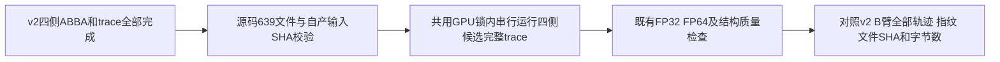

# 实际候选源码的标准球面连续回归

## 1．功能

[`regress_standard_sphere_candidate.py`](regress_standard_sphere_candidate.py)
补充标准球面已有法向A/B测试的覆盖：原A/B两臂均使用`5ca07f99`，只切换
法向设备；生产候选`71cc9189`还修改了共享梯度平均器的缓冲复用。因此，
四侧分别增加一次真实候选完整trace，对照原v2的B臂完整trace，覆盖候选
实际调用的共享平均器。每侧不再重复ABBA。

本工具复用同一份`benchmark_standard_sphere.py worker`及其质量算法。
输入仍为两例FNIT自产的`inflated/smoothwm`，不读取官方表面。完整有序
平均、标准球面优化及收尾停止规则保持原参数；所有候选固定CUDA averaging、
normals和finish。trace包含观测开销，不能作为提速测量或原始T1整例。



## 2．输入、Python调用和输出

`run(plan=...)`接收私有JSON对象，返回整数退出码；入口推荐使用带清单SHA
的CLI。参数错误抛异常；子进程失败在新目录保留报告、日志和已保存表面，
停止后续侧，不自动重试。既有输出目录存在时拒绝运行。

| plan字段 | 含义与结构 |
| --- | --- |
| `worker/worker_sha256` | 本轮v2完整worker普通文件的绝对路径及64位SHA |
| `candidate_source/candidate_commit` | 候选冻结源码根及完整40位提交 |
| `candidate_manifest/candidate_manifest_sha256` | `fnit-sphere-source-v1`清单，覆盖`src/fnit`全部Python文件；当前639项 |
| `candidate_archive_manifest/candidate_archive_manifest_sha256` | 原候选转移清单路径和预先声明SHA，用于绑定来源 |
| `baseline_manifest/baseline_manifest_sha256/control_commit` | v2使用的完整源码清单和控制提交 |
| `inputs_manifest/inputs_manifest_sha256` | `fnit-sphere-production-inputs-v1`四侧清单；逐项绑定生产benchmark、runtime及两张表面 |
| `control_root` | 已完成v2根；读取每侧`trace-01-B`，不会修补旧目录 |
| `output_root` | 必须不存在的新运行根 |
| `python_interpreter/python_interpreter_sha256` | 显式解释器普通文件目标及SHA |
| `cuda_visible_devices` | 外层固定的物理卡可见性；worker内显式使用`cuda:0` |
| `runner_sha256` | 本工具自身预先声明SHA |
| `payloads` | 恰好四项；每项包含既有清单`row`、`mode="trace"`、`arm="B"`、固定源码和输入清单、`device="cuda:0"`及新输出路径 |

源码对照只允许标准球面相关依赖中的
`mris_register_average_numba.py`发生预期变化；其他相关模块变化时报错。
线程环境固定4，CPU亲和性固定0–3。共享锁及具体私有路径由协调者准备。

```python
import hashlib
import json
from pathlib import Path

from regress_standard_sphere_candidate import run

private_plan_path = Path("/data/fnit/new-task/trace-plan.private.json")  # 已核对的私有计划
expected_plan_sha256 = "替换为准备回执中的64位SHA"  # 不根据运行结果改写
plan_bytes = private_plan_path.read_bytes()  # 只读原计划
assert hashlib.sha256(plan_bytes).hexdigest() == expected_plan_sha256
private_plan = json.loads(plan_bytes)  # 结构见上表
# 在协调者已取得共用GPU锁、固定GPU和四线程环境后调用。
exit_code = run(plan=private_plan)  # 0表示四侧执行完成；严格一致性另读summary
```

输出结构为每侧`trace-00-B.payload.private.json`、日志及子目录内的
`report.private.json`、`trace.private.json`、`lh.sphere`或`rh.sphere`。
根`summary.private.json`保留来源、依赖变化、四次退出和逐侧比较。
表面坐标为surface RAS/mm，面为有序三角形索引；trace按每次实际更新和
完整收尾轮次保存坐标/梯度/搜索输入指纹、目标函数和步长接受状态。

严格诊断分别记录全部质量指纹相等、完整JSON轨迹相等、trace字节SHA相等、
球面SHA和字节数相等；执行完成和严格一致性分开。质量范围是既有闭合、
连通、genus0、流形、方向、零面积和两种径向翻折判据，不扩展宣称一般
三角面碰撞已经完整检查。

## 3．命令行

实际私有launcher先等待`task_gpu1.lock`，再检查v2全部24次子进程完成，
之后才开始四侧候选。下面使用说明路径，真实计划由准备回执绑定：

```bash
# 四线程和亲和性与既有同输入测试相同；选卡由协调者设置。
OMP_NUM_THREADS=4 NUMBA_NUM_THREADS=4 MKL_NUM_THREADS=4 OPENBLAS_NUM_THREADS=4 \
taskset --cpu-list 0-3 /data/fnit/env/bin/python \
  /data/fnit/tools/regress_standard_sphere_candidate.py \
  --plan /data/fnit/new-task/trace-plan.private.json \
  --plan-sha256 准备回执中的64位SHA
```

## 4．原软件调用

对应完整标准球面命令为`mris_sphere INPUT_INFLATED OUTPUT_SPHERE`。
内部逐轮观测及控制/候选比较没有独立官方命令。本工具不调用该程序。

## 5．本轮结果和更新记录

目前为工具准备及契约检查，候选四侧trace尚未运行，精度和耗时均未判定。
2026-10-17新增此覆盖，完整worker和质量判据继续使用v2固定版本。
最终原始T1整例速度、显存和官方误差由协调者另行汇总。

## 6．参考

- [既有完整球面A/B工具与输入约定](README.md)。
- [固定FreeSurfer 8.2球面源码](https://github.com/freesurfer/freesurfer/blob/d932c45b7941662ea380a05efef580568b98d41a/mris_sphere/mris_sphere.cpp)。
- Fischl B, Sereno MI, Dale AM. Cortical surface-based analysis. II. Inflation,
  flattening, and a surface-based coordinate system. *NeuroImage* 9:195–207, 1999.
