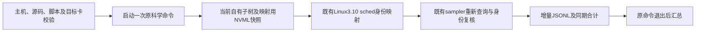

# 四次整例的独立显存监测

## 1. 功能与边界

[`monitor_science_pair.py`](monitor_science_pair.py) 在外层启动一次明确给定的
科学脚本，并监测其自有父子树。它复用
`diagnose_recon_nvml_namespace.build_owned_sched_pid_map` 和
`ProcessTreeDeviceSampler`，不更改归属规则，也不修改冻结科学源码或原报告。
父进程不初始化 CUDA、不分配 GPU 张量，不设置精度、线程或分配器策略。



当前映射来源只在 Linux 3.10 验证，其他内核启动前拒绝。映射用 raw
NVML 查询与 sampler 的重新查询是两个时间点，报告分别记录；显存合计只
取 sampler **本次新增帧**。不复用失败前的历史帧，不相加不同进程的历史
峰值，不以 Torch 零计数替代实际占用。

目标卡有不能归属的外部进程时，既有采样器仍可能给出
`ownership=unresolved`。此时完整自有峰值保持 `null`；
`partial_attributed_same_snapshot_peak_bytes` 仅为已验证进程在同期快照中的
部分合计观察，不能当作完整 FNIT 峰值或据此判定低于20 GB。

## 2. 输入、输出与 Python 调用

所有路径只用于私有现场。该工具不读取影像或许可证内容。源码根包含
`src/`；另传既有 `fnit-sphere-source-v1` JSON 清单与其实际 SHA，清单
`commit` 须匹配 `source_commit`，其中两份监测模块声明和实际文件 SHA
须分别匹配。不创建 marker 或向冻结树写文件。完整科学源码校验仍由原
租约与评估执行，本工具只核对已有清单及实际加载的两份监测模块。目标
UUID 为现场已确认的完整 GPU UUID。

```python
import importlib.util
from pathlib import Path
from types import SimpleNamespace

monitor_script = Path("/data/validation/monitor_science_pair.py")
module_spec = importlib.util.spec_from_file_location("fnit_memory_monitor", monitor_script)
monitor_module = importlib.util.module_from_spec(module_spec)
module_spec.loader.exec_module(monitor_module)
monitor_options = SimpleNamespace(
    source_root=Path("/data/frozen_candidate"),  # 只导入其中已绑定的采样器
    source_commit="<实际40位提交>",  # 与既有清单commit一致
    source_manifest=Path("/data/private/source_manifest.json"),  # 既有完整源码清单
    source_manifest_sha256="<源码清单实际SHA>",  # 不重写或补造清单
    wrapper_sha256="<本监测脚本实际SHA>",  # 绑定实际执行代码
    diagnose_tool=Path("/data/validation/diagnose_recon_nvml_namespace.py"),  # 既有映射工具
    diagnose_sha256="<既有映射工具实际SHA>",  # 不复制或改写映射算法
    profiling_sha256="<profiling.py实际SHA>",  # 冻结采样器源码
    nvml_sha256="<nvml_process_memory.py实际SHA>",  # 冻结NVML查询源码
    command_script=Path("/data/private/run_science_pair.sh"),  # 原科学启动脚本
    command_script_sha256="<原脚本实际SHA>",  # 原科学命令不会被重写
    expected_host="<实际主机名>",  # 当前主机必须匹配
    expected_uid=1000,  # 当前账号实际UID
    gpu_uuid="<实际完整GPU UUID>",  # 与sampler实际枚举目标一致
    device="cuda:0",  # 沿原CUDA_VISIBLE_DEVICES解析的逻辑设备
    interval=0.5,  # 默认采样目标间隔，秒；实际间隔另记
    speed_pair_report=Path("/data/new_pair/speed_pair.private.json"),  # 将由原脚本生成
    output_root=Path("/data/new_monitor"),  # 必须不存在；失败也保留
)
monitor_exit = monitor_module.monitor(
    options=monitor_options,
    command=["/bin/bash", "/data/private/run_science_pair.sh"],  # 仅执行一次的显式argv
)
```

`monitor(options, command)` 返回进程退出整数，不返回科学评估结果。它不
重试，不发送终止信号。监测器内部异常发生在科学命令启动后时，仍等待
原命令退出，并保留独立的科学退出码与监测失败状态。

| 参数 | 类型、默认值和限制 |
| --- | --- |
| `source_root` | 必填目录；包含绑定的 `profiling.py`、`nvml_process_memory.py`，实际导入位置另核对。 |
| `source_commit` | 必填40位小写提交，与既有源码清单的 `commit` 一致。 |
| `source_manifest`、`source_manifest_sha256` | 必填既有 `fnit-sphere-source-v1` JSON 及实际 SHA；其 `files` 映射须包含两份监测模块并分别匹配。完整清单 SHA、声明文件数及本工具的局部校验范围均保存。 |
| `wrapper_sha256` | 必填64位 SHA；绑定实际运行的本监测脚本。 |
| `diagnose_tool`、`diagnose_sha256` | 必填现有映射工具路径及实际 SHA；只导入函数，不调用该工具的分配探针。 |
| `profiling_sha256`、`nvml_sha256` | 必填两份既有监测源码的实际 SHA。 |
| `command_script`、`command_script_sha256` | 必填原科学脚本及 SHA；解析后的文件路径必须出现在显式命令 argv 中。 |
| `expected_host`、`expected_uid` | 必填实际主机名、整数 UID；不符则不启动科学命令。 |
| `gpu_uuid` | 必填完整目标 UUID；NVML 枚举与 sampler 实际目标必须相同。 |
| `device` | 默认 `cuda:0`；沿继承的 `CUDA_VISIBLE_DEVICES` 选择，不修改可见设备。 |
| `interval` | 默认0.5秒，允许0.05–60秒；查询超时不会伪装成达到了设定频率。 |
| `speed_pair_report` | 可选 `Path`，默认未提供；提供时只接受已知四整例 schema，绑定实际 run 与活着的 CLI 身份。 |
| `output_root` | 必填新目录；普通旧目录和悬空入口都拒绝，不覆盖原证据。 |
| `command` | 必填非空 argv 列表；CLI 用 `--` 分隔。无 shell 拼接，不把日志内容解释成命令。 |

输出目录权限为700、文件为私有权限，包含：

- `samples.private.jsonl`：每帧立即写一行。保留 mapping raw 查询起止、映射
  证据、sampler 本次调用起止及新帧、自有 PID/starttime/namespace 身份；
  原始 PID、路径、UUID 只留私有，不能直接提交 GitHub。
- `report.private.json`：每30秒及退出时更新小型汇总；记录原命令退出、实际
  文件 SHA、继承的具名资源环境、采样数量与实际最大间隔、wrapper 总范围
  及各 run 的已观测帧汇总。许可环境及内容不保存。
- `child.private.log`：原科学脚本输出。监测器不把此日志作为成功证明。

所有显存单位为字节，时间为秒；没有影像坐标转换。文件不存在、SHA错误、
身份不符、内核不支持或目标卡初始查询失败时，在科学命令前停止。运行中
单帧查询、身份或元数据失败保持未知，不填零；完整记录写出失败属于监测
失败，不终止科学子任务。CLI退出0只表示命令和监测器执行完成，不代表
精度通过、20 GB达标或部署隔离通过。

### 四次整例的时间绑定

现有冻结 benchmark 保存实际 CLI elapsed、UTC、PID 和显存采样 monotonic，
**没有精确 CLI start/end monotonic 字段**。外层不能补造。工具只在采样
前后都看见同一条 `running` run、相同实际 `cli_pid` 与启动 tick，且该
自有进程命令与 benchmark 的 `cli_command` 一致时，将整帧绑定到该 run。
源码提交、原 T1 SHA 和 benchmark 元数据也须一致。

`first_sample_monotonic` / `last_sample_monotonic` 是存活 CLI 的观测范围，
不等于准确起止，不覆盖两个边界及未观测间隔。未绑定的启动、哈希、运行
间空档、退出帧只在 wrapper 全范围中，不进入任何一例的峰值。各例最终
完整耗时仍引用其实际 `benchmark_cli_wall_seconds` 和
`benchmark_full_harness_seconds`；不能用本监测器总时间替代。

## 3. CLI

```bash
python /data/validation/monitor_science_pair.py \
  --source-root /data/frozen_candidate \
  --source-commit '<实际40位提交>' \
  --source-manifest /data/private/source_manifest.json \
  --source-manifest-sha256 '<源码清单实际SHA>' \
  --wrapper-sha256 '<监测脚本实际SHA>' \
  --diagnose-tool /data/validation/diagnose_recon_nvml_namespace.py \
  --diagnose-sha256 '<映射工具实际SHA>' \
  --profiling-sha256 '<profiling实际SHA>' \
  --nvml-sha256 '<nvml查询实际SHA>' \
  --command-script /data/private/run_science_pair.sh \
  --command-script-sha256 '<科学脚本实际SHA>' \
  --expected-host '<现场主机名>' \
  --expected-uid 1000 \
  --gpu-uuid '<完整GPU UUID>' \
  --device cuda:0 \
  --interval 0.5 \
  --speed-pair-report /data/new_pair/speed_pair.private.json \
  --output-root /data/new_monitor \
  -- /bin/bash /data/private/run_science_pair.sh
```

全部 CLI 具名参数对应上表。外层原有租约继续负责 GPU 准入、四线程 CPU
亲和性及原环境；新增 wrapper 须用新 job/receipt 绑定，不追改已有回执。
监测进程也消耗少量 CPU 与 I/O，四次运行应使用相同监测方式；不能把局部
算子时间直接解释成整例速度。原脚本可能生成几小时任务，本工具没有独立
定时器、后台调度或自动重启。

## 4. 原软件调用与验证

独立监测没有对应 FreeSurfer 命令。原科学脚本仍调用 FNIT 已有四次整例
编排；本工具不调用任何上游重建程序。

2026-10-17 新增最小监测入口。轻量契约测试只覆盖未知/失败帧不伪造峰值、
同帧取最大而非各进程峰值相加、缺少实际运行元数据时不绑定病例，以及
空命令在执行前拒绝。尚未运行服务器分配探针或整例监测；真实显存覆盖与
开销为 `not_assessed`。源算法、原门槛与科学精度没有修改。

- [现有父子归属诊断](../../../../tools/diagnose_recon_nvml_namespace.py)
- [现有过程树采样器](../../../../src/fnit/recon_all/profiling.py)
- [现有 NVML 查询](../../../../src/fnit/recon_all/nvml_process_memory.py)
- [四次整例配对](../../../../tools/benchmark_recon_native_speed_pair.py)
