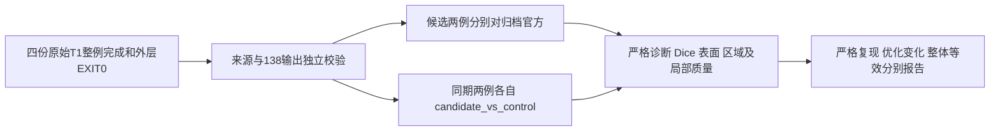

# 四次整例完成后的事后评估

## 1．功能和执行边界

本轮分别评价候选与归档官方的差异，以及同期 FNIT 候选与 FNIT 控制组的
变化。前者使用现有 `evaluate_recon_torch_run.py`，后者用本目录
[`evaluate_native_pair.py`](evaluate_native_pair.py) 适配原生表面配方，再调用
同一个既有 `compare_whole_cases.py::compare_pair`。没有改写指标计算器、
生产代码、阈值或输出，不把 FNIT 控制组标为官方。

旧 `tools/evaluate_recon_optimization_pair.py` 默认只接受 Python GA 配方，
无法直接用于本轮 mixed-native-surfaces。新适配器只补配方和来源绑定，
各指标仍由现有 driver 计算。当前为工具准备，未执行本轮事后数值评估。

四次原始 T1 整例必须全部完成，外层 launcher 退出后再开始。适配器要求
四份成功 benchmark、138输出/生产网格完成报告，以及内容为0的外层EXIT；
协调者还须现场核对该EXIT属于当前四次作业并确认无活动整例。比较顺序
串行，Torch/Numba/BLAS 总预算4线程，CUDA不可见，不与整例争用CPU。



## 2．现场已核对的资源身份

这里只公布文件身份，不公布服务器路径。完整私有路径由协调者保留。现有
参考是700个普通文件，无符号链接，两个公开原始T1的SHA分别绑定在清单。
清单存在并不代替读取前的全部大小和SHA重验。

| 资源 | SHA-256 |
| --- | --- |
| 官方普通文件视图 `TRANSFER_MANIFEST.private.json` | `e6aa553acfe943b4dd753804b7fbf57e6916c89d16f3c65003a677515be303be` |
| 既有helper清单，449项 | `fa0bb8d94794da2d6cbb05c5861443101852e975b626e608c4f274d51a744fea` |
| 独立构建程序 `bin.sha256` | `3cb9b290a76bb94ecd2be1d76ac7cc52ff0fb5d7929e181a915c85b4ae4b3b7e` |
| 现有 `evaluate_recon_torch_run.py` | `b86e98556132424b54c192d5447cb8ca5e0813c8ea8d6c9e7d80f534d0ffaf32` |
| `recon_evaluation_checks.py` | `f00fca03c0e323c21075358b619481e30de9039da70aadfedf23d8fc96e8d7ea` |
| 既有 `compare_whole_cases.py` | `08d083afffec69ba7983771a26e2666f28c6d586e6c3fd0ebb17b4d98d9d313b` |
| `FreeSurferColorLUT.txt` | `da55c6a47d316ee16d2609afd5c93cb8078e08e7e3afec5bb6283027d7c33e7b` |

归档官方版本为 `freesurfer-linux-centos7_x86_64-8.2.0-20260314-d932c45`。
旧 `93affde8` 两例事后报告均已完成，但不能改标为本轮候选结果。新的输出
目录、实际源码根和 benchmark 必须一一对应，官方历史时间不进入同期配对
速度比。

## 3．候选对官方：沿用当前评估器

下例所有路径是说明用占位路径，替换为协调者核对的实际私有路径。先设
`SOURCE_CANDIDATE` 为生成候选输出的冻结源码根，`HELPERS` 为449项helper
清单所在根，`RUNS` 为本轮四份整例的实际目录：

```bash
PYTHON=/data/fnit/env/bin/python
SOURCE_CANDIDATE=/data/fnit/source_candidate
SOURCE_CONTROL=/data/fnit/source_control
HELPERS=/data/fnit/evaluation_helpers
REFERENCE=/data/fnit/official_plain_view
NATIVE_MANIFEST=/data/fnit/native_build/bin.sha256
LUT=/data/fnit/assets/FreeSurferColorLUT.txt
RUNS=/data/fnit/runs/completed-paired-cases
OUTPUT=/data/fnit/runs/new-posthoc

# 每次只执行一例；第二例替换case和对应benchmark，从新输出目录运行。
# CUDA隐藏，所有数值工作在四次生产整例全部结束后串行执行。
CUDA_VISIBLE_DEVICES= OMP_NUM_THREADS=4 NUMBA_NUM_THREADS=4 \
OPENBLAS_NUM_THREADS=4 MKL_NUM_THREADS=4 \
PYTHONPATH="$SOURCE_CANDIDATE/src:$SOURCE_CANDIDATE/tools" \
"$PYTHON" "$SOURCE_CANDIDATE/tools/evaluate_recon_torch_run.py" \
  --benchmark "$RUNS/candidate-sub06/benchmark.json" \
  --source-root "$SOURCE_CANDIDATE" \
  --reference-root "$REFERENCE" \
  --reference-manifest-sha256 e6aa553acfe943b4dd753804b7fbf57e6916c89d16f3c65003a677515be303be \
  --case ds000114_sub-06 \
  --driver "$HELPERS/validation/recon_all/optimizations/20261002_parallel/compare_whole_cases.py" \
  --scripts-dir "$HELPERS/validation/recon_all/python_gpu_port" \
  --label-table "$LUT" \
  --output "$OUTPUT/sub06-candidate-vs-official" \
  --threads 4 \
  --candidate-profile mixed-native-surfaces \
  --expected-native-programs-manifest "$NATIVE_MANIFEST" \
  --expected-native-programs-manifest-sha256 3cb9b290a76bb94ecd2be1d76ac7cc52ff0fb5d7929e181a915c85b4ae4b3b7e
```

参数空间和结构：`benchmark/source-root` 分别绑定完整原始T1运行及实际全部
生成源码；`reference-root` 内有 `subjects/CASE/` 与固定清单；`case` 必须
在清单中；`driver/scripts-dir` 为同套已核对比较器；`label-table` 提供
标签语义；`output` 必须不存在；`threads` 固定4。最后三个选项显式绑定
原生表面配方及程序清单。程序清单和helper/LUT发生变化时先核查真实来源，
不能仅替换字符串绕过检查。

输出包括 `evaluation.json`、`strict_candidate_vs_official.json`、
`geometry_candidate_vs_official.json`、`dice_candidate_vs_official.json`、
`surface_candidate_vs_official.json`、`region_candidate_vs_official.json`、
`all_regions_candidate_vs_official.json`、`no_th3_candidate_vs_official.json`、
`local_candidate_vs_official.json`、双方扩展质量、官方独立自相交及脑图。

## 4．候选对同期FNIT控制：独立适配器

该命令仅接收 FNIT 控制/候选 benchmark，不读取官方影像或参考清单。
`--other-benchmark` 重复两次，指定另一例的控制和候选；两次执行同一个
adapter分别选sub-06/sub-07。`--completion-exit` 可重复，指定本轮外层
作业真实退出文件；四个作业独立启动时应逐项列出相应退出文件。

```bash
ADAPTER=/data/fnit/tools/evaluate_native_pair.py

"$PYTHON" "$ADAPTER" \
  --control-benchmark "$RUNS/control-sub06/benchmark.json" \
  --candidate-benchmark "$RUNS/candidate-sub06/benchmark.json" \
  --other-benchmark "$RUNS/control-sub07/benchmark.json" \
  --other-benchmark "$RUNS/candidate-sub07/benchmark.json" \
  --completion-exit "$RUNS/whole-controller.launcher.EXIT" \
  --control-source-root "$SOURCE_CONTROL" \
  --candidate-source-root "$SOURCE_CANDIDATE" \
  --evaluator "$SOURCE_CANDIDATE/tools/evaluate_recon_torch_run.py" \
  --evaluator-sha256 b86e98556132424b54c192d5447cb8ca5e0813c8ea8d6c9e7d80f534d0ffaf32 \
  --checks-sha256 f00fca03c0e323c21075358b619481e30de9039da70aadfedf23d8fc96e8d7ea \
  --helpers-manifest "$HELPERS/MANIFEST.private.json" \
  --helpers-manifest-sha256 fa0bb8d94794da2d6cbb05c5861443101852e975b626e608c4f274d51a744fea \
  --driver "$HELPERS/validation/recon_all/optimizations/20261002_parallel/compare_whole_cases.py" \
  --scripts-dir "$HELPERS/validation/recon_all/python_gpu_port" \
  --label-table "$LUT" \
  --label-table-sha256 da55c6a47d316ee16d2609afd5c93cb8078e08e7e3afec5bb6283027d7c33e7b \
  --expected-native-programs-manifest "$NATIVE_MANIFEST" \
  --expected-native-programs-manifest-sha256 3cb9b290a76bb94ecd2be1d76ac7cc52ff0fb5d7929e181a915c85b4ae4b3b7e \
  --case ds000114_sub-06 \
  --output "$OUTPUT/sub06-candidate-vs-control"
```

上述全部参数必需。`--helpers-manifest` 使用已存在的list型清单，每项为
`{"path": "实际helper普通文件绝对路径", "sha256": "64位摘要"}`；清单内
449个声明文件全部现场校验。驱动与必需子脚本须在该清单内，不能换成
另一套未声明工具。`--evaluator` 所在目录还须包含已绑定的checks模块。
LUT可以由已声明的资产兼容路径进入，实际目标文件SHA必须一致。

控制/候选必须相同原始T1 SHA、主机、CPU、亲和性、线程、目标GPU声明、
GPU可见性及分配策略环境、权重和资产、已安装原生程序及N4依赖绑定。
源码与138普通输出逐项验证；仅放行明确的mixed-native-surfaces配方。
无效配对在数值计算前报错；数值失败保留 `pair.json`、已生成文件和命令
回执，并非补写或修复生产结果。

适配器输出 `pair.json`、`strict_candidate_vs_control.json`、geometry、
Dice、surface、region、六套all_regions、no-th3、local及双方扩展质量。
表面单位mm、厚度mm、面积mm²、体积mm³、曲率mm⁻¹；不同网格时禁止
同索引结论，沿用双向全顶点到三角面距离。相同有序面及坐标时，既有driver
确认全顶点位于同一网格后可报告同索引和双向距离为0；官方非同网格仍须
真正计算距离，不能从FNIT控制对照的0误差推断官方0误差。

## 5．最终核查与报告

- 检查所有launcher EXIT、`evaluation.json/pair.json` 的 `status`，以及
  `strict_reproduction.checked==138`。退出0不等于严格138通过。
- geometry空间门须核对实际覆盖；有序拓扑不同的顶点图和注释保持
  `not_assessed_vertex_correspondence`，不能补成同索引零误差。
- Dice检查七张标签图的每标签计数/缺失、极小标签与尾部；区域检查六套
  分区、厚度/面积/体积/曲率及共同no-th3，局部异常逐项保留。
- 扩展质量的 `status=partially_measured` 或crossing超时/预算不完整，
  要按实际覆盖报告；production基本门通过不等于全部互不穿越。
- 原始T1生产时间取每次完整外层和CLI报告，解释启动/校验边界。事后
  表面距离及绘图时间单列；两例AB/BA不是重复整例ABBA吞吐结论。
- 本工具不重算GPU占用；显存继续引用各次整例目标GPU同时采样和实际
  ownership状态，归属未知不写0或宣称已满足20 GB。
- 保留“严格复现”“优化是否引入变化/退化”“整体指标等效”三个字段，
  未建立统一等效阈值时后者保持未判定，不事后放宽阈值。

## 6．原实现与参考

比较属于原 `recon-all` 完成后的诊断，没有单条独立官方重建命令。
指标计算仍复用 [FNIT既有比较driver](../20261002_parallel/compare_whole_cases.py)、
[当前整例评估入口](../../../../tools/evaluate_recon_torch_run.py) 和
[来源/统计辅助模块](../../../../tools/recon_evaluation_checks.py)。
