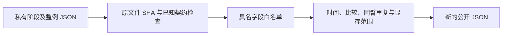

# 本轮阶段与整例报告的脱敏汇总

## 1. 功能与流程

[`summarize_speed_reports.py`](summarize_speed_reports.py) 只读取本轮已知结构
的 JSON 元数据，生成可公开的科学摘要。它不运行重建、事后评估或影像
算子，不读取影像、顶点数组或日志正文，不复制路径、主机、账号、UUID、
错误堆栈及任意未知字段。原始完整私有报告通过文件 SHA-256 绑定。



输入缺失、未知契约或未完成的结果保留 `not_assessed`，未知状态为
`unknown`。生成摘要成功不等于科学验证通过，工具不建立或调整等效阈值。

## 2. Python 调用、输入与输出

```python
import importlib.util
from pathlib import Path
import json

summary_script = Path("/data/fnit/validation/recon_all/optimizations/20261017_sphere_normals/summarize_speed_reports.py")
module_spec = importlib.util.spec_from_file_location("fnit_speed_summary", summary_script)
summary_module = importlib.util.module_from_spec(module_spec)
module_spec.loader.exec_module(summary_module)
public_summary = summary_module.summarize(
    inputs={
        "register_v2": [Path("/data/private/register_v2/report.json")],  # 弧距和缓冲候选
        "register_v3": [Path("/data/private/register_v3/report.json")],  # 另含拟合机器码缓存
        "curvature": [Path("/data/private/curvature/report.private.json")],  # 保留失败结果
        "standard_sphere": [Path("/data/private/sphere/summary.private.json")],  # 法向阶段
        "speed_pair": [],  # 未完成整例不填历史记录替代
        "evaluation": [],  # 未完成评估保持 not_assessed
        "evaluation_bindings": [],  # 评估完成后显式提供下文的子报告SHA清单
        "outer_monitor": [],  # 可选外层监测摘要；未完成整例时不填探针代替
    },
)
public_json_path = Path("/data/public/new_speed_summary.json")  # 使用新路径
with public_json_path.open("x") as public_stream:
    json.dump(public_summary, public_stream, ensure_ascii=False, indent=2, allow_nan=False)
```

`summarize(inputs=...)` 的唯一输入为上述类型到 JSON 路径列表的映射；各类型
均可省略，或提供多份报告保留失败与后续版本。它返回普通 JSON 兼容字典，
不写文件。文件不存在等读取异常直接抛出；已读取但不认识的结构明确记为
未评估，不将未知布尔值解释成通过。输入是元数据，没有坐标空间转换。

| 输入类型 | 现有结构与输出范围 |
| --- | --- |
| `register_v2`、`register_v3` | `benchmark_register_pair.py` 的 `report.json`；保留每轮/每臂 API、同步 wrapper、冷进程墙钟，严格比较的 false/数值误差、输出 SHA、同臂重复波动及拟合缓存命中。 |
| `curvature` | `benchmark_early_curvature.py` 的私有报告；最终八图、最终 stats、早期四图分别导出。`comparison_failed` 不改成通过；stats 注释原文不输出。 |
| `standard_sphere` | `benchmark_standard_sphere.py` 的 summary；仅在子报告实际 SHA 匹配时读取其 JSON，保存已记录 API、worker 和父进程墙钟。失败、trace 或 boundscheck 诊断不计为成功计时样本。 |
| `speed_pair` | `benchmark_recon_native_speed_pair.py` 的 schema v1；保留四次实际整例的三层墙钟及退出/输出/网格摘要。仅同输入且两臂均成功时给出单次观察的 CLI 变化，不宣布稳定提速。 |
| `evaluation` | 当前 `evaluate_native_pair.py` 的 `pair.json`，或已核对 `evaluate_recon_torch_run.py` 的 `evaluation.json`；保留执行、源码和严格138诊断。只有配套 SHA 清单通过时读取既有子报告中的 Dice、表面、脑区、no-th3、空间、局部误差与质量。 |
| `outer_monitor` | `monitor_science_pair.py` 的 `report.private.json`；仅汇总已报帧数量、间隔、同期部分归属下界、目标卡峰值及原执行/源码SHA。探针完成不视为整例监测完成；不读取样本JSONL。 |
| `evaluation_bindings` | 下文显式清单列表；只用于绑定对应 evaluation 主文件及其同目录子 JSON，不作为科学执行证明。缺少/重复/错误 SHA 均不读取对应未绑定数字。 |

公开结果包含每份私有报告 SHA、实际完整代码提交（若原记录确实为 40 位
提交）、科学相关仓库相对文件名和文件 SHA、完整源码映射的规范 JSON
摘要。`manifest_file_sha256` 是已有清单文件的 SHA；
`complete_file_mapping_canonical_sha256` 是映射数据的规范编码摘要，两者
不是同一概念。版本只是工作树标签时不伪造提交，保留标签的摘要及真实
源码文件 SHA。无关 vendor 文件名和完整 639 文件清单不导出。

同臂重复只在同一阶段、同一输入内汇总 min/max/中位数及范围百分比；
首次 JIT 和暖调用原值都保留，不由少量共享节点观察宣布稳定收益。
整例的两例是不同输入，不能算作同臂重复。案例名称不输出，以各节内部
`case_index`、半球及输入哈希绑定；不同报告的编号不自动证明输入对应。

显存保留原始 allocated/reserved 数值和目标设备采样上界。归属不明时
`owned_simultaneous_peak_bytes=null`，缓存关闭时不将 Torch 的零计数当成
实际零显存。曲率 ABBA 共用进程，其 reserved 与进程占用可含上轮缓存；
这些不能当成各臂独立冷进程峰值。20 GB 自有同时显存验收单独保持未评估。

### 外层显存监测的汇总

可选的 `--outer-monitor` 可重复提供多份监测主报告，保留已完成、失败和
未知状态。只读取主 JSON 中已有汇总，不跟随其中任何路径，不读取样本
JSONL。`declared_samples_jsonl_sha256` 只是原监测器保存的摘要声明，本工具
没有再次验证大样本文件。源码提交、源码清单SHA、监测/原科学脚本和两份
监测模块的SHA分别保留；主机、账号、UID、PID、UUID、路径和错误正文不导出。

wrapper 的全范围与各run观测分别列出：帧数、resolved/unknown数、最大
实际间隔、部分已验证进程的同期合计观察下界、整卡/compute-sum采样峰值。
源绑定未证实、运行失败/未知、计数不一致或含未知帧时，完整自有采样峰值
保持 `null`。部分归属的零值不代表自有零显存。即使所有已采样帧可归属，
也只称已观测样本峰值，20 GB验收始终为 `not_assessed`。

各run仅在 `run_metadata_observed` 的原键与 `run_id` 相同，并有明确已知
arm、提交、输入SHA和两份报告SHA时汇总对应帧。`run_index` 只是该份公开
摘要内经过绑定条目的编号，不解析或导出原run名称、病例名或路径；缺少
明确metadata的块另计未绑定数量。存活CLI的观测窗口不等于精确起止时间，
wrapper空档不分摊给病例。科学CLI/harness耗时继续由 `speed_pair` 节提供，
本节不导出监测器总墙钟冒充整例时间。

已用既有无CUDA小探针主报告完成字段契约核对：保留其5帧、未知归属及
0份整例绑定；其0.5秒采样目标不证明四次整例监测完成。本工具固定区分监测状态、科学执行、显存验收和
整体等效；不修改原监测报告或既有公开数据。

### 评估子报告的显式绑定

既有 `evaluation.json`/`pair.json` 不包含全部结果子文件 SHA，因此不能仅凭
文件名读取旁边任何 JSON。评估完成后，由协调者对本次实际文件生成新的
私有绑定清单，结构如下；每个 `sha256` 须为对应文件的实际摘要：

```json
{
  "schema": "fnit-evaluation-summary-bindings-v1",
  "evaluation_report": {"path": "/data/evaluation/pair.json", "sha256": "<实际主报告SHA>"},
  "comparison_label": "candidate_vs_control",
  "reports": {
    "strict": {"path": "/data/evaluation/strict_candidate_vs_control.json", "sha256": "<实际SHA>"},
    "dice": {"path": "/data/evaluation/dice_candidate_vs_control.json", "sha256": "<实际SHA>"},
    "surface": {"path": "/data/evaluation/surface_candidate_vs_control.json", "sha256": "<实际SHA>"},
    "geometry": {"path": "/data/evaluation/geometry_candidate_vs_control.json", "sha256": "<实际SHA>"},
    "region": {"path": "/data/evaluation/region_candidate_vs_control.json", "sha256": "<实际SHA>"},
    "no_th3": {"path": "/data/evaluation/no_th3_candidate_vs_control.json", "sha256": "<实际SHA>"},
    "local": {"path": "/data/evaluation/local_candidate_vs_control.json", "sha256": "<实际SHA>"},
    "all_regions": {"path": "/data/evaluation/all_regions_candidate_vs_control.json", "sha256": "<实际SHA>"},
    "quality_candidate": {"path": "/data/evaluation/quality_candidate/report.json", "sha256": "<实际SHA>"},
    "quality_reference": {"path": "/data/evaluation/quality_control/report.json", "sha256": "<实际SHA>"}
  }
}
```

`comparison_label` 只接受 `candidate_vs_control` 或 `candidate_vs_official`。
后者对应既有官方比较文件和 `quality_official/report.json`；不能将 FNIT
control 改名为官方。主文件必须实际 `status="complete"`，路径及 SHA 与
唯一一份绑定清单一致。各子文件路径必须匹配同一评估目录内的具名结果；
摘要一致后才解析对应数字，缺失或变化的类别保持未评估。公开结果仅保存
清单/子文件 SHA 和校验状态，不输出这些私有路径。

数字直接来自既有 `compare_whole_cases.compare_pair` 及其比较器输出，不
重算 Dice、MAE、P90、表面距离或容差。分别保留以下定义与覆盖：

- 七张标签图的不同体素、最小/P05/中位 Dice、标签并集数量和最差标签
  的计数；零 Dice 与极小标签不丢弃，不以标签 Pearson r 替代 Dice。
- 最终 white/pial 的八个方向点到三角面统计及其实际覆盖；最大值是
  顶点采样最大距离，不称连续 Hausdorff。空间及顶点对应门另列。
- 六套皮层图谱四类统计的已报 MAE、相对偏差、缺失/额外区域；共同
  no-th3 三套体积另列，不用 TH3 顶点体积代替。最差区域只保留区域键
  的摘要及原有数值，原名称可在有 SHA 绑定的私有报告复查。
- 全部44张顶点图与12套注释的同索引比较覆盖、已报数值和失败状态；
  不对应的网格保留 `not_assessed_vertex_correspondence`。注释输出的
  `configured_min_dice` 是比较器门槛，不能当作实际最小 Dice。
- 每侧拓扑、顶点环、sphere/sphere.reg 翻折和 white/pial 横穿计数。
  扩展质量报告没有独立检查的 white/pial 自相交明确保持未评估，不由
  生产基本网格门推断为零。

局部阳性、缺失覆盖与 strict 失败均保留；这些数字不自动决定整体等效。

## 3. CLI

```bash
python validation/recon_all/optimizations/20261017_sphere_normals/summarize_speed_reports.py \
  --register-v2 /data/private/register_v2/report.json \
  --register-v3 /data/private/register_v3/report.json \
  --curvature /data/private/curvature/report.private.json \
  --standard-sphere /data/private/sphere/summary.private.json \
  --output /data/public/new_speed_summary.json
```

`--register-v2`、`--register-v3`、`--curvature`、`--standard-sphere`、
`--speed-pair`、`--evaluation`、`--outer-monitor` 对应上表，均可选、
可重复，默认不提供。
`--evaluation-bindings` 也可重复，用于多例主评估的分别绑定；工具按主
报告路径及 SHA 查找唯一匹配项。
`--output` 必填且必须不存在；工具只写这一公开 JSON，打印其 SHA，不
打印私有输入路径。CLI 退出 0 表示汇总完成，科学失败状态仍保留在结果内。

发布前继续使用仓库已有的隐私检查入口，不新建一套隐私扫描器：

```bash
python tools/audit_public_privacy.py \
  --repository /data/fnit \
  --policy /data/private/publication_regex_policy.json \
  --output /data/private/new_publication_audit.json \
  --include-untracked
```

其中 `repository` 为待发布仓库；`policy` 是仓库外私有正则列表；`output`
仅记匹配计数/文件摘要；`include-untracked` 纳入新文件。该审查不输出
命中原文，不能省去协调者对最终公开结果的复核。

## 4. 原软件调用

报告汇总没有对应的 FreeSurfer 命令。被汇总阶段分别对应原 `mris_register`、
`mris_sphere`、`mris_curvature_stats` 和 `recon-all`，原命令和算法范围继续
由各功能页定义；本工具不会运行它们。

## 5. 验证与更新

2026-10-17 新增白名单 adapter。轻量 metadata 测试覆盖私有字段排除、
strict false 保留、曲率失败与三组输出、段错后已有 API 证据、子 JSON
SHA 失败、未完成整例和未知 schema。测试不构成真实影像 benchmark。
另外覆盖完成主评估的数字提取、失败主报告不读子结果、子结果 SHA 变化
被排除、未提供绑定时不复用任何旧数字。已用两份既有已完成评估的 JSON
元数据核对该契约：各读取十类带 SHA 绑定的子报告，保留20个空间门、
七张 Dice 图、八个最终表面方向、六套图谱及44图/12注释的实际覆盖。
此检查只验证字段读取，不把既有数值作为本轮 benchmark。
外层监测另覆盖失败/未知/部分归属不变成显存通过、来源/计数矛盾保留
未知、只从明确metadata绑定run且隐藏私有标识。
本工具不产生新的影像精度、显存或时间测量，不生成或复制脑图。

真实阶段及整例测量由协调者填写对应报告；整体指标等效仍未判定。
完整测试：[test_summarize_speed_reports.py](../../../../tests/recon_all/test_summarize_speed_reports.py)。

## 6. 相关工具

- [配准阶段配对](../../python_gpu_port/benchmark_register_pair.py)
- [早期曲率验证](../20261017_curvature_schedule/benchmark_early_curvature.py)
- [标准球面验证](benchmark_standard_sphere.py)
- [两例整例配对](../../../../tools/benchmark_recon_native_speed_pair.py)
- [独立外层监测](monitor_science_pair.py)
- [现有发布隐私审查](../../../../tools/audit_public_privacy.py)
- [既有全流程比较](../20261002_parallel/compare_whole_cases.py)
- [既有评估适配器](evaluate_native_pair.py)
