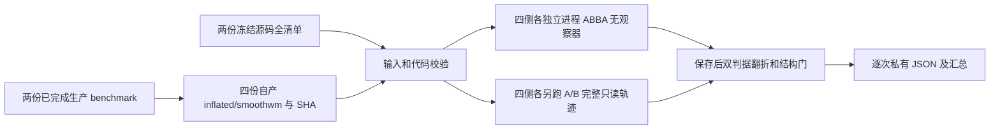

# 标准球面同输入法向配对工具

## 1．功能与当前状态

本目录提供独立 benchmark，未修改生产算法或默认值。v1和v2均在保存
球面后的CPU质量检查中退出SIGSEGV，原失败保留。v3将同一检查函数
隔离到新CPU解释器，从新目录重新运行全部配对，底层故障仍未定位。
输入使用最近两例
完成的 FNIT 生产被试的双侧 `inflated/smoothwm`，不重跑 inflation。

两臂均调用完整 `run_standard_sphere`：CUDA 有序平均、完整 dense CUDA
去翻折、`source_float` 初始化和现有停止条件均相同。A 臂保持 Numba 法向，
B 臂显式选择仓库已有 `TorchFaceNormalTopology`。不读取官方结果、atlas
或参考检查点，不改变候选、轮数、精度或质量门。依赖均在现有 Conda 声明内。



## 2．输入、输出和参数

脚本 [`benchmark_standard_sphere.py`](benchmark_standard_sphere.py) 的公开子命令：

| 子命令 | 必需具名参数 | 含义与输出 |
| --- | --- | --- |
| `freeze` | `--source`、`--commit`、`--output` | 仓库根、实际40位提交、新JSON路径；输出所有 `src/fnit/*.py` 的相对路径与SHA。Git存在时核对HEAD；归档由协调者绑定提交，清单绑定实际内容 |
| `prepare` | 两个 `--benchmark`、`--output` | 两份退出0且执行完成的生产benchmark；读取其同级 `subject/fnit-native-free-run.json` 和四份自产表面，输出输入清单 |
| `run` | `--baseline-source`、`--baseline-manifest`、`--baseline-manifest-sha256` | 基线仓库根、清单及64位SHA；基线提交固定为 `5ca07f999375d02281ab60589cb2840e7b488790` |
| `run` | `--candidate-source`、`--candidate-manifest`、`--candidate-manifest-sha256` | 候选实际冻结仓库根、全量清单及其SHA，不凭可变工作树名称判定版本 |
| `run` | `--inputs-manifest`、`--inputs-manifest-sha256`、`--output` | 四份输入清单、实际SHA、新输出根；目录存在时停止 |
| `run` | `--device`、`--python-interpreter` | 可选，默认 `cuda:0` 和当前解释器；必须显式可用CUDA，无CPU回退 |

`worker --payload --payload-sha256` 由监督器内部调用，不作为独立用户入口。
`quality-worker` 同样只供内部调用，绑定该payload及已保存球面SHA；新进程
隐藏CUDA，以原四线程FP32/FP64和结构判据检查，输出独立报告、日志和退出
回执。任一子检查失败使本轮失败，不自动重试；QA耗时不进入GPU API时间。
每臂固定 Torch/Numba/BLAS 4线程，interop为1；每次独立进程。监督器每侧
按 A、B、B、A 顺序跑完整阶段，再另外跑两次完整 trace。共24次完整阶段。
两臂均显式开启分配缓存，首次JIT及后续调用保留在逐次报告中；没有改变
整例的分配策略。两源码中的 sphere、法向、平均与收尾文件若不同，本工具
会拒绝运行，避免把其他算法变更混入“仅切换法向”的结论。

表面须为普通三角文件：float32 `(N,3)` surface RAS/mm 坐标及有序整数
`(F,3)`面；两个输入的有序面和顶点编号必须相同。清单及输入的任意路径
组件均不能是符号链接。所有输入和全量源码在计算前后重查SHA。任一生产
报告未完成、清单失配、source不完整、CUDA不可用、过程或质量失败时非零
退出，保留全部现场，不覆盖现有目录，也不自动重启。

输出包括 `summary.private.json`、每次 `report.private.json`、新球面文件、
进程日志和带SHA的启动参数。trace另含全部真实update的坐标/梯度SHA、
SSE候选、步长、调度，以及完整dense清理的marked、负面、位移与坐标SHA。
保存后独立检查有序面、MRI几何、闭合单连通genus0、顶点/边流形、方向、
零面积以及FP32/FP64径向翻折；检查不修改表面。一般三角面自相交并未在
此脚本额外计算，完整生产事后评估仍须保留该项。

## 3．复现命令

先由协调者核对两份实际生产 `benchmark.json`、冻结源码和完整提交；下例
路径均为占位示例，不能直接当作本次数据路径或执行记录。

```bash
# 固定脚本与解释器；SOURCE_BASELINE/SOURCE_CANDIDATE均为已核对的冻结仓库根。
PYTHON=/data/fnit/env/bin/python
SCRIPT=/data/fnit/tools/benchmark_standard_sphere.py
SOURCE_BASELINE=/data/fnit/source_5ca07f99
SOURCE_CANDIDATE=/data/fnit/source_candidate
MANIFEST_DIR=/data/fnit/manifests/sphere-normals-new
mkdir -p "$MANIFEST_DIR"

# 基线全量源码清单；候选命令中的提交须替换为实际完整Git SHA。
"$PYTHON" "$SCRIPT" freeze \
  --source "$SOURCE_BASELINE" \
  --commit 5ca07f999375d02281ab60589cb2840e7b488790 \
  --output "$MANIFEST_DIR/baseline.private.json"
"$PYTHON" "$SCRIPT" freeze \
  --source "$SOURCE_CANDIDATE" \
  --commit REPLACE_WITH_ACTUAL_40_CHARACTER_COMMIT \
  --output "$MANIFEST_DIR/candidate.private.json"

# 只读取两例成功FNIT自产文件；同级subject规则防止将参考网格混入计算。
"$PYTHON" "$SCRIPT" prepare \
  --benchmark /data/fnit/runs/completed-native/sub-06/benchmark.json \
  --benchmark /data/fnit/runs/completed-native/sub-07/benchmark.json \
  --output "$MANIFEST_DIR/inputs.private.json"

# SHA由上述命令输出，填写实测64位值；run只使用新目录，不覆盖任何旧结果。
"$PYTHON" "$SCRIPT" run \
  --baseline-source "$SOURCE_BASELINE" \
  --baseline-manifest "$MANIFEST_DIR/baseline.private.json" \
  --baseline-manifest-sha256 REPLACE_WITH_ACTUAL_BASELINE_MANIFEST_SHA256 \
  --candidate-source "$SOURCE_CANDIDATE" \
  --candidate-manifest "$MANIFEST_DIR/candidate.private.json" \
  --candidate-manifest-sha256 REPLACE_WITH_ACTUAL_CANDIDATE_MANIFEST_SHA256 \
  --inputs-manifest "$MANIFEST_DIR/inputs.private.json" \
  --inputs-manifest-sha256 REPLACE_WITH_ACTUAL_INPUT_MANIFEST_SHA256 \
  --output /data/fnit/runs/sphere-normals-new \
  --device cuda:0 \
  --python-interpreter "$PYTHON"
```

## 4．计时、精度与显存的解释

- `stage_seconds_including_io_and_synchronization`：无观察器完整API墙钟，
  内含读取、JIT、搬运、优化及写出；前后显式同步目标CUDA。首次JIT与缓存
  条件在原始顺序中保留，不将首次和热调用混称固定吞吐。
- `parent_full_wall_seconds`：解释器启动至退出，另含源码和输入SHA、质量
  检查和报告开销；不能与API时间相加。
- `trace` 的耗时不进入ABBA中位数。完整步长/调度/坐标/梯度及收尾轨迹、
  六次保存文件和有序几何均分别比较，另给同网格逐顶点距离均值/P99/最大。
- 固定质量门不放宽，任一径向判据有翻折均失败。严格轨迹不同将单独标明，
  不会当作整体指标等效。完整整例另需分区Dice、表面距离、脑区指标及局部
  异常评估，不能用本脚本结果替代。
- PyTorch峰值显式指定目标设备；分配缓存关闭时字段为null并说明不可用。
  本脚本不将整卡占用归属给FNIT，驱动父子同时峰值保持null，须由外层
  资源租约采样器提供。GPU空闲量只作为两个时点的信息，不是峰值证明。

## 5．原软件及本轮结果

对应原软件完整命令为 `mris_sphere INPUT_INFLATED OUTPUT_SPHERE`；独立
自编译参考程序只能由隔离benchmark运行，不能作为本脚本的生产输入。
法向属于命令内部步骤，没有独立官方CLI。

第二轮已有两侧完成全部ABBA和独立完整轨迹，六份保存文件、有序几何及
每次更新/finish轨迹均相同，位移最大/P99为0，结构与双径向门通过：

| 第二轮已完成阶段 | A中位/秒 | B中位/秒 | 本块缩短 |
| --- | ---: | ---: | ---: |
| sub-06 LH | 143.047 | 119.583 | 16.40% |
| sub-06 RH | 149.176 | 97.725 | 34.49% |

第二轮随后在sub-07 LH保存后QA退出-11，整体仍为`failed`；不得用本表
称四侧通过。两臂计算源码均为`5ca07f999375d02281ab60589cb2840e7b488790`，
只切换已有法向后端；最终71cc共享平均器的四侧轨迹回归另做，不混入此表。
第三轮及两例整例尚未完成；[故障与检查隔离](CPU_SQRT_DIAGNOSTIC.md)
保留两次失败、同文件CPU诊断、原判据和新进程执行契约。

历史候选接口与先前局部
证据见[已有GPU法向说明](../../../../docs/recon_all/SURFACE_NORMALS_TORCH_20261009.md)，
整体当前基线见[已发布两例](../20261016_native_surface_hotspots/README.md)。

## 6．参考文献与代码

- Fischl B, Sereno MI, Dale AM. Cortical surface-based analysis II. *NeuroImage* 1999;9:195–207.
- [固定原版球面入口](https://github.com/freesurfer/freesurfer/blob/d932c45b7941662ea380a05efef580568b98d41a/mris_sphere/mris_sphere.cpp)。
- [FNIT已有有序法向](../../../../src/fnit/recon_all/place_surface_normals.py)。
- [FNIT完整标准球面](../../../../src/fnit/recon_all/sphere_standard_run.py)。

## 7．v1诊断与工具回执修正

v1的sub-06左侧A臂进程退出`-11`，监督器没有产生任何配对结论。崩溃前
写出的球面SHA为 `5d943f0eb3207d574dd82b60f2b1680d6363dfe16be7b019af5abcde66c15c3e`，
与上一轮已完成生产及其独立输出清单的同一球面完全相同。两例四侧当前
`inflated/smoothwm/sphere` 共12个文件也全部匹配旧独立评估的历史SHA。
生产sphere报告未单独保存调用时输入SHA；不能把这项缺失写成已验证。
这些证据支持继续定位API返回后的检查阶段，尚不足以指定底层崩溃函数。

工具增加faulthandler和阶段回执：API同步计时截止后立即保存完整API结果，
保存后质量检查前后另存`phase`；计时截止、算法和质量门均保持。原v1不
覆盖。诊断用`NUMBA_BOUNDSCHECK=1`只能运行独立worker，报告明确标为
`diagnostic_not_performance_sample`，ABBA入口拒绝该设置。

协调者在原资源租约内，使用**新输出目录和新JIT缓存**进行一次A诊断；
以下Python仅复制旧payload元数据并启动新worker，不读取参考、不补跑v1：

```python
import hashlib
import json
import os
from pathlib import Path
import subprocess
import sys

new_script = Path("/data/fnit/tools/benchmark_standard_sphere.py")  # 新工具，先核对SHA
old_payload = Path("/data/fnit/runs/sphere-v1/sub06-lh/timing-00-A.payload.private.json")  # 只读v1启动参数
diagnostic_root = Path("/data/fnit/runs/sphere-baseline-diagnostic-new")  # 必须不存在
diagnostic_root.mkdir(parents=True, exist_ok=False)
payload = json.loads(old_payload.read_text())  # 保留同一份自产输入及冻结源码清单
payload["output"] = str(diagnostic_root / "A")  # 新阶段输出，不覆盖v1
payload_path = diagnostic_root / "A.payload.private.json"
payload_path.write_text(json.dumps(payload, indent=2) + "\n")
environment = os.environ.copy()  # CUDA_VISIBLE_DEVICES继承同一已核对租约
environment.update(
    NUMBA_BOUNDSCHECK="1",  # 仅诊断，不进入ABBA速度统计
    NUMBA_CACHE_DIR=str(diagnostic_root / "numba-cache"),  # 新JIT缓存
    TRITON_CACHE_DIR=str(diagnostic_root / "triton-cache"),  # 新GPU内核缓存
    OMP_NUM_THREADS="4", NUMBA_NUM_THREADS="4", OPENBLAS_NUM_THREADS="4", MKL_NUM_THREADS="4",
)
environment.pop("PYTORCH_NO_CUDA_MEMORY_CACHING", None)  # 与两臂原配置相同：启用缓存
with (diagnostic_root / "A.log").open("w") as diagnostic_log:
    result = subprocess.run(
        args=[sys.executable, "-X", "faulthandler", "-u", str(new_script), "worker",
              "--payload", str(payload_path), "--payload-sha256",
              hashlib.sha256(payload_path.read_bytes()).hexdigest()],
        env=environment, stdout=diagnostic_log, stderr=subprocess.STDOUT, check=False,
    )
(diagnostic_root / "launcher.EXIT").write_text(str(result.returncode) + "\n")
```
