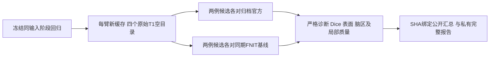
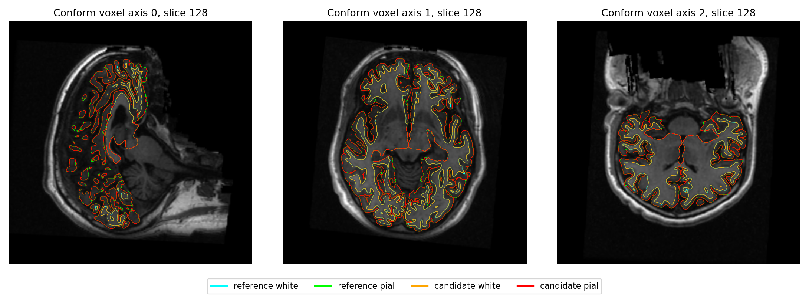
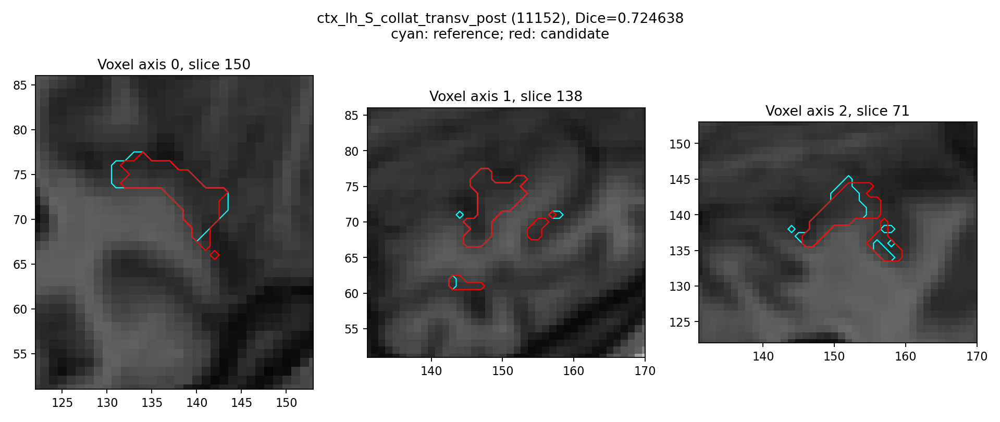
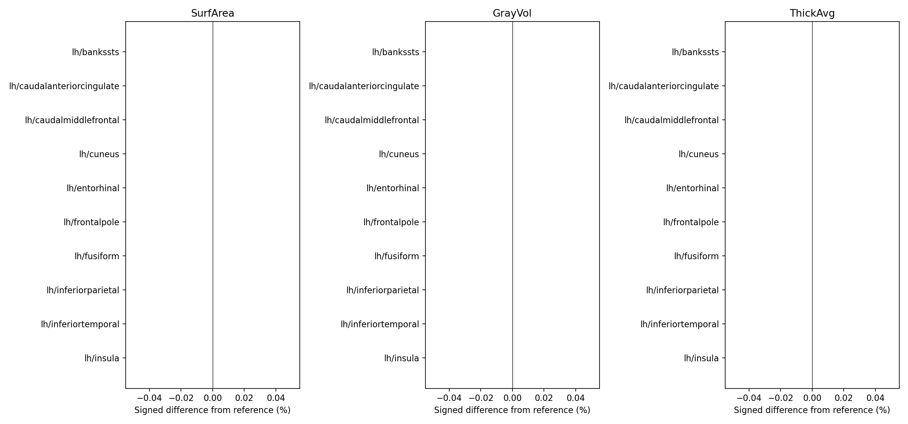

# 球面优化：两例原始 T1 的配对整例结果

2026-10-17，同一 H100、总四线程，两例分别从原始公开 T1 和四个新空目录
完成 A→B、B→A。基线为 `5ca07f999375d02281ab60589cb2840e7b488790`，候选为
`71cc91899bdf9713690cddbe32054386d8f58d63`。四次科学运行及四项事后评估均退出0。
**完整 CLI 分别缩短4.10%和3.02%，合计3.59%；尚未达到10分钟/例。**

优化版对同期 FNIT 基线，七张分割图、最终表面几何和已报告脑区指标保持；
138项原有数值门两例均通过。该门使用既有容差，不能理解为逐字节一致。
各44张局部顶点图仍有20张零容差失败，详见下文。对归档官方参考的严格
诊断为14/138、23/138；整体指标等效和完整自有显存低于20 GB均未判定。

## 1. 改动与验证顺序

本轮保留成熟 Synth/GCA/WM/顶点指标 GPU 算法及显式自编译表面配方：

1. 球面配准：同一次 smoothwm 试步的弧距只算一次；距离和弹簧项沿原有
   双精度累计规则分别使用。坐标变更后重算，不跨试步缓存。
2. CUDA 保序梯度平均：复用两个工作缓冲，邻接和迭代顺序不变，每次返回
   独立结果。保持既有Jacobi平均、每顶点累加顺序及完整轮次。
3. 标准球面：显式接入已有 `TorchFaceNormalTopology`；已有完整 dense
   GPU 收尾独立选择。独立接口和生产默认法向仍为 `numba`，下述完整收益
   适用于本页显式 `sphere_normals_backend="torch"` 配方。
4. 曲率：Numba拟合只缓存机器码，`fastmath=False`。原生放置配方延迟
   无下游消费者的早期 smoothwm 四图，最终完整八图及统计仍必须生成；
   preaparc/inflated 的 H/K、自有 Python 放置路径均保留。



[配准四侧同输入](../../../../docs/recon_all/SPHERE_REGISTRATION_PERFORMANCE.md)
保存坐标、面、几何尾部和轨迹精确一致，首侧完整ABBA观察缩短9.56%，
其余三侧单次A/B缩短8.16–14.93%。[标准球面24次阶段回归](README.md)
保留完整优化及质量门，法向后端阶段观察缩短21.7–24.1%；
[实际候选四侧连续轨迹](CANDIDATE_TRACE_REGRESSION.md)另验证共享平均器。
这些百分比不与整例相加。

[曲率同输入ABBA](../20261017_curvature_schedule/README.md)中最终八图和
统计精确一致，保留的早期H/K出现严格尾差，原 `comparison_failed / EXIT2`
继续保留。旧标准球面进程内QA的SIGSEGV也保留原失败；独立CPU解释器
检查通过，没有将其根因改称已解决。

## 2. 输入、输出与 Python 调用

两例为 OpenNeuro ds000114 的 sub-06、sub-07 原始3D T1w。数组为 `(X,Y,Z)`，
NIfTI affine 为 scanner RAS/mm；conform 后为1 mm、256³网格。权重、模板、
图谱及原生程序均使用同一份声明资源和SHA，不读取官方被试结果参与生产。

| 输入 | SHA-256 |
| --- | --- |
| sub-06 原始 T1w | `7e33afb28f631fac31d81e2428a6144f61aba4102859c694eeb49ee584de04f7` |
| sub-07 原始 T1w | `59ef7bed60d4db64d56d947ebed2ef62a9257c26fe879848fe24d10a490f74fc` |

输出仍为 `subject/{mri,surf,label,stats}` 下138项及运行JSON。体积、
顶点图、标签、统计结构和全部参数见[完整接口](../../../../docs/recon_all/README.md)。
表面坐标为 surface RAS/mm，有序面为 `(F,3)` 整数索引；顶点图沿该侧
顶点顺序，厚度mm、面积mm²、体积mm³、H mm⁻¹、K mm⁻²。TH3顶点体积与
`-no-th3`脑区体积分别记录，不相互替代。

下面展示本轮候选的显式生产策略。调用应在已固定总四线程及目标GPU的
独立进程运行；配对版本、缓存和外层计时由下一节的benchmark控制。

```python
from fnit.recon_all.native_free import run_recon_all_python

reconstruction_report = run_recon_all_python(
    t1="/data/public/sub-06_T1w.nii.gz",  # 原始3D T1w，不是官方中间结果
    subject_dir="/data/fnit/runs/new-sub06",  # 必须为新的空被试目录
    weights_dir="/data/fnit/weights",  # 逐文件大小和SHA已校验的模型
    assets_dir="/data/fnit/assets",  # 已声明模板/图谱，遵守原作者许可
    native_bin_dir="/data/fnit-native/bin",  # 固定源码Conda独立构建程序
    device="cuda:0",  # 当前进程的显式目标GPU
    threads=4,  # 总CPU预算，双侧worker各2线程
    hemisphere_workers=2,  # 独立双侧worker，保留共享输出顺序
    hemisphere_execution="groups",  # 保持surface/register等阶段屏障
    backend="native",  # 混合配方，自有GPU算法继续使用
    native_optimizations="torch",  # 已有自有GCA候选评分和EM
    n4_backend="simpleitk",  # 完整N4 Python库CPU实现
    n4_execution="in-process",  # 与同期基线相同
    input_execution="serial",  # 不引入新的前段并行
    normalization_controls_backend="torch",  # 既有控制点GPU邻域
    normalization_initial_bias_backend="torch",  # 既有初始偏置GPU计算
    wm_backend="torch-optimized",  # 既有完整WM混合实现
    wm_execution="isolated",  # 原有独立exec缓存策略
    wm_edit_backend="python",  # 完整有序WM/aseg编辑
    gca_execution="isolated",  # 原有GCA独立exec
    gca_inverse_backend="torch",  # 原有批量矩阵求逆
    gca_candidate_chunk=4096,  # 完整候选分块，不减少候选
    gca_reuse_atlas_context=True,  # 同次调用复用声明图谱上下文
    topology_backend="native",  # 固定源码Conda GA
    topology_finish_backend="conda-cpp",  # 已验证预清理/remesh/末次清理
    surface_placement_backend="native",  # 同期原生white.preaparc/white/pial
    defects_backend="torch",  # 自有GPU缺陷投射，双侧共享图仍顺序写
    inflate_backend="torch",  # 已有完整inflated/sulc GPU路径
    sphere_finish_backend="torch",  # 完整dense GPU收尾，不减少迭代
    sphere_normals_backend="torch",  # 本轮显式切换的已有有序GPU法向
    annotation_gibbs_backend="numba",  # 保留有序重分类与随机序列
    fill_backend="numba",  # 保留有序填充
    mni_execution="parallel-late",  # 原有完整MNI/网格并行组
    cuda_allocator_cache="disabled",  # 父进程原策略；surface子exec原策略启用
    profile_stages=True,  # 本轮同步目标GPU计时；常规生产默认False
)
# 返回完整字典，含阶段/输出/网格/精度；失败抛异常并尽量保存失败JSON。
```

个人许可证仅由私有环境提供，不写入仓库。参数、设备、资源、输出目录或
阶段失败直接停止，不能跳步补文件。函数返回完成不代表整体指标等效。

## 3. CLI 与复现

两例完整配对复用[现有配对入口和全参数](../../../../docs/recon_all/RECON_NATIVE_SPEED_PAIR.md)：

```bash
# 两份已冻结源码；cases JSON恰好两项，每项case/t1/sha256；common为已核对argv。
OMP_NUM_THREADS=4 MKL_NUM_THREADS=4 OPENBLAS_NUM_THREADS=4 NUMBA_NUM_THREADS=4 python tools/benchmark_recon_native_speed_pair.py   --cases-json /data/private/two_public_cases.json   --output-root /data/fnit/runs/new-sphere-pair   --baseline-source /data/fnit/source_5ca07f99   --baseline-version 5ca07f999375d02281ab60589cb2840e7b488790   --candidate-source /data/fnit/source_71cc9189   --candidate-version 71cc91899bdf9713690cddbe32054386d8f58d63   --weights-dir /data/fnit/weights   --assets-dir /data/fnit/assets   --native-bin-dir /data/fnit-native/bin   --dependency-pythonpath-json /data/private/dependencies.json   --common-arguments-json /data/private/tested_recipe.json   --python-interpreter /data/fnit/env/bin/python   --n4-backend simpleitk   --n4-execution in-process
```

`cases-json`绑定两份原始T1；`output-root`必须不存在；两个source/version绑定
实际源码，不能只改提交字符串；三个资源目录含校验资产；dependencies为
可空依赖目录列表；common为上述相同策略的CLI参数列表，不可覆盖固定
设备/线程/输入/两臂法向。解释器、N4及执行方式两臂相同。总四线程、
亲和性与物理GPU由外层租约固定，详见配对页。两臂Numba/Triton缓存各自
从空目录开始，sub-06为每臂首例，sub-07复用各臂缓存；不是四个全冷调用。

事后评估复用[SHA绑定评估器](POSTHOC.md)，四项均在科学运行完成后执行。
[公开导出器](PUBLIC_SUMMARY.md)只提取已绑定报告，不重新计算指标；
[计时导出器](TIMING_METHOD.md)覆盖全部59条父阶段与六层时钟。
示例路径为说明路径，不包含服务器私有位置。

## 4. 对应原软件与来源

```bash
# 仅在独立官方benchmark路径运行，不作为FNIT生产输入。
recon-all -i /data/public/sub-06_T1w.nii.gz -s ds000114_sub-06 -all
mris_sphere lh.inflated lh.sphere
mris_register -curv lh.sphere folding_atlas.tif lh.sphere.reg
mris_curvature_stats -m --writeCurvatureFiles -G   -o ../stats/lh.curv.stats -F smoothwm ds000114_sub-06 lh curv sulc
```

配准试步弧距、保序平均和机器码缓存属于内部步骤，没有独立官方CLI。
原生表面程序来自固定FreeSurfer源码
`d932c45b7941662ea380a05efef580568b98d41a`的Conda独立编译，18程序清单SHA
`3cb9b290a76bb94ecd2be1d76ac7cc52ff0fb5d7929e181a915c85b4ae4b3b7e`。
未复制预装软件二进制；GPU指标和Synth链继续用FNIT实现。

本轮没有在相同环境重新运行官方整例。官方结果由普通文件视图和清单
`e6aa553acfe943b4dd753804b7fbf57e6916c89d16f3c65003a677515be303be`
绑定。历史官方时钟保留其原版本及硬件范围，不用来计算本轮速度倍率；
官方重复性旧记录也不解释全部当前官方差异。

## 5. 当前真实数据结果

### 5.1 完整时间和瓶颈

CLI包含导入、校验、加载、传输、计算和读写；full harness另含源码/资源
检查，监督器外层还含其解释器启动和最后发布。三者不能相加。

| 公开T1 | 时钟/秒 | 基线 A | 候选 B | CLI观察缩短 |
| --- | --- | ---: | ---: | ---: |
| sub-06 | 完整CLI | 2398.175 | 2299.843 | 4.10% |
| sub-06 | 完整harness | 2404.335 | 2306.409 | — |
| sub-06 | 病例监督器外层 | 2406.540 | 2308.936 | — |
| sub-07 | 完整CLI | 2198.098 | 2131.620 | 3.02% |
| sub-07 | 完整harness | 2204.778 | 2138.142 | — |
| sub-07 | 病例监督器外层 | 2207.290 | 2140.674 | — |

两例CLI总和4596.273→4431.463秒。共享GPU每例每臂仅一次，AB/BA减少顺序
偏倚，不足以证明稳定吞吐。以下是互斥父组，已包含左右半球及嵌套步骤：

| 父组/秒 | sub-06 A→B | sub-07 A→B |
| --- | ---: | ---: |
| 原始T1至前段完成 | 509.229→494.144 | 445.429→445.603 |
| 拓扑/white.preaparc/标准球面父组 | 766.812→729.502 | 831.212→801.309 |
| 球面配准父组 | 336.984→306.474 | 257.904→227.719 |
| 标注父组 | 81.322→81.440 | 73.049→74.549 |
| 最终white/pial父组 | 422.251→423.905 | 348.715→347.755 |
| 统计父组 | 28.554→18.540 | 24.853→24.945 |
| MNI及网格并行父组 | 107.840→105.262 | 89.854→92.529 |
| 其余串行阶段 | 117.518→114.657 | 101.256→92.017 |
| CLI剩余开销 | 27.665→25.917 | 25.826→25.191 |

表面及球面配准父组合计分别减少67.820、60.086秒；其他阶段也有漂移，
不能把所有差值都归因于本轮补丁。剩余最慢父组仍是表面729.502/801.309秒，
随后为体积前段494.144/445.603秒、最终white/pial423.905/347.755秒。
全部59父阶段、两臂实际后端和六时钟见
[完整JSON](reports/whole_timing.public.json)与[CSV](reports/whole_timing.csv)。

### 5.2 优化是否引入变化：候选对同期基线

- 两例严格138项数值门均通过；该既有门包含容差，未修改门槛。
- 七张分割图逐体素相同、Dice均1；12张顶点标注各自精确通过。
- 最终white/pial八对坐标和有序面原始字节相同，整文件SHA不同，未声称
  footer字节一致。[几何字节与未变指标模块清单](reports/final_surface_payload.public.json)
  单独绑定所有文件和坐标/面payload。原报告16个表面的同索引直接距离均0；
  最终white/pial另有4表面、8方向的显式三角面距离，均为0。
  smoothwm/inflated未另测距离，表面记录覆盖为16/20。
- 68区aparc、六图谱皮层统计、三图谱共同no-th3及16项已报全脑量误差均0，
  不把这些结果外推为全部顶点图或所有统计字段均逐位相同。
- **各44张同索引局部图，24通过、20在零容差门失败。** 两例面积类最大
  9.536743×10⁻⁷mm²，TH3体积最大1.907349×10⁻⁶mm³；sub-07 RH curv.pial
  P99为6.854534×10⁻⁶mm⁻¹、最大2.812743×10⁻⁴mm⁻¹。H/K等原失败的
  每图不同元素数、偏差、P99/最大值完整保留于机器报告。

10个指标/ROI核心模块在两臂源码SHA相同。已有
[GPU同输入重复性记录](../../../../docs/recon_all/SURFACE_METRIC_REPEATABILITY.md)
在旧803/A100定位了法线原子累加尾差，可作为诊断背景；本轮未逐算子定位
所有20项差异，不将其一概归因于随机性，也没有建立新的可接受阈值。
本轮保留GPU实现，记录“既有数值门、分割、最终几何、脑区量未见退化；
逐位局部图仍有差异”，不把该结论改称整体等效。

### 5.3 对归档官方：68区最终统计

以下为同名脑区统计比较，面积mm²、体积mm³、厚度mm。相对误差取绝对值；
最高相对误差与最高绝对误差可能来自不同脑区，不能互相换算。

| 公开T1 | 指标 | MAE | 相对误差中位数 | P90 | 最大相对误差 |
| --- | --- | ---: | ---: | ---: | ---: |
| sub-06 | 厚度 | 0.016809 | 0.4445% | 1.5367% | 3.0435% |
| sub-06 | 面积 | 31.750000 | 1.1557% | 3.7791% | 8.3086% |
| sub-06 | GrayVol | 82.397059 | 1.0858% | 4.4138% | 9.1727% |
| sub-07 | 厚度 | 0.019044 | 0.4344% | 2.1989% | 5.0435% |
| sub-07 | 面积 | 22.882353 | 0.7933% | 3.5613% | 17.6056% |
| sub-07 | GrayVol | 73.073529 | 1.2131% | 4.0447% | 10.5975% |

厚度最大绝对误差为0.091/0.116mm。共同no-th3另在两份自身网格上应用
同一定义：aparc相对误差中位数1.0895%/1.1987%，P90为4.4235%/4.0270%，
最大9.2278%/10.5774%。这些数不是TH3顶点图，也不替换原stats中的GrayVol。
六图谱及aseg/wmparc的缺失、匹配数、最差脑区和误差均在公开JSON，不只报告相关性。

### 5.4 分区 Dice 与双向表面距离

Dice每格依次为中位数 / P05 / 最小值，保留原标签并集，不按结果删小区域：

| 标签图 | sub-06 | sub-07 |
| --- | --- | --- |
| aseg.mgz | 1.000000 / 0.980129 / 0.000000 | 1.000000 / 0.992875 / 0.984048 |
| aparc+aseg.mgz | 0.962164 / 0.905324 / 0.000000 | 0.967363 / 0.921327 / 0.880855 |
| aparc.a2009s+aseg.mgz | 0.931411 / 0.820497 / 0.000000 | 0.935645 / 0.846982 / 0.724638 |
| aparc.DKTatlas+aseg.mgz | 0.965980 / 0.922396 / 0.000000 | 0.972926 / 0.933314 / 0.923490 |
| wmparc.mgz | 0.960815 / 0.906973 / 0.866180 | 0.964609 / 0.912931 / 0.880855 |
| ribbon.mgz | 0.984612 / 0.975097 / 0.974843 | 0.987880 / 0.980861 / 0.980853 |
| filled.mgz | 0.999979 / 0.999975 / 0.999975 | 1.000000 / 1.000000 / 1.000000 |

sub-06标签77为官方0/FNIT1体素，Dice0继续保留；不是所有区域Dice0。
sub-07 a2009s最差标签11152 Dice0.724638（官方532、FNIT641、交集425体素）。
标签数值不用于Pearson替代Dice。

最终white/pial的官方与FNIT网格顶点数/有序面不同，不作同索引坐标比较。
以下汇总两侧、
两个方向的点到三角面距离：均值/P99列为四个方向结果的范围，最大值为其中最高。

| 公开T1 | 表面 | 均值范围/mm | P99范围/mm | 最大/mm |
| --- | --- | ---: | ---: | ---: |
| sub-06 | white | 0.038003–0.044249 | 0.285656–0.307478 | 3.482890 |
| sub-06 | pial | 0.066858–0.069930 | 0.473559–0.537580 | 4.126259 |
| sub-07 | white | 0.031506–0.033042 | 0.229787–0.242255 | 6.025012 |
| sub-07 | pial | 0.059185–0.060507 | 0.419385–0.451292 | 2.920187 |

最大6.025mm的局部偏移继续保留，不由平均距离小而忽略。空间检查20/20，
两例各有16/20表面记录：sub-06为16表面的双向三角面距离，sub-07为14表面
的双向三角面距离及双侧orig.nofix的对应顶点直接距离0。最终white/pial
两例各8/8方向完整；不存在顶点对应的官方比较
不生成同索引局部误差或零值占位。

### 5.5 网格与局部异常

四次生产基本网格门均通过：Euler2、闭合单连通、有限坐标、有序面及
单表面white/pial自相交检测为0。扩展检查的边/顶点流形、退化/重复面、
sphere及sphere.reg的零面积/负向/非有限面均无新增问题。

**white与pial之间仍有穿越，不能称网格完全无异常。** 下表为独立扩展
检查的proper transverse三角面对数；两FNIT臂完全相同，并非优化新增。

| 公开T1 | 半球 | 同期基线 | 候选 | 归档官方 |
| --- | --- | ---: | ---: | ---: |
| sub-06 | LH | 469 | 469 | 441 |
| sub-06 | RH | 215 | 215 | 269 |
| sub-07 | LH | 212 | 212 | 240 |
| sub-07 | RH | 173 | 173 | 213 |

四侧两张面均完全在cortex内的穿越分别396、178、156、131对，不能统称为
内侧壁问题。共面/同索引重合另外计数，未混入上表；单表面自相交与跨
white/pial穿越是不同检查。扩展报告状态为measured，不自动视为质量全通过。

### 5.6 当前脑图

所有图在同一conform体积及tkRAS/表面footer门通过后生成；四套各14输入
及3PNG SHA见[图清单](figures/figures.public.json)。官方两套为新评估自动输出；
control补图在四项评估全部完成后用相同脚本生成，没有重跑科学指标。
下面reference分别指官方或同期FNIT基线，图中的candidate均为本轮71cc。

**sub-06对官方：T1与white/pial叠加。** 青/绿为官方white/pial，橙/红为FNIT。



**sub-07对官方：最差a2009s标签11152的局部边界。** 此图Dice0.724638，
不是总体Dice；sub-06图中最差标签77仅有候选1体素。



**sub-07对同期FNIT基线：脑区量差异条图。** 零条柱表示已报脑区量差为0，
不表示44张局部顶点图均精确一致。区域图是统计条图，不是空间距离热图。



其余两例两种对照的全部12图保留于本目录figures，未只选择表现好的切片。

### 5.7 显存、安装与实测边界

外层监测18176帧，目标间隔0.5秒，最大实际间隔1.082897秒。全部帧的完整
进程归属均unknown，因此完整自有同时峰值为null。已验证部分进程同一
快照下界最大13,637,779,456字节（13.638 GB、12.701 GiB）；整卡峰
55,590,912,000字节含其他任务，不是FNIT峰值。20,000,000,000字节验收
保持未评估，不能把部分下界、分配器零值或不同时刻峰值之和当作完整占用。
原科学租约退出0；监测覆盖和所有权限制与科学完成分别报告。

两臂TF32默认、已有FP32例外、线程/亲和性、权重/资产/原生程序和allocator
策略相同，无FP16/BF16。surface组子exec启用缓存，其他三个半球组保留
关闭策略。相同硬件/资源的实际记录见计时JSON；共享负载仍限制速度外推。

无新增依赖：nibabel、Numba、PyTorch等均在主页Conda路径。实际冻结71cc
Conda环境的134项相关测试退出0；公开汇总器15项、外层监测7项另有定向
回归，不把可能重叠集合相加。新增计时提取器的真实元数据测试见
[TIMING_METHOD](TIMING_METHOD.md)。本轮没有重新完成wheel独立安装、
已初始化CUDA的Python API整例或无预装脑影像软件干净环境整例，均未验证。

## 6. 版本、机器报告与未通过项目

| 对象 | SHA-256或版本 |
| --- | --- |
| 当前科学候选 | `71cc91899bdf9713690cddbe32054386d8f58d63` |
| 同期基线 | `5ca07f999375d02281ab60589cb2840e7b488790` |
| 四次运行总报告 | `f12b6c8f64f25730349bf176beecca26aef19ece54a1929e24969a2179fd465c` |
| 候选639项Python清单文件 | `ec75f08006301b23f307be61a31fe0b876187df6ecd4787ade0b097eb2c76acd` |
| 候选2117项归档清单文件 | `6a09044e4bb2138f091c69f94b5bc7088458580c4487552e9c8154cb67e6946e` |
| 公开数值汇总 | `bf81135693bc401347effa9a9c3cdf8111a4a7fc9b307bf725f92c438981a9d6` |
| 独立外层监测原报告 | `a277bb15ea4096380ee68cd206e583251fafeda537bcd4bf487e90d7db929b35` |

[完整数值摘要](reports/whole_metrics.public.json)绑定四份主报告及40份角色
子报告，逐项记录strict、Dice、距离、空间、脑区、no-th3、局部图和双方
网格质量。源码639项、pair944项、归档2117项的范围不同，不混称同一清单。
完整私有报告、原始失败、输入/权重/资产/程序SHA和执行记录保留，公开
摘要不含私有路径、身份、许可证或原始影像。

发布文档/验证工具的提交晚于科学冻结71cc；不得把冻结整例改标为文档提交
实测。发布前另核对生产计算代码与71cc，当前后续 `inflate_torch.py`
只改说明字符串，不改变函数AST。

- 2026-10-16：混合原生表面配方完成两例，见[旧版独立报告](../20261016_native_surface_hotspots/README.md)，原时钟不替代本轮基线。
- 2026-10-17：配准→标准球面→曲率排重，同输入阶段、四次原始T1和四项
  评估完成；没有降低138门或设定新的整体等效阈值。

剩余事项为10分钟目标、官方严格复现、局部形状/穿越异常、局部图零容差
复现、整体指标等效、完整自有显存和干净安装。后续优先从当前最慢的
surface父组内部定位GA/放置/收尾的实际耗时，继续按同输入→整例验证；
不能仅靠本轮约3.6%的收益外推达到10分钟。

## 7. 代码与参考

- [配准弧距复用](../../../../src/fnit/recon_all/mris_register_smoothwm_run.py)、[保序平均缓冲](../../../../src/fnit/recon_all/mris_register_average_numba.py)。
- [已有有序GPU法向](../../../../src/fnit/recon_all/place_surface_normals.py)、[早期曲率调度](../../../../src/fnit/recon_all/native_free.py)。
- [固定FreeSurfer球面源码](https://github.com/freesurfer/freesurfer/blob/d932c45b7941662ea380a05efef580568b98d41a/mris_sphere/mris_sphere.cpp)。
- [固定FreeSurfer配准源码](https://github.com/freesurfer/freesurfer/blob/d932c45b7941662ea380a05efef580568b98d41a/mris_register/mris_register.cpp)。
- Fischl B, Sereno MI, Dale AM. Cortical surface-based analysis II. *NeuroImage* 9, 195–207 (1999).
- Fischl B. FreeSurfer. *NeuroImage* 62, 774–781 (2012).
